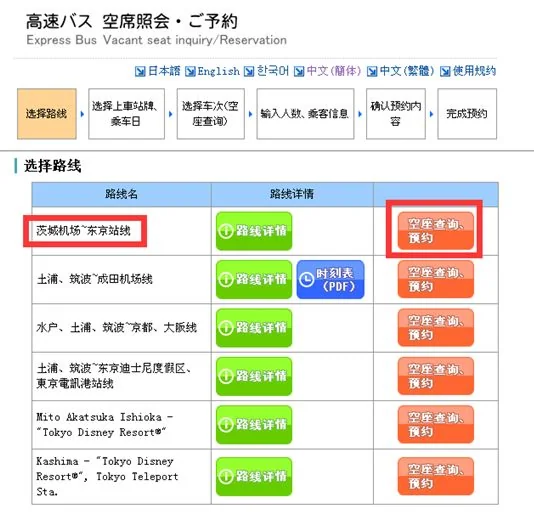

Letiště Ibaraki (IBR) leží v Omitamě v prefektuře Ibaraki, asi 85 km severovýchodně od Tokia. Nemá železniční stanici: všechno se odehrává po silnici, do tokijského nádraží jezdí jeden dálkový autobus a ze stání před terminálem místní autobusy do Išioky, Mita a Cukuby.

Spojení do Tokia se v posledních letech hodně změnilo. Jízdné bylo upraveno 30. března 2025, rezervace se přesunuly na Japan Bus Online s platbou předem a jízdní řád na rok 2026 má jen dva spoje týdně. Jednotlivé jízdenky za 500 jenů a jízdní řády s tuctem spojů denně, které ještě kolují na internetu, jsou dávno minulostí; kdo se jimi řídí, tomu autobus ujede. Tento průvodce se drží aktuálních pravidel.

## 1. 85 km, 100 minut

| Položka | Detail |
| --- | --- |
| Trasa | Letiště Ibaraki ⇄ tokijské nádraží, jižní východ Jaezu |
| Vzdálenost a doba | asi 85 km, asi 100 minut |
| Jízdné jedním směrem | 2 200 jenů dospělý, 1 100 jenů dítě (od 30. března 2025) |
| Platba | hotovost nebo dopravní IC karta |
| Nástup v Tokiu | zastávka dálkových autobusů 3 u jižního východu Jaezu; autobusy z letiště zastavují u východu Nihombaši |
| Nástup na letišti | zastávka 3 před terminálem |
| Provozovatel a informace | Kantetsu (Kanto Railway), kancelář Mito, 029-247-5111, 8:00–19:00 |

Sto minut je údaj samotného letiště: autobus jede po dálnicích Džóban a Šuto, takže při volném provozu platí a prodlužuje se o svátcích a ve večerní špičce. Skutečná hodnota je v tom, že jede přímo — žádné přestupování na vlak v Išioke nebo Cukubě s zavazadly, a vystoupíte přímo na tokijském nádraží. Terminál je malý a značení vás dovede rovnou ke stáním.

## 2. Jízdní řád: jen v pondělí a v pátek

| Směr | Odjezd | Dny |
| --- | --- | --- |
| Tokijské nádraží → letiště Ibaraki | 11:20 | pondělí, pátek |
| Letiště Ibaraki → tokijské nádraží | 15:25 | pondělí, pátek |

Jde o letní jízdní řád platný od 13. dubna do 24. října 2026, se dvěma spoji týdně v každém směru. Jízdní řády se řídí sezónou: zimní a špičkové verze se mohou lišit daty i časy a [stránka letiště s jízdním řádem](https://www.ibaraki-airport.net/en/access/bus/tokyo/) uvádí období, na které platí. Ověřte ji před rezervací — starý snímek obrazovky není jízdní řád.

Plánujte zpětně od těch dvou spojů. Z Tokia na letiště se odjíždí v 11:20 a do terminálu autobus dorazí ve 13:00, což je pohodlné na odpolední let a k ničemu na ranní. Z letiště do Tokia se odjíždí v 15:25, takže musíte být ve veřejné části terminálu kolem 14:30. Pokud váš termín není pondělí ani pátek, autobus pro vás neexistuje a záložní variantou jsou místní autobusy a vlak. Pokud ještě datum nemáte dané, vyberte den, kdy spoj jede, a let přizpůsobte jemu.

## 3. Rezervace: měsíc předem na Japan Bus Online

Spojení funguje v zásadě na rezervaci. Rezervace se otevírá měsíc před cestou a uzavírá v 19:00 předchozího dne, jízdné se platí online přes [Japan Bus Online](https://japanbusonline.com/). Bez rezervace můžete v den odjezdu počkat ve frontě na zastávce a využít volné místo, pokud nějaké je; místa nejsou garantována a na dostupnost je třeba se zeptat personálu na zastávce.

Při rezervaci zkontrolujte směr: tokijské nádraží a letiště jsou samostatné volby a ten den nejede žádný druhý autobus, na který byste se mohli spolehnout. Po dokončení rezervace dostanete rezervační číslo a potvrzovací e-mail. Uchovejte e-mail nebo snímek obrazovky, protože ho po vás řidič chce při nástupu i při výstupu. Řidič je Japonec a nemluví čínsky, takže snímek obrazovky je nejrychlejší cesta. Změny a zrušení se řeší u provozovatele Kantetsu a měly by se vyřídit dřív, než dorazíte na zastávku.

## 4. Od příletu k zastávce za tři minuty

Po pasové kontrole, vyzvednutí zavazadel a celní deklaraci je východ po levé straně nejblíž autobusové zastávce; stání jsou kousek pěšky, tři minuty pohodlným tempem.

Autobus do Tokia odjíždí ze zastávky 3 a stání jsou rozdělená podle destinace — čtěte značení a přijďte o patnáct minut dřív, protože odbavení a zavazadla nějaký čas zaberou. Personál na zastávce provádí odbavení, nosí tašky a udržuje frontu v pohybu: odbavte se a nastupte v pořadí. Ve voze je zdarma Wi-Fi, návod najdete v kapse sedadla před sebou; odpolední slunce je silné, takže se vyplatí zatáhnout závěs. Autobus zastavuje u východu Nihombaši tokijského nádraží, v docházkové vzdálenosti od hotelů v Marunouči a Jaezu; pro Šinkansen nebo linku Jamanote se řiďte značením na nádraží.

## 5. Když vám autobus ujede

Při tak řídkém provozu znamená zmeškaný autobus jinou trasu. Místní autobusy jezdí k nádraží Išioka, do Mita a do Cukuby: v Išioke přestupte na linku JR Džóban do Tokia nebo v Cukubě na Tsukuba Express. Obě varianty přidají přestup a čas a ani jedna není příjemná s těžkými zavazadly. Další možností jsou taxíky a sdílené taxíky pouze na rezervaci, ale dlouhá jízda taxíkem do Tokia je drahá. Jízdní řády autobusů do Išioky a Cukuby jsou také na stránkách letiště.

Pořadí je tedy toto: potvrďte datum, ověřte, zda jede spoj v 11:20 nebo v 15:25, a teprve pak rezervujte let a hotel. Jakmile je v plánu sto minut a potvrzovací snímek obrazovky, je autobus tou snadnou částí cesty.

## Související odkazy

- **Na tomto webu**: [Japonsko (JP)](/country/JP)
- **Stránky letiště**: [Letiště Ibaraki — dálkový autobus do Tokia](https://www.ibaraki-airport.net/en/access/bus/tokyo/)
- **Rezervace**: [Japan Bus Online](https://japanbusonline.com/)
- **Wikipedia**: [Letiště Ibaraki](https://en.wikipedia.org/wiki/Ibaraki_Airport)
- **Baidu Baike**: [茨城机场](https://baike.baidu.com/item/%E8%8C%A8%E5%9F%8E%E6%9C%BA%E5%9C%BA)

Zdroje fotografií: 品质游 找春秋. Jízdné, časy a pravidla rezervace jsou uvedeny tak, jak je pro roky 2025–2026 zveřejnily letiště a Kantetsu; jízdní řády se mění se sezónou, proto si v den cesty ověřte stránky letiště Ibaraki a Japan Bus Online.
