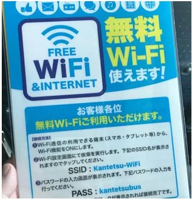

Bandara Ibaraki (IBR) terletak di Omitama, Prefektur Ibaraki, sekitar 85 km di timur laut Tokyo. Tidak ada stasiun kereta: semuanya bergerak lewat jalan raya, dengan satu bus tol ke Stasiun Tokyo dan bus lokal ke Ishioka, Mito, dan Tsukuba dari halte di luar terminal.

Layanan Tokyo telah banyak berubah dalam beberapa tahun terakhir. Tarif direvisi pada 30 Maret 2025, pemesanan beralih ke Japan Bus Online dengan pembayaran di muka, dan jadwal 2026 tinggal dua perjalanan seminggu. Tarif ¥500 dan jadwal belasan kali sehari yang masih beredar online sudah lama tidak berlaku; merencanakan berdasarkan itu berarti Anda ketinggalan bus. Panduan ini mengikuti aturan terkini.

## 1. 85 km, 100 menit

| Item | Detail |
| --- | --- |
| Rute | Bandara Ibaraki ⇄ Stasiun Tokyo, Pintu Keluar Selatan Yaesu |
| Jarak dan waktu | sekitar 85 km, sekitar 100 menit |
| Tarif sekali jalan | ¥2.200 dewasa, ¥1.100 anak (sejak 30 Maret 2025) |
| Pembayaran | tunai atau kartu IC transportasi |
| Naik di Tokyo | Halte 3 bus tol Pintu Keluar Selatan Yaesu; bus dari bandara menurunkan penumpang di Pintu Keluar Nihonbashi |
| Naik di bandara | halte 3 di luar terminal |
| Operator dan pertanyaan | Kantetsu (Kanto Railway) kantor Mito, 029-247-5111, 08.00–19.00 |

Waktu 100 menit adalah angka bandara sendiri: bus melewati jalan tol Joban dan Shuto, jadi angka itu bertahan saat lalu lintas lancar dan memanjang pada hari libur serta jam sibuk sore. Nilai sebenarnya adalah langsung — tidak perlu berganti kereta di Ishioka atau Tsukuba dengan bagasi, dan Anda turun di Stasiun Tokyo. Terminalnya kecil, dan papan penunjuk mengarahkan Anda langsung ke halte.

## 2. Jadwal: hanya Senin dan Jumat

| Arah | Berangkat | Beroperasi |
| --- | --- | --- |
| Stasiun Tokyo → Bandara Ibaraki | 11.20 | Senin, Jumat |
| Bandara Ibaraki → Stasiun Tokyo | 15.25 | Senin, Jumat |

Ini jadwal musim panas, 13 April hingga 24 Oktober 2026, dengan dua perjalanan seminggu di setiap arah. Jadwal mengikuti musim: versi musim dingin dan musim puncak dapat berbeda tanggal dan waktu, dan [halaman jadwal bandara](https://www.ibaraki-airport.net/en/access/bus/tokyo/) mencantumkan periode yang dicakupnya. Periksa sebelum memesan — tangkapan layar lama bukanlah jadwal.

Rencanakan mundur dari dua perjalanan itu. Tokyo ke bandara berangkat pukul 11.20 dan tiba di terminal pukul 13.00, nyaman untuk penerbangan sore dan tidak berguna untuk penerbangan pagi. Bandara ke Tokyo berangkat pukul 15.25, jadi Anda perlu berada di sisi publik sekitar pukul 14.30. Jika tanggal Anda bukan Senin atau Jumat, bus tidak ada untuk Anda dan bus lokal plus kereta menjadi cadangan. Jika tanggal Anda masih terbuka, pilih hari yang memiliki perjalanan dan sesuaikan penerbangan dengannya.

## 3. Pemesanan: satu bulan sebelumnya di Japan Bus Online

Layanan ini pada prinsipnya berbasis reservasi. Pemesanan dibuka satu bulan sebelum perjalanan dan ditutup pukul 19.00 sehari sebelumnya, dan tarif dibayar online melalui [Japan Bus Online](https://japanbusonline.com/). Tanpa reservasi Anda dapat mengantre di halte pada hari itu dan menempati kursi kosong jika ada; kursi tidak dijamin, dan ketersediaan adalah pertanyaan untuk staf di halte.

Periksa arah saat memesan: Stasiun Tokyo dan bandara adalah pilihan terpisah, dan tidak ada bus kedua hari itu sebagai cadangan. Saat pemesanan selesai Anda menerima nomor reservasi dan email konfirmasi. Simpan email atau tangkapan layarnya, karena pengemudi memintanya saat Anda naik dan turun. Pengemudinya orang Jepang dan tidak berbahasa Tiongkok, jadi tangkapan layar adalah cara tercepat. Perubahan dan pembatalan melalui operator, Kantetsu, dan harus dilakukan sebelum Anda mencapai halte.

## 4. Dari kedatangan ke halte dalam tiga menit

Setelah imigrasi, bagasi, dan deklarasi bea cukai, pintu keluar di sebelah kiri Anda adalah yang terdekat ke halte bus; halte hanya beberapa langkah, tiga menit dengan langkah santai.

Bus Tokyo berangkat dari halte 3, dan halte dipisahkan berdasarkan tujuan — baca papannya, dan datang lima belas menit lebih awal, karena check-in dan bagasi memakan waktu. Staf di halte menangani check-in, membawa tas, dan menjaga antrean tetap bergerak: check-in, lalu naik sesuai urutan. Di dalam bus ada Wi-Fi gratis, dengan petunjuk di kantong kursi di depan Anda; sinar matahari sore kuat, jadi tirai sebaiknya ditutup. Bus menurunkan penumpang di Pintu Keluar Nihonbashi Stasiun Tokyo, dalam jarak berjalan kaki dari hotel di Marunouchi dan Yaesu; ikuti papan stasiun menuju Shinkansen atau Jalur Yamanote.

## 5. Jika Anda ketinggalan bus

Dengan begitu sedikit perjalanan, bus yang terlewat berarti rute yang berbeda. Bus lokal mencapai Stasiun Ishioka, Mito, dan Tsukuba: ganti di Ishioka ke Jalur JR Joban menuju Tokyo, atau di Tsukuba ke Tsukuba Express. Keduanya menambah transit dan waktu, dan tidak menyenangkan dengan bagasi berat. Taksi dan taksi bersama khusus reservasi adalah pilihan lain, tetapi taksi jarak jauh ke Tokyo mahal. Jadwal bus Ishioka dan Tsukuba juga ada di situs bandara.

Jadi urutannya: pastikan tanggal, pastikan apakah ada pukul 11.20 atau 15.25, lalu pesan penerbangan dan hotel. Setelah 100 menit dan tangkapan layar konfirmasi menjadi bagian dari rencana, bus adalah bagian termudah dari perjalanan.

## Tautan terkait

- **Di situs ini**: [Jepang (JP)](/country/JP)
- **Situs bandara**: [Bandara Ibaraki — bus tol Tokyo](https://www.ibaraki-airport.net/en/access/bus/tokyo/)
- **Pemesanan**: [Japan Bus Online](https://japanbusonline.com/)
- **Wikipedia**: [Bandara Ibaraki](https://en.wikipedia.org/wiki/Ibaraki_Airport)
- **Baidu Baike**: [茨城机场](https://baike.baidu.com/item/%E8%8C%A8%E5%9F%8E%E6%9C%BA%E5%9C%BA)

Kredit gambar: 品质游 找春秋. Tarif, waktu, dan aturan pemesanan sesuai yang diterbitkan bandara dan Kantetsu untuk 2025–2026; jadwal berubah menurut musim, jadi periksa situs Bandara Ibaraki dan Japan Bus Online pada hari perjalanan Anda.
