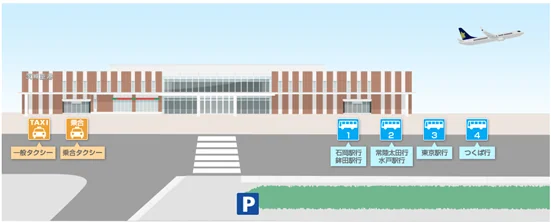

茨城空港（IBR）は茨城県小美玉市にあり、東京の北東約85kmに位置します。鉄道駅はなく、移動はすべて道路です。東京駅への高速バスが1路線、ターミナル外の乗り場から石岡、水戸、つくばへの路線バスが出ています。

東京線はここ数年で大きく変わりました。運賃は2025年3月30日に改定され、予約はJapan Bus Onlineに移り、事前決済になり、2026年のダイヤは週2便に減りました。ネット上に残る500円の片道券や1日十数便のダイヤは遠い過去のものです。それに合わせて計画するとバスに乗り遅れます。本ガイドは現在のルールに従います。

## 1. 85km、100分

| 項目 | 詳細 |
| --- | --- |
| 路線 | 茨城空港 ⇄ 東京駅八重洲南口 |
| 距離と時間 | 約85km、約100分 |
| 片道運賃 | 大人2,200円、子ども1,100円（2025年3月30日以降） |
| 支払い | 現金または交通系ICカード |
| 東京での乗車 | 八重洲南口高速バス3番乗り場。空港発のバスは日本橋口で降車 |
| 空港での乗車 | ターミナル外の3番乗り場 |
| 運行会社・問い合わせ | 関鉄（関東鉄道）水戸営業所、029-247-5111、8:00〜19:00 |

100分は空港自身の数字です。バスは常磐自動車道と首都高速を経由するため、順調な交通なら守られ、休日や夕方のピークには延びます。本当の価値は直行であることです。石岡やつくばで荷物を持って乗り換える必要がなく、東京駅で降りられます。ターミナルは小さく、表示に従えば乗り場にすぐ着きます。

## 2. ダイヤ：月曜と金曜のみ

| 方向 | 出発 | 運行日 |
| --- | --- | --- |
| 東京駅→茨城空港 | 11:20 | 月曜、金曜 |
| 茨城空港→東京駅 | 15:25 | 月曜、金曜 |

これは2026年4月13日から10月24日までの夏ダイヤで、各方向とも週2便です。ダイヤは季節に合わせて変わり、冬ダイヤや繁忙期ダイヤでは日付と時刻が異なることがあります。[空港の時刻表ページ](https://www.ibaraki-airport.net/en/access/bus/tokyo/)に対象期間が明記されています。予約前に確認してください。古いスクリーンショットは時刻表ではありません。

この2便から逆算して計画してください。東京から空港行きは11:20発、13:00にターミナル着で、午後のフライトには余裕があり、午前便には使えません。空港から東京行きは15:25発なので、14:30ごろまでに陸側に出ている必要があります。日付が月曜でも金曜でもなければ、このバスは存在せず、路線バスと鉄道が代替になります。日程がまだ自由なら、運行日を選び、その日に合わせてフライトを組んでください。

## 3. 予約：1か月前からJapan Bus Onlineで

このサービスは原則予約制です。予約は乗車日の1か月前から前日19:00まで受け付け、運賃は[Japan Bus Online](https://japanbusonline.com/)でオンライン決済します。予約なしでも当日乗り場に並び、空席があれば乗れますが、座席は保証されず、空き状況は乗り場の係員に確認してください。

予約時は方向を確認してください。東京駅と空港は別々の選択肢で、その日に代替の2便目はありません。予約が完了すると予約番号と確認メールが届きます。メールまたはスクリーンショットを保存してください。乗車時と降車時にドライバーが確認します。ドライバーは日本人で中国語を話さないため、スクリーンショットが最も早い意思疎通の方法です。変更やキャンセルは運行会社の関鉄を通じて行い、乗り場に着く前に済ませてください。

## 4. 到着ロビーから乗り場まで3分

入国審査、手荷物受取、税関申告を済ませると、左側の出口がバス乗り場に最も近い出口です。乗り場はすぐ近くで、ゆっくり歩いて3分です。

東京行きのバスは3番乗り場から出ます。乗り場は行き先ごとに分かれているので、表示を読んでください。チェックインと荷物の積み込みに時間がかかるため、15分前に到着しましょう。乗り場の係員がチェックイン、荷物の運搬、列の整理を行います。チェックインを済ませ、順番に乗車してください。車内では無料Wi-Fiが使え、案内は前の座席のポケットにあります。午後の日差しが強いので、カーテンを閉める価値があります。バスは東京駅の日本橋口で降車し、丸の内や八重洲のホテルまで徒歩圏内です。新幹線や山手線へは駅の表示に従ってください。

## 5. バスを逃した場合

便数が少ないため、バスを逃すと別ルートになります。路線バスで石岡駅、水戸、つくばへ出られます。石岡でJR常磐線に乗り換えて東京へ、またはつくばでつくばエクスプレスに乗り換えます。どちらも乗り換えと時間が増え、重い荷物では楽ではありません。タクシーや予約制の乗合タクシーという選択肢もありますが、東京までの長距離タクシーは高くつきます。石岡行きとつくば行きのバスの時刻表も空港のサイトにあります。

つまり順序はこうです。日付を確認し、11:20か15:25の便があるかを確認し、それからフライトとホテルを予約します。100分と確認画面のスクリーンショットが計画に組み込まれれば、バスは旅の簡単な部分になります。

## 関連リンク

- **このサイト内**：[日本 (JP)](/country/JP)
- **空港公式サイト**：[茨城空港 — 東京高速バス](https://www.ibaraki-airport.net/en/access/bus/tokyo/)
- **予約**：[Japan Bus Online](https://japanbusonline.com/)
- **Wikipedia**：[茨城空港](https://en.wikipedia.org/wiki/Ibaraki_Airport)
- **百度百科**：[茨城空港](https://baike.baidu.com/item/%E8%8C%A8%E5%9F%8E%E6%9C%BA%E5%9C%BA)

画像提供：品质游 找春秋。運賃、時刻、予約ルールは2025〜2026年に空港と関鉄が公表したものです。ダイヤは季節で変わるため、旅行当日に茨城空港のサイトとJapan Bus Onlineで確認してください。
