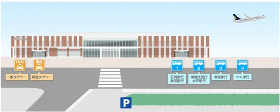
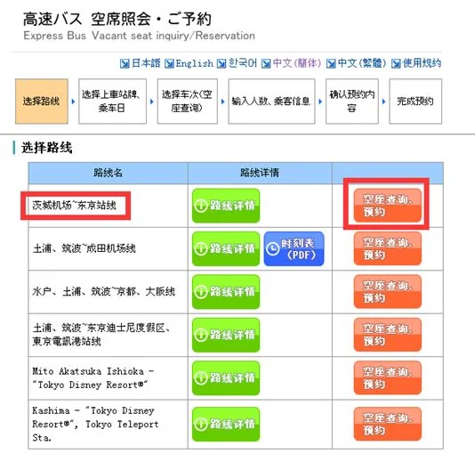
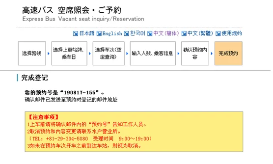
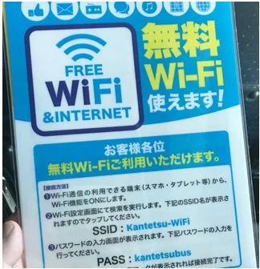
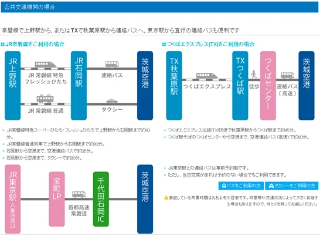

이바라키 공항(IBR)은 이바라키현 오미타마에 있으며 도쿄에서 북동쪽으로 약 85km 떨어져 있습니다. 철도역이 없어 모든 이동이 도로로 이루어집니다. 도쿄역으로 가는 고속버스 한 편과, 터미널 밖 승강장에서 출발하는 이시오카·미토·쓰쿠바 방면 시내버스가 전부입니다.

도쿄 노선은 최근 몇 년 사이 크게 바뀌었습니다. 2025년 3월 30일 요금이 개정되었고, 예약은 사전 결제 방식의 재팬 버스 온라인으로 옮겨 갔으며, 2026년 시간표는 주 2회로 줄었습니다. 인터넷에 아직 떠도는 ¥500 단거리나 하루 열두 번짜리 시간표는 오래전에 사라졌습니다. 그것을 믿고 계획하면 버스를 놓칩니다. 이 글은 현재 규칙을 따릅니다.

## 1. 85km, 100분

| 항목 | 내용 |
| --- | --- |
| 노선 | 이바라키 공항 ⇄ 도쿄역 야에스 남쪽 출구 |
| 거리와 시간 | 약 85km, 약 100분 |
| 편도 요금 | 성인 ¥2,200, 어린이 ¥1,100 (2025년 3월 30일부터) |
| 결제 | 현금 또는 교통 IC 카드 |
| 도쿄에서 탑승 | 야에스 남쪽 출구 고속버스 3번 정류장, 공항발 버스는 니혼바시 출구에 정차 |
| 공항에서 탑승 | 터미널 밖 3번 정류장 |
| 운행사 및 문의 | 간테쓰(간토 철도) 미토 영업소, 029-247-5111, 8:00–19:00 |

100분은 공항 측이 제시한 수치입니다. 버스는 조반·수토 고속도로를 경유하므로 교통이 원활할 때는 이 시간이 지켜지지만 연휴와 저녁 피크에는 늘어납니다. 진짜 가치는 직행이라는 점입니다. 이시오카나 쓰쿠바에서 짐을 끌고 갈아타지 않고 도쿄역에서 바로 내리면 됩니다. 터미널이 작아 표지판을 따라가면 승강장이 바로 나옵니다.

## 2. 시간표: 월요일과 금요일만

| 방향 | 출발 | 운행일 |
| --- | --- | --- |
| 도쿄역 → 이바라키 공항 | 11:20 | 월요일, 금요일 |
| 이바라키 공항 → 도쿄역 | 15:25 | 월요일, 금요일 |

2026년 4월 13일부터 10월 24일까지의 여름 시간표로, 각 방향 주 2회입니다. 시간표는 계절을 따르므로 겨울과 성수기 버전은 날짜와 시각이 다를 수 있습니다. [공항 시간표 페이지](https://www.ibaraki-airport.net/en/access/bus/tokyo/)에 적용 기간이 명시되어 있으니 예약 전에 확인하십시오. 낡은 스크린샷은 시간표가 아닙니다.

이 두 편에서 거꾸로 계획하십시오. 도쿄에서 공항으로 가는 버스는 11:20에 출발해 13:00에 터미널에 도착하므로 오후 항공편에는 넉넉하고 오전 항공편에는 쓸모가 없습니다. 공항에서 도쿄로 가는 버스는 15:25에 출발하므로 14:30쯤에는 일반 구역에 있어야 합니다. 날짜가 월요일이나 금요일이 아니라면 이 버스는 없는 것이나 마찬가지이고, 시내버스와 철도가 대안입니다. 날짜가 아직 정해지지 않았다면 운행일이 있는 날을 골라 항공편을 그에 맞추십시오.

## 3. 예약: 재팬 버스 온라인에서 한 달 전에

이 노선은 원칙적으로 예약제입니다. 예약은 탑승 한 달 전에 열려 전날 19:00에 마감되며, 요금은 [재팬 버스 온라인](https://japanbusonline.com/)에서 온라인으로 결제합니다. 예약 없이도 당일 정류장에서 대기해 빈자리가 있으면 탈 수 있지만, 좌석은 보장되지 않고 여석 여부는 정류장 직원에게 문의해야 합니다.

예약할 때 방향을 확인하십시오. 도쿄역과 공항은 별개의 선택지이고, 그날 대체할 두 번째 버스는 없습니다. 예약이 완료되면 예약 번호와 확인 메일이 옵니다. 메일이나 스크린샷을 보관하십시오. 탈 때와 내릴 때 기사가 확인을 요청합니다. 기사는 일본인이라 중국어를 하지 못하므로 스크린샷이 가장 빠른 방법입니다. 변경과 취소는 운행사인 간테쓰를 통해야 하며, 정류장에 도착하기 전에 처리하십시오.

## 4. 도착층에서 정류장까지 3분

입국심사와 수하물, 세관 신고를 마치면 왼쪽 출구가 버스 정류장에서 가장 가깝습니다. 승강장은 조금만 걸으면 되고, 천천히 걸어 3분입니다.

도쿄행 버스는 3번 정류장에서 출발하며, 승강장은 목적지별로 나뉘어 있습니다. 표지판을 읽고 15분 일찍 도착하십시오. 체크인과 짐 싣는 데 시간이 걸립니다. 정류장 직원이 체크인을 처리하고 짐을 실어 주며 대기열을 정리합니다. 체크인을 한 뒤 순서대로 타면 됩니다. 차 안에는 무료 Wi-Fi가 있고 안내문은 앞좌석 주머니에 있습니다. 오후 햇빛이 강하니 커튼을 치는 편이 좋습니다. 버스는 도쿄역 니혼바시 출구에 서며, 마루노우치와 야에스의 호텔까지 걸어갈 수 있는 거리입니다. 신칸센이나 야마노테선을 타려면 역 안의 표지판을 따라가십시오.

## 5. 버스를 놓쳤다면

운행 횟수가 워낙 적어 버스를 놓치면 다른 경로를 써야 합니다. 시내버스로 이시오카역, 미토, 쓰쿠바에 갈 수 있습니다. 이시오카에서 JR 조반선으로 갈아타 도쿄로 들어가거나, 쓰쿠바에서 쓰쿠바 익스프레스로 갈아타면 됩니다. 둘 다 환승과 시간이 더 들고, 무거운 짐이 있으면 편하지 않습니다. 택시와 예약제 합승 택시도 방법이지만 도쿄까지 택시로 가면 비용이 많이 듭니다. 이시오카와 쓰쿠바행 버스 시간표도 공항 사이트에 있습니다.

정리하면 순서는 이렇습니다. 날짜를 확정하고, 11:20인지 15:25인지 확인한 다음, 항공편과 호텔을 예약하십시오. 100분과 확인 스크린샷이 계획의 일부가 되면 버스는 여행에서 가장 쉬운 부분이 됩니다.

## 관련 링크

- **이 사이트:** [일본(JP)](/country/JP)
- **공항 사이트:** [이바라키 공항 — 도쿄 고속버스](https://www.ibaraki-airport.net/en/access/bus/tokyo/)
- **예약:** [재팬 버스 온라인](https://japanbusonline.com/)
- **위키백과:** [이바라키 공항](https://en.wikipedia.org/wiki/Ibaraki_Airport)
- **바이두 백과:** [이바라키 공항](https://baike.baidu.com/item/%E8%8C%A8%E5%9F%8E%E6%9C%BA%E5%9C%BA)

사진 출처: 品质游 找春秋. 요금과 시간, 예약 규칙은 공항과 간테쓰가 2025–2026년에 발표한 내용을 따랐습니다. 시간표는 계절에 따라 바뀌므로 여행 당일 이바라키 공항 사이트와 재팬 버스 온라인에서 확인하십시오.
