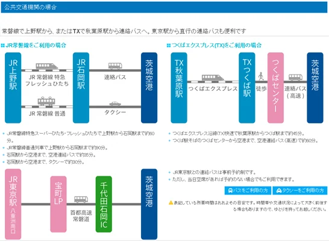

Аэропорт Ибараки (IBR) находится в Омитаме, префектура Ибараки, примерно в 85 км к северо-востоку от Токио. Железнодорожной станции нет: всё движется по дорогам — один скоростной автобус до станции Токио и местные автобусы до Исиоки, Мито и Цукубы с остановок у терминала.

Токийский маршрут сильно изменился за последние годы. Тариф пересмотрели 30 марта 2025 года, бронирование перевели на Japan Bus Online с предоплатой, а в расписании на 2026 год осталось два рейса в неделю. Билеты за 500 ¥ и расписания с десятком рейсов в день, которые до сих пор гуляют по интернету, давно в прошлом; планируйте по ним — и опоздаете на автобус. Этот гид следует действующим правилам.

## 1. 85 км, 100 минут

| Пункт | Детали |
| --- | --- |
| Маршрут | Аэропорт Ибараки ⇄ станция Токио, южный выход Яэсу |
| Расстояние и время | около 85 км, около 100 минут |
| Тариф в одну сторону | 2 200 ¥ взрослый, 1 100 ¥ детский (с 30 марта 2025 года) |
| Оплата | наличные или транспортная IC-карта |
| Посадка в Токио | остановка скоростного автобуса 3 у южного выхода Яэсу; автобусы из аэропорта высаживают пассажиров у выхода Нихомбаси |
| Посадка в аэропорту | остановка 3 у терминала |
| Оператор и справки | офис Kantetsu (Kanto Railway) в Мито, 029-247-5111, 8:00–19:00 |

100 минут — собственная оценка аэропорта: автобус идёт по скоростным дорогам Дзёбан и Сюто, поэтому в свободном потоке время выдерживается, а в праздники и вечерний пик растягивается. Главная ценность — прямое сообщение: не нужно пересаживаться на поезд в Исиоке или Цукубе с багажом, и вы выходите на станции Токио. Терминал небольшой, указатели ведут прямо к остановкам.

## 2. Расписание: только понедельник и пятница

| Направление | Отправление | Дни |
| --- | --- | --- |
| Станция Токио → аэропорт Ибараки | 11:20 | понедельник, пятница |
| Аэропорт Ибараки → станция Токио | 15:25 | понедельник, пятница |

Это летнее расписание с 13 апреля по 24 октября 2026 года, по два рейса в неделю в каждом направлении. Расписания следуют сезонам: зимняя и пиковая версии могут отличаться датами и временем, а [страница расписания аэропорта](https://www.ibaraki-airport.net/en/access/bus/tokyo/) указывает охватываемый период. Проверьте её перед бронированием — старый скриншот не является расписанием.

Отталкивайтесь от этих двух рейсов при планировании. Из Токио в аэропорт автобус уходит в 11:20 и прибывает в терминал в 13:00 — удобно для дневного рейса и бесполезно для утреннего. Из аэропорта в Токио он уходит в 15:25, поэтому нужно оказаться в общей зоне примерно к 14:30. Если ваша дата не понедельник и не пятница, автобуса для вас не существует, и запасной вариант — местные автобусы плюс поезд. Если даты ещё свободны, выберите день с рейсом и подстройте под него перелёт.

## 3. Бронирование: за месяц на Japan Bus Online

Формально сервис работает по бронированию. Бронирование открывается за месяц до поездки и закрывается в 19:00 накануне, а тариф оплачивается онлайн через [Japan Bus Online](https://japanbusonline.com/). Без брони можно встать в очередь на остановке в день поездки и занять свободное место, если оно есть; места не гарантированы, а наличие уточняйте у сотрудников на остановке.

При бронировании проверьте направление: станция Токио и аэропорт — отдельные варианты, а второго автобуса в этот день не будет. После завершения бронирования вы получаете номер брони и письмо с подтверждением. Сохраните письмо или скриншот: водитель спросит их при посадке и при выходе. Водитель японец и не говорит по-китайски, поэтому скриншот — самый быстрый способ объясниться. Изменения и отмены проходят через оператора Kantetsu и должны быть сделаны до того, как вы подойдёте к остановке.

## 4. От прилёта до остановки за три минуты

После паспортного контроля, получения багажа и таможенной декларации выход слева — ближайший к автобусной остановке; до остановок короткая прогулка, три минуты спокойным шагом.

Токийский автобус отправляется с остановки 3, и остановки разделены по направлениям — читайте указатели и приходите за пятнадцать минут, потому что регистрация и погрузка багажа занимают время. Сотрудники на остановке оформляют посадку, принимают сумки и следят за очередью: сначала регистрация, затем посадка по порядку. В автобусе есть бесплатный Wi-Fi, инструкция — в кармане сиденья перед вами; послеполуденное солнце сильное, поэтому штору стоит закрыть. Автобус высаживает у выхода Нихомбаси станции Токио, в пешей доступности от отелей в Маруноути и Яэсу; дальше следуйте указателям станции к синкансэну или линии Яманотэ.

## 5. Если вы опоздали на автобус

При таком небольшом числе рейсов пропущенный автобус означает другой маршрут. Местные автобусы доходят до станции Исиока, Мито и Цукубы: в Исиоке пересаживайтесь на линию JR Дзёбан до Токио, в Цукубе — на Tsukuba Express. Оба варианта добавляют пересадку и время, и ни один не приятен с тяжёлым багажом. Такси и совместные такси только по бронированию — другой вариант, но долгая поездка на такси в Токио дорога. Расписания автобусов до Исиоки и Цукубы также есть на сайте аэропорта.

Итак, порядок такой: подтвердите дату, подтвердите, есть ли рейс в 11:20 или 15:25, затем бронируйте билет на самолёт и отель. Когда 100 минут и скриншот подтверждения станут частью плана, автобус окажется самой простой частью поездки.

## Полезные ссылки

- **На этом сайте**: [Япония (JP)](/country/JP)
- **Сайт аэропорта**: [Аэропорт Ибараки — скоростной автобус до Токио](https://www.ibaraki-airport.net/en/access/bus/tokyo/)
- **Бронирование**: [Japan Bus Online](https://japanbusonline.com/)
- **Википедия**: [Аэропорт Ибараки](https://en.wikipedia.org/wiki/Ibaraki_Airport)
- **Baidu Baike**: [Аэропорт Ибараки](https://baike.baidu.com/item/%E8%8C%A8%E5%9F%8E%E6%9C%BA%E5%9C%BA)

Источники фотографий: 品质游 找春秋. Тарифы, время и правила бронирования приведены по публикациям аэропорта и Kantetsu на 2025–2026 годы; расписания меняются по сезонам, поэтому проверяйте сайт аэропорта Ибараки и Japan Bus Online в день поездки.
