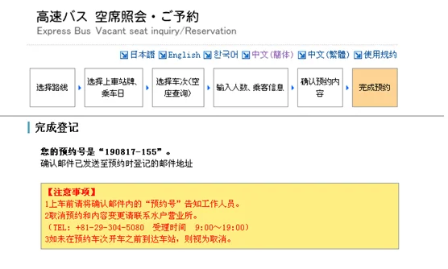

Sân bay Ibaraki (IBR) nằm ở Omitama, tỉnh Ibaraki, cách Tokyo khoảng 85 km về phía đông bắc. Không có ga đường sắt: mọi thứ di chuyển bằng đường bộ, với một chuyến xe khách cao tốc vào Ga Tokyo và xe buýt địa phương đến Ishioka, Mito và Tsukuba từ các bến bên ngoài nhà ga.

Tuyến Tokyo đã thay đổi nhiều trong những năm gần đây. Giá vé được điều chỉnh ngày 30 tháng 3 năm 2025, việc đặt chỗ chuyển sang Japan Bus Online với thanh toán trước, và thời gian biểu năm 2026 chỉ còn hai chuyến mỗi tuần. Những chuyến 500 yên và thời gian biểu hàng chục chuyến mỗi ngày vẫn còn lưu truyền trên mạng đã biến mất từ lâu; lên kế hoạch theo chúng và bạn sẽ lỡ xe. Hướng dẫn này theo các quy định hiện hành.

## 1. 85 km, 100 phút

| Hạng mục | Chi tiết |
| --- | --- |
| Tuyến | Sân bay Ibaraki ⇄ Ga Tokyo, Cửa Nam Yaesu |
| Khoảng cách và thời gian | khoảng 85 km, khoảng 100 phút |
| Giá một chiều | 2.200 yên người lớn, 1.100 yên trẻ em (từ ngày 30 tháng 3 năm 2025) |
| Thanh toán | tiền mặt hoặc thẻ IC giao thông |
| Lên xe tại Tokyo | Bến xe buýt cao tốc số 3 Cửa Nam Yaesu; xe từ sân bay trả khách tại Cửa Nihonbashi |
| Lên xe tại sân bay | bến 3 bên ngoài nhà ga |
| Hãng vận hành và liên hệ | Văn phòng Mito của Kantetsu (Đường sắt Kanto), 029-247-5111, 8:00–19:00 |

100 phút là con số của chính sân bay: xe chạy qua đường cao tốc Joban và Shuto, nên giữ đúng khi đường thoáng và kéo dài vào ngày lễ và giờ cao điểm buổi tối. Giá trị thực sự là đi thẳng — không phải đổi tàu ở Ishioka hay Tsukuba với hành lý, và bạn xuống ngay Ga Tokyo. Nhà ga nhỏ, biển chỉ dẫn dẫn bạn thẳng đến các bến.

## 2. Thời gian biểu: chỉ thứ Hai và thứ Sáu

| Hướng | Khởi hành | Ngày chạy |
| --- | --- | --- |
| Ga Tokyo → Sân bay Ibaraki | 11:20 | Thứ Hai, thứ Sáu |
| Sân bay Ibaraki → Ga Tokyo | 15:25 | Thứ Hai, thứ Sáu |

Đây là thời gian biểu mùa hè, từ 13 tháng 4 đến 24 tháng 10 năm 2026, với hai chuyến mỗi tuần theo mỗi hướng. Lịch chạy theo mùa: bản mùa đông và bản cao điểm có thể khác về ngày và giờ, và [trang thời gian biểu của sân bay](https://www.ibaraki-airport.net/en/access/bus/tokyo/) nêu rõ khoảng thời gian áp dụng. Hãy kiểm tra trước khi đặt — một ảnh chụp màn hình cũ không phải thời gian biểu.

Hãy lên kế hoạch ngược từ hai chuyến đó. Tokyo đi sân bay khởi hành lúc 11:20 và đến nhà ga lúc 13:00, thoải mái cho chuyến bay buổi chiều và vô dụng cho chuyến buổi sáng. Sân bay đi Tokyo khởi hành lúc 15:25, nên bạn cần ra khu công cộng trước khoảng 14:30. Nếu ngày đi của bạn không phải thứ Hai hay thứ Sáu, chuyến xe không tồn tại với bạn và xe buýt địa phương cộng tàu là phương án dự phòng. Nếu ngày đi còn linh hoạt, hãy chọn một ngày có chuyến và sắp chuyến bay theo đó.

## 3. Đặt chỗ: trước một tháng trên Japan Bus Online

Dịch vụ về nguyên tắc là đặt chỗ trước. Đặt chỗ mở trước một tháng và đóng lúc 19:00 ngày hôm trước, và giá vé được thanh toán trực tuyến qua [Japan Bus Online](https://japanbusonline.com/). Không đặt trước, bạn có thể xếp hàng tại bến trong ngày và ngồi chỗ trống nếu có; chỗ không được bảo đảm, và tình trạng chỗ là câu hỏi dành cho nhân viên tại bến.

Hãy kiểm tra hướng khi đặt: Ga Tokyo và sân bay là hai lựa chọn riêng, và không có chuyến thứ hai trong ngày để dự phòng. Khi hoàn tất đặt chỗ, bạn nhận được mã đặt chỗ và email xác nhận. Hãy giữ email hoặc ảnh chụp màn hình, vì tài xế hỏi khi bạn lên xe và khi xuống xe. Tài xế là người Nhật và không nói tiếng Trung, nên ảnh chụp màn hình là cách nhanh nhất để qua chuyện. Thay đổi và hủy đi qua hãng vận hành, Kantetsu, và nên làm trước khi bạn đến bến.

## 4. Từ khu đến bến xe trong ba phút

Sau nhập cảnh, nhận hành lý và khai hải quan, lối ra bên trái của bạn là lối gần bến xe nhất; các bến chỉ cách một đoạn đi bộ ngắn, ba phút với nhịp thong thả.

Xe khách đi Tokyo khởi hành từ bến 3, và các bến được phân theo điểm đến — hãy đọc biển, và đến sớm mười lăm phút vì check-in và hành lý mất thời gian. Nhân viên tại bến lo check-in, khuân hành lý và giữ hàng chờ di chuyển: check-in, rồi lên xe theo thứ tự. Trên xe có Wi-Fi miễn phí, với hướng dẫn trong túi ghế phía trước; nắng chiều mạnh, nên kéo rèm lại là đáng. Xe trả khách tại Cửa Nihonbashi của Ga Tokyo, trong khoảng đi bộ đến các khách sạn ở Marunouchi và Yaesu; đi theo biển của nhà ga để đến Shinkansen hoặc tuyến Yamanote.

## 5. Nếu bạn lỡ xe

Với quá ít chuyến, lỡ xe nghĩa là phải đi tuyến khác. Xe buýt địa phương đến Ga Ishioka, Mito và Tsukuba: đổi tại Ishioka sang tuyến JR Joban vào Tokyo, hoặc tại Tsukuba sang Tsukuba Express. Cả hai đều thêm một lần đổi và thời gian, và không dễ chịu chút nào với hành lý nặng. Taxi và taxi chia chỗ chỉ đặt trước là lựa chọn khác, nhưng taxi đường dài vào Tokyo rất đắt. Lịch chạy của xe buýt Ishioka và Tsukuba cũng có trên trang sân bay.

Vậy thứ tự là: xác nhận ngày, xác nhận có chuyến 11:20 hay 15:25, rồi đặt chuyến bay và khách sạn. Khi 100 phút và ảnh xác nhận đã nằm trong kế hoạch, xe khách là phần dễ nhất của chuyến đi.

## Liên kết liên quan

- **Trên trang này**: [Nhật Bản (JP)](/country/JP)
- **Trang sân bay**: [Sân bay Ibaraki — xe buýt cao tốc đi Tokyo](https://www.ibaraki-airport.net/en/access/bus/tokyo/)
- **Đặt chỗ**: [Japan Bus Online](https://japanbusonline.com/)
- **Wikipedia**: [Sân bay Ibaraki](https://en.wikipedia.org/wiki/Ibaraki_Airport)
- **Baidu Baike**: [Sân bay Ibaraki](https://baike.baidu.com/item/%E8%8C%A8%E5%9F%8E%E6%9C%BA%E5%9C%BA)

Nguồn ảnh: 品质游 找春秋. Giá vé, thời gian và quy định đặt chỗ theo công bố của sân bay và Kantetsu giai đoạn 2025–2026; lịch chạy thay đổi theo mùa, nên hãy kiểm tra trang Sân bay Ibaraki và Japan Bus Online vào ngày bạn đi.
