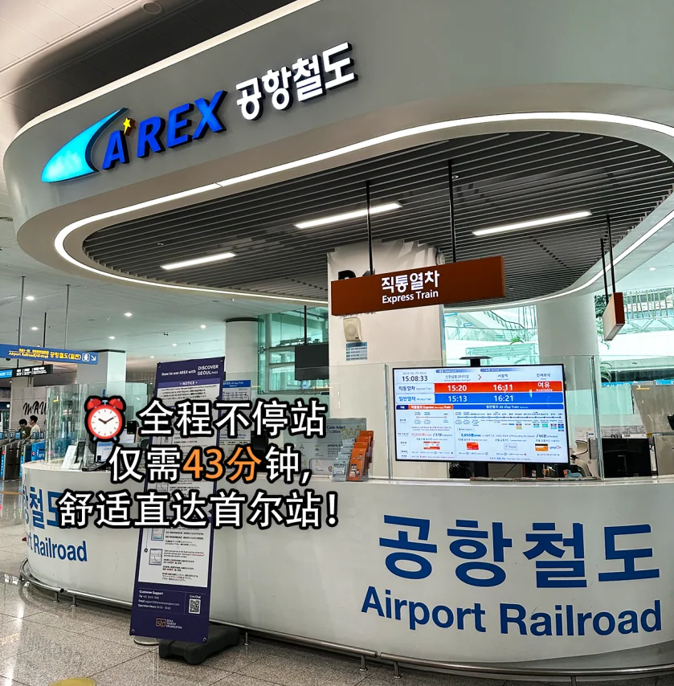
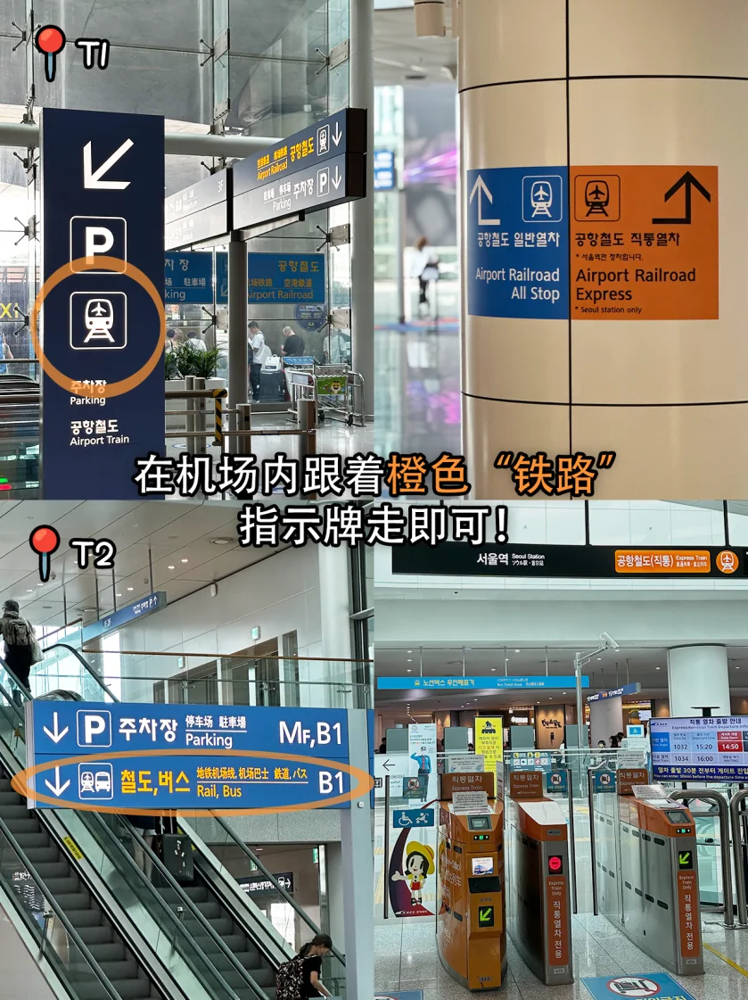
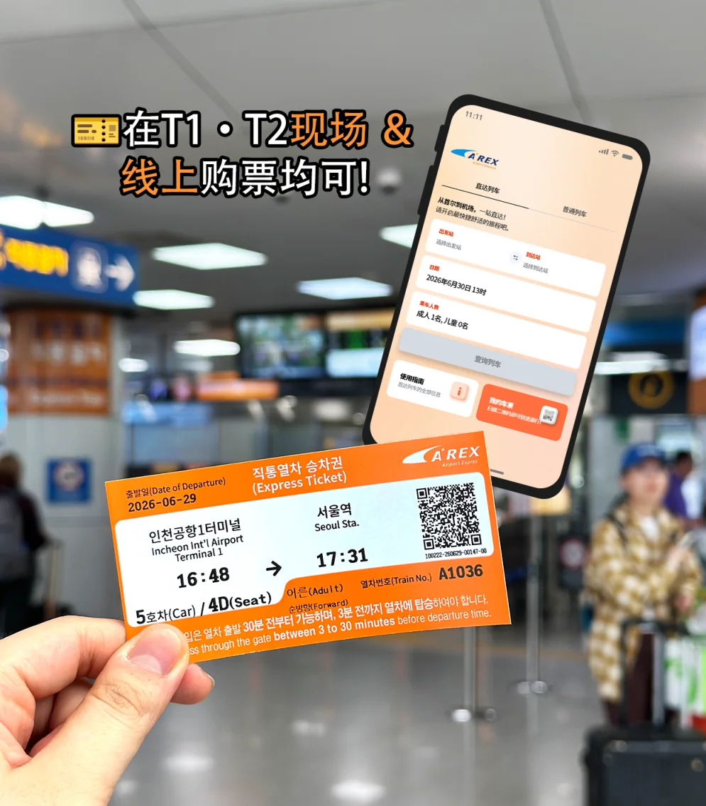
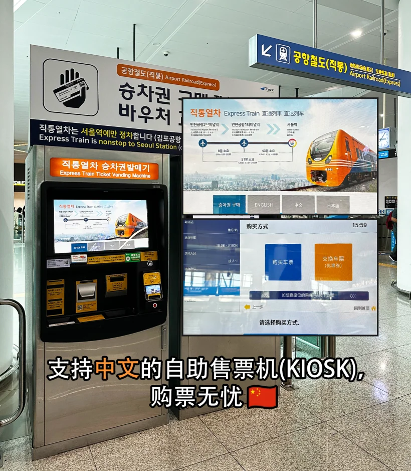
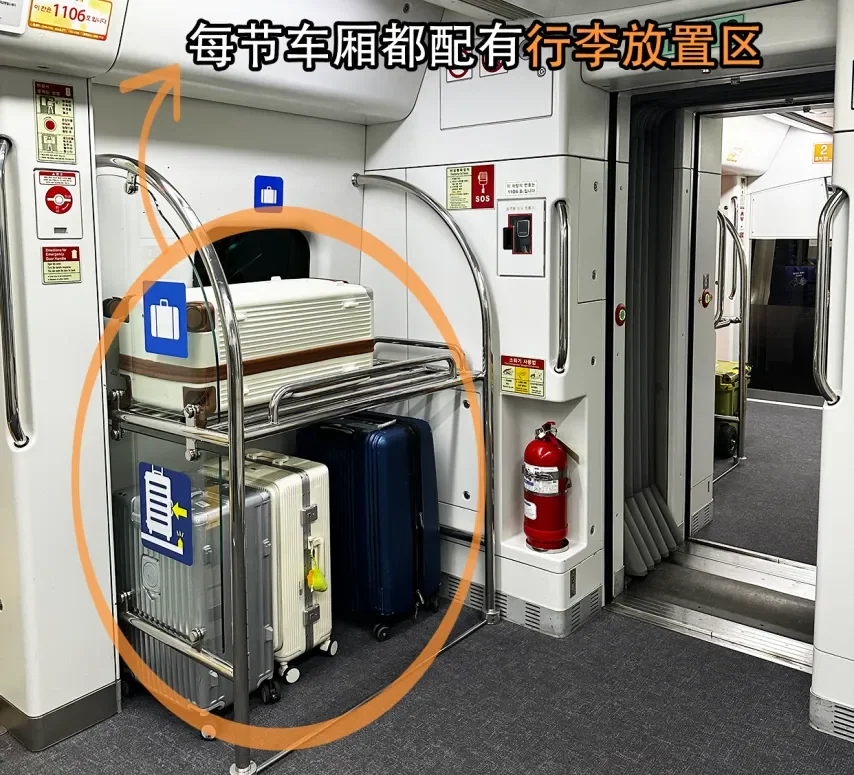
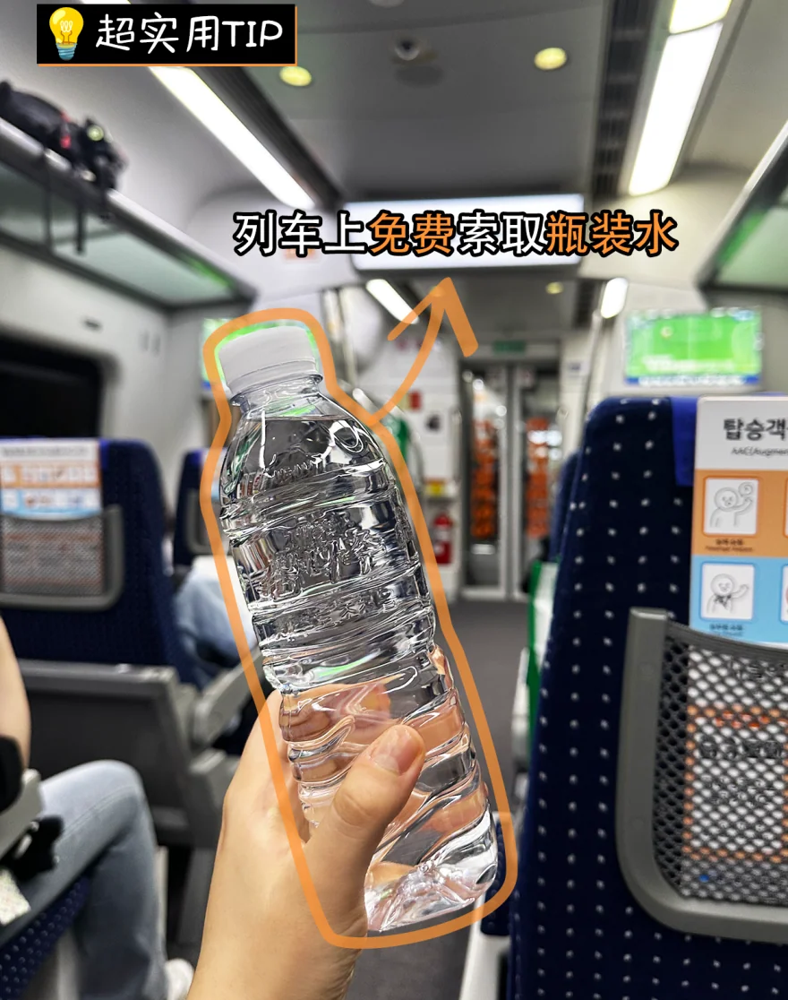

The fastest way from Incheon International Airport into Seoul runs underground: go down to level B1 of your terminal and take the AREX airport railway — officially the Airport Railroad Express. The Express train runs non-stop and reaches Seoul Station in 43 minutes; the all-stop train makes a few more stops and costs less than half as much. The two share the same track and nothing else — not the fare, not the ticket, not the experience.

Every figure below can be checked on the [AREX website](https://www.airportrailroad.com/), and the operator's own timetable is the final word. Immigration and baggage come on top: allow an hour or so from landing to the platform.

## Express or all-stop: the short comparison

| Item | Express | All-stop |
| --- | --- | --- |
| Adult fare | 13,000 won | about 4,750 won (T1) / 5,350 won (T2) |
| Journey time | 43 min from T1; 51 min from T2 | 58–66 min |
| Stops | Incheon Airport T1, T2 and Seoul Station only | Gimpo Airport, Digital Media City, Hongik University, Gongdeok and others |
| Seating | Reserved | Unreserved; standing at peak times |
| Payment | Separate ticket required; T-money not accepted | T-money accepted at the gate |
| Best for | Tight schedules, heavy bags, no changes | Tight budgets, Hongdae or Gimpo Airport |

The rule of thumb is simple. A hotel near Seoul Station, or a KTX connection the same day, makes the Express the easy choice; a hotel in Hongdae, Gongdeok or by Gimpo Airport makes the all-stop train the one with no changes and less dragging of cases.

## Finding the platform on B1, and buying a ticket

Both services leave from level B1. At T1 the station sits inside the Transport Centre, one level down from arrivals. T2 is the same, and the signs at the escalator already split into "Express Train" and "All Stop".

The walk from arrivals to the gate takes a few minutes, with lifts and escalators down to the platform. Colour beats text here: orange means Express, blue means all-stop. Orange appears only at the Express counter, gates and platform; the platforms are separate, so entering the wrong gate means backing out again.

Tickets come three ways. The counter in the B1 Transport Centre is staffed with Chinese- and English-speaking agents. The machines switch to Chinese on screen: pick a date, a departure and the number of passengers, then pay by card or cash. Booking ahead on the official site or a partner platform is usually cheaper than paying at the counter, and you collect the ticket with a QR code or reference number.

The all-stop train needs no ticket in advance. Tap in with T-money or a single-journey card, tap out at Seoul Station and the fare is deducted by distance; top-up machines stand in the concourse and convenience stores sell the cards too.

## The Express: 43 minutes to Seoul Station

The Express sells one thing: speed. Forty-three minutes from T1, fifty-one from T2, no stops in between, and almost no exposure to traffic — more predictable than the airport bus or a taxi. If you land in the evening rush, it is also the one option that cannot be slowed by traffic on the airport expressway.

Adults pay 13,000 won and children 9,500 won. The operator lists the normal fare as 18,500 won to T1 and 19,100 won to T2, so 13,000 won is already the discounted price.

Every seat is reserved and wider than on the all-stop train, and each carriage has a dedicated luggage area that takes a 28-inch case. Wi-Fi is free for the whole journey, and bottled water comes free on request from the cabin crew. All of it is included in the fare.

The ticket carries one more benefit: free use of the City Airport Terminal at Seoul Station for check-in and bag drop, so you can leave your luggage behind and go into the city light. Which airlines are handled there, and when the desks close, is posted on site; check-in usually shuts more than an hour before departure, so add that to the 43 minutes on the train.

## The all-stop train: cheaper, and it stops more

The all-stop service is simply a stretch of the Seoul metropolitan railway, priced by distance: about 4,750 won from T1 to Seoul Station and 5,350 won from T2, taking 58–66 minutes end to end. Tap in with T-money and there is no queue for a ticket; the fare is charged by the distance between the station where you tap in and the one where you tap out, so Hongik University costs less than Seoul Station.

The extra fifteen or twenty minutes go on stops. Leaving the airport, the train calls at Gimpo Airport, Digital Media City (DMC), Hongik University and Gongdeok before Seoul Station. Gimpo Airport connects to Lines 5 and 9 and the Gimpo Goldline; Hongik University to Line 2; Gongdeok to Lines 5 and 6 and the Gyeongui–Jungang line. Staying near any of them, the all-stop train beats riding to Seoul Station and doubling back; and if the next flight leaves from Gimpo Airport, it stops there, so there is no need to go into Seoul first.

The trade-off is crowding. Seats are unreserved, and at rush hour and weekends you may stand; two large cases have to be lifted on and off, with a step between platform and carriage. With a tight schedule and luggage, the Express is calmer; with time and a budget, the all-stop train wins.

Coming back from Seoul Station, the rules are the same: tap in with T-money, pay by distance, and the last train runs later than the Express. The platforms are separate, so read the colour — orange for the Express, blue for the all-stop.

## Beyond Seoul Station: KTX, metro and city check-in

Seoul Station is the country's rail hub and a very large building, so get your bearings first: KTX trains depart for Busan, Gangneung and Mokpo, Lines 1 and 4 of the metro meet inside the station, and Gyeongui line trains to Munsan start here. The signs inside are clear and the interchange is all indoors.

Myeongdong and Dongdaemun are on Line 4, City Hall and Jongno on Line 1. Hongdae and Gongdeok do not need Seoul Station at all — the all-stop train stops there. For Gangnam, change to Line 9 at Gimpo Airport; for Itaewon and Yongsan, Line 6 at Gongdeok. The Express only reaches Seoul Station, so budget the metro change for anywhere else.

If you are flying home from Incheon, check in at the City Airport Terminal before you go sightseeing; if you skip it, allow 43 minutes on the train plus security.

## First and last trains, and a few things to watch

The Express runs from about 05:15 to 22:48 and the all-stop from about 05:18 to 23:32, airport to Seoul. Treat those as reference times: they shift with weekday, weekend and season, so check the operator's timetable before you travel, and if your day sits either side of the first or last train, look up the actual departure before deciding whether to wait or take a taxi.

A few things catch people out. Land before the first train and you wait at the airport, so look at your arrival time when you book. The metro itself stops around midnight, so an arrival after the last all-stop train usually means a taxi into the city. T1 and T2 are one AREX stop apart: if you surface at the wrong terminal, stay inside and take the all-stop train with your T-money card rather than buying again. On the all-stop train the luggage racks sit at the carriage ends and are not always free.

Express tickets open the gate 30 minutes before departure and close 3 minutes before it, so board the train you booked.

## Related links

- **On this site**: [Incheon International Airport (ICN)](/airport/ICN), [South Korea (KR)](/country/KR)
- **Wikipedia**: [Incheon International Airport](https://en.wikipedia.org/wiki/Incheon_International_Airport), [AREX](https://en.wikipedia.org/wiki/AREX)
- **Baidu Baike**: [Incheon International Airport](https://baike.baidu.com/item/%E4%BB%81%E5%B7%9D%E5%9B%BD%E9%99%85%E6%9C%BA%E5%9C%BA)

Fares and times follow the AREX and Incheon Airport official publications (checked October 2026); the operators' current notices prevail. Image credit: Incheon Airport.
