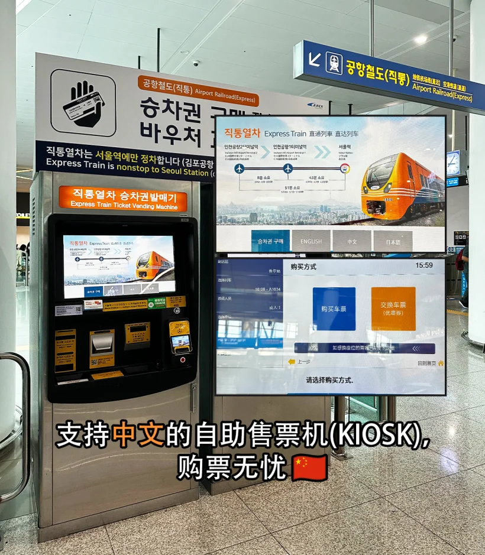

La forma más rápida de ir del aeropuerto internacional de Incheon a Seúl discurre bajo tierra: baja a la planta B1 de tu terminal y toma el ferrocarril AREX, oficialmente Airport Railroad Express. El tren Express circula sin paradas y llega a la Estación de Seúl en 43 minutos; el tren omnibús hace algunas paradas más y cuesta menos de la mitad. Los dos comparten la misma vía y nada más: ni la tarifa, ni el billete, ni la experiencia.

Todas las cifras que siguen se pueden comprobar en la [web de AREX](https://www.airportrailroad.com/), y el horario del propio operador es la última palabra. A eso hay que sumar inmigración y equipaje: calcula una hora aproximadamente desde que aterrizas hasta el andén.

## Express u omnibús: la comparación breve

| Concepto | Express | Omnibús |
| --- | --- | --- |
| Tarifa adulto | 13,000 won | unos 4,750 won (T1) / 5,350 won (T2) |
| Tiempo de viaje | 43 min desde T1; 51 min desde T2 | 58–66 min |
| Paradas | Solo aeropuerto de Incheon T1, T2 y Estación de Seúl | Aeropuerto de Gimpo, Digital Media City, Hongik University, Gongdeok y otras |
| Asientos | Reservados | Sin reserva; de pie en hora punta |
| Pago | Billete aparte obligatorio; no se acepta T-money | Se acepta T-money en el torno |
| Ideal para | Horarios ajustados, mucho equipaje, sin transbordos | Presupuestos ajustados, Hongdae o aeropuerto de Gimpo |

La regla es sencilla. Un hotel cerca de la Estación de Seúl, o una conexión con el KTX el mismo día, hacen del Express la elección fácil; un hotel en Hongdae, Gongdeok o junto al aeropuerto de Gimpo hacen del tren omnibús la opción sin transbordos y con menos maletas que arrastrar.

## Encontrar el andén en B1 y comprar un billete

Ambos servicios salen de la planta B1. En la T1 la estación está dentro del Centro de Transporte, una planta por debajo de las llegadas. En la T2 ocurre lo mismo, y los carteles de la escalera mecánica ya se dividen entre “Express Train” y “All Stop”.

El paseo desde las llegadas hasta el torno dura unos minutos, con ascensores y escaleras mecánicas hasta el andén. Aquí el color manda sobre el texto: naranja significa Express, azul significa omnibús. El naranja solo aparece en el mostrador, los tornos y el andén del Express; los andenes están separados, así que entrar por el torno equivocado obliga a retroceder.

Los billetes se consiguen de tres formas. El mostrador del Centro de Transporte de la B1 tiene personal que habla chino e inglés. Las máquinas cambian al chino en pantalla: elige una fecha, una salida y el número de pasajeros, y paga con tarjeta o en efectivo. Reservar por adelantado en la web oficial o en una plataforma asociada suele salir más barato que pagar en el mostrador, y recoges el billete con un código QR o un número de referencia.

El tren omnibús no necesita billete por adelantado. Toca al entrar con T-money o una tarjeta de viaje sencillo, toca al salir en la Estación de Seúl y la tarifa se descuenta por distancia; hay máquinas de recarga en el vestíbulo y las tiendas de conveniencia también venden las tarjetas.

## El Express: 43 minutos a la Estación de Seúl

El Express vende una sola cosa: velocidad. Cuarenta y tres minutos desde la T1, cincuenta y uno desde la T2, sin paradas intermedias y casi sin exposición al tráfico: más previsible que el autobús de aeropuerto o un taxi. Si aterrizas en la hora punta de la tarde, es además la única opción que no se puede ver frenada por el tráfico de la autopista del aeropuerto.

Los adultos pagan 13,000 won y los niños 9,500 won. El operador indica una tarifa normal de 18,500 won a la T1 y 19,100 won a la T2, así que los 13,000 won son ya el precio con descuento.

Todos los asientos están reservados y son más anchos que los del tren omnibús, y cada coche tiene una zona de equipaje propia que admite una maleta de 28 pulgadas. El Wi-Fi es gratis durante todo el trayecto y el agua embotellada se sirve gratis si se la pides a la tripulación. Todo ello está incluido en la tarifa.

El billete incluye una ventaja más: el uso gratuito de la Terminal Urbana del Aeropuerto en la Estación de Seúl para facturar y dejar el equipaje, así que puedes desprenderte de las maletas y salir a la ciudad ligero. Qué aerolíneas se atienden allí y a qué hora cierran los mostradores está indicado en el sitio; la facturación suele cerrar más de una hora antes de la salida, así que añade eso a los 43 minutos de tren.

## El tren omnibús: más barato y con más paradas

El servicio omnibús no es más que un tramo del ferrocarril metropolitano de Seúl, con precio por distancia: unos 4,750 won de la T1 a la Estación de Seúl y 5,350 won desde la T2, con 58–66 minutos de punta a punta. Toca al entrar con T-money y no hay cola para un billete; la tarifa se cobra según la distancia entre la estación donde tocas al entrar y la que tocas al salir, así que Hongik University cuesta menos que la Estación de Seúl.

Los quince o veinte minutos extra se van en paradas. Al salir del aeropuerto, el tren para en el aeropuerto de Gimpo, Digital Media City (DMC), Hongik University y Gongdeok antes de la Estación de Seúl. El aeropuerto de Gimpo conecta con las líneas 5 y 9 y con la Gimpo Goldline; Hongik University, con la línea 2; Gongdeok, con las líneas 5 y 6 y la línea Gyeongui–Jungang. Si te alojas cerca de cualquiera de ellas, el tren omnibús es mejor que ir hasta la Estación de Seúl y volver sobre tus pasos; y si el siguiente vuelo sale del aeropuerto de Gimpo, para allí, así que no hace falta entrar antes en Seúl.

El precio a pagar es la aglomeración. Los asientos no están reservados, y en hora punta y los fines de semana puede que vayas de pie; dos maletas grandes hay que subirlas y bajarlas a pulso, con un escalón entre el andén y el coche. Con un horario ajustado y equipaje, el Express es más tranquilo; con tiempo y presupuesto, gana el tren omnibús.

De vuelta desde la Estación de Seúl, las reglas son las mismas: toca al entrar con T-money, paga por distancia y el último tren circula más tarde que el Express. Los andenes están separados, así que fíjate en el color: naranja para el Express, azul para el omnibús.

## Más allá de la Estación de Seúl: KTX, metro y facturación urbana

La Estación de Seúl es el nudo ferroviario del país y un edificio muy grande, así que ubícate primero: los trenes KTX salen hacia Busan, Gangneung y Mokpo, las líneas 1 y 4 del metro se cruzan dentro de la estación y los trenes de la línea Gyeongui a Munsan arrancan aquí. Los carteles interiores son claros y el transbordo es todo en interior.

Myeongdong y Dongdaemun están en la línea 4; City Hall y Jongno, en la línea 1. Hongdae y Gongdeok no necesitan la Estación de Seúl en absoluto: el tren omnibús para allí. Para Gangnam, cambia a la línea 9 en el aeropuerto de Gimpo; para Itaewon y Yongsan, a la línea 6 en Gongdeok. El Express solo llega a la Estación de Seúl, así que cuenta con el transbordo de metro para cualquier otro destino.

Si vuelves a casa desde Incheon, factura en la Terminal Urbana del Aeropuerto antes de ir a hacer turismo; si te la saltas, calcula 43 minutos de tren más el control de seguridad.

## Primeros y últimos trenes, y algunas cosas que vigilar

El Express circula aproximadamente de 05:15 a 22:48 y el omnibús de 05:18 a 23:32, del aeropuerto a Seúl. Toma esos horarios como referencia: cambian según el día de la semana, el fin de semana y la temporada, así que consulta el horario del operador antes de viajar y, si tu día queda a un lado u otro del primer o último tren, busca la salida real antes de decidir si esperas o tomas un taxi.

Unas cuantas cosas sorprenden a la gente. Si aterrizas antes del primer tren, esperas en el aeropuerto, así que mira la hora de llegada al reservar. El metro en sí cierra alrededor de medianoche, así que llegar después del último tren omnibús suele significar un taxi a la ciudad. La T1 y la T2 están a una parada de AREX: si sales en la terminal equivocada, quédate dentro y toma el tren omnibús con tu tarjeta T-money en lugar de comprar otro billete. En el tren omnibús los portaequipajes están en los extremos del coche y no siempre están libres.

Los billetes del Express abren el torno 30 minutos antes de la salida y lo cierran 3 minutos antes, así que sube al tren que reservaste.

## Enlaces relacionados

- **En este sitio**: [Aeropuerto Internacional de Incheon (ICN)](/airport/ICN), [Corea del Sur (KR)](/country/KR)
- **Wikipedia**: [Aeropuerto Internacional de Incheon](https://en.wikipedia.org/wiki/Incheon_International_Airport), [AREX](https://en.wikipedia.org/wiki/AREX)
- **Baidu Baike**: [Aeropuerto Internacional de Incheon](https://baike.baidu.com/item/%E4%BB%81%E5%B7%9D%E5%9B%BD%E9%99%85%E6%9C%BA%E5%9C%BA)

Las tarifas y los horarios siguen las publicaciones oficiales de AREX y del aeropuerto de Incheon (consultadas en octubre de 2026); prevalecen los avisos actuales de los operadores. Crédito de la imagen: aeropuerto de Incheon.
