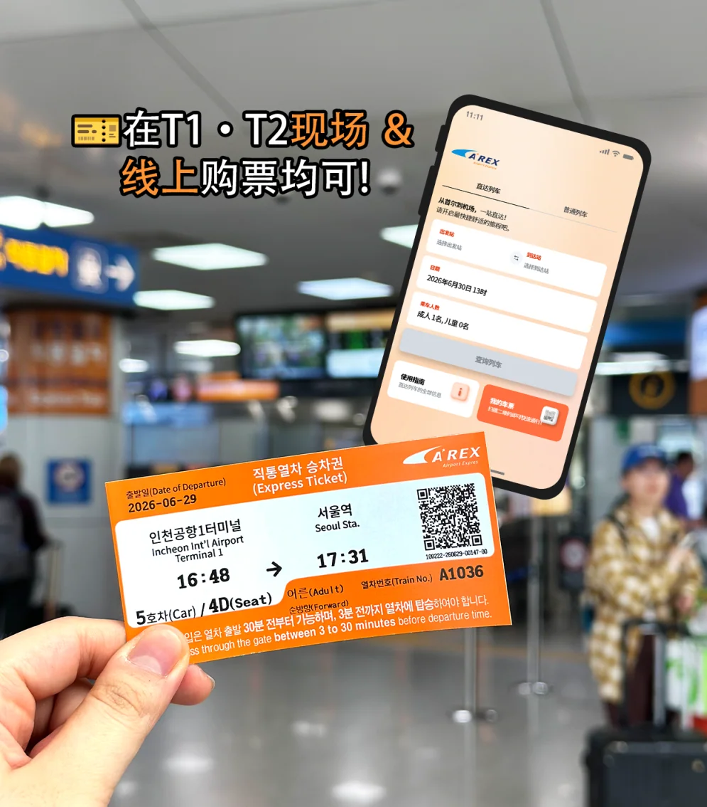

De snelste weg van Incheon International Airport naar Seoul loopt ondergronds: ga naar niveau B1 van je terminal en neem de AREX-luchthavenspoorlijn — officieel de Airport Railroad Express. De expresstrein rijdt zonder stops en bereikt Seoul Station in 43 minuten; de stoptrein heeft een paar extra haltes en kost minder dan de helft. De twee delen hetzelfde spoor en verder niets — niet het tarief, niet het kaartje, niet de ervaring.

Elk cijfer hieronder is te controleren op de [AREX-website](https://www.airportrailroad.com/), en de dienstregeling van de vervoerder zelf is bepalend. Paspoortcontrole en bagage komen daar nog bij: reken ongeveer een uur van de landing tot het perron.

## Express of stoptrein: de korte vergelijking

| Onderdeel | Express | Stoptrein |
| --- | --- | --- |
| Tarief volwassene | 13,000 won | ongeveer 4,750 won (T1) / 5,350 won (T2) |
| Reistijd | 43 min vanaf T1; 51 min vanaf T2 | 58–66 min |
| Haltes | alleen Incheon Airport T1, T2 en Seoul Station | Gimpo Airport, Digital Media City, Hongik University, Gongdeok en andere |
| Zitplaatsen | gereserveerd | niet gereserveerd; staan in de spits |
| Betaling | apart kaartje nodig; T-money niet geaccepteerd | T-money geaccepteerd bij de poortjes |
| Best voor | krappe schema's, zware bagage, geen overstappen | krap budget, Hongdae of Gimpo Airport |

De vuistregel is simpel. Een hotel bij Seoul Station, of een KTX-aansluiting dezelfde dag, maakt de Express de makkelijke keuze; een hotel in Hongdae, Gongdeok of bij Gimpo Airport maakt de stoptrein de optie zonder overstappen en met minder slepen met koffers.

## Het perron vinden op B1 en een kaartje kopen

Beide diensten vertrekken van niveau B1. Op T1 ligt het station in het Transport Centre, één niveau onder aankomst. Op T2 is het net zo, en de borden bij de roltrap splitsen al in "Express Train" en "All Stop".

De wandeling van aankomst naar de poortjes duurt een paar minuten, met liften en roltrappen naar het perron. Kleur is hier belangrijker dan tekst: oranje betekent Express, blauw betekent stoptrein. Oranje verschijnt alleen bij de Express-balie, de poortjes en het perron; de perrons zijn gescheiden, dus door het verkeerde poortje gaan betekent weer terug naar buiten.

Kaartjes kun je op drie manieren kopen. De balie in het Transport Centre op B1 wordt bemand door medewerkers die Chinees en Engels spreken. De automaten schakelen op het scherm over naar het Chinees: kies een datum, een vertrektijd en het aantal passagiers en betaal met kaart of contant. Vooraf boeken op de officiële site of een partnerplatform is meestal goedkoper dan aan de balie betalen, en je haalt het kaartje op met een QR-code of referentienummer.

De stoptrein heeft geen kaartje vooraf nodig. Tik in met T-money of een enkelritkaart, tik uit op Seoul Station en het tarief wordt naar afstand afgeschreven; oplaadautomaten staan in de hal en gemakswinkels verkopen de kaarten ook.

## De Express: 43 minuten naar Seoul Station

De Express verkoopt één ding: snelheid. Drieënveertig minuten vanaf T1, eenenvijftig vanaf T2, geen haltes ertussen en nauwelijks blootstelling aan verkeer — voorspelbaarder dan de luchthavenbus of een taxi. Als je in de avondspits landt, is het ook de enige optie die niet vertraagd kan worden door verkeer op de luchthavensnelweg.

Volwassenen betalen 13,000 won en kinderen 9,500 won. De vervoerder vermeldt een normaal tarief van 18,500 won naar T1 en 19,100 won naar T2, dus 13,000 won is al de gereduceerde prijs.

Elke stoel is gereserveerd en breder dan in de stoptrein, en elke wagon heeft een eigen bagageruimte waar een koffer van 28 inch in past. Wifi is gratis gedurende de hele rit, en flessenwater is gratis op verzoek bij het cabinepersoneel. Alles zit bij het tarief in.

Het kaartje heeft nog een voordeel: gratis gebruik van de City Airport Terminal op Seoul Station voor inchecken en bagage afgeven, zodat je je bagage kunt achterlaten en licht de stad in kunt. Welke luchtvaartmaatschappijen daar worden behandeld en wanneer de balies sluiten, staat ter plaatse aangegeven; het inchecken sluit meestal meer dan een uur voor vertrek, dus reken dat op bij de 43 minuten in de trein.

## De stoptrein: goedkoper, en hij stopt vaker

De stoptrein is simpelweg een stuk van het metrospoor van Seoul, met een tarief naar afstand: ongeveer 4,750 won van T1 naar Seoul Station en 5,350 won van T2, met 58–66 minuten van begin tot eind. Tik in met T-money en je hoeft niet in de rij voor een kaartje; het tarief wordt berekend naar de afstand tussen het station waar je in- en uitcheckt, dus Hongik University kost minder dan Seoul Station.

De extra vijftien of twintig minuten gaan naar de haltes. Bij vertrek van de luchthaven stopt de trein bij Gimpo Airport, Digital Media City (DMC), Hongik University en Gongdeok voordat hij Seoul Station bereikt. Gimpo Airport sluit aan op lijn 5 en 9 en de Gimpo Goldline; Hongik University op lijn 2; Gongdeok op lijn 5 en 6 en de Gyeongui–Jungang-lijn. Als je bij een van die haltes verblijft, is de stoptrein beter dan naar Seoul Station rijden en terugkomen; en als je volgende vlucht van Gimpo Airport vertrekt, stopt hij daar, dus je hoeft niet eerst Seoul in.

De keerzijde is drukte. Zitplaatsen zijn niet gereserveerd, en in de spits en in het weekend sta je mogelijk; twee grote koffers moeten in en uit worden getild, met een tree tussen perron en wagon. Met een krap schema en bagage is de Express rustiger; met tijd en een beperkt budget wint de stoptrein.

Terug vanaf Seoul Station gelden dezelfde regels: inchecken met T-money, betalen naar afstand, en de laatste trein rijdt later dan de Express. De perrons zijn gescheiden, dus let op de kleur — oranje voor de Express, blauw voor de stoptrein.

## Voorbij Seoul Station: KTX, metro en inchecken in de stad

Seoul Station is het spoorknooppunt van het land en een zeer groot gebouw, dus oriënteer je eerst: KTX-treinen vertrekken naar Busan, Gangneung en Mokpo, lijn 1 en 4 van de metro komen samen in het station, en treinen van de Gyeongui-lijn naar Munsan beginnen hier. De borden binnen zijn duidelijk en de overstap is volledig overdekt.

Myeongdong en Dongdaemun liggen aan lijn 4, City Hall en Jongno aan lijn 1. Voor Hongdae en Gongdeok heb je Seoul Station helemaal niet nodig — de stoptrein stopt daar. Voor Gangnam stap je in Gimpo Airport over op lijn 9; voor Itaewon en Yongsan op lijn 6 in Gongdeok. De Express komt alleen bij Seoul Station, dus reken voor alle andere bestemmingen de metro-overstap mee.

Vlieg je terug vanaf Incheon, check dan in bij de City Airport Terminal voordat je gaat sightseeing; sla je dat over, reken dan op 43 minuten in de trein plus de beveiliging.

## Eerste en laatste treinen, en een paar dingen om op te letten

De Express rijdt van ongeveer 05:15 tot 22:48 en de stoptrein van ongeveer 05:18 tot 23:32, van de luchthaven naar Seoul. Zie die tijden als richtlijnen: ze verschuiven per werkdag, weekend en seizoen, dus controleer de dienstregeling van de vervoerder voor je reist, en als je dag aan weerszijden van de eerste of laatste trein valt, zoek dan de werkelijke vertrektijd op voordat je besluit te wachten of een taxi te nemen.

Een paar dingen verrassen reizigers. Land je voor de eerste trein, dan wacht je op de luchthaven, dus kijk bij het boeken naar je aankomsttijd. De metro zelf stopt rond middernacht, dus een aankomst na de laatste stoptrein betekent meestal een taxi de stad in. T1 en T2 liggen één AREX-halte uit elkaar: kom je boven in de verkeerde terminal, blijf dan binnen en neem de stoptrein met je T-money-kaart in plaats van opnieuw te kopen. In de stoptrein zitten de bagagerekken aan de uiteinden van de wagon en zijn ze niet altijd vrij.

Kaartjes voor de Express openen de poortjes 30 minuten voor vertrek en sluiten 3 minuten ervoor, dus stap op de trein die je hebt geboekt.

## Gerelateerde links

- **Op deze site**: [Incheon International Airport (ICN)](/airport/ICN), [Zuid-Korea (KR)](/country/KR)
- **Wikipedia**: [Incheon International Airport](https://en.wikipedia.org/wiki/Incheon_International_Airport), [AREX](https://en.wikipedia.org/wiki/AREX)
- **Baidu Baike**: [Incheon International Airport](https://baike.baidu.com/item/%E4%BB%81%E5%B7%9D%E5%9B%BD%E9%99%85%E6%9C%BA%E5%9C%BA)

Tarieven en tijden volgen de officiële publicaties van AREX en Incheon Airport (gecontroleerd in oktober 2026); de actuele mededelingen van de vervoerders zijn bepalend. Beeldcredit: Incheon Airport.
