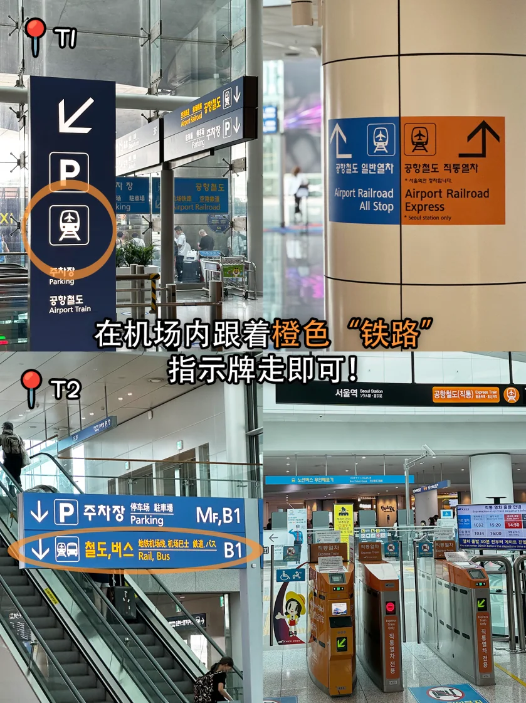

Najszybsza droga z międzynarodowego lotniska Incheon do Seulu prowadzi pod ziemią: zjedź na poziom B1 swojego terminalu i wsiądź do kolei lotniskowej AREX — oficjalnie Airport Railroad Express. Pociąg Express jedzie bez postojów i dociera na stację Seul w 43 minuty; pociąg osobowy zatrzymuje się na kilku dodatkowych stacjach i kosztuje mniej niż połowę. Oba łączy ten sam tor i nic więcej — ani cena, ani bilet, ani doświadczenie.

Każdą z poniższych liczb można sprawdzić na [stronie AREX](https://www.airportrailroad.com/), a rozkład przewoźnika jest rozstrzygający. Do tego dochodzą kontrola paszportowa i odbiór bagażu: od lądowania do peronu zaplanuj około godziny.

## Express czy pociąg osobowy: krótkie porównanie

| Element | Express | Pociąg osobowy |
| --- | --- | --- |
| Cena dla dorosłych | 13 000 wonów | około 4750 wonów (T1) / 5350 wonów (T2) |
| Czas jazdy | 43 min z T1; 51 min z T2 | 58–66 min |
| Przystanki | tylko lotnisko Incheon T1, T2 i stacja Seul | lotnisko Gimpo, Digital Media City, Hongik University, Gongdeok i inne |
| Miejsca | numerowane | bez rezerwacji; w godzinach szczytu na stojąco |
| Płatność | wymagany osobny bilet; T-money nie jest akceptowane | T-money akceptowane przy bramce |
| Najlepszy dla | napiętych harmonogramów, ciężkiego bagażu, braku przesiadek | ograniczonego budżetu, Hongdae lub lotniska Gimpo |

Prosta zasada: hotel w pobliżu stacji Seul albo połączenie KTX tego samego dnia sprawiają, że Express jest oczywistym wyborem; hotel w Hongdae, Gongdeok lub przy lotnisku Gimpo sprawia, że pociąg osobowy to opcja bez przesiadek i z mniejszym targaniem walizek.

## Jak znaleźć peron na poziomie B1 i kupić bilet

Oba połączenia odjeżdżają z poziomu B1. W T1 stacja znajduje się wewnątrz Centrum Transportowego, poziom niżej od przylotów. W T2 jest tak samo, a oznaczenia przy schodach ruchomych już dzielą się na „Express Train” i „All Stop”.

Droga od przylotów do bramki zajmuje kilka minut, z windami i schodami ruchomymi w dół na peron. Kolor wygrywa tu z tekstem: pomarańczowy oznacza Express, niebieski — pociąg osobowy. Pomarańczowy pojawia się tylko przy kasie Express, bramkach i peronie; perony są oddzielne, więc wejście nie przy tej bramce oznacza zawrócenie.

Bilety można kupić na trzy sposoby. W kasie w Centrum Transportowym na poziomie B1 obsługują pracownicy mówiący po chińsku i po angielsku. Automaty mają chiński interfejs: wybierz datę, odjazd i liczbę pasażerów, a następnie zapłać kartą lub gotówką. Rezerwacja z wyprzedzeniem na oficjalnej stronie lub platformie partnerskiej jest zwykle tańsza niż zapłata w kasie, a bilet odbiera się za pomocą kodu QR lub numeru referencyjnego.

Pociąg osobowy nie wymaga biletu z wyprzedzeniem. Przyłóż kartę T-money lub bilet jednorazowy przy wejściu, przyłóż przy wyjściu na stacji Seul, a opłata zostanie pobrana według odległości; automaty do doładowania stoją w hali, a karty sprzedają też sklepy całodobowe.

## Express: 43 minuty do stacji Seul

Express sprzedaje jedną rzecz: szybkość. Czterdzieści trzy minuty z T1, pięćdziesiąt jeden z T2, bez postojów po drodze i niemal bez wpływu ruchu drogowego — bardziej przewidywalny niż autobus lotniskowy czy taksówka. Jeśli lądujesz w wieczornym szczycie, to także jedyna opcja, której nie spowolni korek na autostradzie lotniskowej.

Dorośli płacą 13 000 wonów, dzieci 9500 wonów. Przewoźnik podaje cenę normalną 18 500 wonów do T1 i 19 100 wonów do T2, więc 13 000 wonów to już cena zniżkowa.

Wszystkie miejsca są numerowane i szersze niż w pociągu osobowym, a każdy wagon ma wydzieloną strefę bagażową mieszczącą walizkę 28-calową. Wi-Fi jest darmowe przez całą podróż, a butelkowaną wodę obsługa podaje bezpłatnie na życzenie. Wszystko to wliczone jest w cenę biletu.

Bilet daje jeszcze jedną korzyść: bezpłatne korzystanie z City Airport Terminal przy stacji Seul do odprawy i nadania bagażu, dzięki czemu możesz zostawić bagaż i zwiedzać miasto bez obciążenia. Informacje, jakie linie lotnicze są tam obsługiwane i kiedy zamykają się stanowiska, są podane na miejscu; odprawa zwykle kończy się ponad godzinę przed odlotem, więc dolicz to do 43 minut jazdy pociągiem.

## Pociąg osobowy: taniej i z większą liczbą przystanków

Pociąg osobowy to po prostu odcinek kolei miejskiej Seulu, rozliczany według odległości: około 4750 wonów z T1 na stację Seul i 5350 wonów z T2, a przejazd trwa 58–66 minut. Przyłóż kartę T-money i nie ma kolejki po bilet; opłata zależy od odległości między stacją, na której przyłożysz kartę, a tą, na której ją odłożysz, więc Hongik University kosztuje mniej niż stacja Seul.

Dodatkowe piętnaście czy dwadzieścia minut idzie na przystanki. Wyjeżdżając z lotniska, pociąg zatrzymuje się na lotnisku Gimpo, Digital Media City (DMC), Hongik University i Gongdeok przed stacją Seul. Lotnisko Gimpo łączy się z liniami 5 i 9 oraz Gimpo Goldline; Hongik University z linią 2; Gongdeok z liniami 5 i 6 oraz linią Gyeongui–Jungang. Jeśli nocujesz w pobliżu któregoś z nich, pociąg osobowy wygrywa z jazdą na stację Seul i zawracaniem; a jeśli następny lot odlatuje z lotniska Gimpo, pociąg tam się zatrzymuje, więc nie trzeba najpierw jechać do Seulu.

Cena kompromisu to tłok. Miejsca są nienumerowane, a w godzinach szczytu i w weekendy możesz stać; dwie duże walizki trzeba wnieść i wynieść, pokonując stopień między peronem a wagonem. Przy napiętym harmonogramie i bagażu spokojniejszy jest Express; gdy masz czas i ograniczony budżet, wygrywa pociąg osobowy.

W drodze powrotnej ze stacji Seul zasady są te same: przyłóż T-money, zapłać według odległości, a ostatni pociąg odjeżdża później niż Express. Perony są oddzielne, więc czytaj kolor — pomarańczowy to Express, niebieski to pociąg osobowy.

## Poza stacją Seul: KTX, metro i odprawa miejska

Stacja Seul to krajowy węzeł kolejowy i bardzo duży budynek, więc najpierw się rozejrzyj: pociągi KTX odjeżdżają do Busan, Gangneung i Mokpo, linie metra 1 i 4 spotykają się wewnątrz stacji, a pociągi linii Gyeongui do Munsan zaczynają bieg tutaj. Oznaczenia wewnątrz są czytelne, a przesiadka odbywa się pod dachem.

Myeongdong i Dongdaemun są na linii 4, City Hall i Jongno na linii 1. Hongdae i Gongdeok w ogóle nie wymagają stacji Seul — pociąg osobowy tam się zatrzymuje. Do Gangnam przesiądź się na linię 9 na lotnisku Gimpo; do Itaewon i Yongsan na linię 6 w Gongdeok. Express dociera tylko na stację Seul, więc w każdym innym przypadku uwzględnij przesiadkę na metro.

Jeśli wracasz samolotem z Incheon, odpraw się w City Airport Terminal, zanim ruszysz na zwiedzanie; jeśli to pominiesz, zaplanuj 43 minuty jazdy pociągiem plus kontrolę bezpieczeństwa.

## Pierwsze i ostatnie pociągi oraz kilka rzeczy, na które warto uważać

Express kursuje od około 05:15 do 22:48, a pociąg osobowy od około 05:18 do 23:32, z lotniska do Seulu. Traktuj te godziny jako orientacyjne: zmieniają się w zależności od dnia tygodnia, weekendu i sezonu, więc przed podróżą sprawdź rozkład przewoźnika, a jeśli twoja data wypada tuż przed pierwszym lub po ostatnim pociągu, sprawdź rzeczywisty odjazd, zanim zdecydujesz, czy czekać, czy wziąć taksówkę.

Kilka rzeczy zaskakuje podróżnych. Jeśli wylądujesz przed pierwszym pociągiem, czekasz na lotnisku, więc przy rezerwacji zwróć uwagę na godzinę przylotu. Samo metro zatrzymuje się około północy, więc przylot po ostatnim pociągu osobowym zwykle oznacza taksówkę do miasta. T1 i T2 dzieli jeden przystanek AREX: jeśli wynurzysz się w niewłaściwym terminalu, zostań w środku i przejedź pociągiem osobowym na karcie T-money, zamiast kupować bilet ponownie. W pociągu osobowym półki bagażowe są na końcach wagonów i nie zawsze są wolne.

Bilety Express otwierają bramkę 30 minut przed odjazdem i zamykają ją 3 minuty przed nim, więc wsiadaj do pociągu, który zarezerwowałeś.

## Powiązane linki

- **W tym serwisie**: [Międzynarodowy port lotniczy Incheon (ICN)](/airport/ICN), [Korea Południowa (KR)](/country/KR)
- **Wikipedia**: [Międzynarodowy port lotniczy Incheon](https://en.wikipedia.org/wiki/Incheon_International_Airport), [AREX](https://en.wikipedia.org/wiki/AREX)
- **Baidu Baike**: [Międzynarodowy port lotniczy Incheon](https://baike.baidu.com/item/%E4%BB%81%E5%B7%9D%E5%9B%BD%E9%99%85%E6%9C%BA%E5%9C%BA)

Ceny i godziny podano zgodnie z oficjalnymi publikacjami AREX i lotniska Incheon (sprawdzone w październiku 2026 roku); decydujące są aktualne komunikaty przewoźników. Źródło zdjęcia: lotnisko Incheon.
