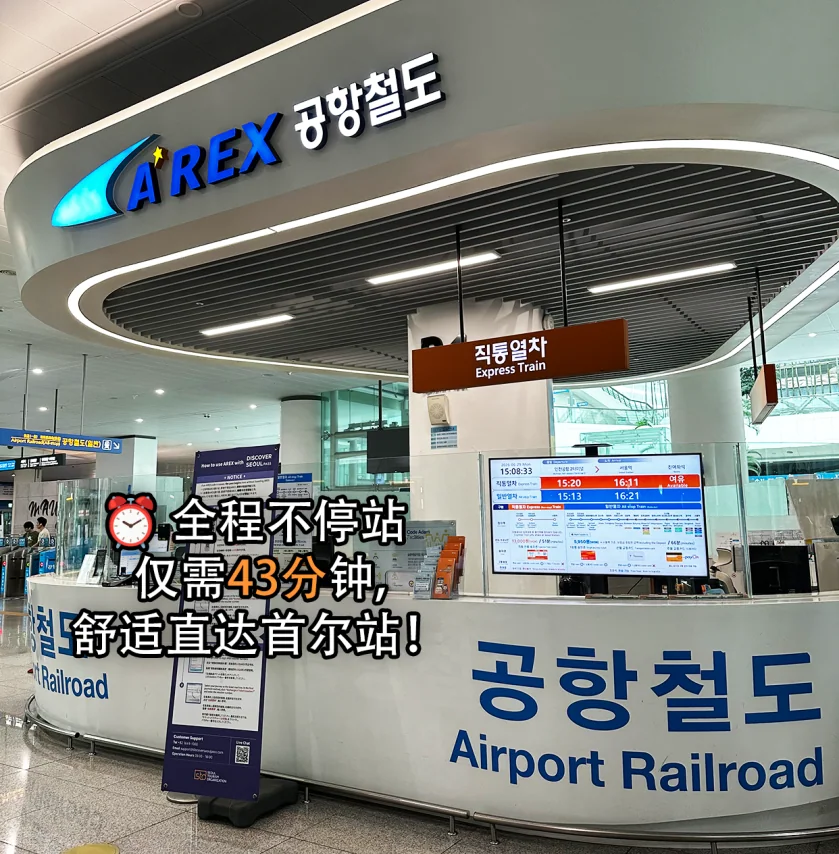

Det snabbaste sättet från Incheon International Airport in till Seoul går under jord: gå ner till plan B1 i din terminal och ta flygplatsjärnvägen AREX – officiellt Airport Railroad Express. Expresståget går utan uppehåll och når Seoul Station på 43 minuter; stopptåget gör några fler stopp och kostar mindre än hälften så mycket. De två delar samma spår och inget annat – inte biljettpriset, inte biljetten, inte upplevelsen.

Alla siffror nedan kan kontrolleras på [AREX:s webbplats](https://www.airportrailroad.com/), och operatörens egen tidtabell är det som gäller. Passkontroll och bagage tillkommer: räkna med ungefär en timme från landning till plattformen.

## Express eller stopptåg: den korta jämförelsen

| Post | Express | Stopptåg |
| --- | --- | --- |
| Vuxenbiljett | 13 000 won | cirka 4 750 won (T1) / 5 350 won (T2) |
| Restid | 43 min från T1; 51 min från T2 | 58–66 min |
| Stopp | endast Incheon Airport T1, T2 och Seoul Station | Gimpo Airport, Digital Media City, Hongik University, Gongdeok med flera |
| Sittplats | Reserverad | Icke reserverad; stående i rusningstid |
| Betalning | separat biljett krävs; T-money accepteras inte | T-money accepteras i spärren |
| Bäst för | pressade scheman, tungt bagage, inga byten | begränsad budget, Hongdae eller Gimpo Airport |

Tumregeln är enkel. Ett hotell nära Seoul Station, eller en KTX-anslutning samma dag, gör Express till det enkla valet; ett hotell i Hongdae, Gongdeok eller vid Gimpo Airport gör stopptåget till det alternativ som kräver inga byten och mindre släpande på resväskor.

## Hitta plattformen på B1 och köpa biljett

Båda tågalternativen avgår från plan B1. I T1 ligger stationen inne i Transport Centre, en våning under ankomsthallen. Detsamma gäller T2, och skyltarna vid rulltrappan är redan uppdelade i "Express Train" och "All Stop".

Promenaden från ankomsthallen till spärren tar några minuter, med hissar och rulltrappor ner till plattformen. Här vinner färgen över texten: orange betyder Express, blått betyder stopptåg. Orange finns bara vid Expressdisken, spärrarna och plattformen; plattformarna är separata, så går du in genom fel spärr får du backa ut igen.

Det finns tre sätt att köpa biljett. Disken i Transport Centre på B1 är bemannad med agenter som talar kinesiska och engelska. Maskinerna växlar till kinesiska på skärmen: välj datum, avgång och antal passagerare och betala sedan med kort eller kontanter. Att boka i förväg på den officiella webbplatsen eller en partnerplattform är oftast billigare än att betala vid disken, och du hämtar biljetten med en QR-kod eller ett referensnummer.

Stopptåget kräver ingen förköpt biljett. Blippa in med T-money eller ett enkelresekort, blippa ut vid Seoul Station, där biljettpriset dras efter avstånd; påfyllningsautomater står i biljetthallen och kort säljs även i närbutiker.

## Express: 43 minuter till Seoul Station

Express säljer en sak: snabbhet. 43 minuter från T1, 51 från T2, inga stopp däremellan och nästan ingen trafikpåverkan – det är mer förutsägbart än flygbussen eller en taxi. Om du landar i kvällsrusningen är det också det enda alternativet som inte kan fördröjas av trafik på flygplatsmotorvägen.

Vuxna betalar 13 000 won och barn 9 500 won. Operatören anger normalpriset till 18 500 won till T1 och 19 100 won till T2, så 13 000 won är redan det rabatterade priset.

Varje plats är reserverad och bredare än på stopptåget, och varje vagn har ett eget bagageutrymme som rymmer en 28-tumsväska. Wi-Fi är gratis under hela resan, och kabinpersonalen erbjuder buteljerat vatten gratis på begäran. Allt ingår i biljettpriset.

Biljetten ger ytterligare en förmån: gratis användning av City Airport Terminal vid Seoul Station för incheckning och bagageinlämning, så du kan lämna bagaget och ta dig ut i staden lätt packad. Vilka flygbolag som hanteras där och när diskarna stänger finns anslaget på plats; incheckningen stänger vanligtvis mer än en timme före avgång, så räkna med det utöver de 43 minuterna på tåget.

## Stopptåget: billigare, och det stannar oftare

Stopptåget är helt enkelt en del av Seouls lokaltågsnät och prissätts efter avstånd: cirka 4 750 won från T1 till Seoul Station och 5 350 won från T2, med en restid på 58–66 minuter från ände till ände. Blippa in med T-money och slipp kön för att köpa biljett; biljettpriset beräknas efter avståndet mellan stationen där du blippar in och den där du blippar ut, så Hongik University kostar mindre än Seoul Station.

De extra femton eller tjugo minuterna går åt till stoppen. När tåget lämnar flygplatsen stannar det vid Gimpo Airport, Digital Media City (DMC), Hongik University och Gongdeok före Seoul Station. Gimpo Airport ansluter till linjerna 5 och 9 och Gimpo Goldline; Hongik University till linje 2 och Gongdeok till linjerna 5 och 6 och Gyeongui–Jungang-linjen. Bor du nära någon av dem är stopptåget bättre än att åka till Seoul Station och vända tillbaka; om nästa flyg avgår från Gimpo Airport stannar tåget där, så du behöver inte åka in till Seoul först.

Avvägningen är trängseln. Platserna är inte reserverade, och i rusningstid och på helger kan du få stå; två stora väskor måste lyftas på och av, med ett steg mellan plattformen och vagnen. Med ett pressat schema och bagage är Express lugnare; med tid och en begränsad budget vinner stopptåget.

På vägen tillbaka från Seoul Station är reglerna desamma: blippa in med T-money, betala efter avstånd, och det sista tåget går senare än Express. Plattformarna är separata, så läs färgen – orange för Express, blått för stopptåget.

## Bortom Seoul Station: KTX, tunnelbana och stadsincheckning

Seoul Station är landets järnvägsknut och en mycket stor byggnad, så orientera dig först: KTX-tåg avgår till Busan, Gangneung och Mokpo, tunnelbanans linjer 1 och 4 möts inne i stationen och Gyeongui-linjens tåg till Munsan utgår härifrån. Skyltningen inne är tydlig och alla byten sker inomhus.

Myeongdong och Dongdaemun ligger på linje 4, City Hall och Jongno på linje 1. Hongdae och Gongdeok kräver inte Seoul Station alls – stopptåget stannar där. För Gangnam byter du till linje 9 vid Gimpo Airport; för Itaewon och Yongsan till linje 6 vid Gongdeok. Express når bara Seoul Station, så räkna med tunnelbanebyte för alla andra destinationer.

Om du flyger hem från Incheon kan du checka in vid City Airport Terminal innan du ger dig ut för att se dig omkring; hoppar du över det bör du räkna med 43 minuter på tåget plus säkerhetskontroll.

## Första och sista tågen, och några saker att se upp med

Express går från ungefär 05:15 till 22:48 och stopptåget från ungefär 05:18 till 23:32, från flygplatsen till Seoul. Se dem som referenstider: de varierar beroende på vardag, helg och säsong, så kontrollera operatörens tidtabell före resan, och om din resdag ligger före första tåget eller efter det sista bör du slå upp den faktiska avgången innan du bestämmer dig för att vänta eller ta taxi.

Det finns några saker som brukar överraska resenärer. Landar du före det första tåget får du vänta på flygplatsen, så titta på ankomsttiden när du bokar. Tunnelbanetrafiken upphör runt midnatt, så en ankomst efter det sista stopptåget innebär oftast taxi in till staden. T1 och T2 ligger ett AREX-stopp från varandra: om du kommer upp i fel terminal ska du stanna inomhus och ta stopptåget med ditt T-money-kort i stället för att köpa ny biljett. På stopptåget sitter bagagehyllorna vid vagnsändarna och är inte alltid lediga.

Expressbiljetter öppnar spärren 30 minuter före avgång och stänger 3 minuter före, så stig på det tåg du har bokat.

## Relaterade länkar

- **På den här webbplatsen**: [Incheon International Airport (ICN)](/airport/ICN), [Sydkorea (KR)](/country/KR)
- **Wikipedia**: [Incheon International Airport](https://en.wikipedia.org/wiki/Incheon_International_Airport), [AREX](https://en.wikipedia.org/wiki/AREX)
- **Baidu Baike**: [Incheon International Airport](https://baike.baidu.com/item/%E4%BB%81%E5%B7%9D%E5%9B%BD%E9%99%85%E6%9C%BA%E5%9C%BA)

Biljettpriser och tider följer AREX och Incheon Airports officiella publikationer (kontrollerade i oktober 2026); operatörernas aktuella meddelanden har företräde. Bildkredit: Incheon Airport.
