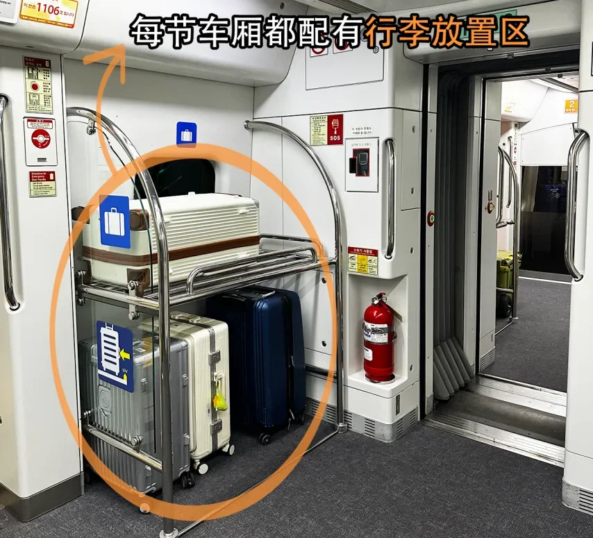

วิธีที่เร็วที่สุดจากท่าอากาศยานนานาชาติอินชอนเข้าโซลอยู่ใต้ดิน: ลงไปที่ชั้น B1 ของอาคารผู้โดยสารแล้วขึ้นรถไฟสนามบิน AREX — ชื่อทางการคือ Airport Railroad Express รถเอ็กซ์เพรสวิ่งไม่จอดและถึงสถานีโซลใน 43 นาที ส่วนรถไฟจอดทุกสถานีจอดเพิ่มอีกไม่กี่แห่งและราคาถูกกว่าครึ่งหนึ่ง ทั้งสองใช้รางเดียวกันและไม่มีอะไรเหมือนกันเลย — ไม่ว่าค่าโดยสาร ตั๋ว หรือประสบการณ์

ตัวเลขทุกตัวด้านล่างตรวจสอบได้บน[เว็บไซต์ AREX](https://www.airportrailroad.com/) และตารางเวลาของผู้ให้บริการเองถือเป็นข้อมูลสุดท้าย ต้องบวกเวลาตรวจคนเข้าเมืองและรับกระเป๋า: เผื่อเวลาประมาณหนึ่งชั่วโมงจากลงจอดถึงชานชาลา

## เอ็กซ์เพรสหรือจอดทุกสถานี: การเปรียบเทียบแบบสั้น

| รายการ | เอ็กซ์เพรส | จอดทุกสถานี |
| --- | --- | --- |
| ค่าโดยสารผู้ใหญ่ | 13,000 วอน | ประมาณ 4,750 วอน (T1) / 5,350 วอน (T2) |
| เวลาเดินทาง | 43 นาทีจาก T1; 51 นาทีจาก T2 | 58–66 นาที |
| สถานีที่จอด | ท่าอากาศยานอินชอน T1, T2 และสถานีโซลเท่านั้น | ท่าอากาศยานกิมโป, ดิจิทัลมีเดียซิตี้, มหาวิทยาลัยฮงอิก, คงด็อก และอื่น ๆ |
| ที่นั่ง | จองแล้ว | ไม่จอง; ยืนในช่วงเร่งด่วน |
| การชำระเงิน | ต้องมีตั๋วแยก; ไม่รับ T-money | รับ T-money ที่ประตู |
| เหมาะกับ | ตารางเวลาแน่น สัมภาระหนัก ไม่ต้องเปลี่ยนรถ | งบจำกัด ฮงแดหรือท่าอากาศยานกิมโป |

หลักง่าย ๆ คือ: โรงแรมใกล้สถานีโซล หรือการต่อ KTX ในวันเดียวกัน ทำให้เอ็กซ์เพรสเป็นตัวเลือกที่ง่าย ส่วนโรงแรมในฮงแด คงด็อก หรือใกล้ท่าอากาศยานกิมโป ทำให้รถไฟจอดทุกสถานีเป็นตัวเลือกที่ไม่ต้องเปลี่ยนรถและลากกระเป๋าน้อยกว่า

## หาชานชาลาที่ B1 และซื้อตั๋ว

ทั้งสองบริการออกจากชั้น B1 ที่ T1 สถานีอยู่ในศูนย์ขนส่ง ลงหนึ่งชั้นจากขาเข้า T2 ก็เช่นกัน และป้ายที่บันไดเลื่อนแยกเป็น "Express Train" และ "All Stop" อยู่แล้ว

เดินจากขาเข้าถึงประตูใช้เวลาสองสามนาที มีลิฟต์และบันไดเลื่อนลงไปยังชานชาลา สีสำคัญกว่าข้อความตรงนี้: สีส้มหมายถึงเอ็กซ์เพรส สีน้ำเงินหมายถึงจอดทุกสถานี สีส้มปรากฏเฉพาะที่เคาน์เตอร์เอ็กซ์เพรส ประตู และชานชาลา ชานชาลาแยกกัน ดังนั้นหากเข้าประตูผิดต้องถอยออกมาใหม่

ตั๋วมีสามวิธี เคาน์เตอร์ในศูนย์ขนส่งชั้น B1 มีเจ้าหน้าที่พูดภาษาจีนและอังกฤษ เครื่องจำหน่ายตั๋วเปลี่ยนหน้าจอเป็นภาษาจีนได้: เลือกวันที่ เที่ยวออก และจำนวนผู้โดยสาร แล้วชำระด้วยบัตรหรือเงินสด การจองล่วงหน้าบนเว็บไซต์ทางการหรือแพลตฟอร์มพันธมิตรมักถูกกว่าการจ่ายที่เคาน์เตอร์ และรับตั๋วด้วย QR code หรือหมายเลขอ้างอิง

รถไฟจอดทุกสถานีไม่ต้องซื้อตั๋วล่วงหน้า แตะเข้าด้วย T-money หรือบัตรโดยสารเที่ยวเดียว แตะออกที่สถานีโซล และค่าโดยสารถูกหักตามระยะทาง เครื่องเติมเงินตั้งอยู่ในโถง และร้านสะดวกซื้อก็ขายบัตรเช่นกัน

## เอ็กซ์เพรส: 43 นาทีถึงสถานีโซล

เอ็กซ์เพรสขายสิ่งเดียว: ความเร็ว สี่สิบสามนาทีจาก T1 ห้าสิบเอ็ดนาทีจาก T2 ไม่จอดระหว่างทาง และแทบไม่ได้รับผลจากการจราจร — คาดเดาได้มากกว่ารถบัสสนามบินหรือแท็กซี่ หากคุณลงจอดในช่วงเร่งด่วนเย็น นี่ก็เป็นตัวเลือกเดียวที่การจราจรบนทางด่วนสนามบินทำให้ช้าไม่ได้

ผู้ใหญ่จ่าย 13,000 วอน และเด็ก 9,500 วอน ผู้ให้บริการระบุค่าโดยสารปกติที่ 18,500 วอนไป T1 และ 19,100 วอนไป T2 ดังนั้น 13,000 วอนจึงเป็นราคาที่ลดแล้ว

ทุกที่นั่งจองล่วงหน้าและกว้างกว่าบนรถไฟจอดทุกสถานี และแต่ละตู้มีพื้นที่สัมภาระเฉพาะที่รับกระเป๋า 28 นิ้วได้ Wi-Fi ฟรีตลอดการเดินทาง และน้ำดื่มบรรจุขวดฟรีเมื่อขอจากพนักงานบนขบวน ทั้งหมดรวมอยู่ในค่าโดยสาร

ตั๋วยังมีสิทธิประโยชน์อีกอย่าง: ใช้ซิตี้แอร์พอร์ตเทอร์มินัลที่สถานีโซลสำหรับเช็คอินและฝากกระเป๋าได้ฟรี คุณจึงฝากสัมภาระไว้และเข้าเมืองแบบเบาได้ สายการบินใดให้บริการที่นั่นและเคาน์เตอร์ปิดเมื่อไรมีประกาศในพื้นที่ โดยปกติเช็คอินปิดมากกว่าหนึ่งชั่วโมงก่อนออกเดินทาง จึงต้องบวกเวลานั้นเข้ากับ 43 นาทีบนรถไฟ

## รถไฟจอดทุกสถานี: ถูกกว่า และจอดมากกว่า

บริการจอดทุกสถานีเป็นเพียงช่วงหนึ่งของรถไฟเขตมหานครโซล คิดราคาตามระยะทาง: ประมาณ 4,750 วอนจาก T1 ถึงสถานีโซล และ 5,350 วอนจาก T2 ใช้เวลา 58–66 นาทีตลอดเส้นทาง แตะเข้าด้วย T-money และไม่ต้องต่อคิวซื้อตั๋ว ค่าโดยสารคิดตามระยะทางระหว่างสถานีที่แตะเข้าและสถานีที่แตะออก ดังนั้นมหาวิทยาลัยฮงอิกจึงถูกกว่าสถานีโซล

สิบห้าหรือยี่สิบนาทีที่เพิ่มขึ้นนั้นหมดไปกับการจอด ออกจากสนามบิน รถไฟจอดที่ท่าอากาศยานกิมโป ดิจิทัลมีเดียซิตี้ (DMC) มหาวิทยาลัยฮงอิก และคงด็อก ก่อนถึงสถานีโซล ท่าอากาศยานกิมโปเชื่อมกับสาย 5 และ 9 รวมถึงกิมโปโกลด์ไลน์ มหาวิทยาลัยฮงอิกเชื่อมกับสาย 2 คงด็อกเชื่อมกับสาย 5 และ 6 และสายคยองอึย-จุงอัง หากพักใกล้สถานีใดสถานีหนึ่งเหล่านี้ รถไฟจอดทุกสถานีดีกว่านั่งไปสถานีโซลแล้วย้อนกลับ และหากเที่ยวบินถัดไปออกจากท่าอากาศยานกิมโป รถไฟก็จอดที่นั่น จึงไม่จำเป็นต้องเข้าโซลก่อน

ข้อแลกเปลี่ยนคือความแออัด ที่นั่งไม่จอง และในช่วงเร่งด่วนกับวันหยุดคุณอาจต้องยืน กระเป๋าใบใหญ่สองใบต้องยกขึ้นลง โดยมีขั้นระหว่างชานชาลากับตู้โดยสาร หากตารางเวลาแน่นและมีสัมภาระ เอ็กซ์เพรสสงบกว่า หากมีเวลาและงบจำกัด รถไฟจอดทุกสถานีชนะ

ขากลับจากสถานีโซล กฎเหมือนเดิม: แตะเข้าด้วย T-money ชำระตามระยะทาง และเที่ยวสุดท้ายวิ่งดึกกว่าเอ็กซ์เพรส ชานชาลาแยกกัน จึงให้ดูสี — สีส้มสำหรับเอ็กซ์เพรส สีน้ำเงินสำหรับจอดทุกสถานี

## ต่อจากสถานีโซล: KTX รถไฟใต้ดิน และเช็คอินในเมือง

สถานีโซลเป็นศูนย์กลางรถไฟของประเทศและเป็นอาคารขนาดใหญ่มาก จึงควรทำความเข้าใจก่อน: รถไฟ KTX ออกไปปูซาน คังนึง และมกโพ สาย 1 และ 4 ของรถไฟใต้ดินมาบรรจบกันในสถานี และรถไฟสายคยองอึยไปมุนซานเริ่มที่นี่ ป้ายภายในชัดเจนและการเปลี่ยนรถทั้งหมดอยู่ในอาคาร

เมียงดงและทงแดมุนอยู่บนสาย 4 ส่วนศาลาว่าการเมืองและจงโนอยู่บนสาย 1 ฮงแดและคงด็อกไม่จำเป็นต้องใช้สถานีโซลเลย — รถไฟจอดทุกสถานีจอดที่นั่น สำหรับคังนัม ให้เปลี่ยนไปสาย 9 ที่ท่าอากาศยานกิมโป สำหรับอีแทวอนและยงซาน ให้เปลี่ยนไปสาย 6 ที่คงด็อก เอ็กซ์เพรสไปถึงเพียงสถานีโซล ดังนั้นต้องเผื่อเวลาเปลี่ยนรถไฟใต้ดินสำหรับจุดหมายอื่น

หากคุณบินกลับจากอินชอน ให้เช็คอินที่ซิตี้แอร์พอร์ตเทอร์มินัลก่อนไปเที่ยว หากข้ามไป ให้เผื่อเวลา 43 นาทีบนรถไฟบวกกับการตรวจความปลอดภัย

## รถเที่ยวแรกและเที่ยวสุดท้าย และเรื่องที่ควรระวัง

เอ็กซ์เพรสวิ่งตั้งแต่ประมาณ 05:15 ถึง 22:48 และจอดทุกสถานีตั้งแต่ประมาณ 05:18 ถึง 23:32 จากสนามบินไปโซล ให้ถือเป็นเวลาอ้างอิง: เวลาเปลี่ยนตามวันธรรมดา วันหยุดสุดสัปดาห์ และฤดูกาล จึงควรตรวจสอบตารางเวลาของผู้ให้บริการก่อนเดินทาง และหากวันเดินทางของคุณอยู่ก่อนหรือหลังรถเที่ยวแรกหรือเที่ยวสุดท้าย ให้ตรวจสอบเวลาออกจริงก่อนตัดสินใจรอหรือเรียกแท็กซี่

มีบางเรื่องที่ทำให้ผู้โดยสารพลาดได้ หากลงจอดก่อนรถเที่ยวแรก คุณต้องรอที่สนามบิน จึงควรดูเวลามาถึงเมื่อจอง รถไฟใต้ดินหยุดให้บริการราวเที่ยงคืน การมาถึงหลังรถไฟจอดทุกสถานีเที่ยวสุดท้ายมักหมายถึงต้องนั่งแท็กซี่เข้าเมือง T1 กับ T2 ห่างกันหนึ่งสถานีของ AREX: หากคุณขึ้นมาผิดอาคาร ให้อยู่ในอาคารและใช้รถไฟจอดทุกสถานีด้วยบัตร T-money แทนการซื้อตั๋วใหม่ บนรถไฟจอดทุกสถานี ชั้นวางสัมภาระอยู่ที่ปลายตู้และไม่ได้ว่างเสมอ

ตั๋วเอ็กซ์เพรสเปิดประตู 30 นาทีก่อนออกเดินทางและปิด 3 นาทีก่อนออกเดินทาง จึงควรขึ้นขบวนที่คุณจองไว้

## ลิงก์ที่เกี่ยวข้อง

- **ในเว็บไซต์นี้**: [ท่าอากาศยานนานาชาติอินชอน (ICN)](/airport/ICN), [เกาหลีใต้ (KR)](/country/KR)
- **Wikipedia**: [ท่าอากาศยานนานาชาติอินชอน](https://en.wikipedia.org/wiki/Incheon_International_Airport), [AREX](https://en.wikipedia.org/wiki/AREX)
- **Baidu Baike**: [ท่าอากาศยานนานาชาติอินชอน](https://baike.baidu.com/item/%E4%BB%81%E5%B7%9D%E5%9B%BD%E9%99%85%E6%9C%BA%E5%9C%BA)

ค่าโดยสารและเวลาเป็นไปตามประกาศทางการของ AREX และท่าอากาศยานอินชอน (ตรวจสอบตุลาคม 2026) โดยประกาศปัจจุบันของผู้ให้บริการมีผลเหนือกว่า เครดิตภาพ: ท่าอากาศยานอินชอน
