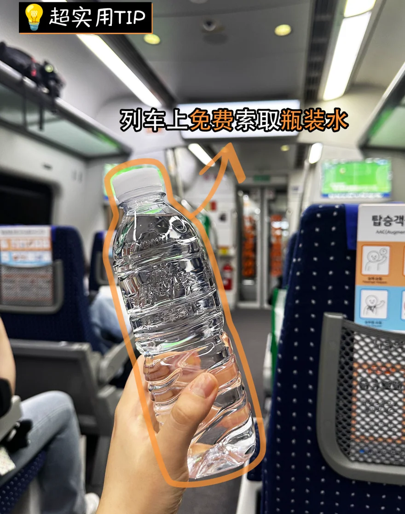

Cách nhanh nhất từ Sân bay Quốc tế Incheon vào Seoul chạy ngầm: xuống tầng B1 của nhà ga và đi tuyến đường sắt sân bay AREX — tên chính thức là Airport Railroad Express. Tàu Express chạy không dừng và đến Ga Seoul trong 43 phút; tàu dừng mọi ga dừng thêm vài ga và có giá chưa bằng một nửa. Hai loại dùng chung đường ray và không chia sẻ gì khác — không chung giá vé, không chung vé, không chung trải nghiệm.

Mọi con số dưới đây có thể kiểm tra trên [trang web AREX](https://www.airportrailroad.com/), và thời gian biểu của chính hãng vận hành là nguồn cuối cùng. Nhập cảnh và hành lý tính thêm: hãy dành khoảng một giờ từ lúc hạ cánh đến sân ga.

## Express hay dừng mọi ga: so sánh nhanh

| Hạng mục | Express | Dừng mọi ga |
| --- | --- | --- |
| Giá người lớn | 13.000 won | khoảng 4.750 won (T1) / 5.350 won (T2) |
| Thời gian đi | 43 phút từ T1; 51 phút từ T2 | 58–66 phút |
| Điểm dừng | Chỉ Sân bay Incheon T1, T2 và Ga Seoul | Sân bay Gimpo, Digital Media City, Đại học Hongik, Gongdeok và các ga khác |
| Chỗ ngồi | Đặt trước | Không đặt trước; phải đứng vào giờ cao điểm |
| Thanh toán | Cần vé riêng; không nhận T-money | Nhận T-money tại cổng soát |
| Phù hợp nhất | Lịch trình gấp, hành lý nặng, không đổi tàu | Ngân sách eo hẹp, Hongdae hoặc Sân bay Gimpo |

Quy tắc nhanh rất đơn giản. Khách sạn gần Ga Seoul, hoặc nối chuyến KTX trong cùng ngày, khiến Express thành lựa chọn dễ dàng; khách sạn ở Hongdae, Gongdeok hoặc cạnh Sân bay Gimpo khiến tàu dừng mọi ga thành lựa chọn không phải đổi tàu và ít kéo vali hơn.

## Tìm sân ga ở B1 và mua vé

Cả hai dịch vụ đều khởi hành từ tầng B1. Tại T1, ga nằm trong Trung tâm Giao thông, cách sảnh đến một tầng. T2 cũng vậy, và biển ở thang cuốn đã tách thành “Express Train” và “All Stop”.

Đoạn đi bộ từ khu đến đến cổng soát mất vài phút, với thang máy và thang cuốn xuống sân ga. Màu sắc dễ hơn chữ: màu cam là Express, màu xanh là dừng mọi ga. Màu cam chỉ xuất hiện ở quầy, cổng soát và sân ga Express; các sân ga tách riêng, nên vào nhầm cổng sẽ phải quay ra.

Vé có ba cách mua. Quầy ở Trung tâm Giao thông B1 có nhân viên nói tiếng Trung và tiếng Anh. Máy bán vé chuyển sang tiếng Trung trên màn hình: chọn ngày, chuyến khởi hành và số hành khách, rồi thanh toán bằng thẻ hoặc tiền mặt. Đặt trước trên trang chính thức hoặc nền tảng đối tác thường rẻ hơn trả tại quầy, và bạn nhận vé bằng mã QR hoặc mã tham chiếu.

Tàu dừng mọi ga không cần vé trước. Quẹt vào bằng T-money hoặc thẻ một chuyến, quẹt ra tại Ga Seoul và giá vé được trừ theo khoảng cách; máy nạp tiền đứng ở sảnh và cửa hàng tiện lợi cũng bán thẻ.

## Tàu Express: 43 phút đến Ga Seoul

Tàu Express bán một thứ: tốc độ. Bốn mươi ba phút từ T1, năm mươi mốt phút từ T2, không dừng giữa đường, và gần như không chịu ảnh hưởng giao thông — đáng tin hơn xe buýt sân bay hay taxi. Nếu bạn hạ cánh vào giờ cao điểm buổi tối, đây cũng là lựa chọn duy nhất không thể bị giao thông trên đường cao tốc sân bay làm chậm.

Người lớn trả 13.000 won và trẻ em 9.500 won. Hãng vận hành niêm yết giá thường là 18.500 won đến T1 và 19.100 won đến T2, nên 13.000 won đã là giá giảm.

Mọi chỗ ngồi đều đặt trước và rộng hơn tàu dừng mọi ga, và mỗi toa có khu hành lý riêng chứa được vali 28 inch. Wi-Fi miễn phí suốt hành trình, và nước đóng chai miễn phí theo yêu cầu từ tiếp viên. Tất cả đã bao gồm trong giá vé.

Vé còn mang lại một lợi ích nữa: sử dụng miễn phí Trung tâm Sân bay Thành phố tại Ga Seoul để check-in và gửi hành lý, nên bạn có thể để hành lý lại và vào thành phố nhẹ nhàng. Những hãng hàng không nào được phục vụ ở đó, và quầy đóng khi nào, được niêm yết tại chỗ; check-in thường đóng trước khởi hành hơn một giờ, nên hãy cộng thêm vào 43 phút trên tàu.

## Tàu dừng mọi ga: rẻ hơn, và dừng nhiều hơn

Tàu dừng mọi ga thực chất là một đoạn của đường sắt đô thị Seoul, tính giá theo khoảng cách: khoảng 4.750 won từ T1 đến Ga Seoul và 5.350 won từ T2, mất 58–66 phút từ đầu đến cuối. Quẹt vào bằng T-money và không phải xếp hàng mua vé; giá vé tính theo khoảng cách giữa ga bạn quẹt vào và ga bạn quẹt ra, nên Đại học Hongik rẻ hơn Ga Seoul.

Mười lăm hoặc hai mươi phút thêm dành cho các điểm dừng. Rời sân bay, tàu dừng tại Sân bay Gimpo, Digital Media City (DMC), Đại học Hongik và Gongdeok trước khi đến Ga Seoul. Sân bay Gimpo nối với tuyến 5 và 9 cùng Gimpo Goldline; Đại học Hongik nối với tuyến 2; Gongdeok nối với tuyến 5, 6 và tuyến Gyeongui–Jungang. Ở gần bất kỳ ga nào trong số đó, tàu dừng mọi ga tốt hơn việc đi đến Ga Seoul rồi quay lại; và nếu chuyến bay tiếp theo khởi hành từ Sân bay Gimpo, tàu dừng ở đó, nên không cần vào Seoul trước.

Đánh đổi là sự đông đúc. Chỗ ngồi không đặt trước, và vào giờ cao điểm và cuối tuần bạn có thể phải đứng; hai vali lớn phải nhấc lên xuống, với một bậc giữa sân ga và toa tàu. Với lịch trình gấp và hành lý, Express bình tĩnh hơn; với thời gian và ngân sách, tàu dừng mọi ga thắng.

Quay về từ Ga Seoul, quy định vẫn vậy: quẹt vào bằng T-money, trả theo khoảng cách, và chuyến tàu cuối chạy muộn hơn Express. Các sân ga tách riêng, nên hãy đọc màu — cam cho Express, xanh cho tàu dừng mọi ga.

## Ngoài Ga Seoul: KTX, tàu điện ngầm và check-in thành phố

Ga Seoul là trung tâm đường sắt của đất nước và là một tòa nhà rất lớn, nên hãy định hướng trước: tàu KTX khởi hành đi Busan, Gangneung và Mokpo, tuyến 1 và 4 của tàu điện ngầm gặp nhau trong ga, và tàu tuyến Gyeongui đi Munsan bắt đầu từ đây. Biển chỉ dẫn bên trong rõ ràng và việc chuyển tuyến hoàn toàn trong nhà.

Myeongdong và Dongdaemun nằm trên tuyến 4, City Hall và Jongno trên tuyến 1. Hongdae và Gongdeok không cần Ga Seoul — tàu dừng mọi ga dừng ở đó. Để đi Gangnam, đổi sang tuyến 9 tại Sân bay Gimpo; để đi Itaewon và Yongsan, đổi sang tuyến 6 tại Gongdeok. Express chỉ đến Ga Seoul, nên hãy tính thêm việc đổi tàu điện ngầm cho mọi điểm khác.

Nếu bạn bay về từ Incheon, hãy check-in tại Trung tâm Sân bay Thành phố trước khi đi tham quan; nếu bỏ qua, hãy dành 43 phút trên tàu cộng thêm kiểm tra an ninh.

## Chuyến tàu đầu và cuối, và vài điều cần lưu ý

Express chạy từ khoảng 05:15 đến 22:48 và tàu dừng mọi ga từ khoảng 05:18 đến 23:32, từ sân bay đến Seoul. Hãy coi đó là giờ tham khảo: chúng thay đổi theo ngày thường, cuối tuần và mùa, nên hãy kiểm tra thời gian biểu của hãng vận hành trước khi đi, và nếu ngày đi của bạn nằm sát chuyến đầu hoặc cuối, hãy tra giờ khởi hành thực tế trước khi quyết định chờ hay bắt taxi.

Vài điều khiến người ta bị bất ngờ. Hạ cánh trước chuyến đầu tiên thì bạn phải chờ ở sân bay, nên hãy xem giờ đến khi đặt vé. Bản thân tàu điện ngầm dừng khoảng nửa đêm, nên đến sau chuyến tàu dừng mọi ga cuối thường có nghĩa là bắt taxi vào thành phố. T1 và T2 cách nhau một ga AREX: nếu bạn ra nhầm nhà ga, hãy ở lại bên trong và đi tàu dừng mọi ga bằng thẻ T-money thay vì mua vé mới. Trên tàu dừng mọi ga, giá để hành lý nằm ở đầu toa và không phải lúc nào cũng trống.

Vé Express mở cổng soát trước khởi hành 30 phút và đóng trước 3 phút, nên hãy lên đúng chuyến bạn đã đặt.

## Liên kết liên quan

- **Trên trang này**: [Sân bay Quốc tế Incheon (ICN)](/airport/ICN), [Hàn Quốc (KR)](/country/KR)
- **Wikipedia**: [Sân bay Quốc tế Incheon](https://en.wikipedia.org/wiki/Incheon_International_Airport), [AREX](https://en.wikipedia.org/wiki/AREX)
- **Baidu Baike**: [Sân bay Quốc tế Incheon](https://baike.baidu.com/item/%E4%BB%81%E5%B7%9D%E5%9B%BD%E9%99%85%E6%9C%BA%E5%9C%BA)

Giá vé và thời gian theo công bố chính thức của AREX và Sân bay Incheon (kiểm tra tháng 10 năm 2026); thông báo hiện hành của hãng vận hành là nguồn quyết định. Nguồn ảnh: Sân bay Incheon.
