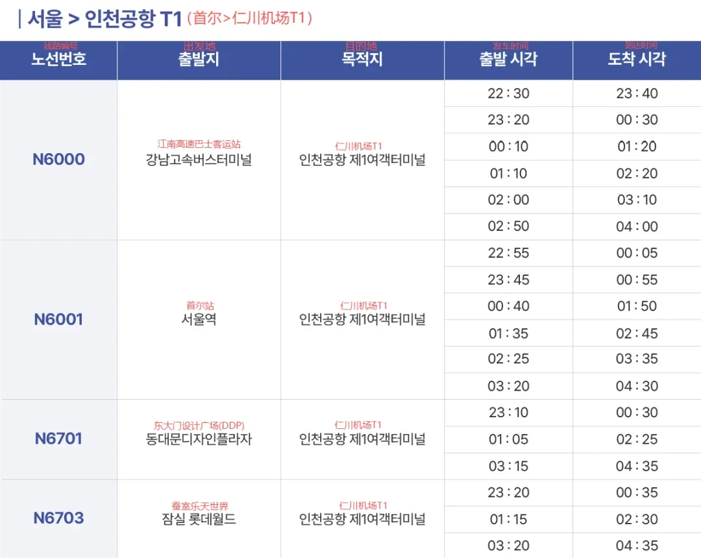
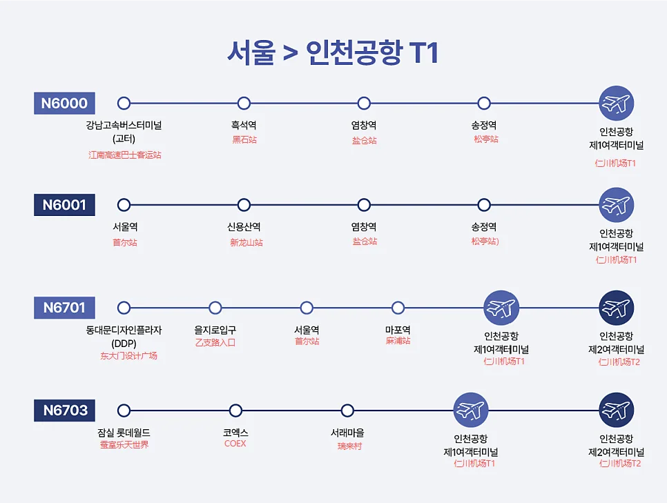
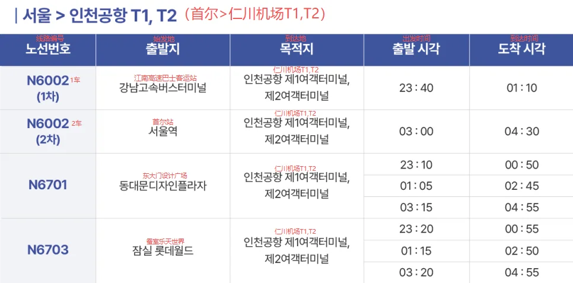
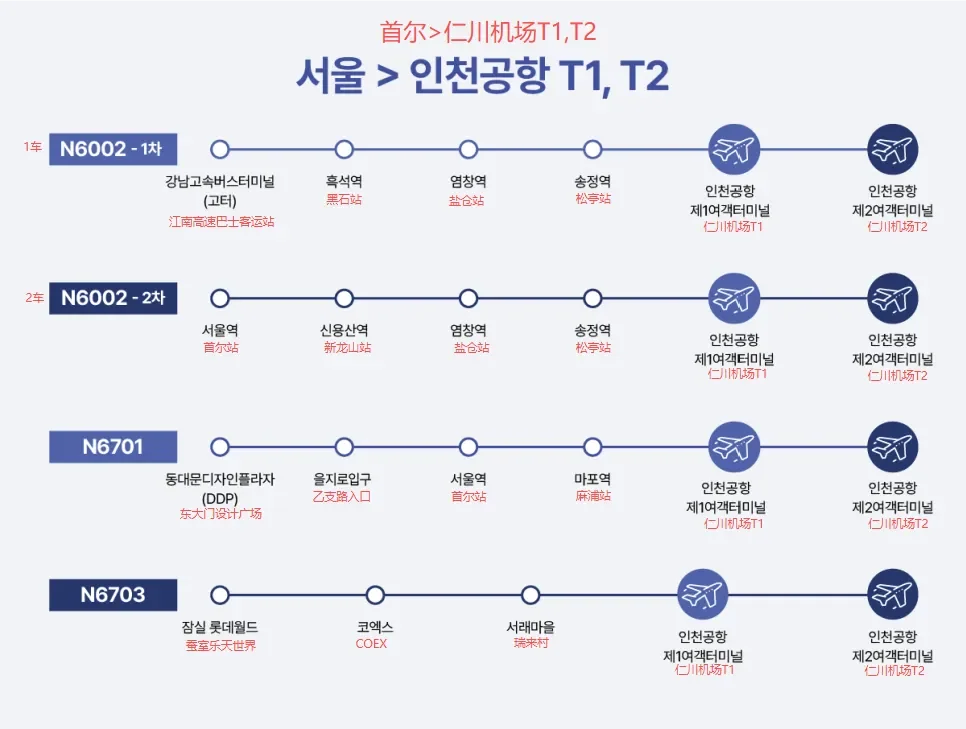

Si vous atterrissez tard à Incheon, ou partez sur un vol au petit matin, le métro est fermé et le taxi coûte cher — il reste donc les bus de nuit et le taxi. Les bus de la série N de l'aéroport d'Incheon relient le centre de Séoul aux deux terminaux, les tarifs se répartissent en deux tranches et les départs sont peu nombreux, mais chacun part à heure fixe.

Ce guide expose ce que fait chacune des cinq lignes, les tarifs, les points de départ à Séoul, les arrêts intermédiaires et l'endroit où chaque bus dépose à l'aéroport, avec l'horaire Séoul-aéroport retranscrit ci-dessous. Les vols de nuit, les correspondances nocturnes et les hôtels loin d'une station de métro posent tous la même question du dernier trajet de la journée. Une précision d'abord : ce contenu traite du sens Séoul-aéroport ; pour l'aéroport vers Séoul, utilisez la page des bus de nuit de l'aéroport.

## Ce que font les cinq lignes

Il existe cinq lignes de nuit, en deux groupes. N6000, N6001 et N6002 passent par Gangnam, Yongsan, Yeomchang et Songjeong au tarif le plus bas, desservant le sud-ouest de Séoul ; N6701 et N6703 partent de Dongdaemun et de la gare de Séoul en passant par Mapo, ou de Jamsil via COEX et Seorae Village, au tarif plus élevé, couvrant le nord-est et l'est de Gangnam. Les cinq circulent de la ville vers l'aéroport, les routes sont vides à cette heure-là, et les horaires donnent à peu près 70 à 90 minutes du premier arrêt au T1.

Les terminaux ne sont pas uniformes. N6000 ne dessert que le T1 ; N6001 dessert surtout le T1, avec quelques courses uniquement vers le T2 ; N6002 ne dessert que le T2 ; N6701 et N6703 desservent les deux. Vérifiez de quel terminal vous partez avant de monter — le T1 et le T2 sont séparés d'un arrêt de train, et changer entre eux la nuit n'est pas pratique. Les bagages vont dans la soute, en bas, et les chauffeurs descendent généralement pour aider ; arrivez quelques minutes en avance plutôt que de chercher la soute une fois le bus au trottoir.

## Tarifs : 10,000 ou 18,000 won

Le tarif dépend de la ligne, réparti en deux tranches distinctes.

| Ligne | Adulte | Enfant |
| --- | --- | --- |
| N6000, N6001, N6002 | 10,000 won | 8,000 won |
| N6701, N6703 | 18,000 won | 12,000 won |

Songjeong est l'exception : y monter coûte 5,000 won pour un adulte et 4,000 pour un enfant, car l'arrêt est presque à l'aéroport. Si vous logez vers Yeomchang ou Songjeong, monter à Songjeong permet une économie appréciable.

Les tarifs sont ceux publiés en octobre 2026 ; les changements suivent l'exploitant et l'aéroport. Achetez à la borne du quai, dans une supérette ou auprès du chauffeur — les pratiques varient, et les guichets sont généralement fermés à cette heure-là.

## Séoul vers l'aéroport : heures de départ

Les départs de Séoul sont fixes, à partir de dix heures et demie du soir et jusqu'à un dernier bus quittant la ville vers 03:20.

| Ligne | Point de départ à Séoul | Départ | Arrivée |
| --- | --- | --- | --- |
| N6000 | Gangnam Express Bus Terminal | 22:30 / 23:20 / 00:10 / 01:10 / 02:00 / 02:50 | T1 23:40 / 00:30 / 01:20 / 02:20 / 03:10 / 04:00 |
| N6001 | Gare de Séoul | 22:55 / 23:45 / 00:40 / 01:35 / 02:25 / 03:20 | T1 00:05 / 00:55 / 01:50 / 02:45 / 03:35 / 04:30 |
| N6002 (bus 1) | Gangnam Express Bus Terminal | 23:40 | T2 01:10 |
| N6002 (bus 2) | Gare de Séoul | 03:00 | T2 04:30 |
| N6701 | Dongdaemun Design Plaza (DDP) | 23:10 / 01:05 / 03:15 | T1 00:30 / 02:25 / 04:35 ; T2 00:50 / 02:45 / 04:55 |
| N6703 | Jamsil Lotte World | 23:20 / 01:15 / 03:20 | T1 00:35 / 02:30 / 04:35 ; T2 00:55 / 02:50 / 04:55 |

Deux détails comptent. Le même bus passe au T1 avant le T2, à environ 20 minutes d'intervalle : si vous allez au T2, prenez l'heure tardive. N6701 et N6703 ne circulent chacun que trois fois par nuit, et en manquer un signifie attendre presque deux heures — ne coupez pas les délais trop fin avant un vol.

Notez aussi que ces heures sont les départs du premier arrêt, et non des arrêts intermédiaires. Si vous montez en route, ajoutez de dix à vingt-cinq minutes selon la position de l'arrêt sur la ligne ; en cas de doute, cherchez l'arrêt sur le site de l'aéroport.

## Arrêts intermédiaires et points de dépose à l'aéroport

Au-delà des points de départ de Séoul, chaque ligne dessert quelques arrêts de plus, dans un ordre différent selon la ligne.

| Ligne | Arrêts à Séoul | Dépose à l'aéroport |
| --- | --- | --- |
| N6000 | Gangnam Express Bus Terminal → Heukseok → Yeomchang → Songjeong | T1, niveau 1, 6A |
| N6001 | Gare de Séoul → Sinyongsan → Yeomchang → Songjeong | T1, niveau 1, 6A ; certaines courses T2 B1, quai 24 |
| N6002 (bus 1) | Gangnam Express Bus Terminal → Heukseok → Yeomchang → Songjeong | T2 B1, quai 24 |
| N6002 (bus 2) | Gare de Séoul → Sinyongsan → Yeomchang → Songjeong | T2 B1, quai 24 |
| N6701 | DDP → Euljiro 1-ga → Gare de Séoul → Mapo | T1, niveau 3, 3B ; T2 B1, quai 18 |
| N6703 | Jamsil Lotte World → COEX → Seorae Village | T1, niveau 3, 3B ; T2 B1, quai 19 |

La dépose dépend du terminal. Au T1, 6A se trouve devant le hall des arrivées du niveau 1 et 3B sur la route des départs du niveau 3 ; au T2, le Transport Centre du B1 est l'échangeur, et les numéros de quai sont les numéros de porte. Suivez les panneaux du terminal après être descendu ; les comptoirs d'enregistrement sont au niveau des départs.

Au T2, le Transport Centre du B1 est partagé avec la ligne ferroviaire de l'aéroport, si bien que les quais de bus sont à côté des portiques du train. Au T1, le trottoir du niveau 1 est juste devant les arrivées, sans route à traverser.

## L'autre sens : de l'aéroport vers Séoul

Arriver et gagner la ville, c'est le trajet inverse, avec d'autres lignes et d'autres horaires. Ce guide ne couvre que Séoul vers l'aéroport ; pour les bus de nuit de l'aéroport vers la ville, utilisez le site de l'aéroport : Transport & Parking → Public Transport → Bus → Late-night Bus (Terminal 1) → Seoul late-night bus, à l'adresse [airport.kr/ap_ch/1702](https://www.airport.kr/ap_ch/1702/subview.do).

La page est organisée par terminal et présente les lignes, les heures de départ et les numéros de quai de la saison en cours, ce qui vaut mieux que n'importe quel résumé de seconde main. Déterminez d'abord si vous sortez du T1 ou du T2, puis faites correspondre le numéro de quai. Si vous manquez le dernier bus de nuit, le premier train de la ligne ferroviaire de l'aéroport part vers 05:15 : deux ou trois heures dans le terminal vous permettront donc encore de rejoindre la ville ; si c'est trop long, prenez un taxi.

## Quelques points à connaître la nuit

Les bus de nuit sont bien plus rares que les services de jour : la plupart des lignes circulent trois à six fois par nuit, N6002 seulement deux fois, et un bus manqué signifie souvent une heure d'attente ou plus. Si vous atterrissez près du dernier départ, comptez l'immigration et les bagages pendant que vous êtes encore dans l'avion ; manquez-le et le taxi reste la seule option.

Le taxi est le recours. De l'aéroport d'Incheon au centre de Séoul, il se paie au compteur à la distance avec une majoration de nuit, nettement plus cher que le bus, mais de porte à porte et sans attente. Pour un groupe de trois ou quatre avec bagages, le taxi revient souvent moins cher par personne.

Deux derniers points. Le paiement dans les lignes de nuit varie, alors ayez de l'espèce ou une carte de transport prête avant de monter ; les annonces sont surtout en coréen, donc si vous n'êtes pas sûr de votre arrêt, notez le nom et montrez-le au chauffeur. Et si votre vol est retardé jusqu'au petit matin et que votre bus est parti, vérifiez sur le site s'il reste une course plus tardive avant de vous installer à un arrêt qui n'a peut-être plus de départ.

## Liens utiles

- **Sur ce site** : [Aéroport international d'Incheon (ICN)](/airport/ICN), [Corée du Sud (KR)](/country/KR)
- **Wikipédia** : [Aéroport international d'Incheon](https://en.wikipedia.org/wiki/Incheon_International_Airport)
- **Baidu Baike** : [Aéroport international d'Incheon](https://baike.baidu.com/item/%E4%BB%81%E5%B7%9D%E5%9B%BD%E9%99%85%E6%9C%BA%E5%9C%BA)

Les tarifs et horaires suivent les publications officielles de l'aéroport d'Incheon (octobre 2026) ; les avis en vigueur de l'aéroport priment. Crédit image : blog officiel de l'aéroport d'Incheon.
