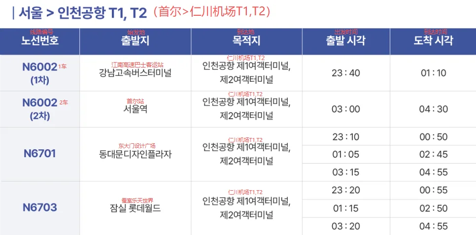
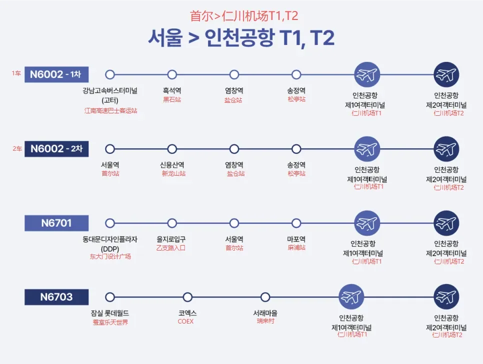

Po przylocie do Incheon późną nocą albo przy wylocie lotem w środku nocy metro jest zamknięte, a taksówka droga — zostają nocne autobusy i taksówka. Nocne autobusy serii N na lotnisku Incheon łączą centrum Seulu z oboma terminalami, opłaty dzielą się na dwa przedziały, a kursów jest niewiele, ale każdy odjeżdża o ustalonej godzinie.

Ten przewodnik opisuje, co robi każda z pięciu tras, jakie są opłaty, punkty odjazdu w Seulu, przystanki pośrednie i gdzie każdy autobus wysadza pasażerów na lotnisku, a poniżej zamieszczono rozkład jazdy z Seulu na lotnisko. Loty nocne, przesiadki przez noc i hotele daleko od stacji metra sprowadzają się do tego samego pytania o ostatnią podróż dnia. Najpierw jedna uwaga: ten materiał dotyczy kierunku z Seulu na lotnisko; w drugą stronę skorzystaj ze strony lotniska poświęconej nocnym autobusom.

## Jak kursuje pięć tras

Istnieje pięć tras nocnych, podzielonych na dwie grupy. N6000, N6001 i N6002 kursują przez Gangnam, Yongsan, Yeomchang i Songjeong po niższej opłacie, obsługując południowo-zachodnią część Seulu; N6701 i N6703 jadą z Dongdaemun i dworca Seul przez Mapo albo z Jamsil przez COEX i Seorae Village po wyższej opłacie, obejmując północny wschód i wschodnią stronę Gangnamu. Wszystkie pięć tras kursuje z miasta w stronę lotniska; o tej porze drogi są puste, a rozkłady przewidują około 70–90 minut od pierwszego przystanku do T1.

Terminale nie są obsługiwane jednolicie. N6000 zatrzymuje się tylko na T1; N6001 przeważnie obsługuje T1, a niektóre kursy jadą wyłącznie do T2; N6002 obsługuje tylko T2; N6701 i N6703 obsługują oba terminale. Przed wejściem do autobusu sprawdź, z którego terminala lecisz — T1 i T2 dzieli jedna stacja kolei, a przesiadka między nimi w nocy nie jest wygodna. Bagaż wkłada się do luku bagażowego pod autobusem, a kierowcy zwykle wysiadają, żeby pomóc; przyjdź kilka minut wcześniej, zamiast szukać luku, gdy autobus stoi już przy krawężniku.

## Opłaty: 10 000 lub 18 000 wonów

Opłata zależy od trasy i dzieli się na dwa przedziały wyraźnie różniące się wysokością.

| Trasa | Dorośli | Dzieci |
| --- | --- | --- |
| N6000, N6001, N6002 | 10 000 wonów | 8000 wonów |
| N6701, N6703 | 18 000 wonów | 12 000 wonów |

Songjeong jest wyjątkiem: wsiadanie tam kosztuje 5000 wonów za osobę dorosłą i 4000 wonów za dziecko, ponieważ przystanek znajduje się niemal przy lotnisku. Jeśli zatrzymujesz się w okolicy Yeomchang lub Songjeong, wsiadanie na Songjeong pozwala sporo zaoszczędzić.

Opłaty są zgodne z publikacją z października 2026 r.; zmiany zależą od przewoźnika i lotniska. Bilet kupisz w automacie na peronie, w sklepie całodobowym lub u kierowcy — praktyka bywa różna, a kasy biletowe o tej porze są zwykle zamknięte.

## Z Seulu na lotnisko: godziny odjazdu

Odjazdy z Seulu są o stałych godzinach, począwszy od kursów po 22:30, a ostatni autobus wyjeżdża z miasta około 03:20.

| Trasa | Punkt odjazdu w Seulu | Odjazd | Przyjazd |
| --- | --- | --- | --- |
| N6000 | Terminal autobusów ekspresowych Gangnam | 22:30 / 23:20 / 00:10 / 01:10 / 02:00 / 02:50 | T1 23:40 / 00:30 / 01:20 / 02:20 / 03:10 / 04:00 |
| N6001 | Dworzec Seul | 22:55 / 23:45 / 00:40 / 01:35 / 02:25 / 03:20 | T1 00:05 / 00:55 / 01:50 / 02:45 / 03:35 / 04:30 |
| N6002 (kurs 1) | Terminal autobusów ekspresowych Gangnam | 23:40 | T2 01:10 |
| N6002 (kurs 2) | Dworzec Seul | 03:00 | T2 04:30 |
| N6701 | Dongdaemun Design Plaza (DDP) | 23:10 / 01:05 / 03:15 | T1 00:30 / 02:25 / 04:35; T2 00:50 / 02:45 / 04:55 |
| N6703 | Jamsil Lotte World | 23:20 / 01:15 / 03:20 | T1 00:35 / 02:30 / 04:35; T2 00:55 / 02:50 / 04:55 |

Dwa szczegóły są istotne. Ten sam autobus zatrzymuje się najpierw na T1, a około 20 minut później na T2, więc jeśli jedziesz na T2, kieruj się późniejszą godziną. N6701 i N6703 kursują tylko trzy razy w nocy, a pominięcie jednego kursu oznacza prawie dwie godziny czekania — nie zostawiaj sobie zbyt mało czasu przed lotem.

Pamiętaj też, że podane godziny dotyczą odjazdu z pierwszego przystanku, a nie z przystanków pośrednich. Wsiadając po drodze, dolicz od dziesięciu do dwudziestu pięciu minut w zależności od tego, jak daleko na trasie znajduje się przystanek; w razie wątpliwości sprawdź przystanek na stronie lotniska.

## Przystanki pośrednie i miejsca wysiadania na lotnisku

Poza punktami odjazdu w Seulu każda trasa zatrzymuje się na kilku dodatkowych przystankach, w innej kolejności na każdej linii.

| Trasa | Przystanki w Seulu | Miejsce wysiadania na lotnisku |
| --- | --- | --- |
| N6000 | Terminal autobusów ekspresowych Gangnam → Heukseok → Yeomchang → Songjeong | T1, poziom 1, 6A |
| N6001 | Dworzec Seul → Sinyongsan → Yeomchang → Songjeong | T1, poziom 1, 6A; część kursów: T2, B1, stanowisko 24 |
| N6002 (kurs 1) | Terminal autobusów ekspresowych Gangnam → Heukseok → Yeomchang → Songjeong | T2, B1, stanowisko 24 |
| N6002 (kurs 2) | Dworzec Seul → Sinyongsan → Yeomchang → Songjeong | T2, B1, stanowisko 24 |
| N6701 | DDP → Euljiro 1-ga → Dworzec Seul → Mapo | T1, poziom 3, 3B; T2, B1, stanowisko 18 |
| N6703 | Jamsil Lotte World → COEX → Seorae Village | T1, poziom 3, 3B; T2, B1, stanowisko 19 |

Miejsce wysiadania zależy od terminala. Na T1 przystanek 6A znajduje się przed halą przylotów na poziomie 1, a 3B przy drodze odlotów na poziomie 3; na T2 węzłem przesiadkowym jest Centrum Transportu na poziomie B1, a numery stanowisk to numery drzwi. Po wysiadaniu kieruj się oznaczeniami terminala; stanowiska odprawy znajdują się na poziomie odlotów.

Na T2 Centrum Transportu na poziomie B1 jest wspólne z koleją lotniskową, więc stanowiska autobusów znajdują się obok bramek kolejowych. Na T1 krawężnik na poziomie 1 jest tuż przed halą przylotów, nie trzeba przechodzić przez jezdnię.

## W drugą stronę: z lotniska do Seulu

Przylot i podróż do miasta to podróż w przeciwnym kierunku, z innymi trasami i innymi godzinami. Ten przewodnik obejmuje wyłącznie kierunek z Seulu na lotnisko; w sprawie nocnych autobusów z lotniska do miasta skorzystaj ze strony lotniska: Transport i parking → Transport publiczny → Autobus → Nocny autobus (terminal 1) → Nocny autobus do Seulu, pod adresem [airport.kr/ap_ch/1702](https://www.airport.kr/ap_ch/1702/subview.do).

Strona jest uporządkowana według terminali i zawiera trasy, godziny odjazdu oraz numery stanowisk aktualne w danym sezonie, co jest lepsze od wszelkich wtórnych zestawień. Najpierw ustal, czy wychodzisz z T1, czy z T2, a następnie dopasuj numer stanowiska. Jeśli przegapisz ostatni nocny autobus, pierwszy pociąg kolei lotniskowej odjeżdża około 05:15, więc dwie lub trzy godziny spędzone na terminalu nadal pozwolą ci dotrzeć do miasta; jeśli to zbyt długo, weź taksówkę.

## Kilka rzeczy, które warto wiedzieć w nocy

Nocne autobusy kursują znacznie rzadziej niż dzienne: większość tras ma od trzech do sześciu kursów w nocy, N6002 tylko dwa, a przegapiony autobus oznacza często godzinę czekania lub więcej. Jeśli lądujesz tuż przed ostatnim odjazdem, uwzględnij czas na kontrolę imigracyjną i odbiór bagażu, jeszcze będąc w samolocie; jeśli go przegapisz, pozostanie tylko taksówka.

Taksówka jest rozwiązaniem awaryjnym. Podróż z lotniska Incheon do centrum Seulu jest rozliczana według taksometru na podstawie odległości, z nocną dopłatą; jest wyraźnie droższa niż autobus, ale dowozi od drzwi do drzwi i nie trzeba czekać. Dla grupy trzech lub czterech osób z bagażem taksówka często wychodzi taniej na osobę.

Dwie ostatnie uwagi. Płatności na trasach nocnych bywają różne, więc przed wejściem przygotuj gotówkę lub kartę transportową; komunikaty są przeważnie po koreańsku, więc jeśli nie masz pewności co do przystanku, zapisz jego nazwę i pokaż kierowcy. Jeśli lot opóźni się do późnej nocy i twój autobus już odjedzie, sprawdź na stronie, czy jest późniejszy kurs, zanim rozgościsz się na przystanku, z którego może już nie być odjazdów.

## Powiązane linki

- **Na tej stronie**: [Międzynarodowe Lotnisko Incheon (ICN)](/airport/ICN), [Korea Południowa (KR)](/country/KR)
- **Wikipedia**: [Międzynarodowe Lotnisko Incheon](https://en.wikipedia.org/wiki/Incheon_International_Airport)
- **Baidu Baike**: [Międzynarodowe Lotnisko Incheon](https://baike.baidu.com/item/%E4%BB%81%E5%B7%9D%E5%9B%BD%E9%99%85%E6%9C%BA%E5%9C%BA)

Opłaty i godziny podano na podstawie oficjalnych publikacji lotniska Incheon (październik 2026 r.); decydujące są aktualne komunikaty lotniska. Źródło zdjęcia: oficjalny blog lotniska Incheon.
