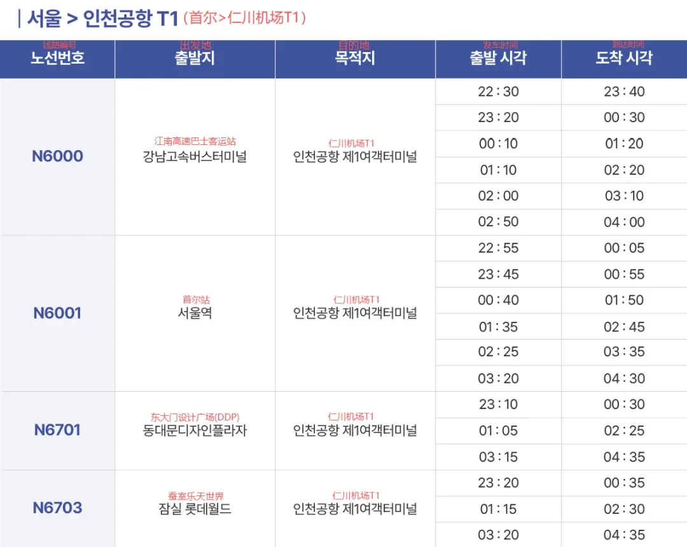
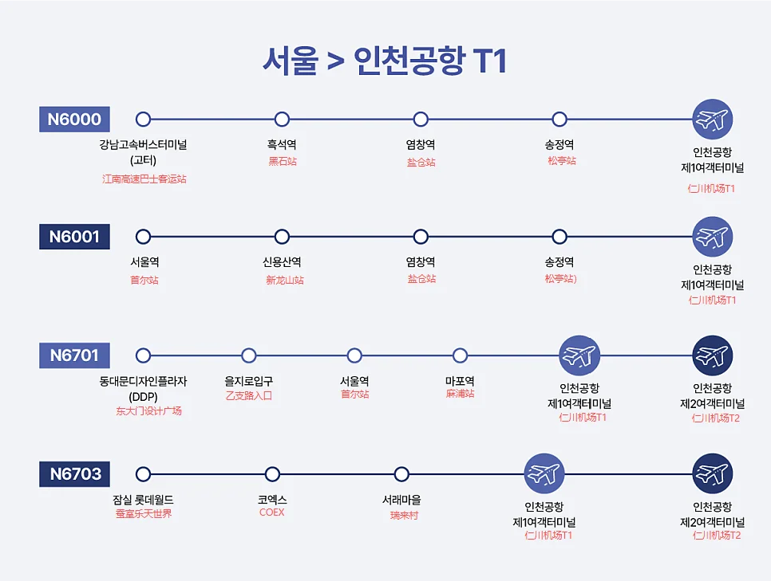

Landar du i Incheon sent på kvällen, eller reser du med ett flyg som går mitt i natten, är tunnelbanan stängd och taxin dyr – då återstår nattbussarna och taxin. Incheon Airports N-seriebussar förbinder centrala Seoul med båda terminalerna, biljettpriserna ligger i två prisklasser och avgångarna är få – men alla går vid en fast tid.

Den här guiden går igenom vad var och en av de fem linjerna täcker, biljettpriserna, avgångsplatserna i Seoul, mellanhållplatserna och var varje buss släpper av vid flygplatsen, med tidtabellen Seoul–flygplatsen återgiven nedan. Nattflyg, byten över natten och hotell långt från en tunnelbanestation leder alla fram till samma fråga om dagens sista resa. En sak först: materialet här gäller riktningen Seoul–flygplatsen; för flygplatsen–Seoul använder du flygplatsens egen sida om nattbussar.

## Vad de fem linjerna täcker

Det finns fem nattlinjer, i två grupper. N6000, N6001 och N6002 går genom Gangnam, Yongsan, Yeomchang och Songjeong med det lägre biljettpriset och trafikerar sydvästra Seoul; N6701 och N6703 går från Dongdaemun och Seoul Station genom Mapo, eller från Jamsil genom COEX och Seorae Village, med det högre biljettpriset och täcker nordöstra Seoul och östra sidan av Gangnam. Alla fem går från staden mot flygplatsen, vägarna är tomma vid den tiden och enligt tidtabellerna tar resan ungefär 70–90 minuter från första hållplatsen till T1.

Terminaltillhörigheten varierar. N6000 trafikerar endast T1; N6001 trafikerar mestadels T1, med vissa avgångar endast till T2; N6002 trafikerar endast T2; N6701 och N6703 trafikerar båda. Kontrollera vilken terminal du flyger från innan du går ombord – T1 och T2 ligger ett tågstopp från varandra, och att byta mellan dem på natten är inte smidigt. Väskorna lastas i bagageutrymmet under bussen, och förarna brukar komma ut och hjälpa till; kom några minuter i förväg i stället för att leta efter bagageutrymmet när bussen redan står vid trottoarkanten.

## Priser: 10 000 won eller 18 000 won

Biljettpriset beror på linjen och ligger i två tydligt åtskilda prisklasser.

| Linje | Vuxen | Barn |
| --- | --- | --- |
| N6000, N6001, N6002 | 10 000 won | 8 000 won |
| N6701, N6703 | 18 000 won | 12 000 won |

Songjeong är undantaget: att stiga på där kostar 5 000 won för en vuxen och 4 000 för ett barn, eftersom hållplatsen ligger nästan vid flygplatsen. Om du bor runt Yeomchang eller Songjeong sparar du en rejäl slant genom att stiga på i Songjeong.

Priserna är de som publicerades i oktober 2026; ändringar följer operatören och flygplatsen. Köp biljett i automaten på hållplatsen, i en närbutik eller av föraren – rutinerna varierar, och biljettluckorna är vanligtvis stängda vid den tiden.

## Seoul till flygplatsen: avgångstider

Avgångarna från Seoul är fasta, med start efter halv elva på kvällen och med sista bussen ut ur staden omkring 03:20.

| Linje | Avgångsplats i Seoul | Avgår | Ankommer |
| --- | --- | --- | --- |
| N6000 | Gangnam Express Bus Terminal | 22:30 / 23:20 / 00:10 / 01:10 / 02:00 / 02:50 | T1 23:40 / 00:30 / 01:20 / 02:20 / 03:10 / 04:00 |
| N6001 | Seoul Station | 22:55 / 23:45 / 00:40 / 01:35 / 02:25 / 03:20 | T1 00:05 / 00:55 / 01:50 / 02:45 / 03:35 / 04:30 |
| N6002 (buss 1) | Gangnam Express Bus Terminal | 23:40 | T2 01:10 |
| N6002 (buss 2) | Seoul Station | 03:00 | T2 04:30 |
| N6701 | Dongdaemun Design Plaza (DDP) | 23:10 / 01:05 / 03:15 | T1 00:30 / 02:25 / 04:35; T2 00:50 / 02:45 / 04:55 |
| N6703 | Jamsil Lotte World | 23:20 / 01:15 / 03:20 | T1 00:35 / 02:30 / 04:35; T2 00:55 / 02:50 / 04:55 |

Två detaljer spelar roll. Samma buss stannar vid T1 före T2, och det är cirka 20 minuter mellan stoppen, så om du ska till T2 ska du använda den senare tiden. N6701 och N6703 går bara tre gånger per natt, och missar du en får du vänta nästan två timmar – chansa inte med tiden före ett flyg.

Observera också att tiderna är avgångstider från första hållplatsen, inte från mellanhållplatserna. Om du stiger på längs vägen lägger du till mellan tio och tjugofem minuter beroende på hur långt framme hållplatsen ligger; i tveksamma fall kan du slå upp hållplatsen på flygplatsens webbplats.

## Mellanhållplatser och avstigningsplatser på flygplatsen

Förutom avgångsplatserna i Seoul stannar varje linje vid ytterligare några hållplatser, i olika ordning på varje linje.

| Linje | Hållplatser i Seoul | Avstigning på flygplatsen |
| --- | --- | --- |
| N6000 | Gangnam Express Bus Terminal → Heukseok → Yeomchang → Songjeong | T1, plan 1, 6A |
| N6001 | Seoul Station → Sinyongsan → Yeomchang → Songjeong | T1, plan 1, 6A; vissa avgångar T2 B1, bussficka 24 |
| N6002 (buss 1) | Gangnam Express Bus Terminal → Heukseok → Yeomchang → Songjeong | T2 B1, bussficka 24 |
| N6002 (buss 2) | Seoul Station → Sinyongsan → Yeomchang → Songjeong | T2 B1, bussficka 24 |
| N6701 | DDP → Euljiro 1-ga → Seoul Station → Mapo | T1, plan 3, 3B; T2 B1, bussficka 18 |
| N6703 | Jamsil Lotte World → COEX → Seorae Village | T1, plan 3, 3B; T2 B1, bussficka 19 |

Avstigningsplatsen beror på terminalen. I T1 ligger 6A utanför ankomsthallen på plan 1 och 3B vid avgångarna på plan 3; i T2 är transportcentret på B1 knutpunkten, och bussfickornas nummer motsvarar dörrnumren. Följ terminalens skyltar när du har stigit av; incheckningsdiskarna ligger på avgångsplanet.

I T2 delar transportcentret på B1 utrymme med flygplatståget, så bussfickorna ligger intill tågspärrarna. I T1 ligger kantstenen på plan 1 direkt utanför ankomsten, utan någon väg att korsa.

## Den andra riktningen: flygplatsen till Seoul

Att landa och ta sig in till staden är den omvända resan, med andra linjer och andra tider. Den här guiden handlar bara om Seoul till flygplatsen; för nattbussar från flygplatsen till staden använder du flygplatsens webbplats: Transport & Parking → Public Transport → Bus → Late-night Bus (Terminal 1) → Seoul late-night bus, på [airport.kr/ap_ch/1702](https://www.airport.kr/ap_ch/1702/subview.do).

Sidan är ordnad efter terminal och innehåller säsongens aktuella linjer, avgångstider och bussfickenummer, vilket slår alla andrahandssammanfattningar. Ta först reda på om du kommer ut från T1 eller T2 och hitta sedan rätt bussficka. Om du missar den sista nattbussen går flygplatstågets första tåg omkring 05:15, så två eller tre timmar i terminalen tar dig fortfarande in till staden; om det är för länge kan du ta en taxi.

## Några saker att veta på natten

Nattbussarna är mycket glesare än dagtrafiken: de flesta linjer går tre till sex gånger per natt, N6002 bara två gånger, och en missad buss innebär ofta en timmes väntan eller mer. Om du landar nära den sista avgången bör du redan på planet räkna med passkontroll och bagage; missar du den är taxin enda alternativet.

Taxin är reservlösningen. Från Incheon Airport till centrala Seoul beräknas taxan efter avstånd med ett nattillägg, klart dyrare än bussen, men den går dörr till dörr utan väntan. För en grupp på tre eller fyra med bagage blir taxin ofta billigare per person.

Två sista punkter. Betalningen på nattlinjerna varierar, så ha kontanter eller ett resekort redo innan du går ombord; utropen är mestadels på koreanska, så om du är osäker på din hållplats kan du skriva ner namnet och visa föraren. Och om ditt flyg blir försenat till småtimmarna och din buss har gått, kontrollera webbplatsen för en senare avgång innan du slår dig ner vid en hållplats som kanske inte har fler avgångar.

## Relaterade länkar

- **På den här webbplatsen**: [Incheon International Airport (ICN)](/airport/ICN), [Sydkorea (KR)](/country/KR)
- **Wikipedia**: [Incheon International Airport](https://en.wikipedia.org/wiki/Incheon_International_Airport)
- **Baidu Baike**: [Incheon International Airport](https://baike.baidu.com/item/%E4%BB%81%E5%B7%9D%E5%9B%BD%E9%99%85%E6%9C%BA%E5%9C%BA)

Priserna och tiderna följer Incheon Airports officiella publikationer (oktober 2026); flygplatsens aktuella meddelanden gäller. Bildkredit: Incheon Airports officiella blogg.
