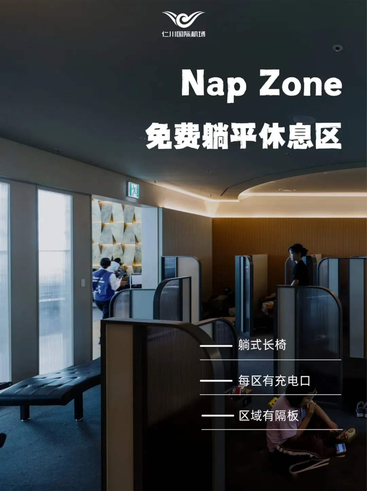
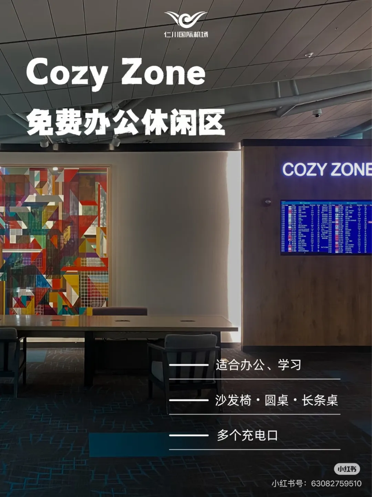
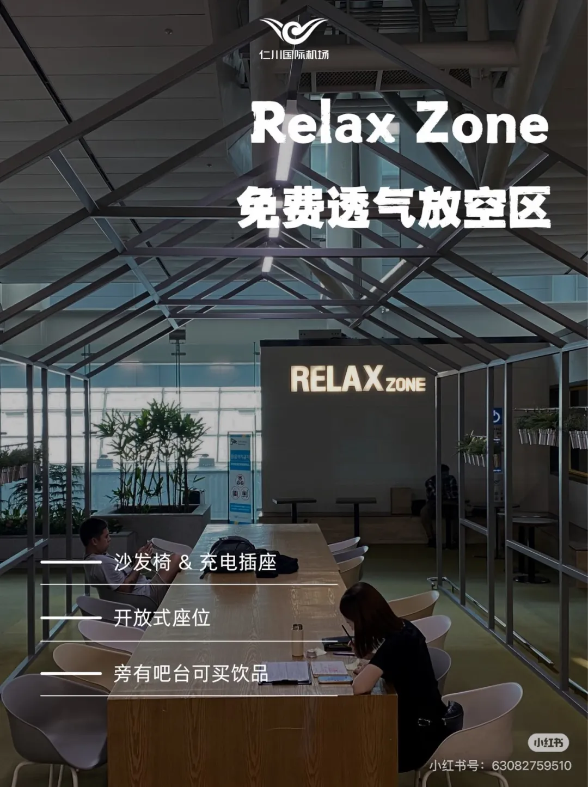
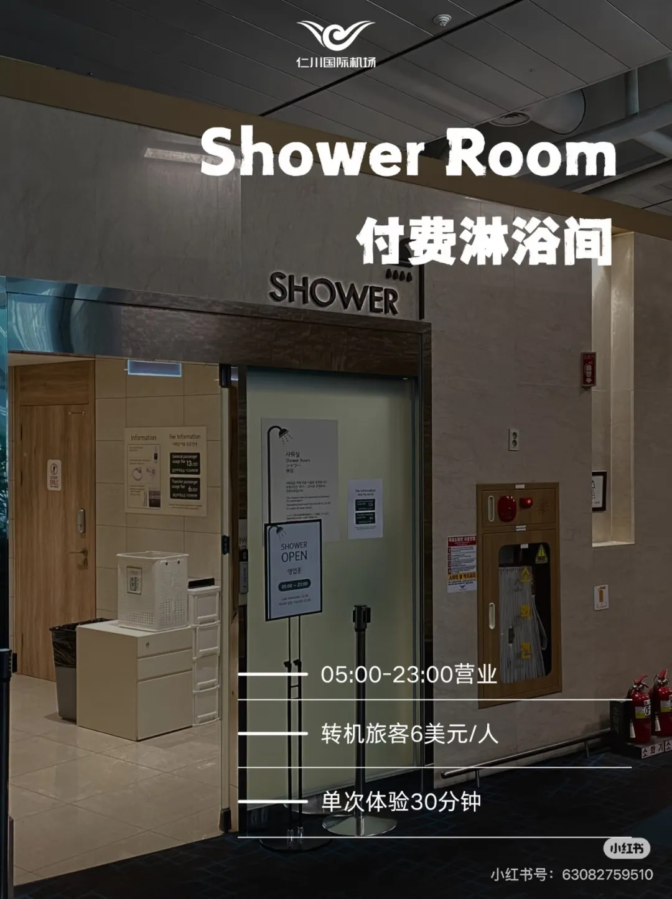

**Kostenloser 24-Stunden-Ruheleitfaden**

_RUHEN & ENTSPANNEN_

Bei einem Zwischenstopp in Incheon müssen Sie nichts ausgeben, um eine bequeme Ecke zum Hinlegen zu finden. Ob Sie nur für wenige Stunden umsteigen oder über Nacht bleiben: Sowohl T1 als auch T2 halten kostenlose Ruhebereiche rund um die Uhr geöffnet – und wenn Sie vor dem nächsten Flug duschen möchten, betreibt der Flughafen auch kostenpflichtige Duschräume.

Dieser Leitfaden behandelt die drei kostenlosen Bereiche (Nap-, Cozy- und Relax-Zone) und den kostenpflichtigen Duschraum: wo sich jeder befindet, was er bietet und wann er geöffnet ist. Es lohnt sich, diesen Leitfaden vor dem Flug zu speichern.

## Auf einen Blick: Welche der drei kostenlosen Zonen Sie wählen sollten

Alle liegen im vierten Stock (4F), nur wenige Gehminuten voneinander entfernt. Die einzige Frage ist, was Sie tun möchten:

| Zone | Wo | Am besten für |
| --- | --- | --- |
| Nap Zone | T1, 4F Ostseite, in der Nähe von Gate 25; T2, 4F Ostseite, in der Nähe von Gate 268 und 4F Westseite, in der Nähe von Gate 231 | Hinlegen und schlafen |
| Cozy Zone | T1, 4F Ostseite, Ruhebereich für Transitreisende | Arbeiten oder Lernen |
| Relax Zone | T1, 4F Westseite, in der Nähe von Gate 43 und 4F Ostseite, in der Nähe von Gate 11 | Frische Luft und ein Getränk |

## 01 Nap Zone: Der kostenlose Bereich zum Schlafen

Sie haben einen sehr langen Zwischenstopp und möchten sich flach hinlegen? Die kostenlosen Nap Zones des Flughafens stehen Ihnen offen, mit verstellbaren Liegebänken und Trennwänden zwischen den Kabinen für deutlich mehr Privatsphäre.

📍 T1, 4F Ostseite, in der Nähe von Gate 25

📍 T2, 4F Ostseite, in der Nähe von Gate 268

📍 T2, 4F Westseite, in der Nähe von Gate 231

👉 **Das Erlebnis**: verstellbare Liegebänke mit Trennwänden zwischen den Kabinen für deutlich mehr Privatsphäre.

💡 **Ausstattung**: Jede Zone hat Steckdosen – koreanische Rundstiftbuchsen, bringen Sie also einen Adapter mit.

💡 **Warm bleiben**: Decken Sie sich mit einem dicken Mantel oder einer Decke zu, bevor Sie einschlafen.

## 02 Cozy Zone: Der Bereich zum Arbeiten und Lernen

Für Transitreisende, die arbeiten oder lernen müssen, ist dies die richtige Wahl. Die Cozy Zone ist offen gestaltet, mit Sofasesseln und runden Tischen sowie langen Schreibtischen mit Steckdosen, und Sitzplätze sind normalerweise verfügbar. 24 Stunden lang kostenlos geöffnet.

📍 **Wo**: T1, 4F Ostseite, Ruhebereich für Transitreisende.

✨ Offene Gestaltung mit Sofasesseln und runden Tischen sowie langen Schreibtischen mit Steckdosen.

✨ Sitzplätze sind normalerweise verfügbar; 24 Stunden lang kostenlos geöffnet.

## 03 Relax Zone: Sofas und Raum zum Durchatmen

Ebenfalls ein kostenloser, 24 Stunden lang geöffneter Bereich mit Sofasesseln, Steckdosen und ausgezeichneter Luftzirkulation; die Bar nebenan verkauft Getränke. Wenn Sie sich ein wenig bewegen möchten, ist er besser als die Sitzplätze am Gate.

📍 T1, 4F Westseite, in der Nähe von Gate 43

📍 T1, 4F Ostseite, in der Nähe von Gate 11

## 04 Duschraum: Kostenpflichtig und nicht rund um die Uhr geöffnet

Sie haben einen langen Zwischenstopp und möchten sich frisch machen? Beide Terminals verfügen über **kostenpflichtige Duschräume** neben den Nap Zones, die in Einheiten von 30 Minuten angeboten werden. Beachten Sie, dass sie nicht 24 Stunden geöffnet sind – letzter Einlass ist 22:30 Uhr.

⭐ **Wo**:

📍 T1, 4F Ostseite, in der Nähe von Gate 25

📍 T1, 4F Westseite, in der Nähe von Gate 29

📍 T2, 4F Ostseite, in der Nähe von Gate 268

📍 T2, 4F Westseite, in der Nähe von Gate 231

💰 **Preis**: 6 USD pro Transitreisenden (Karte oder Bargeld), für 30 Minuten – Verlängerung wird zusätzlich berechnet.

⏰ **Öffnungszeiten**: 05:00–23:00 Uhr. Die Duschräume sind _nicht_ rund um die Uhr geöffnet; letzter Einlass ist 22:30 Uhr.

🧴 **Ausstattung**: Duschgel, Shampoo und Conditioner, Zahnbürste und Zahnpasta, Haartrockner.

## Tipps für den Zwischenstopp

- Prüfen Sie zuerst, in welchem Terminal Sie sind: Alle drei kostenlosen Zonen und die Duschräume gibt es sowohl in T1 als auch in T2, aber an unterschiedlichen Gates.
- Bringen Sie einen Steckdosenadapter mit – die meisten Buchsen sind koreanische Rundstiftbuchsen, und Sie werden ihn zum Laden und für den Haartrockner brauchen.
- Wenn Sie schlafen möchten, halten Sie Ihren dicken Mantel oder Ihre Decke in Reichweite, damit Ihnen über Nacht nicht kalt wird.
- Planen Sie die Dusche im Voraus: Letzter Einlass ist 22:30 Uhr, daher ist es bei einem knappen Anschluss sicherer, zuerst zu duschen und danach zu ruhen.

_💡 Ein Tipp: Wenn Ihr Zwischenstopp lang ist, planen Sie Ihre Ruhe- und Duschzeiten im Voraus und bringen Sie einen Steckdosenadapter mit. Genießen Sie Ihren Zwischenstopp!_

## Weiterführende Links

- **Auf dieser Website**: [Incheon International Airport (ICN)](/airport/ICN), [Südkorea (KR)](/country/KR)
- **Wikipedia**: [Incheon International Airport](https://en.wikipedia.org/wiki/Incheon_International_Airport)
- **Baidu Baike**: [Incheon International Airport](https://baike.baidu.com/item/%E4%BB%81%E5%B7%9D%E5%9B%BD%E9%99%85%E6%9C%BA%E5%9C%BA)

Quelle: Der offizielle Xiaohongshu-Account des Incheon Airport
