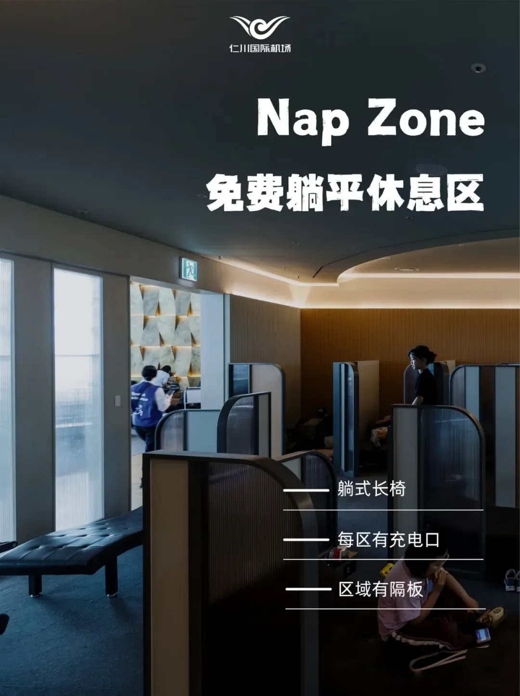
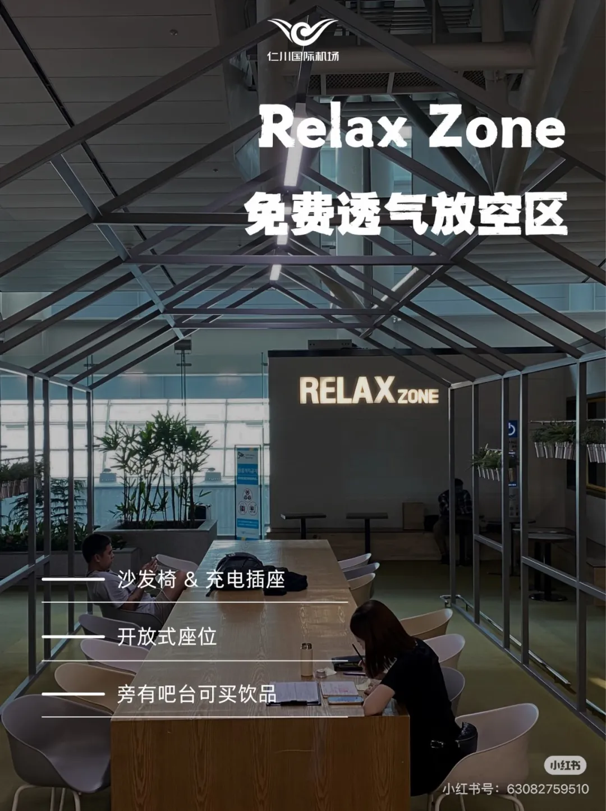
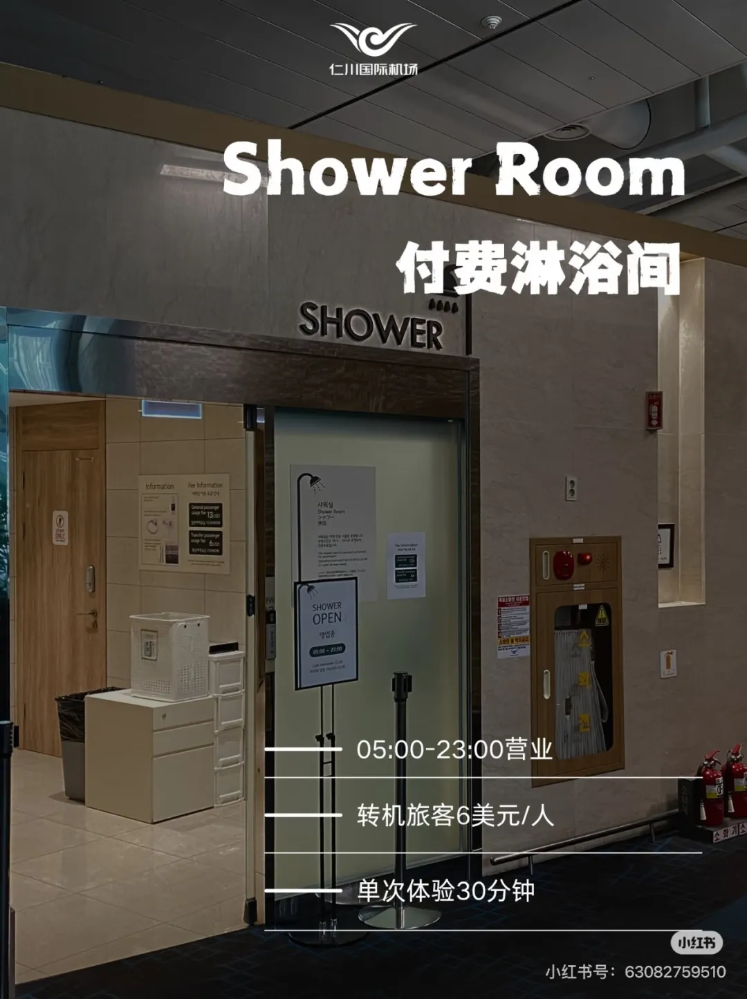

**Бесплатный гид по отдыху: 24 часа в сутки**

_ОТДЫХ И РЕЛАКСАЦИЯ_

При пересадке в Инчхоне не нужно ничего тратить, чтобы найти уютный уголок и прилечь. Будь то стыковка на несколько часов или ночь в аэропорту, и T1, и T2 держат бесплатные зоны отдыха открытыми круглосуточно — а если перед следующим рейсом хочется принять душ, в аэропорту есть и платные душевые.

Этот гид охватывает три бесплатные зоны (Nap, Cozy и Relax) и платную душевую: где каждая находится, что предлагает и когда открыта. Стоит сохранить перед полётом.

## Сразу к делу: какую из трёх бесплатных зон выбрать

Все они находятся на четвёртом этаже (4F), в нескольких минутах ходьбы друг от друга. Вопрос только в том, что вы хотите делать:

| Зона | Где | Для чего лучше |
| --- | --- | --- |
| Nap Zone | T1, 4F, восточная сторона, рядом с выходом 25; T2, 4F, восточная сторона, рядом с выходами 268 и 4F, западная сторона, рядом с выходом 231 | Прилечь поспать |
| Cozy Zone | T1, 4F, восточная сторона, транзитная зона отдыха | Работа или учёба |
| Relax Zone | T1, 4F, западная сторона, рядом с выходом 43, и 4F, восточная сторона, рядом с выходом 11 | Свежий воздух и напиток |

## 01 Nap Zone: бесплатная зона, созданная для сна

Очень долгая пересадка и хочется лечь? Бесплатные Nap Zone аэропорта открыты для вас: там есть лежаки с регулируемой спинкой и перегородки между местами, дающие гораздо больше приватности.

📍 T1, 4F, восточная сторона, рядом с выходом 25

📍 T2, 4F, восточная сторона, рядом с выходом 268

📍 T2, 4F, западная сторона, рядом с выходом 231

👉 **Впечатления**: лежаки с регулируемой спинкой и перегородки между местами для гораздо большей приватности.

💡 **Удобства**: в каждой зоне есть розетки — корейские круглые штырьки, поэтому возьмите переходник.

💡 **Оставайтесь в тепле**: прежде чем заснуть, укройтесь плотным пальто или пледом.

## 02 Cozy Zone: зона для работы и учёбы

Транзитным пассажирам, которым нужно работать или учиться, стоит выбрать именно её. Cozy Zone — открытое пространство с диванными креслами и круглыми столами, а также длинными столами с розетками; места обычно есть. Открыто бесплатно 24 часа.

📍 **Где**: T1, 4F, восточная сторона, транзитная зона отдыха.

✨ Открытое пространство с диванными креслами и круглыми столами, а также длинными столами с розетками.

✨ Места обычно есть; открыто бесплатно 24 часа.

## 03 Relax Zone: диваны и место, чтобы подышать

Тоже бесплатная открытая зона 24 часа с диванными креслами, розетками и отличной циркуляцией воздуха; бар рядом продаёт напитки. Если хочется встать и немного размяться, она лучше сидений у выхода.

📍 T1, 4F, западная сторона, рядом с выходом 43

📍 T1, 4F, восточная сторона, рядом с выходом 11

## 04 Душевая: платная и не круглосуточная

Долгая пересадка и хочется освежиться? В обоих терминалах есть **платные душевые** рядом с Nap Zone, продаются сеансы по 30 минут. Обратите внимание: они работают не 24 часа в сутки — последний вход в 22:30.

⭐ **Где**:

📍 T1, 4F, восточная сторона, рядом с выходом 25

📍 T1, 4F, западная сторона, рядом с выходом 29

📍 T2, 4F, восточная сторона, рядом с выходом 268

📍 T2, 4F, западная сторона, рядом с выходом 231

💰 **Цена**: 6 долларов США с транзитного пассажира (карта или наличные) за 30 минут — за превышение времени берут отдельно.

⏰ **Часы работы**: 05:00–23:00. Душевые _не_ работают круглосуточно; последний вход в 22:30.

🧴 **Предоставляется**: гель для душа, шампунь и кондиционер, зубная щётка и паста, фен.

## Советы при пересадке

- Сначала проверьте, в каком терминале вы находитесь: все три бесплатные зоны и душевые есть и в T1, и в T2, но у разных выходов.
- Возьмите переходник для вилки — большинство розеток корейские с круглыми штырьками, и он понадобится для зарядки и фена.
- Если планируете спать, держите плотное пальто или плед под рукой, чтобы не замёрзнуть ночью.
- Планируйте душ заранее: последний вход в 22:30, поэтому при короткой стыковке надёжнее сначала принять душ, а потом отдохнуть.

_💡 Совет: если пересадка долгая, заранее спланируйте время отдыха и душа и возьмите переходник. Приятной стыковки!_

## Полезные ссылки

- **На этом сайте**: [Международный аэропорт Инчхон (ICN)](/airport/ICN), [Южная Корея (KR)](/country/KR)
- **Википедия**: [Международный аэропорт Инчхон](https://en.wikipedia.org/wiki/Incheon_International_Airport)
- **Baidu Baike**: [Международный аэропорт Инчхон](https://baike.baidu.com/item/%E4%BB%81%E5%B7%9D%E5%9B%BD%E9%99%85%E6%9C%BA%E5%9C%BA)
