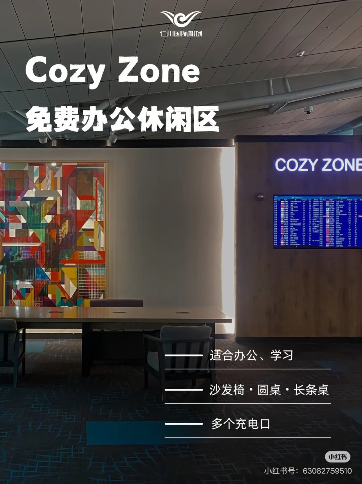

**Mwongozo wa kupumzika bila malipo saa 24**

_PUMZIKA NA UTULIE_

Ukiwa kwenye mapumziko ya safari Incheon, huna haja ya kutumia chochote kupata kona ya starehe na kulala. Iwe unaunganisha safari kwa saa chache au unakaa usiku kucha, T1 na T2 zote huweka maeneo ya kupumzika bila malipo wazi saa 24 — na ikiwa unataka kuoga kabla ya ndege inayofuata, uwanja wa ndege pia una Vyumba vya Kuoga vinavyolipiwa.

Mwongozo huu unahusu maeneo matatu ya bure (Kanda za Nap, Cozy na Relax) na Chumba cha Kuoga kinacholipiwa: kila kimoja kilipo, kinachotoa na lini hufunguliwa. Inafaa kuuhifadhi kabla ya kusafiri.

## Kwa mtazamo wa haraka: kanda ipi ya bure kati ya tatu uchague

Zote ziko kwenye ghorofa ya nne (4F), zenye umbali wa dakika chache za kutembea. Swali pekee ni unataka kufanya nini:

| Kanda | Mahali | Bora kwa |
| --- | --- | --- |
| Kanda ya Nap | T1, upande wa mashariki wa 4F, karibu na lango 25; T2, upande wa mashariki wa 4F, karibu na lango 268 na upande wa magharibi wa 4F, karibu na lango 231 | Kulala chali |
| Kanda ya Cozy | T1, upande wa mashariki wa 4F, eneo la mapumziko la usafiri wa kuunganisha | Kufanya kazi au kusoma |
| Kanda ya Relax | T1, upande wa magharibi wa 4F, karibu na lango 43 na upande wa mashariki wa 4F, karibu na lango 11 | Hewa safi na kinywaji |

## 01 Kanda ya Nap: eneo la bure lililoundwa kwa ajili ya kulala

Una mapumziko marefu sana ya safari na unataka kulala chali? Kanda za Nap za bure za uwanja wa ndege ziko wazi kwako, zikiwa na viti vya kuegemea na vizuizi kati ya maeneo kwa faragha zaidi.

📍 T1, upande wa mashariki wa 4F, karibu na lango 25

📍 T2, upande wa mashariki wa 4F, karibu na lango 268

📍 T2, upande wa magharibi wa 4F, karibu na lango 231

👉 **Uzoefu**: viti vya kuegemea, vyenye vizuizi kati ya maeneo kwa faragha zaidi.

💡 **Vifaa**: kila kanda ina soketi za umeme — soketi za Kikorea zenye pini za mviringo, kwa hivyo lete adapta.

💡 **Kaa joto**: jifunike kwa koti nene au blanketi kabla ya kulala.

## 02 Kanda ya Cozy: eneo la kufanyia kazi na kusoma

Kwa abiria wa safari za kuunganisha wanaohitaji kufanya kazi au kusoma, hii ndiyo ya kuchagua. Kanda ya Cozy haina kuta za kugawanya, ikiwa na viti vya sofa na meza za mviringo pamoja na madawati marefu yenye soketi za umeme, na kwa kawaida viti hupatikana. Iko wazi bila malipo saa 24.

📍 **Mahali**: T1, upande wa mashariki wa 4F, eneo la mapumziko la usafiri wa kuunganisha.

✨ Bila kuta za kugawanya, ikiwa na viti vya sofa na meza za mviringo, pamoja na madawati marefu yenye soketi za umeme.

✨ Viti kwa kawaida hupatikana; iko wazi bila malipo saa 24.

## 03 Kanda ya Relax: sofa na nafasi ya kupumua

Pia ni eneo la bure lililo wazi saa 24, lenye viti vya sofa na soketi za umeme na mzunguko bora wa hewa; baa iliyo karibu huuza vinywaji. Ikiwa unataka kusimama na kuzunguka kidogo, ni bora kuliko viti vya kwenye malango.

📍 T1, upande wa magharibi wa 4F, karibu na lango 43

📍 T1, upande wa mashariki wa 4F, karibu na lango 11

## 04 Chumba cha Kuoga: kinacholipiwa, na hakifunguliwi saa 24

Una mapumziko marefu ya safari na ungependa kujiburudisha? Vituo vyote viwili vina **Vyumba vya Kuoga vinavyolipiwa** karibu na Kanda za Nap, vinavyouzwa kwa vipindi vya dakika 30. Kumbuka kwamba havifunguliwi saa 24 — muda wa mwisho wa kuingia ni 22:30.

⭐ **Mahali**:

📍 T1, upande wa mashariki wa 4F, karibu na lango 25

📍 T1, upande wa magharibi wa 4F, karibu na lango 29

📍 T2, upande wa mashariki wa 4F, karibu na lango 268

📍 T2, upande wa magharibi wa 4F, karibu na lango 231

💰 **Bei**: dola 6 za Marekani kwa abiria wa safari ya kuunganisha (kadi au fedha taslimu), kwa dakika 30 — muda wa ziada hutozwa ada ya nyongeza.

⏰ **Saa za kufungua**: 05:00–23:00. Vyumba vya Kuoga _havifunguliwi_ saa 24; muda wa mwisho wa kuingia ni 22:30.

🧴 **Vinavyotolewa**: sabuni ya mwili, sabuni ya nywele, kondisha, mswaki na dawa ya meno, kikausha nywele.

## Vidokezo vya mapumziko ya safari

- Angalia kwanza uko kituo gani: kanda zote tatu za bure na vyumba vya kuoga viko T1 na T2, lakini kwenye malango tofauti.
- Lete adapta ya plagi — soketi nyingi ni za Kikorea zenye pini za mviringo, na utaihitaji kwa kuchaji na kwa kikausha nywele.
- Ikiwa unapanga kulala, weka koti lako nene au blanketi karibu nawe ili usipate baridi usiku kucha.
- Panga kuoga mapema: muda wa mwisho wa kuingia ni 22:30, kwa hivyo kwenye safari ya kuunganisha yenye muda mfupi ni salama kuoga kwanza na kupumzika baadaye.

_💡 Kidokezo: ikiwa mapumziko yako ya safari ni marefu, panga saa zako za kupumzika na kuoga mapema na ulete adapta ya plagi. Furahia safari yako ya kuunganisha!_

## Viungo vinavyohusiana

- **Kwenye tovuti hii**: [Uwanja wa Ndege wa Kimataifa wa Incheon (ICN)](/airport/ICN), [Korea Kusini (KR)](/country/KR)
- **Wikipedia**: [Uwanja wa Ndege wa Kimataifa wa Incheon](https://en.wikipedia.org/wiki/Incheon_International_Airport)
- **Baidu Baike**: [Uwanja wa Ndege wa Kimataifa wa Incheon](https://baike.baidu.com/item/%E4%BB%81%E5%B7%9D%E5%9B%BD%E9%99%85%E6%9C%BA%E5%9C%BA)
