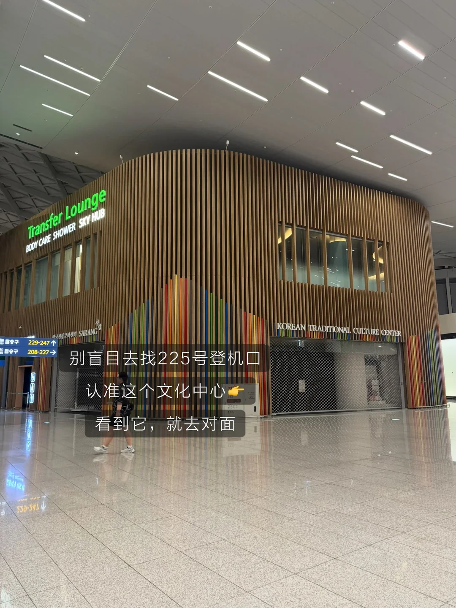

Při vyzvedávání objednávek z bezcelních obchodů na terminálu 2 letiště Inčchon spousta lidí, kteří z Koreje odlétají poprvé, ztratí dvacet minut. Aplikace uvede „směrem k bráně 225“, takže dojdete k bráně 225 a najdete bránu. Hala pro vyzvednutí je o patro níž a její vchod označuje modrá tabule s nápisem „Duty Free Pick Up“.

Následuje postup v pořadí: objednávka, kdy přijít, nalezení místa vyzvednutí, vytažení pořadového čísla, vyzvednutí u přepážky a nakonec pravidla pro tekutiny a přestupy. Doba čekání ve frontě a provoz u přepážek se výrazně liší mezi všedním dnem a svátkem.

## Před letem: objednejte v aplikaci

Lotte, Shilla, Shinsegae a Hyundai provozují každý vlastní aplikaci bezcelního obchodu. Nainstalujte si ji a zaregistrujte se ještě před cestou, naplňte košík a při dokončení objednávky zadejte **číslo odletového letu, datum a terminál**. Místa vyzvednutí se přidělují podle terminálu, takže objednávku pro odlet z T2 lze vyzvednout jen na T2; pokud terminál zadáte špatně, objednávku bude nutné upravit.

Většina bezcelních prodejců vyžaduje dokončení objednávky určitý počet hodin před odletem a limitované sady se vyprodají ještě dřív. Bezpečnou volbou je objednat brzy; uzávěrka a limity nákupu jsou uvedeny na stránce objednávky.

Aplikace pak zobrazí místo vyzvednutí, obvykle ve formulaci „směrem k bráně 225“. **To je směr, ne adresa** – skutečné místo najdete na modrých orientačních tabulích letiště.

Dvě další věci lidi často zaskočí. Objednávky pro odlety z Kimpa, Pusanu nebo jiných letišť se v Inčchonu nevyzvedávají. A tranzitní cestující, kteří nevstupují do Koreje, obvykle objednávají na svůj konečný odletový let, nikoli na let, kterým do Koreje přiletěli; pokud je v objednávce uvedený špatný let, přepážka ji nenajde.

## Jak brzy: tři hodiny, nebo hodina

Pokud nepřestupujete, pohodlné je dorazit zhruba tři hodiny před odletem. Tento čas pokryje odbavení, odevzdání zavazadel, bezpečnostní kontrolu, cestu k místu vyzvednutí i frontu; samotná chůze z odletové části T2 trvá kolem deseti minut. Ve svátečních špičkách může fronta přesáhnout 40 minut.

Tranzitní cestující neprocházejí imigrační kontrolou a k místu vyzvednutí jdou uvnitř tranzitního prostoru, ale i tak by si měli vyhradit **alespoň hodinu před nástupem do letadla**. Při těsném přestupu nejdřív vyzvedněte zboží a nakupujte až potom.

Místo vyzvednutí je za bezpečnostní kontrolou v tranzitním prostoru; nelze se k němu dostat z veřejné části terminálu a nikdo jiný za vás zboží nevyzvedne. Příliš brzký příchod má také svá rizika – přepážky se otevírají podle odletových vln, takže při velmi brzkém příchodu mohou být zavřené. Otevírací doba se řídí oznámeními letiště.

## Místo vyzvednutí není brána 225

Hledejte **Korejské centrum tradiční kultury**. Stojí ve 3. patře, jeho fasádu tvoří barevné dřevěné lamely a vedle něj je zelená tabule s nápisem Transfer Lounge. Místo vyzvednutí je naproti této budově – ne přímo u brány 225.

Najděte modrou tabuli s nápisem „면세품인도장 / DUTY FREE PICK UP / 免税品取货处“ a následujte šipku k eskalátoru.

O patro níž je hala pro vyzvednutí ve 2F. Terminál T2 má dlouhou odletovou halu: od bezpečnostní kontroly sem obvykle dojdete za deset minut, takže čas neodhadujte podle čísla brány.

## Dole ve 2F: kiosky a pořadová čísla

Hala ve 2F je rozdělená podle bezcelních prodejců a u vchodu stojí řada samoobslužných kiosků – **jeden automat na prodejce**, každý s logem své společnosti. Zařaďte se ke správnému kiosku.

Automat Lotte nabízí korejštinu, čínštinu, angličtinu a japonštinu. Řiďte se pokyny na obrazovce, položte fotografickou stránku pasu na skener a automat vytiskne lístek s pořadovým číslem; pokud skenování selže, číslo pasu lze zadat ručně. Lístek uvádí prodejce, pořadové číslo a čas vystavení.

Zkontrolujte, do které zóny lístek patří, a čekejte v příslušné zóně. Obrazovky nad halou postupně zobrazují vyřizovaná čísla; až se objeví to vaše, jděte k přepážce, protože zmeškané číslo obvykle znamená vzít si další.

## U přepážky: pas, palubní vstupenka, číslo

Předejte najednou **pas, palubní vstupenku a lístek s pořadovým číslem**. Pracovníci porovnají objednávku se zbožím, každou položku naskenují, zabalí, zapečetí, přiloží doklady a požádají vás o podpis.

Než odejdete, všechno zkontrolujte: počet kusů, velikosti, odstíny, dárky. Poškození nebo špatnou položku lze u přepážky vyřešit na místě výměnou nebo vrácením peněz; jakmile odejdete, stává se z toho případ pro zákaznickou podporu.

Zapečetěný sáček neotvírejte dřív. Tekutiny se vkládají do průhledného bezpečnostního sáčku společně s účtenkou a sáček ani účtenka nesmí být porušené až do nástupu do letadla – při přestupu vás čeká další bezpečnostní kontrola.

## Tekutiny, přestupy a další nástrahy

**Tekutiny a pečeti.** Bezcelní tekutiny nad 100 ml musí zůstat v zapečetěném bezpečnostním sáčku s účtenkou. Bezpečnostní kontrola při přestupu nepřijme porušenou pečeť a otevřené lahve mohou být zabaveny.

**Nejdřív si ověřte trasu přestupu.** Některá letiště na navazující trase nepřijímají bezpečnostní sáčky z bezcelního prodeje a mohou vyžadovat, abyste tekutinu dali do odbaveného zavazadla, nebo se ji vzdali. Než koupíte alkohol nebo kosmetiku, ověřte si pravidla na letišti, kde přestupujete.

**Objednávka je vázaná na let.** Platí pouze v den odletu a na uvedeném terminálu; při zpáteční cestě ji vyzvednout nelze. U nevyzvednutých objednávek platí zásady jednotlivých prodejců, obvykle jsou vratné, jak je uvedeno na stránce objednávky.

**Dva užitečné tipy navíc.** Přepážka pro vrácení DPH je u brány 249; hotovost se vrací pouze v amerických dolarech a jenech, ostatní měny vyřizuje automat a přijímají se Alipay a WeChat Pay. Kolem bran 233 až 278 najdete večerky, obchod s rybími placičkami, čaj s tapiokou a pekárnu, takže zásobit se po vyzvednutí vyjde levněji než u brány.

## Související odkazy

- **Na tomto webu**: [Mezinárodní letiště Inčchon (ICN)](/airport/ICN), [Jižní Korea (KR)](/country/KR)
- **Wikipedia**: [Mezinárodní letiště Inčchon](https://en.wikipedia.org/wiki/Incheon_International_Airport)
- **Baidu Baike**: [Mezinárodní letiště Inčchon](https://baike.baidu.com/item/%E4%BB%81%E5%B7%9D%E5%9B%BD%E9%99%85%E6%9C%BA%E5%9C%BA)

Místa vyzvednutí, otevírací doba a doby čekání se řídí oznámeními letiště Inčchon a prodejců přímo na místě. Zdroj obrázků: původní cestovní průvodce.
