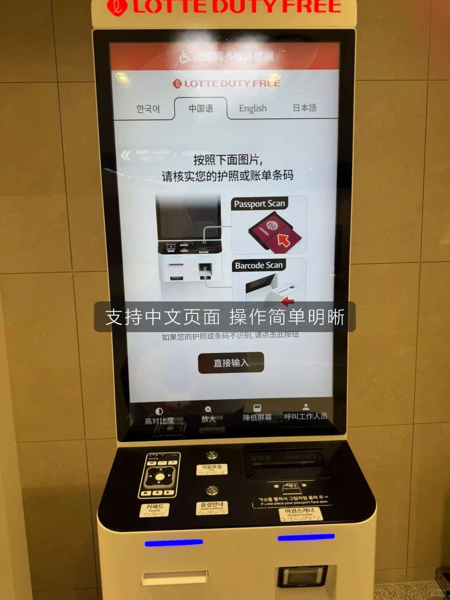

इंचियोन एयरपोर्ट के टर्मिनल 2 पर ड्यूटी-फ़्री ऑर्डर लेने के दौरान ही कोरिया से पहली बार जाने वाले कई यात्री बीस मिनट गँवा देते हैं। ऐप कहता है "गेट 225 की ओर", तो आप गेट 225 तक चलते हैं और वहाँ एक गेट मिलता है। कलेक्शन हॉल एक मंज़िल नीचे है, और उसका प्रवेश द्वार एक नीली तख़्ती है जिस पर "Duty Free Pick Up" लिखा है।

आगे सब कुछ क्रम से है: ऑर्डर करना, कब पहुँचें, पिकअप पॉइंट ढूँढ़ना, नंबर लेना, काउंटर पर सामान लेना और अंत में तरल पदार्थों तथा ट्रांसफ़र के नियम। कतार का समय और काउंटर पर कर्मचारियों की संख्या कार्यदिवस और छुट्टी के दिन में बहुत बदल जाती है।

## उड़ान से पहले: ऐप पर ऑर्डर करें

लोटे, शिला, शिनसेगे और ह्युंदई — हर एक का अपना ड्यूटी-फ़्री ऐप है। यात्रा से पहले ऐप इंस्टॉल करके रजिस्टर करें, कार्ट भरें और चेकआउट पर **प्रस्थान उड़ान का नंबर, तारीख़ और टर्मिनल** डालें। पिकअप पॉइंट टर्मिनल के हिसाब से तय होते हैं, इसलिए T2 से प्रस्थान के ऑर्डर सिर्फ़ T2 पर ही लिए जा सकते हैं; टर्मिनल गलत होने पर ऑर्डर बदलना पड़ता है।

ज़्यादातर ड्यूटी-फ़्री रिटेलर चाहते हैं कि ऑर्डर प्रस्थान से तय घंटों पहले पूरा हो जाए, और सीमित सेट उससे भी पहले बिक जाते हैं। जल्दी ऑर्डर करना सुरक्षित रहता है; कट-ऑफ़ और खरीद की सीमाएँ ऑर्डर पेज पर दी होती हैं।

इसके बाद ऐप कलेक्शन पॉइंट दिखाता है, आमतौर पर "गेट 225 की ओर" जैसे शब्दों में। **यह दिशा है, पता नहीं** — असली जगह एयरपोर्ट की नीली तख़्तियों पर लिखी होती है।

दो और बातें लोगों को उलझा देती हैं। गिम्पो, बुसान या दूसरे एयरपोर्ट से प्रस्थान के ऑर्डर इंचियोन पर नहीं लिए जाते। और जो ट्रांज़िट यात्री कोरिया में प्रवेश नहीं करते, वे आमतौर पर अपनी अंतिम प्रस्थान उड़ान के हिसाब से ऑर्डर करते हैं, न कि उस उड़ान के हिसाब से जो उन्हें कोरिया लेकर आई; ऑर्डर में गलत उड़ान होने पर काउंटर उसे ढूँढ़ नहीं पाता।

## कितना पहले पहुँचें: तीन घंटे या एक

बिना कनेक्शन के, प्रस्थान से क़रीब तीन घंटे पहले पहुँचना आरामदायक है। इस समय में चेक-इन, सामान जमा करना, सुरक्षा जाँच, पिकअप पॉइंट तक पैदल जाना और कतार — सब आ जाता है, और अकेले चलने में ही T2 के प्रस्थान क्षेत्र से क़रीब दस मिनट लगते हैं। छुट्टियों के व्यस्त दिनों में कतार 40 मिनट से भी ज़्यादा लंबी हो सकती है।

ट्रांज़िट यात्रियों को इमिग्रेशन से नहीं गुज़रना पड़ता और वे ट्रांज़िट क्षेत्र के अंदर से पिकअप पॉइंट तक चलते हैं, फिर भी **बोर्डिंग से कम से कम एक घंटा** पहले का समय रखना चाहिए। कम समय वाले कनेक्शन में पहले सामान लें और शॉपिंग बाद में करें।

पिकअप पॉइंट एयरसाइड में, सुरक्षा जाँच के आगे है; वहाँ सार्वजनिक कॉन्कोर्स से नहीं पहुँचा जा सकता और कोई आपकी ओर से सामान नहीं ले सकता। बहुत पहले पहुँचने का अपना जोखिम है — काउंटर अपनी उड़ानों के समय के आसपास खुलते हैं, इसलिए बहुत जल्दी पहुँचने पर वे बंद मिल सकते हैं। खुलने का समय एयरपोर्ट की सूचनाओं के अनुसार है।

## पिकअप पॉइंट गेट 225 नहीं है

**कोरियन ट्रेडिशनल कल्चर सेंटर** को ढूँढ़ें। यह तीसरी मंज़िल पर है, रंगीन लकड़ी की पट्टियों वाला अग्रभाग, और उसके बगल में हरे रंग की Transfer Lounge तख़्ती है। कलेक्शन पॉइंट उसी इमारत के सामने है — गेट 225 पर नहीं।

नीली तख़्ती ढूँढ़ें जिस पर "면세품인도장 / DUTY FREE PICK UP / 免税品取货处" लिखा है और तीर के साथ एस्केलेटर तक जाएँ।

एक मंज़िल नीचे 2F पर कलेक्शन हॉल है। T2 का कॉन्कोर्स लंबा है: सुरक्षा जाँच से यहाँ तक आमतौर पर दस मिनट पैदल है, इसलिए गेट नंबर से समय का अंदाज़ा न लगाएँ।

## 2F पर नीचे: कियोस्क और नंबर

2F का हॉल ड्यूटी-फ़्री कंपनी के हिसाब से बँटा है, और प्रवेश पर सेल्फ़-सर्विस कियोस्क की कतार है — **हर रिटेलर की एक मशीन**, हर एक पर कंपनी का लोगो। सही मशीन पर कतार लगाएँ।

लोटे की मशीन कोरियन, चीनी, अंग्रेज़ी और जापानी में सुविधा देती है। निर्देशों का पालन करें, अपने पासपोर्ट का फ़ोटो वाला पेज स्कैनर पर रखें, और मशीन नंबर की पर्ची प्रिंट कर देती है; स्कैन न हो तो पासपोर्ट नंबर टाइप किया जा सकता है। पर्ची पर रिटेलर, नंबर और जारी होने का समय लिखा होता है।

देखें कि पर्ची किस ज़ोन की है, फिर उसी ज़ोन में इंतज़ार करें। हॉल के ऊपर लगी स्क्रीनों पर चल रहे नंबर दिखते हैं; अपना नंबर आने पर जाएँ, क्योंकि नंबर छूट जाने पर आमतौर पर नया नंबर लेना पड़ता है।

## काउंटर पर: पासपोर्ट, बोर्डिंग पास, नंबर

**पासपोर्ट, बोर्डिंग पास और नंबर की पर्ची** एक साथ दें। कर्मचारी ऑर्डर को सामान से मिलाते हैं, हर वस्तु स्कैन करते हैं, थैले में डालते हैं, सील करते हैं, काग़ज़ात लगाते हैं और आपसे हस्ताक्षर कराते हैं।

हटने से पहले सब कुछ जाँचें: सामान की संख्या, साइज़, शेड, गिफ़्ट। खराब या गलत सामान का निपटारा काउंटर पर वहीं बदलकर या रिफ़ंड से हो जाता है; एक बार चले जाने के बाद यह ग्राहक सेवा का मामला बन जाता है।

सील किया हुआ थैला समय से पहले न खोलें। तरल पदार्थ पारदर्शी सुरक्षा थैले में जाते हैं और रसीद उसके अंदर रहती है; थैला और रसीद बोर्डिंग तक साबुत रहें — ट्रांसफ़र कर रहे हों तो एक और सुरक्षा जाँच होती है।

## तरल पदार्थ, ट्रांसफ़र और दूसरे जाल

**तरल पदार्थ और सील।** 100 मिलीलीटर से ज़्यादा के ड्यूटी-फ़्री तरल पदार्थ सीलबंद सुरक्षा थैले में रसीद के साथ ही रहने चाहिए। ट्रांसफ़र पर सुरक्षा जाँच टूटी सील स्वीकार नहीं करती, और खोली गई बोतलें ज़ब्त करनी पड़ सकती हैं।

**पहले ट्रांसफ़र का रास्ता जाँचें।** कनेक्टिंग यात्रा में कुछ एयरपोर्ट ड्यूटी-फ़्री सुरक्षा थैले स्वीकार नहीं करते और तरल पदार्थ चेक-इन करने या छोड़ने के लिए कह सकते हैं। शराब या कॉस्मेटिक खरीदने से पहले उस एयरपोर्ट के नियम पक्के कर लें जहाँ आप बदलेंगे।

**ऑर्डर उड़ान से जुड़ा है।** यह सिर्फ़ प्रस्थान के दिन और बताए गए टर्मिनल पर मान्य है; वापसी की उड़ान पर सामान नहीं मिलता। न लिए गए ऑर्डर हर रिटेलर की नीति के अनुसार होते हैं, आमतौर पर रिफ़ंड मिल जाता है, जैसा ऑर्डर पेज पर लिखा होता है।

**दो काम की बातें।** टैक्स रिफ़ंड डेस्क गेट 249 के पास है; नकद रिफ़ंड सिर्फ़ अमेरिकी डॉलर और येन में मिलता है, दूसरी मुद्राओं का काम मशीन से होता है, और Alipay तथा WeChat Pay स्वीकार किए जाते हैं। गेट 233 से 278 के आसपास कन्वीनियंस स्टोर, फ़िशकेक की दुकान, बबल टी और बेकरी हैं, इसलिए सामान लेने के बाद वहाँ से खरीदना गेट पर खरीदने से सस्ता पड़ता है।

## संबंधित लिंक

- **इस साइट पर**: [इंचियोन अंतरराष्ट्रीय एयरपोर्ट (ICN)](/airport/ICN), [दक्षिण कोरिया (KR)](/country/KR)
- **विकिपीडिया**: [इंचियोन अंतरराष्ट्रीय एयरपोर्ट](https://en.wikipedia.org/wiki/Incheon_International_Airport)
- **बाइडू बाइके**: [इंचियोन अंतरराष्ट्रीय एयरपोर्ट](https://baike.baidu.com/item/%E4%BB%81%E5%B7%9D%E5%9B%BD%E9%99%85%E6%9C%BA%E5%9C%BA)

पिकअप के स्थान, खुलने का समय और कतार का समय मौके पर इंचियोन एयरपोर्ट और रिटेलरों की सूचनाओं के अनुसार हैं। चित्र स्रोत: मूल यात्रा गाइड।
