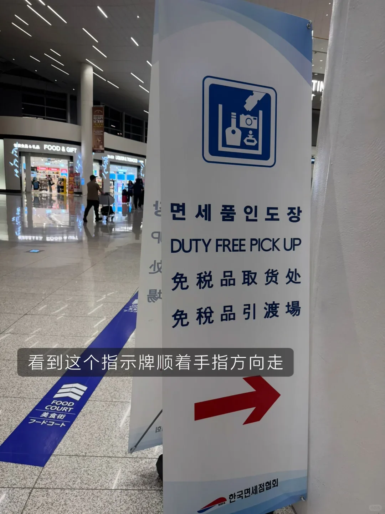

Mengambil pesanan bebas bea di Terminal 2 Bandara Incheon adalah tempat banyak keberangkatan pertama dari Korea kehilangan dua puluh menit. Aplikasi mengatakan “menuju gerbang 225”, jadi Anda berjalan ke gerbang 225 dan menemukan gerbang. Aula pengambilan berada satu lantai di bawah, dan pintu masuknya adalah papan biru bertuliskan “Duty Free Pick Up”.

Berikut urutannya: memesan, kapan harus datang, menemukan titik pengambilan, mengambil nomor, mengambil di loket, dan akhirnya aturan cairan dan transit. Waktu antrean dan jumlah staf loket sangat bervariasi antara hari kerja dan hari libur.

## Sebelum terbang: pesan di aplikasi

Lotte, Shilla, Shinsegae, dan Hyundai masing-masing menjalankan aplikasi bebas bea sendiri. Pasang dan daftar sebelum perjalanan, isi keranjang, dan saat checkout masukkan **nomor penerbangan keberangkatan, tanggal, dan terminal**. Titik pengambilan ditetapkan berdasarkan terminal, jadi pesanan untuk keberangkatan T2 hanya dapat diambil di T2; jika salah terminal, pesanan perlu diubah.

Sebagian besar peritel bebas bea mewajibkan pesanan diselesaikan sejumlah jam tertentu sebelum keberangkatan, dan set terbatas terjual lebih awal dari itu. Memesan lebih awal adalah langkah aman; batas waktu dan batas pembelian ada di halaman pesanan.

Aplikasi kemudian menampilkan titik pengambilan, biasanya dengan frasa “menuju gerbang 225”. **Itu adalah arah, bukan alamat** — lokasi sebenarnya ada di papan biru bandara.

Dua hal lagi yang sering membuat orang keliru. Pesanan untuk keberangkatan dari Gimpo, Busan, atau bandara lain tidak diambil di Incheon. Dan penumpang transit yang tidak masuk Korea biasanya memesan berdasarkan penerbangan keberangkatan akhir mereka, bukan penerbangan yang membawa mereka ke Korea; jika penerbangan di pesanan salah, loket tidak dapat menemukannya.

## Seberapa awal: tiga jam, atau satu

Tanpa koneksi, tiba sekitar tiga jam sebelum keberangkatan sudah nyaman. Waktu itu mencakup check-in, penyerahan bagasi, keamanan, jalan ke titik pengambilan dan antrean, dan jalan kaki saja memakan waktu sekitar sepuluh menit dari area keberangkatan T2. Pada puncak liburan antrean bisa lebih dari 40 menit.

Penumpang transit tidak melewati imigrasi dan berjalan ke titik pengambilan di dalam area transit, tetapi tetap harus menyediakan **setidaknya satu jam sebelum naik pesawat**. Pada koneksi ketat, ambil dulu dan berbelanja setelahnya.

Titik pengambilan berada di sisi udara, setelah keamanan; tidak dapat dijangkau dari concourse publik dan tidak ada yang dapat mengambil atas nama Anda. Datang terlalu awal juga berisiko — loket buka sekitar gelombang penerbangan, jadi kedatangan yang terlalu awal mungkin mendapati loket tutup. Jam buka mengikuti pemberitahuan bandara.

## Titik pengambilan bukan gerbang 225

Cari **Korean Traditional Culture Center**. Bangunan ini berdiri di lantai 3, berlapis bilah kayu berwarna, dengan papan Transfer Lounge hijau di sampingnya. Titik pengambilan berada di seberang bangunan itu — bukan di gerbang 225 itu sendiri.

Temukan papan biru bertuliskan “면세품인도장 / DUTY FREE PICK UP / 免税品取货处” dan ikuti panah ke eskalator.

Turun satu lantai adalah aula pengambilan di 2F. Concourse T2 panjang: dari keamanan ke sini biasanya sepuluh menit berjalan kaki, jadi jangan memperkirakan waktu dari nomor gerbang.

## Turun di 2F: kios dan nomor

Aula 2F dibagi berdasarkan perusahaan bebas bea, dan sederet kios swalayan berdiri di pintu masuk — **satu mesin per peritel**, masing-masing membawa logo perusahaannya. Antre di mesin yang benar.

Mesin Lotte menawarkan bahasa Korea, Tiongkok, Inggris, dan Jepang. Ikuti petunjuknya, letakkan halaman foto paspor Anda di pemindai, dan mesin mencetak tiket nomor; jika pemindaian gagal, nomor paspor dapat diketik. Tiket menunjukkan peritel, nomor, dan waktu penerbitannya.

Periksa zona mana tiket itu, lalu tunggu di zona tersebut. Layar di atas aula menggulir nomor yang sedang dilayani; naik saat nomor Anda muncul, karena nomor yang terlewat biasanya berarti mengambil nomor lagi.

## Di loket: paspor, boarding pass, nomor

Serahkan **paspor, boarding pass, dan tiket nomor** bersama-sama. Staf mencocokkan pesanan dengan barang, memindai setiap item, mengemasnya, menyegelnya, melampirkan dokumen, dan meminta Anda menandatangani.

Periksa semuanya sebelum pergi: jumlah item, ukuran, warna, hadiah. Kerusakan atau barang yang salah ditangani di loket saat itu juga, dengan penukaran atau pengembalian dana; setelah Anda pergi, itu menjadi kasus layanan pelanggan.

Jangan membuka kantong yang disegel lebih awal. Cairan dimasukkan ke kantong keamanan bening dengan struk di dalamnya, dan kantong serta struk tetap utuh hingga naik pesawat — ada pemeriksaan keamanan lain jika Anda transit.

## Cairan, transit, dan jebakan lain

**Cairan dan segel.** Cairan bebas bea di atas 100 ml harus tetap di dalam kantong keamanan yang disegel dengan struk. Keamanan di titik transit tidak akan menerima segel yang rusak, dan botol yang dibuka mungkin harus diserahkan.

**Periksa rute transit terlebih dahulu.** Beberapa bandara dalam itinerari koneksi tidak menerima kantong keamanan bebas bea dan mungkin mewajibkan cairan tersebut diperiksa masuk atau ditinggalkan. Sebelum membeli alkohol atau kosmetik, konfirmasikan aturannya di bandara tempat Anda transit.

**Pesanan terikat pada penerbangan.** Pesanan hanya berlaku pada hari keberangkatan dan di terminal yang dinyatakan; tidak ada pengambilan pada segmen kembali. Pesanan yang tidak diambil mengikuti kebijakan masing-masing peritel, biasanya dapat dikembalikan, sesuai yang tercantum di halaman pesanan.

**Dua tambahan berguna.** Meja pengembalian pajak berada di dekat gerbang 249; pengembalian tunai hanya dalam dolar AS dan yen, mata uang lain ditangani oleh mesin, dan Alipay serta WeChat Pay diterima. Toko serba ada, toko fishcake, bubble tea, dan toko roti berada di sekitar gerbang 233 hingga 278, jadi menimbun setelah pengambilan lebih murah daripada di gerbang.

## Tautan terkait

- **Di situs ini**: [Bandara Internasional Incheon (ICN)](/airport/ICN), [Korea Selatan (KR)](/country/KR)
- **Wikipedia**: [Bandara Internasional Incheon](https://en.wikipedia.org/wiki/Incheon_International_Airport)
- **Baidu Baike**: [Bandara Internasional Incheon](https://baike.baidu.com/item/%E4%BB%81%E5%B7%9D%E5%9B%BD%E9%99%85%E6%9C%BA%E5%9C%BA)

Lokasi pengambilan, jam buka, dan waktu antrean mengikuti pemberitahuan Bandara Incheon dan peritel di lokasi. Kredit gambar: panduan perjalanan asli.
