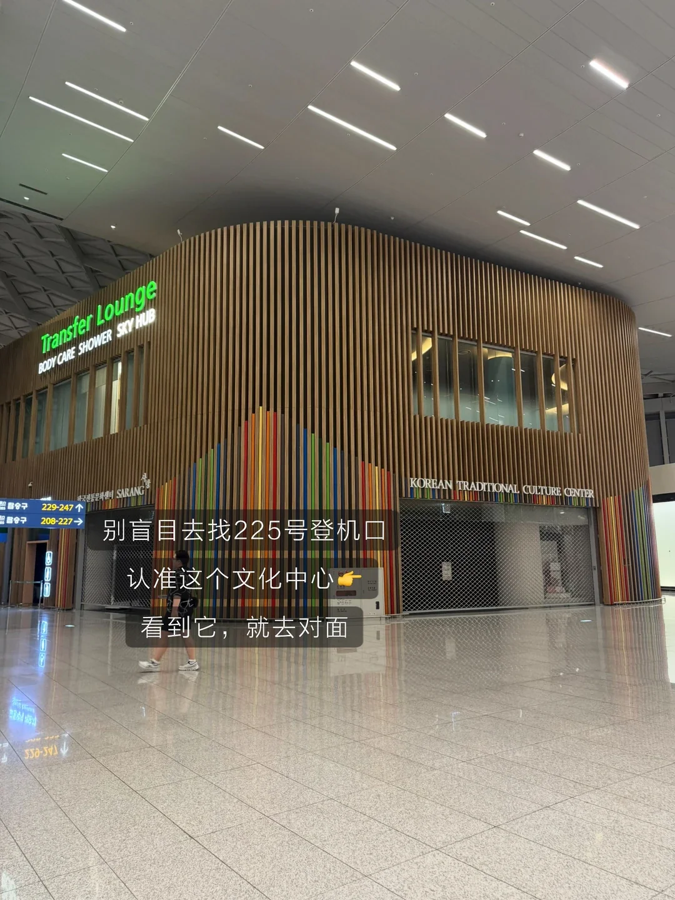
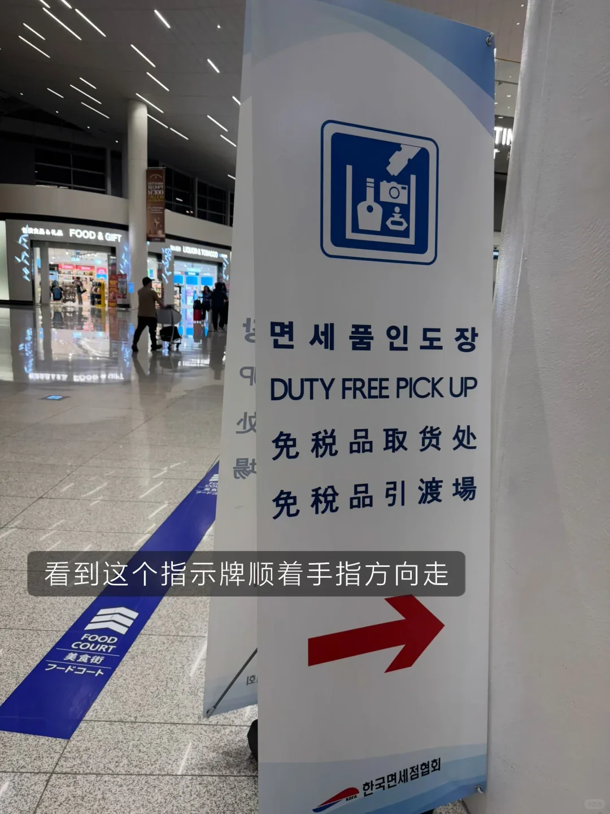
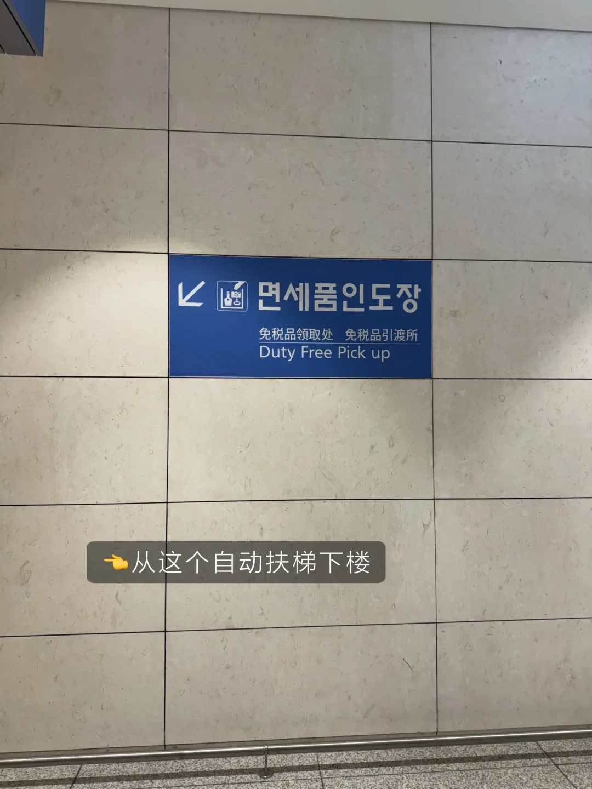
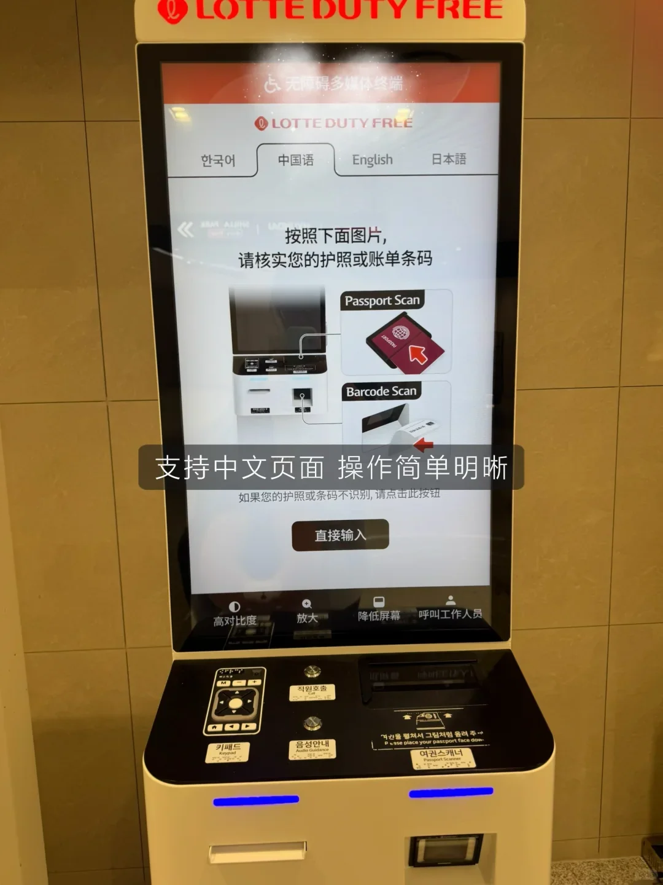
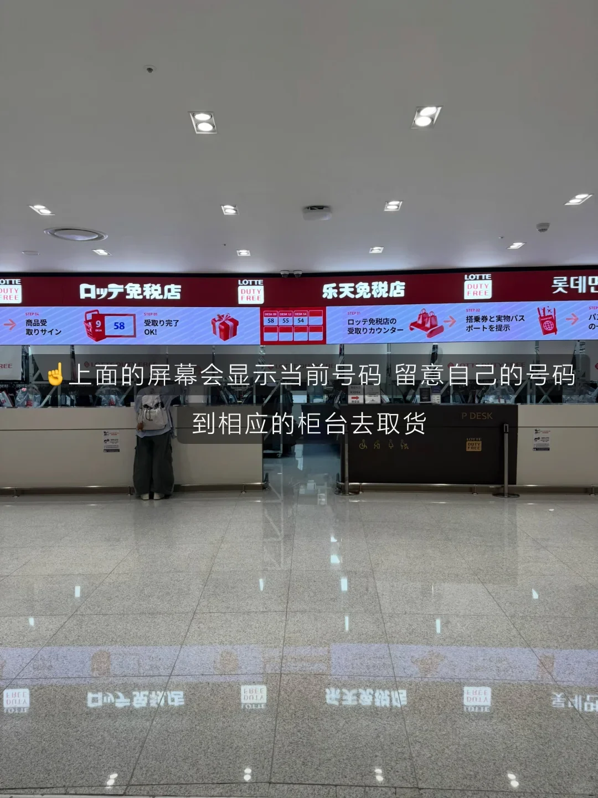

在仁川机场 T2 提免税品，是很多人第一次从韩国离境时最容易走冤枉路的一环。App 上写着「225 号登机口方向」，跟着走却发现那里只有登机口；真正的提货大厅在下一层，入口是一块蓝色的「免税品取货处」牌子。

下面按顺序拆开：下单、到机场的时间、找提货点、取号、柜台取货，最后说液体和转机的注意事项。排队时长与柜台安排以现场为准，节假日和工作日差别很大。

## 出发前：在 App 上把单下好

乐天、新罗、新世界、现代各自有免税店 App。出发前装好、注册，选好商品加入购物车，下单时填写**离境航班号、日期和航站楼**。提货点按航班所在航站楼分配，T2 出发的订单只能在 T2 取，填错航站楼要改单。

多数免税店要求起飞前若干小时完成下单，热门商品和限量套装会提前售罄，越早下单越稳。具体截止时间、限购件数以 App 订单页为准。

下单后 App 会显示提货地点，通常写成「225 号登机口方向」这类大致方位。**这只是一个方位提示，不是具体位置**，真正的地点要看机场里的蓝色指示牌。

还有两点容易忽略：从金浦、釜山等其他机场离境的订单不在仁川提货；在仁川转机又不入境的，订单一般按最终离境航班填写，而不是抵达韩国的航班。填错航班，柜台查不到订单。

## 提前多久：3 小时与 1 小时两种算法

不转机的话，提前 3 小时左右到机场比较稳。这段时间要分给值机、托运、安检、走到提货点和排队：安检之后从 T2 的出发区走到提货点要十来分钟，节假日排队可能超过 40 分钟。

转机旅客不用入境，直接在转机区里走到提货点，时间上至少留出**登机时间前 1 小时**。转机衔接紧的，把提货排在落地后的第一件事，别等逛完免税店再去。

提货点在安检之后的隔离区，公共区域找不到，也不能托人代取。到得太早也有风险：提货柜台按航班时段开放，太早可能还没开柜，具体营业时间以现场为准。

## 提货点不在 225 号登机口

认准**韩国传统文化中心**（Korean Traditional Culture Center）。它在 T2 三层，外墙是一排彩色的木条，旁边连着 Transfer Lounge 的绿色招牌。看到这个建筑，提货点就在它对面，不在 225 号登机口本身。

找到蓝色立牌，上面写着「면세품인도장／DUTY FREE PICK UP／免税品取货处」，跟着箭头方向走到扶梯口。

坐扶梯下到 2 层，就是提货大厅。T2 的指廊很长，从安检口走到这里通常要十分钟上下，算时间时别按登机口的距离反推。

## 下到 2 层：取号机与叫号屏

2 层大厅按免税店分区，入口处一排自助取号机，**每家免税店各有一台**，机身上印着公司标志，别排错队。

选乐天的机器，屏幕上有韩文、中文、英文、日文四种语言。按提示把护照照片页放到扫描区，机器识别后打印一张号码票；扫不出来可以手动输入护照号。号码票上印着免税店名称、号码和取号时间。

拿到票先看清是哪个区域，再到对应区域等叫号。大厅上方的屏幕滚动显示当前号码，叫到自己的号再去柜台，过号一般要重新取号。

## 柜台取货：护照、登机牌、号码票

叫到号后到指定柜台，把**护照、登机牌和号码票**一起递过去。工作人员核对订单和商品，逐件扫码、装袋、封口、贴单，最后请本人签字确认。

东西递出来时当场清点：件数、规格、色号、赠品是否齐全。有破损或与订单不符，当场提出，柜台可以换货或办理退货；离柜之后再处理，就要走客服流程了。

封口的袋子不要提前拆。液体类会装进透明的封口袋，袋子和收据要一直留到登机，转机时还要再过一次安检。

## 液体、转机与几个坑

**液体与封袋。** 超过 100 毫升的免税液体必须封在透明封口袋里，收据随袋放置。转机再过安检时袋子不能拆封，一旦拆开，液体可能被要求丢弃。

**转机路线要提前确认。** 如果下一段在其他国家或地区转机，部分机场不接受免税封袋，可能要求托运或放弃。买酒和化妆品之前，先确认转机机场的规则。

**提货与航班绑定。** 订单只在离境当天、指定航站楼有效，回程不能取；没取货按各免税店的规则处理，多数可以退，具体看订单页说明。

**其他实用信息。** T2 的退税柜台在 249 号登机口一带，现金退税只退美元和日元，其他币种用机器办理，支持支付宝和微信。登机口 233、245、254、278 附近有便利店、鱼饼店、奶茶和面包店，取完货顺路补给比在登机口买便宜。

## 相关链接

- **本站页面**：[仁川国际机场（ICN）](/zh/airport/ICN)、[韩国（KR）](/zh/country/KR)
- **维基百科**：[仁川国际机场](https://zh.wikipedia.org/wiki/%E4%BB%81%E5%B7%9D%E5%9C%8B%E9%9A%9B%E6%A9%9F%E5%A0%B4)
- **百度百科**：[仁川国际机场](https://baike.baidu.com/item/%E4%BB%81%E5%B7%9D%E5%9B%BD%E9%99%85%E6%9C%BA%E5%9C%BA)

提货点位置、营业时间与排队情况以仁川机场与各免税店现场公示为准。图片来源：原始旅行攻略。
