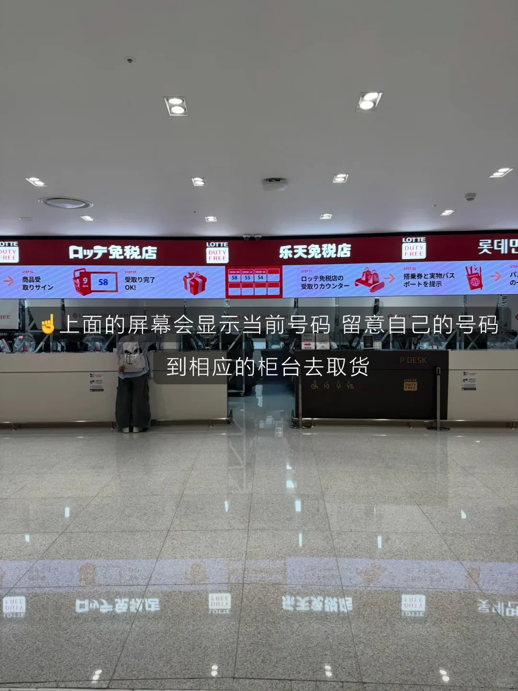

Het ophalen van belastingvrije bestellingen op Terminal 2 van Incheon Airport is waar veel mensen die voor het eerst uit Korea vertrekken twintig minuten verliezen. De app zegt "richting gate 225", dus je loopt naar gate 225 en treft er een gate aan. De ophaalhal ligt een verdieping lager, en de ingang is een blauw bord met de tekst "Duty Free Pick Up".

Wat volgt is de volgorde: bestellen, wanneer aankomen, het ophaalpunt vinden, een nummer trekken, ophalen aan de balie en ten slotte de regels voor vloeistoffen en overstappen. Wachttijden en de bezetting aan de balies verschillen enorm tussen een werkdag en een feestdag.

## Voor je vliegt: bestel via de app

Lotte, Shilla, Shinsegae en Hyundai hebben elk hun eigen belastingvrije app. Installeer en registreer voor de reis, vul een winkelwagen en voer bij het afrekenen het **vluchtnummer, de datum en de terminal van vertrek** in. Ophaalpunten worden per terminal toegewezen, dus een bestelling voor een vertrek vanaf T2 kan alleen op T2 worden opgehaald; heb je de terminal verkeerd, dan moet de bestelling worden gewijzigd.

De meeste belastingvrije winkels eisen dat de bestelling een vast aantal uren voor vertrek is afgerond, en gelimiteerde sets zijn eerder uitverkocht. Vroeg bestellen is de veilige keuze; de uiterste termijn en aankooplimieten staan op de bestelpagina.

De app toont vervolgens een ophaalpunt, meestal geformuleerd als "richting gate 225". **Dat is een richting, geen adres** — de werkelijke locatie staat op de blauwe borden van de luchthaven.

Twee andere dingen zorgen vaak voor verrassingen. Bestellingen voor vertrek vanaf Gimpo, Busan of andere luchthavens worden niet op Incheon opgehaald. En overstappassagiers die Korea niet binnenkomen, boeken normaal gesproken op hun laatste vertrekkende vlucht, niet op de vlucht waarmee ze naar Korea zijn gekomen; staat er een verkeerde vlucht op de bestelling, dan kan de balie die niet vinden.

## Hoe vroeg: drie uur, of één

Zonder overstap is het comfortabel om ongeveer drie uur voor vertrek aan te komen. Die tijd dekt inchecken, bagage afgeven, de beveiliging, de wandeling naar het ophaalpunt en de wachtrij, en de wandeling alleen al duurt vanaf het vertrekgebied van T2 zo'n tien minuten. Op feestdagenpieken kan de wachtrij oplopen tot meer dan 40 minuten.

Overstappassagiers passeren geen immigratie en lopen binnen de transitzone naar het ophaalpunt, maar moeten nog steeds **minstens een uur voor het boarden** rekenen. Bij een krappe overstap eerst ophalen en daarna shoppen.

Het ophaalpunt ligt aan de luchtzijde, voorbij de beveiliging; het is niet bereikbaar vanaf de openbare hal en niemand kan het voor je ophalen. Te vroeg aankomen heeft zijn eigen risico — de balies gaan open rond de vertrekblokken van hun vluchten, dus bij een heel vroege aankomst kunnen ze nog gesloten zijn. Openingstijden volgen de mededelingen van de luchthaven.

## Het ophaalpunt is niet gate 225

Zoek het **Korean Traditional Culture Center**. Het staat op niveau 3, bekleed met gekleurde houten latten, met het groene bord Transfer Lounge ernaast. Het ophaalpunt ligt tegenover dat gebouw — niet bij gate 225 zelf.

Zoek het blauwe bord met "면세품인도장 / DUTY FREE PICK UP / 免税品取货处" en volg de pijl naar de roltrap.

Een verdieping lager ligt de ophaalhal op 2F. De hal van T2 is lang: van de beveiliging tot hier is het meestal tien minuten lopen, dus schat de timing niet op basis van het gatenummer.

## Beneden op 2F: kiosken en nummers

De hal op 2F is per belastingvrije maatschappij verdeeld, en bij de ingang staat een rij zelfbedieningskiosken — **één automaat per aanbieder**, elk met het logo van het bedrijf. Ga in de rij staan bij de juiste.

De automaat van Lotte biedt Koreaans, Chinees, Engels en Japans. Volg de aanwijzingen, leg de fotopagina van je paspoort op de scanner, en er wordt een nummerticket geprint; als het scannen mislukt, kan het paspoortnummer worden ingetypt. Het ticket toont de aanbieder, het nummer en het tijdstip van uitgifte.

Controleer bij welke zone het ticket hoort en wacht in die zone. De schermen boven de hal laten de nummers die aan de beurt zijn voorbijkomen; ga naar voren wanneer het jouwe verschijnt, want een gemist nummer betekent meestal dat je een nieuw moet trekken.

## Aan de balie: paspoort, instapkaart, nummer

Geef **paspoort, instapkaart en nummerticket** samen af. Het personeel controleert de bestelling tegen de goederen, scant elk artikel, doet het in een zak, verzegelt die, bevestigt de papieren en vraagt je te tekenen.

Controleer alles voordat je weggaat: aantal artikelen, maten, tinten, cadeaus. Schade of een verkeerd artikel wordt ter plekke aan de balie afgehandeld, door ruilen of terugbetalen; zodra je weg bent, wordt het een zaak voor de klantenservice.

Maak de verzegelde zak niet vroeg open. Vloeistoffen gaan in een transparante beveiligingszak met de bon erin, en zak en bon blijven intact tot het boarden — bij een overstap volgt nog een beveiligingscontrole.

## Vloeistoffen, overstappen en andere valkuilen

**Vloeistoffen en zegels.** Belastingvrije vloeistoffen boven 100 ml moeten in de verzegelde beveiligingszak met de bon blijven. De beveiliging bij een overstap accepteert geen verbroken zegel, en geopende flessen moeten mogelijk worden ingeleverd.

**Controleer eerst de overstaproute.** Sommige luchthavens op een doorreisroute accepteren geen beveiligingszakken van belastingvrije aankopen en kunnen eisen dat de vloeistof wordt ingecheckt of achtergelaten. Bevestig voordat je alcohol of cosmetica koopt de regels op de luchthaven waar je overstapt.

**De bestelling is aan de vlucht gebonden.** Ze is alleen geldig op de dag van vertrek en op de opgegeven terminal; op de terugreis is er geen ophaalmogelijkheid. Niet-opgehaalde bestellingen volgen het beleid van elke aanbieder, meestal terugbetaalbaar, zoals vermeld op de bestelpagina.

**Twee nuttige extra's.** De balie voor belastingteruggaaf ligt bij gate 249; contante terugbetalingen zijn alleen in Amerikaanse dollars en yen mogelijk, andere valuta's worden via een automaat afgehandeld, en Alipay en WeChat Pay worden geaccepteerd. Gemakswinkels, een viskoekwinkel, bubble tea en een bakkerij liggen rond de gates 233 tot 278, dus inslaan na het ophalen is goedkoper dan bij de gate.

## Gerelateerde links

- **Op deze site**: [Incheon International Airport (ICN)](/airport/ICN), [Zuid-Korea (KR)](/country/KR)
- **Wikipedia**: [Incheon International Airport](https://en.wikipedia.org/wiki/Incheon_International_Airport)
- **Baidu Baike**: [Incheon International Airport](https://baike.baidu.com/item/%E4%BB%81%E5%B7%9D%E5%9B%BD%E9%99%85%E6%9C%BA%E5%9C%BA)

Ophaallocaties, openingstijden en wachttijden volgen de mededelingen van Incheon Airport en de aanbieders ter plaatse. Beeldcredit: de oorspronkelijke reisgids.
