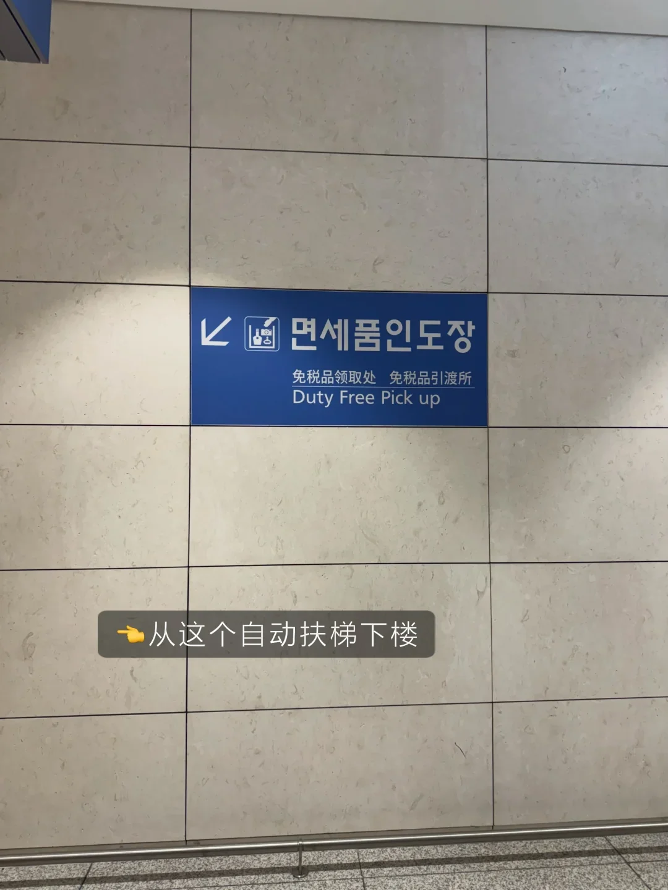

Odbiór zamówień bezcłowych w terminalu T2 lotniska Incheon to miejsce, w którym wiele osób wylatujących z Korei po raz pierwszy traci dwadzieścia minut. Aplikacja podaje „w kierunku bramki 225”, więc idziesz do bramki 225 i znajdujesz bramkę. Hala odbioru znajduje się piętro niżej, a jej wejście oznacza niebieski szyld „Duty Free Pick Up”.

Dalej opisano kolejno: zamawianie, czas przyjazdu, odnalezienie punktu odbioru, pobranie numerka, odbiór przy ladzie, a na końcu zasady dotyczące płynów i przesiadek. Czas oczekiwania w kolejce i liczba personelu przy ladach różnią się ogromnie w zależności od tego, czy to dzień powszedni, czy święto.

## Przed lotem: zamów w aplikacji

Lotte, Shilla, Shinsegae i Hyundai prowadzą własne aplikacje zakupów bezcłowych. Zainstaluj aplikację i zarejestruj się przed podróżą, wypełnij koszyk, a przy finalizacji zamówienia podaj **numer lotu odlotowego, datę i terminal**. Punkty odbioru są przypisane do terminala, więc zamówienie na odlot z T2 można odebrać tylko na T2; jeśli podasz zły terminal, zamówienie trzeba będzie zmienić.

Większość sprzedawców sklepów bezcłowych wymaga złożenia zamówienia w określonej liczbie godzin przed odlotem, a limitowane zestawy wyprzedają się jeszcze przed tym terminem. Wczesne zamówienie to bezpieczne rozwiązanie; termin graniczny i limity zakupów podano na stronie zamówienia.

Aplikacja pokazuje następnie punkt odbioru, zwykle opisany jako „w kierunku bramki 225”. **To kierunek, a nie adres** — rzeczywista lokalizacja jest na niebieskich oznaczeniach lotniska.

Na dwie rzeczy warto jeszcze uważać. Zamówień na odloty z Gimpo, Busan lub innych lotnisk nie odbiera się w Incheon. Pasażerowie tranzytowi, którzy nie wjeżdżają do Korei, zwykle zamawiają na swój ostatni lot odlotowy, a nie na lot, którym przylecieli do Korei; jeśli w zamówieniu widnieje niewłaściwy lot, lada nie będzie mogła go znaleźć.

## Jak wcześnie: trzy godziny albo jedna

Jeśli nie masz przesiadki, przyjazd około trzech godzin przed odlotem jest wygodny. Ten czas obejmuje odprawę, nadanie bagażu, kontrolę bezpieczeństwa, dojście do punktu odbioru i kolejkę, a samo dojście z części odlotowej T2 zajmuje około dziesięciu minut. W szczytach okresu świątecznego kolejka może wydłużyć się ponad 40 minut.

Pasażerowie tranzytowi nie przechodzą kontroli imigracyjnej i idą do punktu odbioru w strefie tranzytowej, ale nadal powinni zarezerwować **co najmniej godzinę przed wejściem na pokład**. Przy krótkiej przesiadce najpierw odbierz zamówienie, a potem rób zakupy.

Punkt odbioru znajduje się po stronie zastrzeżonej, za kontrolą bezpieczeństwa; nie można do niego dotrzeć z ogólnodostępnego holu i nikt nie może odebrać zamówienia w twoim imieniu. Zbyt wczesne przybycie wiąże się z własnym ryzykiem — lady otwierają się w rytmie obsługiwanych fal odlotów, więc przy bardzo wczesnym przybyciu można je zastać zamknięte. Godziny otwarcia są zgodne z komunikatami lotniska.

## Punkt odbioru to nie bramka 225

Szukaj **Koreańskiego Centrum Kultury Tradycyjnej**. Stoi na 3. piętrze; jego elewację tworzą kolorowe drewniane listwy, a obok znajduje się zielony znak „Transfer Lounge”. Punkt odbioru znajduje się naprzeciwko tego budynku — nie przy samej bramce 225.

Znajdź niebieski znak z napisem „면세품인도장 / DUTY FREE PICK UP / 免税品取货处” i idź za strzałką do schodów ruchomych.

Piętro niżej znajduje się hala odbioru na 2. piętrze. Hol terminala T2 jest długi: od kontroli bezpieczeństwa do tego miejsca zwykle idzie się około dziesięciu minut, więc nie oceniaj czasu na podstawie numeru bramki.

## Na 2. piętrze: kioski i numerki

Hala na 2. piętrze jest podzielona według firm oferujących zakupy bezcłowe, a przy wejściu stoi rząd samoobsługowych kiosków — **po jednym automacie na sprzedawcę**, każdy z logo firmy. Ustaw się w kolejce do właściwego automatu.

Automat Lotte obsługuje język koreański, chiński, angielski i japoński. Postępuj zgodnie z poleceniami, połóż stronę paszportu ze zdjęciem na skanerze, a automat wydrukuje bilet z numerkiem; jeśli skanowanie się nie powiedzie, numer paszportu można wpisać ręcznie. Bilet zawiera nazwę sprzedawcy, numerek i godzinę wydania.

Sprawdź, do której strefy należy bilet, i czekaj w tej strefie. Ekrany nad halą przewijają numery aktualnie obsługiwanych osób; podejdź, gdy pojawi się twój, ponieważ pominięty numerek zwykle oznacza konieczność pobrania kolejnego.

## Przy ladzie: paszport, karta pokładowa, numerek

Podaj jednocześnie **paszport, kartę pokładową i bilet z numerkiem**. Personel sprawdza zamówienie z towarem, skanuje każdy artykuł, pakuje go, plombuje, dołącza dokumenty i prosi o podpis.

Sprawdź wszystko, zanim odejdziesz od lady: liczbę sztuk, rozmiary, odcienie i prezenty. Uszkodzenie lub niewłaściwy artykuł są rozpatrywane na miejscu przy ladzie przez wymianę lub zwrot; po odejściu sprawa trafia do obsługi klienta.

Nie otwieraj zapieczętowanej torby wcześniej. Płyny trafiają do przezroczystej torby bezpieczeństwa razem z paragonem, a torba i paragon pozostają nienaruszone aż do wejścia na pokład — przy przesiadce czeka cię kolejna kontrola bezpieczeństwa.

## Płyny, przesiadki i inne pułapki

**Płyny i plomby.** Płyny bezcłowe o pojemności ponad 100 ml muszą pozostać w zapieczętowanej torbie bezpieczeństwa wraz z paragonem. Kontrola bezpieczeństwa przy przesiadce nie zaakceptuje naruszonej plomby, a otwarte butelki mogą zostać odebrane.

**Najpierw sprawdź trasę przesiadki.** Niektóre lotniska na trasie z przesiadką nie akceptują toreb bezpieczeństwa z zakupami bezcłowymi i mogą wymagać nadania płynów jako bagażu rejestrowanego lub ich porzucenia. Przed zakupem alkoholu lub kosmetyków potwierdź zasady na lotnisku, na którym się przesiadasz.

**Zamówienie jest powiązane z lotem.** Jest ważne tylko w dniu odlotu i we wskazanym terminalu; nie ma odbioru na trasie powrotnej. Nieodebrane zamówienia podlegają zasadom danego sprzedawcy — zwykle można je zwrócić; szczegóły podano na stronie zamówienia.

**Dwa przydatne dodatki.** Punkt zwrotu podatku znajduje się w pobliżu bramki 249; zwroty gotówkowe są wypłacane wyłącznie w dolarach amerykańskich i jenach, inne waluty są obsługiwane przez automat, a Alipay i WeChat Pay są akceptowane. W okolicach bramek od 233 do 278 znajdują się sklepy całodobowe, sklep z ciastkami rybnymi, herbata bąbelkowa i piekarnia, więc zaopatrzenie się po odbiorze jest tańsze niż przy bramce.

## Powiązane linki

- **Na tej stronie**: [Międzynarodowe Lotnisko Incheon (ICN)](/airport/ICN), [Korea Południowa (KR)](/country/KR)
- **Wikipedia**: [Międzynarodowe Lotnisko Incheon](https://en.wikipedia.org/wiki/Incheon_International_Airport)
- **Baidu Baike**: [Międzynarodowe Lotnisko Incheon](https://baike.baidu.com/item/%E4%BB%81%E5%B7%9D%E5%9B%BD%E9%99%85%E6%9C%BA%E5%9C%BA)

Lokalizacje punktów odbioru, godziny otwarcia i czas oczekiwania w kolejkach są zgodne z komunikatami lotniska Incheon i sprzedawców na miejscu. Źródło zdjęcia: oryginalny przewodnik turystyczny.
