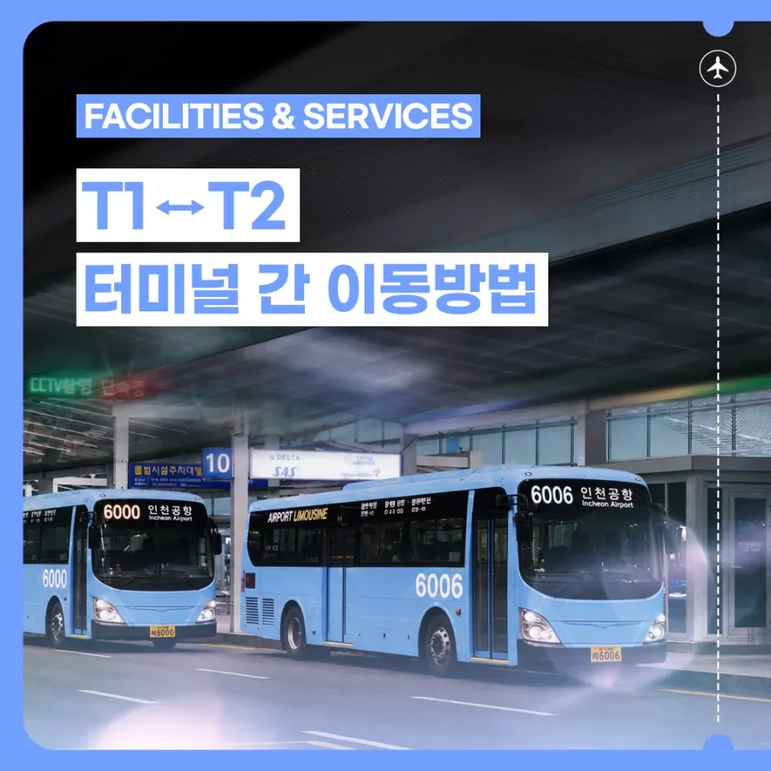
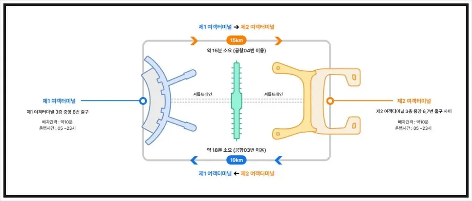
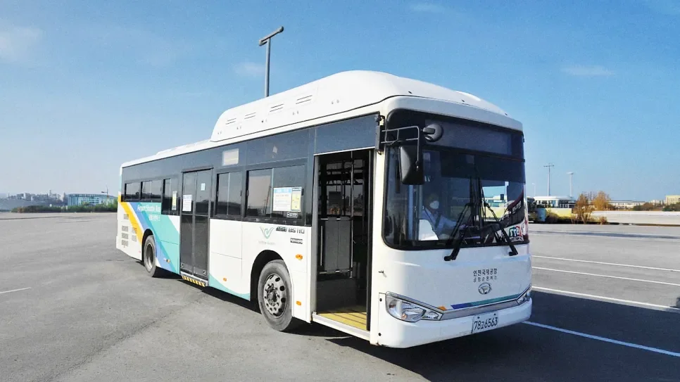
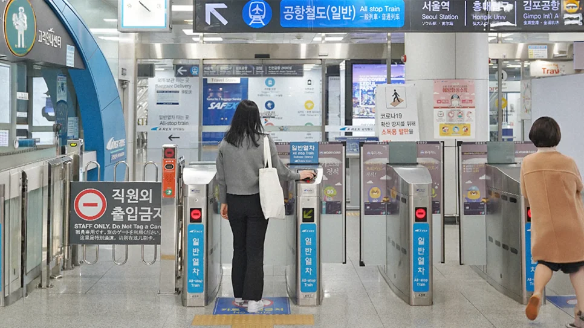
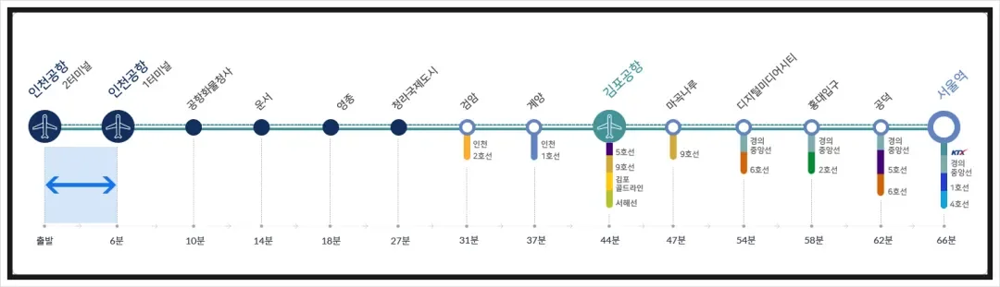

Der Incheon International Airport hat zwei Terminals, T1 und T2, die 15–19 km auseinanderliegen — eines am Nordende der Insel Yeongjong, eines im Süden. Vor jeder Reise stellen sich zwei Fragen: Welches Terminal nutzt mein Flug, und wie schnell komme ich ans andere, wenn ich mich vertan habe?

Zwischen ihnen gibt es nur zwei richtige Wege: den kostenlosen Shuttlebus auf der äußeren Spur der Abflugebene im 3. Stock und den AREX-Zug im Untergeschoss B1 des Transport Centre. Der Bus ist kostenlos und nimmt Gepäck leicht mit; der Zug ist schnell und bleibt durchgehend im Gebäude. Zeiten und Fahrpreise können sich ändern; prüfen Sie am Reisetag die Durchsagen des Flughafens.

## 1. Prüfen Sie Ihr Ticket: T1 oder T2

- **Terminal 1**: Jeju Air, T'way Air, Eastar Jet, Air Premia, Parata Air, Aero K und die meisten anderen internationalen Gesellschaften.
- **Terminal 2**: Korean Air, Asiana Airlines, Jin Air, Air Seoul, Air Busan, Delta Air Lines und andere.

Diese Liste ist nicht dauerhaft. Airlines wechseln das Terminal, wenn sich ihre Betriebsvereinbarungen ändern, am häufigsten die Billigfluggesellschaften; prüfen Sie das Terminal daher am Tag vor dem Flug auf Ihrem Ticket und lesen Sie bei der Ankunft die Bildschirme des Flughafens, statt einem alten Leitfaden zu vertrauen. In beiden Terminals liegen die Abflüge im 3. Stock und die Ankünfte im 1. Stock, „auf 3 abfliegen, auf 1 landen“ gilt also in beiden Gebäuden. Zwischen T1 und T2 gibt es keinen Fußweg; bei dieser Entfernung sind Shuttle oder Zug die einzigen Optionen.

## 2. Der kostenlose Shuttle: die Busse 03 und 04

Die Shuttlebusse halten auf der äußeren Spur der Abflugebene im 3. Stock. Jede Richtung hat ihre eigene Liniennummer, prüfen Sie diese vor dem Einsteigen:

| Richtung | Linie | Haltestelle | Betriebszeiten | Takt | Fahrzeit |
| --- | --- | --- | --- | --- | --- |
| T1 → T2 | Airport 04 | T1, 3F Gate 8 | 04:30–23:20 | alle 5–8 Min. | etwa 15 Min. |
| T2 → T1 | Airport 03 | T2, 3F Gates 6–7 | 04:30–23:40 | alle 5–8 Min. | etwa 18 Min. |

Beide sind kostenlos, und die Busse tragen „Airport 03 / 04“ an der Front und auf den Haltestellenschildern. An Bord ist Platz für Gepäck, was dies mit großen Koffern, Kinderwagen oder einer Reisegruppe zur einfacheren Wahl macht — kein Schleppen der Taschen hinunter nach B1 und wieder hinauf.

Ein häufiger Fehler ist das Warten am Ankunftsbordstein im 1. Stock, wo die Stadtlimousinen der 6000er-Serie nach Seoul halten; das sind andere Fahrzeuge mit anderen Tickets. Der Shuttle fährt eine Etage höher auf der Abflugebene im 3. Stock, eine Aufzugsfahrt von der Ankunft entfernt. Prüfen Sie die Liniennummer an der Front, bevor Sie Ihr Gepäck einladen.

Die Frequenz ist der große Vorteil: normalerweise höchstens zehn Minuten Wartezeit. Wenn mehrere Flüge gleichzeitig landen, bildet sich auf der Spur im 3. Stock eine Schlange und die Wartezeit dehnt sich; mit reinem Handgepäck ist dann der Zug unten die schnellere Wahl.

## 3. AREX: eine Station im B1, 1.050 Won

Wenn die Zeit knapp ist, gehen Sie hinunter ins Transport Centre im B1. Die AREX-Bahnsteige beider Terminals liegen auf dieser Ebene: Nehmen Sie den Zug mit Halt an allen Stationen in Richtung des anderen Terminals, eine Station, etwa 6–10 Minuten, für 1.050 Won, mit Abfahrten etwa alle 5 Minuten. Halten Sie eine T-Money-Karte an das Gate, statt anzustehen.

Der Reiz ist, dass Wetter und Verkehr keine Rolle spielen — die gesamte Strecke verläuft im Gebäude. Der Preis dafür sind die Aufzüge zwischen Bahnsteig und Abflugebene: Mit mehreren Koffern während einer Check-in-Spitze kann das Warten auf einen Aufzug länger dauern als die Fahrt. Achten Sie auch darauf, welchen Zug Sie nehmen: Der orange-gelbe Express fährt zum Seoul Station, zwischen den Terminals nehmen Sie also den blauen Zug mit Halt an allen Stationen. Ein falsches Ticket kostet mehr als das Zehnfache.

Direkt gegenübergestellt: Der Shuttle ist kostenlos, schluckt Gepäck und hängt vom Verkehr ab; AREX kostet 1.050 Won, braucht sechs bis zehn Minuten und ignoriert die Straßen, aber Sie hantieren mit den Taschen in den Aufzügen. Mehr als zwei Koffer oder Kinder — nehmen Sie den Bus. Ein Rucksack und eine Boardingzeit, die es zu schützen gilt — nehmen Sie den Zug.

## 4. Falsches Terminal? Vier Schritte

1. **Zuerst das Terminal bestätigen.** Prüfen Sie Ticket, Reiseplan oder die Bildschirme des Flughafens; verlassen Sie sich nicht auf Ihr Gedächtnis. T2 ist das Revier von Korean Air und Asiana, während T1 die meisten Billig- und ausländischen Gesellschaften abfertigt.
2. **Nach der Uhr entscheiden.** Mehr als eine Stunde vor dem Abflug mit schwerem Gepäck: der kostenlose Shuttle. Unter einer Stunde mit reinem Handgepäck: AREX vom B1 ist schneller.
3. **Drei Stunden einplanen.** Seien Sie bei einem internationalen Flug drei Stunden vorher am Flughafen und rechnen Sie beim Terminalwechsel die 15–18 Minuten Transfer plus Wartezeit dazu; in der Hochsaison sind die Schlangen länger.
4. **Bei der Ankunft die Bildschirme lesen.** Bestätigen Sie Check-in-Schalter und Gate, bevor Sie losgehen, damit Sie nicht kreuz und quer durch das Gebäude laufen.

Der klassische Fall eines Terminalwechsels: ein internationaler Flug einer ausländischen Gesellschaft (meist T1), gefolgt von Korean Air oder Asiana (T2). Bei einem einzigen Ticket ist das Gepäck womöglich schon durchgecheckt, während Sie sich selbst noch bewegen müssen — lesen Sie das Terminal auf Ihrer Bordkarte, bevor Sie zwischen Bus und Zug entscheiden.

## 5. Zwei Dinge, die Sie beim Umsteigen zwischen Terminals wissen sollten

Das erste ist die Einwanderung. Shuttle und AREX verkehren beide landside, außerhalb des Transitbereichs. Wenn Ihre beiden Flüge separate Tickets sind und Sie das Gebäude selbst wechseln müssen, müssen Sie die Einwanderung passieren und wieder hinauf zu den Abflügen, um einzuchecken und erneut durch die Sicherheitskontrolle zu gehen; nur eine Verbindung, die im Transitbereich bleibt, erspart Ihnen das. Fragen Sie Ihre Airline, welche Art Ticket Sie haben — „das Gate wechseln“ und „das Terminal wechseln“ sind nicht dasselbe.

Das zweite ist das Gepäck. Bei einem Ticket kann das Gepäck bis zum Endziel durchgecheckt werden; bei zwei separaten Tickets holen Sie es in T1 oder T2 ab, schieben es hinüber und checken erneut ein. Auf diesem Abschnitt bewegt niemand Ihr Gepäck für Sie, mit großen Koffern ist der Shuttlebus also die bessere Wahl.

Späte Ankünfte erfordern eine weitere Rechnung. Der Shuttle T1 → T2 fährt bis 23:20 und T2 → T1 bis 23:40; zwischen dieser Zeit und 04:30 fahren weder Shuttle noch AREX, eine späte Landung bedeutet also ein Taxi von der Ankunft oder Warten auf den ersten Bus. Alle Zeiten richten sich nach den Durchsagen des Flughafens am jeweiligen Tag.

## Weiterführende Links

- **Auf dieser Website**: [Incheon International Airport (ICN)](/airport/ICN), [Südkorea (KR)](/country/KR)
- **Wikipedia**: [Incheon International Airport](https://en.wikipedia.org/wiki/Incheon_International_Airport)
- **Baidu Baike**: [Incheon International Airport](https://baike.baidu.com/item/%E4%BB%81%E5%B7%9D%E5%9B%BD%E9%99%85%E6%9C%BA%E5%9C%BA)
- **Offizielle Websites**: [Incheon Airport](https://www.airport.kr/), [AREX](https://www.airportrailroad.com/)

_Terminalzuordnungen, Shuttlezeiten und AREX-Fahrpreise können sich ändern; die hier genannten Zahlen dienen als Anhaltspunkt. Prüfen Sie vor der Reise die Website des Incheon Airport und die Schilder vor Ort._
