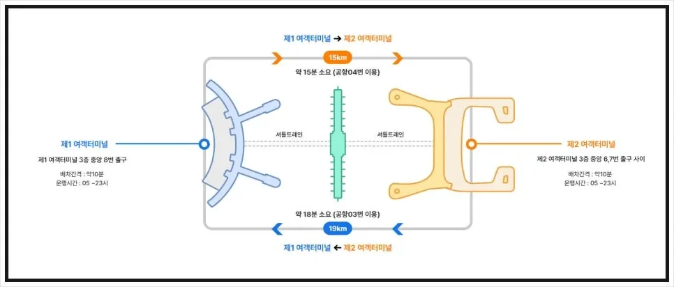
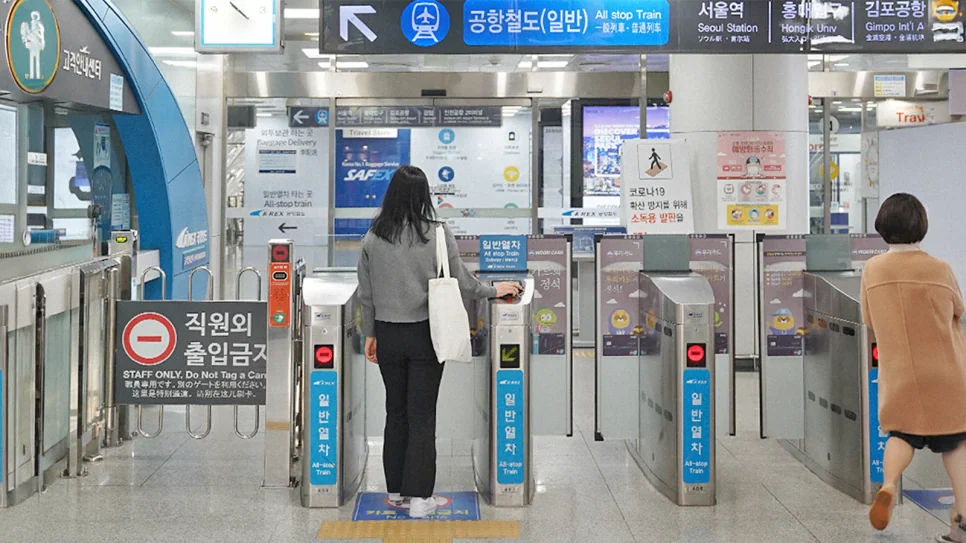

Bandara Internasional Incheon memiliki dua terminal, T1 dan T2, berjarak 15–19 km — satu di ujung utara Pulau Yeongjong, satu di selatan. Dua pertanyaan muncul sebelum setiap perjalanan: terminal mana yang digunakan penerbangan saya, dan jika saya salah, seberapa cepat saya bisa berpindah?

Hanya ada dua cara yang tepat di antara keduanya: bus antar-jemput gratis di lajur luar lantai keberangkatan 3F, dan kereta AREX di B1 Transport Centre. Bus gratis dan mudah membawa bagasi; kereta cepat dan seluruhnya di dalam ruangan. Waktu dan tarif dapat berubah; periksa pengumuman bandara pada hari itu.

## 1. Periksa tiket Anda: T1 atau T2

- **Terminal 1**: Jeju Air, T'way Air, Eastar Jet, Air Premia, Parata Air, Aero K, dan sebagian besar maskapai internasional lainnya.
- **Terminal 2**: Korean Air, Asiana Airlines, Jin Air, Air Seoul, Air Busan, Delta Air Lines, dan lainnya.

Daftar itu tidak permanen. Maskapai berpindah terminal ketika pengaturan operasional berubah, maskapai bertarif rendah paling sering, jadi periksa terminal pada tiket Anda sehari sebelum terbang dan baca layar bandara saat tiba daripada mempercayai panduan lama. Kedua terminal menempatkan keberangkatan di 3F dan kedatangan di 1F, jadi “naik di lantai 3, mendarat di lantai 1” berlaku di kedua gedung. Tidak ada rute berjalan kaki antara T1 dan T2; pada jarak ini bus antar-jemput atau kereta adalah satu-satunya pilihan.

## 2. Bus antar-jemput gratis: bus 03 dan 04

Bus antar-jemput menjemput di lajur luar lantai keberangkatan 3F. Setiap arah memiliki nomor rute sendiri, jadi periksa sebelum naik:

| Arah | Rute | Halte | Jam | Frekuensi | Perjalanan |
| --- | --- | --- | --- | --- | --- |
| T1 → T2 | Airport 04 | T1, lantai 3F gerbang 8 | 04.30–23.20 | setiap 5–8 menit | sekitar 15 menit |
| T2 → T1 | Airport 03 | T2, lantai 3F gerbang 6–7 | 04.30–23.40 | setiap 5–8 menit | sekitar 18 menit |

Keduanya gratis, dan bus membawa tulisan “Airport 03 / 04” di depan dan di papan halte. Ada ruang untuk bagasi di dalam, yang membuat ini pilihan lebih mudah dengan koper besar, kereta dorong, atau rombongan keluarga — tidak perlu menyeret tas turun ke B1 dan naik lagi.

Kesalahan umum adalah menunggu di tepi kedatangan 1F, tempat limusin kota seri 6000 ke Seoul berhenti; itu kendaraan berbeda dengan tiket berbeda. Bus antar-jemput berada satu lantai di atas di keberangkatan 3F, naik lift dari kedatangan. Periksa nomor rute di depan sebelum memuat bagasi.

Frekuensi adalah keunggulan utama: biasanya tidak lebih dari sepuluh menit menunggu. Ketika beberapa penerbangan mendarat bersamaan, lajur 3F mengantre dan waktu tunggu memanjang; dengan hanya bagasi kabin, kereta di bawah kemudian menjadi pilihan lebih cepat.

## 3. AREX: satu perhentian di B1, 1.050 won

Ketika waktu ketat, turun ke Transport Centre B1. Peron AREX kedua terminal berada di lantai itu: naik kereta all-stop menuju terminal lain, satu perhentian, sekitar 6–10 menit, seharga 1.050 won, dengan keberangkatan kira-kira setiap 5 menit. Ketuk kartu T-money di gerbang daripada mengantre.

Daya tariknya adalah cuaca dan lalu lintas tidak relevan — seluruh rute di dalam ruangan. Komprominya adalah lift antara peron dan lantai keberangkatan: dengan beberapa koper selama puncak check-in, menunggu lift bisa lebih lama daripada perjalanannya. Perhatikan juga kereta yang Anda naiki: Express oranye-kuning berjalan ke Stasiun Seoul, jadi antar terminal naik layanan all-stop biru. Membeli tiket yang salah biaya lebih dari sepuluh kali lipat.

Dibandingkan berdampingan: bus antar-jemput gratis, menelan bagasi, dan tunduk pada lalu lintas; AREX berbiaya 1.050 won, memakan enam hingga sepuluh menit dan mengabaikan jalan, tetapi Anda harus menangani bagasi di lift. Lebih dari dua koper, atau anak-anak — naik bus. Satu ransel dan waktu naik pesawat yang harus dijaga — naik kereta.

## 4. Salah terminal? Empat langkah

1. **Pastikan terminalnya dulu.** Periksa tiket, itinerary, atau layar bandara; jangan mengandalkan ingatan. T2 adalah wilayah Korean Air dan Asiana, sedangkan T1 menangani sebagian besar maskapai bertarif rendah dan asing.
2. **Pilih berdasarkan jam.** Lebih dari satu jam sebelum keberangkatan dengan bagasi berat: bus antar-jemput gratis. Kurang dari satu jam dengan hanya bagasi kabin: AREX dari B1 lebih cepat.
3. **Sediakan tiga jam.** Berada di bandara tiga jam lebih awal untuk penerbangan internasional, dan tambahkan transfer 15–18 menit plus waktu tunggu saat berpindah terminal; antrean musim puncak lebih panjang.
4. **Baca layar saat tiba.** Konfirmasikan meja check-in dan gerbang Anda sebelum berangkat, agar tidak bolak-balik melintasi gedung.

Kasus klasik lintas terminal: penerbangan internasional dengan maskapai asing (biasanya T1) diikuti Korean Air atau Asiana (T2). Pada satu tiket bagasi mungkin sudah dicek sampai tujuan sementara Anda tetap harus berpindah sendiri — baca terminal pada boarding pass sebelum memutuskan antara bus dan kereta.

## 5. Dua hal yang perlu diketahui saat transit antar terminal

Yang pertama adalah imigrasi. Bus antar-jemput dan AREX sama-sama beroperasi di sisi publik, di luar area transit. Jika kedua penerbangan Anda adalah tiket terpisah dan Anda harus berpindah gedung sendiri, Anda harus melewati imigrasi dan naik kembali ke keberangkatan untuk check-in dan melewati keamanan lagi; hanya koneksi yang tetap di area transit yang menghindari itu. Tanyakan kepada maskapai Anda jenis tiket apa yang Anda pegang — “berpindah gerbang” dan “berpindah terminal” bukan hal yang sama.

Yang kedua adalah bagasi. Pada satu tiket, bagasi dapat dicek sampai tujuan akhir; pada dua tiket terpisah Anda mengambilnya di T1 atau T2, mendorongnya menyeberang, dan check-in lagi. Tidak ada yang memindahkan bagasi untuk Anda pada segmen itu, jadi bus antar-jemput adalah pilihan lebih baik dengan koper besar.

Kedatangan larut memerlukan satu perhitungan lagi. Bus antar-jemput T1 → T2 beroperasi hingga 23.20 dan T2 → T1 hingga 23.40; di antara waktu itu dan 04.30 tidak ada bus antar-jemput maupun AREX, jadi pendaratan larut berarti taksi dari kedatangan, atau menunggu bus pertama. Semua waktu tunduk pada pengumuman bandara pada hari itu.

## Tautan terkait

- **Di situs ini**: [Bandara Internasional Incheon (ICN)](/airport/ICN), [Korea Selatan (KR)](/country/KR)
- **Wikipedia**: [Bandara Internasional Incheon](https://en.wikipedia.org/wiki/Incheon_International_Airport)
- **Baidu Baike**: [Bandara Internasional Incheon](https://baike.baidu.com/item/%E4%BB%81%E5%B7%9D%E5%9B%BD%E9%99%85%E6%9C%BA%E5%9C%BA)
- **Situs resmi**: [Bandara Incheon](https://www.airport.kr/), [AREX](https://www.airportrailroad.com/)

_Penugasan terminal, waktu bus antar-jemput, dan tarif AREX dapat berubah; angka di sini adalah acuan. Periksa situs web Bandara Incheon dan papan pada hari sebelum Anda bepergian._
