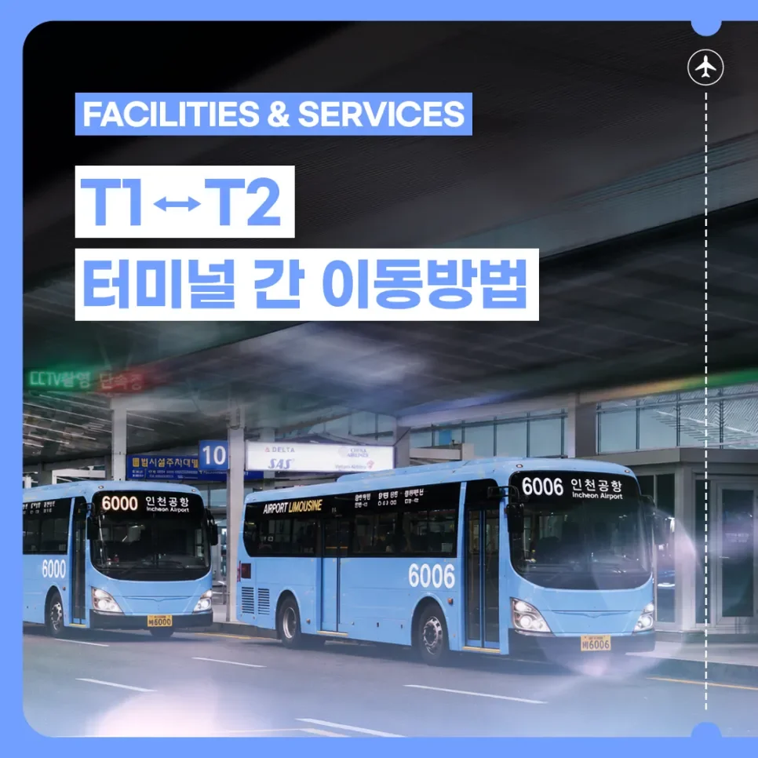
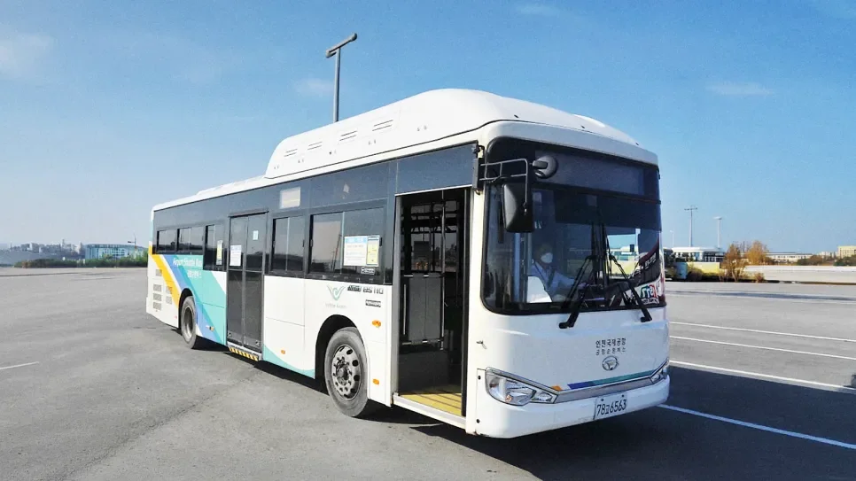

Międzynarodowe Lotnisko Incheon ma dwa terminale, T1 i T2, oddalone od siebie o 15–19 km — jeden na północnym krańcu wyspy Yeongjong, drugi na południu. Przed każdą podróżą pojawiają się dwa pytania: z którego terminala korzysta mój lot i — jeśli pomylę terminal — jak szybko uda mi się przemieszczać?

Są tylko dwa właściwe sposoby przemieszczania się między nimi: bezpłatny autobus wahadłowy na zewnętrznym pasie poziomu odlotów na 3. piętrze oraz pociąg AREX na poziomie B1 Centrum Transportu. Autobus jest bezpłatny i bez problemu przewozi bagaż; pociąg jest szybki i kursuje wyłącznie wewnątrz budynków. Godziny i opłaty mogą się zmieniać; w dniu podróży sprawdź komunikaty lotniska.

## 1. Sprawdź bilet: T1 czy T2

- **Terminal 1**: Jeju Air, T'way Air, Eastar Jet, Air Premia, Parata Air, Aero K i większość pozostałych przewoźników międzynarodowych.
- **Terminal 2**: Korean Air, Asiana Airlines, Jin Air, Air Seoul, Air Busan, Delta Air Lines i inne.

Ta lista nie jest stała. Linie lotnicze przenoszą się między terminalami, gdy zmieniają się warunki ich działalności, a najczęściej robią to tanie linie lotnicze, więc dzień przed lotem sprawdź terminal na bilecie, a po przylocie czytaj ekrany lotniska, zamiast ufać staremu przewodnikowi. W obu terminalach odloty odbywają się na 3. piętrze, a przyloty na 1. piętrze, więc zasada „wsiadasz na 3, lądujesz na 1” obowiązuje w obu budynkach. Między T1 i T2 nie ma trasy pieszej; przy tej odległości jedynymi opcjami są wahadłowiec lub pociąg.

## 2. Bezpłatny wahadłowiec: autobusy 03 i 04

Wahadłowce zabierają pasażerów z zewnętrznego pasa poziomu odlotów na 3. piętrze. Każdy kierunek ma własny numer trasy, więc sprawdź go przed wejściem:

| Kierunek | Trasa | Przystanek | Godziny | Częstotliwość | Czas przejazdu |
| --- | --- | --- | --- | --- | --- |
| T1 → T2 | Lotniskowa 04 | T1, 3. piętro, bramka 8 | 04:30–23:20 | co 5–8 min | około 15 min |
| T2 → T1 | Lotniskowa 03 | T2, 3. piętro, bramki 6–7 | 04:30–23:40 | co 5–8 min | około 18 min |

Oba autobusy są bezpłatne, a mają oznaczenie „Airport 03 / 04” z przodu i na znakach przystankowych. Na pokładzie jest miejsce na bagaż, dzięki czemu jest to łatwiejszy wybór przy dużych walizkach, wózku dziecięcym lub podróży z rodziną — bez wleczenia bagażu w dół na B1 i z powrotem na górę.

Częstym błędem jest czekanie przy krawężniku przylotów na 1. piętrze, gdzie zatrzymują się limuzyny miejskie serii 6000 do Seulu; to inne pojazdy i inne bilety. Wahadłowiec odjeżdża piętro wyżej, z poziomu odlotów na 3. piętrze, dokąd można wjechać windą z przylotów. Przed załadowaniem bagażu sprawdź numer trasy z przodu autobusu.

Częstotliwość to duża zaleta: zwykle czeka się nie dłużej niż dziesięć minut. Gdy kilka lotów ląduje jednocześnie, pas na 3. piętrze się korkuje i oczekiwanie się wydłuża; jeśli masz tylko bagaż podręczny, szybszy może się wtedy okazać pociąg na dole.

## 3. AREX: jeden przystanek na B1, 1050 wonów

Gdy czasu jest mało, zjedź do Centrum Transportu na poziomie B1. Perony AREX obu terminali znajdują się na tym poziomie: wsiądź w pociąg zatrzymujący się na wszystkich stacjach w kierunku drugiego terminala, jeden przystanek, około 6–10 minut, za 1050 wonów; pociągi odjeżdżają mniej więcej co 5 minut. Przy bramce biletowej przyłóż kartę T-money do czytnika, zamiast stać w kolejce.

Atutem jest to, że pogoda i ruch drogowy nie mają znaczenia — cała trasa przebiega wewnątrz budynków. Minusem są windy między peronem a poziomem odlotów: przy kilku walizkach w szczycie odpraw oczekiwanie na windę może trwać dłużej niż sam przejazd. Uważaj też, do którego pociągu wsiadasz: pomarańczowo-żółty Express jedzie na dworzec Seul, więc między terminalami wybierz niebieski pociąg zatrzymujący się na wszystkich stacjach. Zły bilet kosztuje ponad dziesięć razy więcej.

W zestawieniu: wahadłowiec jest bezpłatny, bez problemu mieści bagaż i zależy od ruchu drogowego; AREX kosztuje 1050 wonów, jedzie sześć do dziesięciu minut i ignoruje drogi, ale bagaże trzeba przewieźć windami. Więcej niż dwie walizki lub dzieci — wybierz autobus. Jeden plecak i godzina wejścia na pokład, której trzeba pilnować — wybierz pociąg.

## 4. Zły terminal? Cztery kroki

1. **Najpierw potwierdź terminal.** Sprawdź bilet, plan podróży lub ekrany lotniska; nie polegaj na pamięci. T2 to terytorium Korean Air i Asiana, a T1 obsługuje większość tanich i zagranicznych przewoźników.
2. **Wybierz według zegara.** Ponad godzina do odlotu i ciężkie bagaże: bezpłatny wahadłowiec. Mniej niż godzina i tylko bagaż podręczny: AREX z B1 jest szybszy.
3. **Zarezerwuj trzy godziny.** Bądź na lotnisku trzy godziny przed odlotem międzynarodowym, a przy zmianie terminala dodaj 15–18 minut na przejazd oraz czas oczekiwania; w szczycie sezonu kolejki są dłuższe.
4. **Czytaj ekrany po przylocie.** Potwierdź stanowisko odprawy i bramkę, zanim wyruszysz, żeby nie krążyć po budynku w tę i z powrotem.

Typowy przypadek przesiadki między terminalami: lot międzynarodowy obsługiwany przez zagranicznego przewoźnika (zwykle T1), a następnie Korean Air lub Asiana (T2). Przy jednym bilecie bagaże mogą być już nadane do miejsca docelowego, a ty nadal musisz się przemieszczać — zanim wybierzesz autobus lub pociąg, sprawdź terminal na karcie pokładowej.

## 5. Dwie rzeczy, o których warto wiedzieć przy przesiadce między terminalami

Pierwsza to kontrola imigracyjna. I wahadłowiec, i AREX kursują po stronie ogólnodostępnej, poza strefą tranzytową. Jeśli twoje dwa loty są na osobnych biletach i musisz sam zmienić budynek, musisz przejść kontrolę imigracyjną, wrócić na poziom odlotów, odprawić się i ponownie przejść kontrolę bezpieczeństwa; unika tego tylko przesiadka, która pozostaje w strefie tranzytowej. Zapytaj linię lotniczą, jaki rodzaj biletu posiadasz — „zmiana bramki” i „zmiana terminala” to nie to samo.

Druga to bagaż. Przy jednym bilecie bagaże można nadać do końcowego miejsca przeznaczenia; przy dwóch osobnych biletach odbierasz je na T1 lub T2, przewozisz na drugi terminal i ponownie odprawiasz. Nikt nie przenosi za ciebie bagażu na tym odcinku, więc przy dużych walizkach lepszym wyborem jest autobus wahadłowy.

Późne przyloty wymagają jeszcze jednego obliczenia. Wahadłowiec z T1 do T2 kursuje do 23:20, a z T2 do T1 do 23:40; od tego czasu do 04:30 nie kursuje ani wahadłowiec, ani AREX, więc późne lądowanie oznacza taksówkę z przylotów albo czekanie na pierwszy autobus. Wszystkie godziny zależą od komunikatów lotniska w danym dniu.

## Powiązane linki

- **Na tej stronie**: [Międzynarodowe Lotnisko Incheon (ICN)](/airport/ICN), [Korea Południowa (KR)](/country/KR)
- **Wikipedia**: [Międzynarodowe Lotnisko Incheon](https://en.wikipedia.org/wiki/Incheon_International_Airport)
- **Baidu Baike**: [Międzynarodowe Lotnisko Incheon](https://baike.baidu.com/item/%E4%BB%81%E5%B7%9D%E5%9B%BD%E9%99%85%E6%9C%BA%E5%9C%BA)
- **Oficjalne strony**: [Lotnisko Incheon](https://www.airport.kr/), [AREX](https://www.airportrailroad.com/)

_Przydziały terminali, godziny kursowania wahadłowców i opłaty AREX mogą się zmieniać; podane wartości mają charakter informacyjny. Dzień przed podróżą sprawdź stronę internetową lotniska Incheon i oznaczenia na miejscu._
