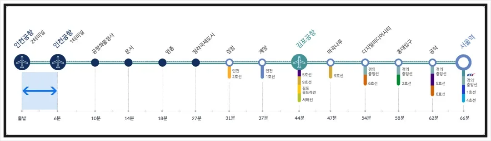

ท่าอากาศยานนานาชาติอินชอนมีสองอาคารคือ T1 และ T2 ห่างกัน 15–19 กม. — อาคารหนึ่งอยู่ทางเหนือของเกาะยองจง อีกอาคารอยู่ทางใต้ มีสองคำถามเกิดขึ้นก่อนทุกการเดินทาง: เที่ยวบินของฉันใช้อาคารไหน และหากเข้าใจผิด ฉันจะย้ายไปได้เร็วแค่ไหน?

มีเพียงสองวิธีที่เหมาะสมระหว่างอาคาร: รถบัสรับส่งฟรีบนช่องทางนอกสุดของชั้น 3 ฝั่งขาออก และรถไฟ AREX บนชั้น B1 ของศูนย์ขนส่ง รถบัสฟรีและรับสัมภาระได้ง่าย ส่วนรถไฟเร็วและอยู่ในอาคารทั้งหมด เวลาและค่าโดยสารอาจเปลี่ยนแปลง ตรวจสอบประกาศของสนามบินในวันเดินทาง

## 1. ตรวจสอบตั๋ว: T1 หรือ T2

- **อาคารผู้โดยสาร 1**: Jeju Air, T'way Air, Eastar Jet, Air Premia, Parata Air, Aero K และสายการบินระหว่างประเทศอื่น ๆ ส่วนใหญ่
- **อาคารผู้โดยสาร 2**: Korean Air, Asiana Airlines, Jin Air, Air Seoul, Air Busan, Delta Air Lines และอื่น ๆ

รายชื่อนั้นไม่ถาวร สายการบินย้ายอาคารเมื่อข้อตกลงการดำเนินงานเปลี่ยน โดยสายการบินต้นทุนต่ำย้ายบ่อยที่สุด จึงควรตรวจสอบอาคารบนตั๋วก่อนวันเดินทางหนึ่งวันและอ่านจอของสนามบินเมื่อมาถึง แทนที่จะเชื่อคู่มือเก่า ทั้งสองอาคารมีขาออกบนชั้น 3 และขาเข้าบนชั้น 1 ดังนั้น "ขึ้นเครื่องชั้น 3 ลงเครื่องชั้น 1" ใช้ได้กับทั้งสองอาคาร ไม่มีเส้นทางเดินระหว่าง T1 กับ T2 ในระยะทางนี้ รถรับส่งหรือรถไฟเป็นทางเลือกเดียว

## 2. รถรับส่งฟรี: รถบัส 03 และ 04

รถรับส่งรับผู้โดยสารบนช่องทางนอกสุดของชั้น 3 ฝั่งขาออก แต่ละทิศทางมีหมายเลขเส้นทางของตัวเอง จึงควรตรวจสอบก่อนขึ้นรถ:

| ทิศทาง | เส้นทาง | ป้าย | เวลา | ความถี่ | เวลาเดินทาง |
| --- | --- | --- | --- | --- | --- |
| T1 → T2 | Airport 04 | T1 ชั้น 3 ประตู 8 | 04:30–23:20 | ทุก 5–8 นาที | ประมาณ 15 นาที |
| T2 → T1 | Airport 03 | T2 ชั้น 3 ประตู 6–7 | 04:30–23:40 | ทุก 5–8 นาที | ประมาณ 18 นาที |

ทั้งสองฟรี และรถบัสมีป้าย "Airport 03 / 04" ที่ด้านหน้าและที่ป้ายจอด มีพื้นที่วางสัมภาระบนรถ ทำให้เป็นตัวเลือกที่ง่ายกว่าเมื่อมีกระเป๋าใบใหญ่ รถเข็นเด็ก หรือเดินทางเป็นครอบครัว — ไม่ต้องลากกระเป๋าลงไป B1 แล้วขึ้นมาอีก

ข้อผิดพลาดที่พบบ่อยคือการรอที่ขอบถนนชั้น 1 ฝั่งขาเข้า ซึ่งเป็นที่จอดของรถลีมูซีนในเมืองสาย 6000 ไปโซล รถเหล่านั้นเป็นรถคนละแบบและใช้ตั๋วคนละใบ รถรับส่งอยู่ขึ้นไปหนึ่งชั้นที่ชั้น 3 ฝั่งขาออก ขึ้นลิฟต์จากขาเข้า ตรวจสอบหมายเลขเส้นทางที่ด้านหน้าก่อนโหลดกระเป๋า

ความถี่คือข้อได้เปรียบสำคัญ: โดยปกติรอไม่เกินสิบนาที เมื่อมีหลายเที่ยวบินลงพร้อมกัน ช่องทางชั้น 3 จะติดขัดและเวลารอยืดออก หากมีเพียงกระเป๋าถือขึ้นเครื่อง รถไฟชั้นล่างจะเป็นตัวเลือกที่เร็วกว่า

## 3. AREX: หนึ่งสถานีบนชั้น B1 ราคา 1,050 วอน

เมื่อเวลาแน่น ให้ลงไปที่ศูนย์ขนส่งชั้น B1 ชานชาลา AREX ของทั้งสองอาคารอยู่บนชั้นนั้น: ขึ้นรถไฟจอดทุกสถานีไปยังอีกอาคาร หนึ่งสถานี ประมาณ 6–10 นาที ราคา 1,050 วอน ออกทุกประมาณ 5 นาที แตะบัตร T-money ที่ประตูแทนการต่อคิว

จุดดึงดูดคือสภาพอากาศและการจราจรไม่มีความหมาย — เส้นทางทั้งหมดอยู่ในอาคาร ข้อแลกเปลี่ยนคือลิฟต์ระหว่างชานชาลากับชั้นขาออก: หากมีกระเป๋าหลายใบในช่วงพีคเช็คอิน การรอลิฟต์อาจใช้เวลานานกว่าการนั่งรถ ระวังขบวนที่ขึ้นด้วย: เอ็กซ์เพรสสีส้มเหลืองวิ่งไปสถานีโซล ดังนั้นระหว่างอาคารให้ใช้บริการจอดทุกสถานีสีน้ำเงิน การซื้อตั๋วผิดมีค่าใช้จ่ายมากกว่าสิบเท่า

เมื่อเทียบกัน: รถรับส่งฟรี กลืนสัมภาระได้ และขึ้นกับการจราจร ส่วน AREX ราคา 1,050 วอน ใช้เวลาหกถึงสิบนาทีและไม่สนถนน แต่คุณต้องจัดการกระเป๋าบนลิฟต์ หากมีกระเป๋าเกินสองใบหรือมีเด็ก — ใช้รถบัส หากมีเป้หนึ่งใบและต้องรักษาเวลาขึ้นเครื่อง — ใช้รถไฟ

## 4. ผิดอาคาร? สี่ขั้นตอน

1. **ยืนยันอาคารก่อน** ตรวจสอบตั๋ว กำหนดการเดินทาง หรือจอของสนามบิน อย่าใช้ความจำ T2 เป็นพื้นที่ของ Korean Air และ Asiana ส่วน T1 ดูแลสายการบินต้นทุนต่ำและสายการบินต่างชาติส่วนใหญ่
2. **เลือกตามเวลา** หากเหลือเวลาก่อนออกเดินทางมากกว่าหนึ่งชั่วโมงและมีกระเป๋าหนัก: รถรับส่งฟรี หากเหลือไม่ถึงหนึ่งชั่วโมงและมีเพียงกระเป๋าถือขึ้นเครื่อง: AREX จาก B1 เร็วกว่า
3. **เผื่อสามชั่วโมง** มาถึงสนามบินก่อนสามชั่วโมงสำหรับเที่ยวบินระหว่างประเทศ และบวกเวลาเปลี่ยนอาคาร 15–18 นาทีพร้อมเวลารอเมื่อข้ามอาคาร คิวในช่วงพีคยาวกว่า
4. **อ่านจอเมื่อมาถึง** ยืนยันเคาน์เตอร์เช็คอินและประตูขึ้นเครื่องก่อนออกเดินทาง เพื่อไม่ต้องเดินตัดสลับไปมาทั่วอาคาร

กรณีข้ามอาคารแบบคลาสสิก: เที่ยวบินระหว่างประเทศของสายการบินต่างชาติ (มักเป็น T1) ตามด้วย Korean Air หรือ Asiana (T2) หากเป็นตั๋วใบเดียว กระเป๋าอาจถูกโอนต่อไปแล้วในขณะที่คุณยังต้องย้ายตัวเอง — อ่านอาคารบนบัตรโดยสารก่อนตัดสินใจระหว่างรถบัสกับรถไฟ

## 5. สองเรื่องที่ควรรู้เมื่อเปลี่ยนเครื่องระหว่างอาคาร

เรื่องแรกคือตรวจคนเข้าเมือง รถรับส่งและ AREX วิ่งฝั่งนอกเขตควบคุม ทั้งคู่อยู่นอกโซนเปลี่ยนเครื่อง หากเที่ยวบินสองเที่ยวเป็นตั๋วแยกและคุณต้องย้ายอาคารเอง คุณต้องผ่านตรวจคนเข้าเมืองแล้วขึ้นมาที่ขาออกเพื่อเช็คอินและผ่านตรวจความปลอดภัยอีกครั้ง มีเพียงการเปลี่ยนเครื่องที่อยู่ในโซนเปลี่ยนเครื่องเท่านั้นที่เลี่ยงขั้นตอนนี้ได้ ถามสายการบินว่าคุณถือตั๋วประเภทไหน — "เปลี่ยนประตูขึ้นเครื่อง" กับ "เปลี่ยนอาคารผู้โดยสาร" ไม่ใช่สิ่งเดียวกัน

เรื่องที่สองคือสัมภาระ หากเป็นตั๋วใบเดียว กระเป๋าสามารถโอนต่อไปยังจุดหมายสุดท้ายได้ หากเป็นตั๋วแยกสองใบ คุณต้องรับกระเป๋าที่ T1 หรือ T2 ลากข้ามอาคาร และเช็คอินอีกครั้ง ไม่มีใครย้ายสัมภาระให้คุณในช่วงนั้น รถบัสรับส่งจึงเป็นตัวเลือกที่ดีกว่าหากมีกระเป๋าใบใหญ่

การมาถึงดึกต้องคำนวณเพิ่มอีกอย่าง รถรับส่ง T1 → T2 วิ่งถึง 23:20 และ T2 → T1 ถึง 23:40 ระหว่างนั้นถึง 04:30 ทั้งรถรับส่งและ AREX ไม่วิ่ง ดังนั้นการลงจอดดึกหมายถึงเรียกแท็กซี่จากขาเข้าหรือรอรถเที่ยวแรก เวลาทั้งหมดขึ้นอยู่กับประกาศของสนามบินในวันนั้น

## ลิงก์ที่เกี่ยวข้อง

- **ในเว็บไซต์นี้**: [ท่าอากาศยานนานาชาติอินชอน (ICN)](/airport/ICN), [เกาหลีใต้ (KR)](/country/KR)
- **Wikipedia**: [ท่าอากาศยานนานาชาติอินชอน](https://en.wikipedia.org/wiki/Incheon_International_Airport)
- **Baidu Baike**: [ท่าอากาศยานนานาชาติอินชอน](https://baike.baidu.com/item/%E4%BB%81%E5%B7%9D%E5%9B%BD%E9%99%85%E6%9C%BA%E5%9C%BA)
- **เว็บไซต์ทางการ**: [ท่าอากาศยานอินชอน](https://www.airport.kr/), [AREX](https://www.airportrailroad.com/)

_การกำหนดอาคารผู้โดยสาร เวลารถรับส่ง และค่าโดยสาร AREX อาจเปลี่ยนแปลง ตัวเลขที่นี่ใช้เป็นข้อมูลอ้างอิง ตรวจสอบเว็บไซต์ท่าอากาศยานอินชอนและป้ายในวันก่อนเดินทาง_
