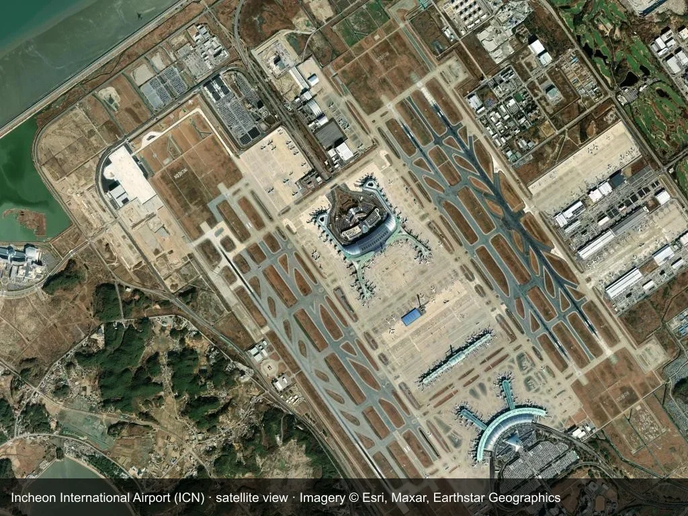

Flights to Seoul do not all land in the same place. Incheon (ICN) sits on Yeongjong Island off the west coast; Gimpo (GMP) is pressed against the western edge of the city. Both can get you into Seoul, but the queues, the journey times and even the ticket rules belong to two different systems. Choosing "wrong" is not fatal — it just costs an hour or two and a lot of dragging.

This guide takes them in order: which airport first, then which route. It covers distance and immigration, how to tell Incheon's two AREX trains apart, why Gimpo reaches Seoul Station in about twenty minutes, what buses and taxis cost, and the arrival paperwork — Q-CODE, the C-3-9 visa, and one restriction that catches visa-free travellers at Gimpo. Fares and timetables change; check official sources before you fly.

## 1. Incheon and Gimpo: two airports, two rhythms

Incheon International Airport (ICN) lies on Yeongjong Island about 50 km west of the city, and it carries the bulk of Korea's international traffic — most Chinese cities with a direct flight to Seoul land here. It runs 24 hours, so red-eye arrivals are fine, and Terminals 1 and 2 are well equipped with duty-free shops, restaurants and transit facilities. The price is sheer size: the walk from the aircraft to immigration, and then to the baggage belt, is a long one.

Gimpo International Airport (GMP) is only about 17 km from the centre, with a compact terminal that puts the metro and the airport railway a few minutes' walk from arrivals. Its international network is small — Shanghai Hongqiao, Beijing, Tokyo and similar short-haul routes — its duty-free area is small with few shops, and most of its traffic is domestic, chiefly to Jeju. The immigration hall is small, and 20–40 minutes is a normal time to clear it, usually quicker than Incheon.

The choice starts with your flight and your hotel. If fares are similar and you are staying in Hongdae or the city centre, take Gimpo: the hour you save is real. If your city only has a direct flight to Incheon, if you are on a red-eye, or if you want time in the airport's duty-free area, take Incheon. Check the terminal as well: Korean Air and most SkyTeam flights use T2, while Chinese carriers mostly use T1. A free shuttle links the two terminals in about 18 minutes, so allow at least 20 minutes for the transfer.

## 2. The comparison at a glance

| | Incheon (ICN) | Gimpo (GMP) |
| --- | --- | --- |
| Distance from the city | About 50 km, on Yeongjong Island | About 17 km, on the western edge |
| Terminals | T1 and T2, linked by a free shuttle (about 18 minutes) | Separate international and domestic buildings, walkable |
| Immigration | 30–60 minutes when smooth, longer in peak season | 20–40 minutes, usually faster |
| Main ways into town | AREX express or all-stop, airport bus, taxi | AREX all-stop, metro Lines 5 and 9, airport bus |
| To Seoul Station | Express 43 minutes (T1), 51 minutes (T2); all-stop 58–66 minutes | AREX all-stop about 22 minutes |
| Reference fare | Express 13,000 won; all-stop 4,750 won (T1) or 5,350 won (T2) | About 1,750 won with T-money |
| Best for | Red-eyes, more direct flights, duty-free, heavy bags | Staying in Hongdae or the centre, short-haul routes, tight schedules, light bags |

The two middle rows are easy to skim past: immigration and travel are separate costs. At Incheon 30–60 minutes of immigration is followed by at least 43 minutes on the railway; at Gimpo, 20–40 minutes is followed by 22 minutes to Seoul Station. With children or a landing close to midnight, that half hour decides how the evening goes.

## 3. From Incheon: don't mix up the two AREX trains

After baggage claim, follow the **공항철도 AREX / Airport Railroad** signs down to the B1 transport centre. AREX runs two services with similar names from adjacent platforms, and taking the wrong one adds seven or eight stops.

- **Express:** non-stop from Incheon T1 or T2 to Seoul Station. About 43 minutes from T1 and 51 minutes from T2, 13,000 won for an adult, with an assigned seat. It does **not** accept T-money — you need a separate ticket, and plenty of people only discover this at the gate. Best if your hotel is near Seoul Station or Myeongdong, or if you have luggage and want a predictable arrival time.
- **All-stop:** Incheon Airport → Gimpo Airport → Digital Media City → Hongik University → Gongdeok → Seoul Station, 58–66 minutes end to end. About 4,750 won from T1 and 5,350 won from T2, and T-money works, so you can turn up and go. Best for Hongdae, tight budgets and light luggage.

Roughly, the express runs 05:15–22:48 and the all-stop 05:18–23:32; check the AREX site for the day you travel. If you land after the last train, you are down to the late-night airport bus or a taxi.

Airport buses cost a reference 6,000–17,000 won depending on the route and take 65–90 minutes. Heavy bags stay in the hold and some routes run direct to Myeongdong or Gangnam, but traffic makes timing unpredictable and late-night departures thin out. A daytime taxi to the centre is about 50,000–70,000 won, with a night surcharge — worth it for a group with big bags, poor value solo.

## 4. From Gimpo: twenty-two minutes to Seoul Station

Gimpo's advantage is that the station sits under the terminal, a few minutes on foot from arrivals. There is no AREX express here, only the all-stop service — Gimpo Airport → Hongik University → Gongdeok → Seoul Station, about 22 minutes, roughly 1,750 won on T-money.

The metro adds options. Line 5 (purple) runs from Gimpo Airport station towards Yeouido, Gwanghwamun and Dongdaemun with easy transfers; Line 9 heads for Gangnam, Sinnonhyeon and Express Bus Terminal, and is the obvious choice south of the river. Journeys to Hongdae, Yeouido or the centre take roughly 20–35 minutes, and everything at Gimpo — metro and AREX all-stop alike — takes T-money, which makes it simpler than Incheon.

Airport buses from Gimpo are thinner than at Incheon and offer little advantage; the metro is the better bet.

## 5. Before you land: Q-CODE, visas and the Jeju trap

Both airports share the same arrival preparation. Fill in Q-CODE (the quarantine information pre-entry form) before you land to save time at the health desk, and if you are travelling on a C-3-9 tourist visa, keep your return ticket and hotel booking on your phone — customs spot-check them. A T-money card can be bought and topped up at any airport convenience store; at Incheon it only works on the all-stop AREX, while at Gimpo it covers buses, metro, convenience stores and most taxis.

One point deserves emphasis. **Visa-free flights to Jeju mostly arrive at Gimpo's domestic terminal, and visa-free arrivals cannot take a domestic flight on to Seoul.** In other words, the "fly to Jeju visa-free, then hop to Seoul" plan breaks at check-in or at the gate: Jeju to Gimpo is a domestic Korean route and needs the appropriate visa or residence status. Confirm your entry status before you book, and do not stitch the two legs together on the assumption that it will work.

## 6. Pick a route by where you sleep

- **Staying in Hongdae:** from Incheon, the AREX all-stop runs direct to Hongik University; from Gimpo, the same train takes about 22 minutes.
- **Staying in Myeongdong or near Seoul Station:** from Incheon, take the AREX express for the 43-minute run to Seoul Station; from Gimpo, ride the all-stop to Seoul Station and change to the metro.
- **Staying in Gangnam:** from Incheon, an airport bus runs direct; from Gimpo, Line 9 goes straight there.

Neither airport is hard to navigate; mismatched information is the problem. On the same AREX corridor the express and all-stop differ by more than double in fare and in whether your transit card works at all, and "Gimpo" means two separate buildings for international and domestic flights. Get the terminal, the train type and your hotel into one plan, and that first hour will not be lost.

## Related links

- **On this site**: [Incheon International Airport (ICN)](/airport/ICN), [South Korea (KR)](/country/KR)
- **Wikipedia**: [Incheon International Airport](https://en.wikipedia.org/wiki/Incheon_International_Airport), [Gimpo International Airport](https://en.wikipedia.org/wiki/Gimpo_International_Airport)
- **Baidu Baike**: [Incheon International Airport](https://baike.baidu.com/item/%E4%BB%81%E5%B7%9D%E5%9B%BD%E9%99%85%E6%9C%BA%E5%9C%BA), [Gimpo International Airport](https://baike.baidu.com/item/%E9%87%91%E6%B5%A6%E5%9B%BD%E9%99%85%E6%9C%BA%E5%9C%BA)
- **Official sites**: [AREX airport railroad](https://www.airportrailroad.com/), [Incheon International Airport](https://www.airport.kr/)

Source: VJW Chinese Simplified Edition (WeChat account); cover satellite image of Incheon Airport from this site's photo library. Fares, timetables and entry rules follow AREX, Incheon International Airport and Korean immigration announcements.
