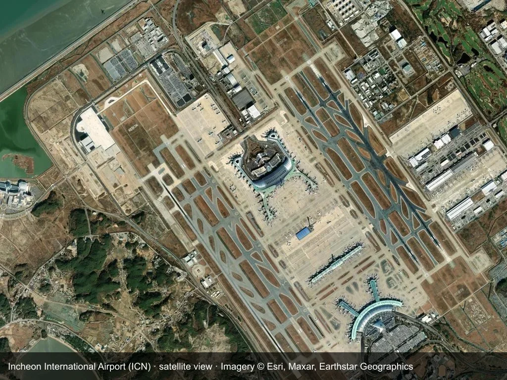

เที่ยวบินไปโซลไม่ได้ลงจอดที่เดียวกันทั้งหมด อินชอน (ICN) อยู่บนเกาะยองจงนอกชายฝั่งตะวันตก ส่วนกิมโป (GMP) ชิดขอบตะวันตกของเมือง ทั้งสองพาคุณเข้าโซลได้ แต่คิว เวลาเดินทาง และแม้แต่กฎตั๋วก็เป็นของสองระบบที่ต่างกัน การเลือก "ผิด" ไม่ถึงขั้นร้ายแรง — แค่เสียเวลาหนึ่งหรือสองชั่วโมงและการลากกระเป๋าเยอะ

คู่มือนี้พาไปตามลำดับ: สนามบินไหนก่อน แล้วใช้เส้นทางไหน ครอบคลุมระยะทางและตรวจคนเข้าเมือง วิธีแยกรถไฟ AREX สองแบบของอินชอน ทำไมกิมโปถึงสถานีโซลได้ในประมาณยี่สิบนาที ค่ารถบัสและแท็กซี่ และเอกสารขาเข้า — Q-CODE วีซ่า C-3-9 และข้อจำกัดหนึ่งที่ทำให้นักเดินทางปลอดวีซ่าติดกับที่กิมโป ค่าโดยสารและตารางเวลาเปลี่ยน ตรวจสอบแหล่งทางการก่อนเดินทาง

## 1. อินชอนและกิมโป: สองสนามบิน สองจังหวะ

ท่าอากาศยานนานาชาติอินชอน (ICN) อยู่บนเกาะยองจงห่างจากเมืองไปทางตะวันตกประมาณ 50 กม. และรองรับการจราจรระหว่างประเทศส่วนใหญ่ของเกาหลี — เมืองจีนส่วนใหญ่ที่มีเที่ยวบินตรงไปโซลลงจอดที่นี่ สนามบินเปิด 24 ชั่วโมง การมาถึงด้วยเที่ยวบินกลางคืนจึงไม่มีปัญหา และอาคารผู้โดยสาร 1 และ 2 มีร้านปลอดภาษี ร้านอาหาร และสิ่งอำนวยความสะดวกสำหรับเปลี่ยนเครื่องครบครัน ราคาที่ต้องจ่ายคือขนาดที่ใหญ่โต: การเดินจากเครื่องบินไปตรวจคนเข้าเมืองแล้วไปสายพานรับกระเป๋านั้นยาวไกล

ท่าอากาศยานนานาชาติกิมโป (GMP) อยู่ห่างจากใจกลางเมืองเพียงประมาณ 17 กม. มีอาคารผู้โดยสารกะทัดรัดที่ทำให้รถไฟใต้ดินและรถไฟสนามบินอยู่ห่างจากขาเข้าเพียงเดินไม่กี่นาที เครือข่ายระหว่างประเทศมีน้อย — เซี่ยงไฮ้หงเฉียว ปักกิ่ง โตเกียว และเส้นทางระยะสั้นคล้ายกัน — พื้นที่ปลอดภาษีเล็กและมีร้านไม่มาก และการจราจรส่วนใหญ่เป็นเที่ยวบินในประเทศ โดยเฉพาะไปเชจู โถงตรวจคนเข้าเมืองมีขนาดเล็ก และ 20–40 นาทีเป็นเวลาปกติในการผ่านด่าน ซึ่งมักเร็วกว่าอินชอน

การเลือกเริ่มจากเที่ยวบินและโรงแรมของคุณ หากค่าโดยสารใกล้กันและคุณพักในฮงแดหรือใจกลางเมือง ให้เลือกกิมโป: หนึ่งชั่วโมงที่ประหยัดได้นั้นเป็นของจริง หากเมืองของคุณมีเพียงเที่ยวบินตรงไปอินชอน หากคุณเดินทางด้วยเที่ยวบินกลางคืน หรืออยากใช้เวลาในพื้นที่ปลอดภาษีของสนามบิน ให้เลือกอินชอน ตรวจสอบอาคารด้วย: Korean Air และเที่ยวบิน SkyTeam ส่วนใหญ่ใช้ T2 ขณะที่สายการบินจีนส่วนใหญ่ใช้ T1 รถรับส่งฟรีเชื่อมสองอาคารในประมาณ 18 นาที จึงควรเผื่อเวลาอย่างน้อย 20 นาทีสำหรับการย้ายอาคาร

## 2. การเปรียบเทียบแบบรวบรัด

| | อินชอน (ICN) | กิมโป (GMP) |
| --- | --- | --- |
| ระยะทางจากเมือง | ประมาณ 50 กม. บนเกาะยองจง | ประมาณ 17 กม. ริมขอบตะวันตก |
| อาคารผู้โดยสาร | T1 และ T2 เชื่อมด้วยรถรับส่งฟรี (ประมาณ 18 นาที) | อาคารระหว่างประเทศและในประเทศแยกกัน เดินถึงกันได้ |
| ตรวจคนเข้าเมือง | 30–60 นาทีเมื่อราบรื่น นานกว่าในช่วงพีค | 20–40 นาที มักเร็วกว่า |
| วิธีเข้าเมืองหลัก | AREX เอ็กซ์เพรสหรือจอดทุกสถานี รถบัสสนามบิน แท็กซี่ | AREX จอดทุกสถานี รถไฟใต้ดินสาย 5 และ 9 รถบัสสนามบิน |
| ถึงสถานีโซล | เอ็กซ์เพรส 43 นาที (T1), 51 นาที (T2); จอดทุกสถานี 58–66 นาที | AREX จอดทุกสถานีประมาณ 22 นาที |
| ค่าโดยสารอ้างอิง | เอ็กซ์เพรส 13,000 วอน; จอดทุกสถานี 4,750 วอน (T1) หรือ 5,350 วอน (T2) | ประมาณ 1,750 วอนด้วย T-money |
| เหมาะกับ | เที่ยวบินกลางคืน เที่ยวบินตรงมากขึ้น ปลอดภาษี สัมภาระหนัก | พักในฮงแดหรือใจกลาง เส้นทางระยะสั้น ตารางเวลาแน่น สัมภาระเบา |

สองแถวกลางอ่านข้ามง่าย: ตรวจคนเข้าเมืองและการเดินทางเป็นเวลาที่แยกกัน ที่อินชอน ตรวจคนเข้าเมือง 30–60 นาทีตามด้วยรถไฟอย่างน้อย 43 นาที ที่กิมโป 20–40 นาทีตามด้วย 22 นาทีถึงสถานีโซล หากมีเด็กหรือลงจอดใกล้เที่ยงคืน ครึ่งชั่วโมงนั้นเป็นตัวกำหนดว่าค่ำคืนจะเป็นอย่างไร

## 3. จากอินชอน: อย่าสับสนรถไฟ AREX สองแบบ

หลังรับกระเป๋า ให้ทำตามป้าย **공항철도 AREX / Airport Railroad** ลงไปที่ศูนย์ขนส่งชั้น B1 AREX ให้บริการสองรูปแบบที่มีชื่อคล้ายกันจากชานชาลาข้างกัน และการขึ้นผิดแบบจะเพิ่มการจอดอีกเจ็ดหรือแปดสถานี

- **เอ็กซ์เพรส:** ไม่จอดจากอินชอน T1 หรือ T2 ถึงสถานีโซล ประมาณ 43 นาทีจาก T1 และ 51 นาทีจาก T2 ราคา 13,000 วอนสำหรับผู้ใหญ่ พร้อมที่นั่งกำหนด **ไม่** รับ T-money — คุณต้องมีตั๋วแยก และหลายคนเพิ่งรู้เรื่องนี้ที่ประตู เหมาะหากโรงแรมอยู่ใกล้สถานีโซลหรือเมียงดง หรือหากมีสัมภาระและต้องการเวลาถึงที่คาดเดาได้
- **จอดทุกสถานี:** ท่าอากาศยานอินชอน → ท่าอากาศยานกิมโป → ดิจิทัลมีเดียซิตี้ → มหาวิทยาลัยฮงอิก → คงด็อก → สถานีโซล 58–66 นาทีตลอดเส้นทาง ประมาณ 4,750 วอนจาก T1 และ 5,350 วอนจาก T2 และใช้ T-money ได้ จึงมาถึงแล้วไปได้เลย เหมาะกับฮงแด งบจำกัด และสัมภาระเบา

โดยประมาณ เอ็กซ์เพรสวิ่ง 05:15–22:48 และจอดทุกสถานี 05:18–23:32 ตรวจสอบเว็บไซต์ AREX สำหรับวันเดินทาง หากลงจอดหลังรถไฟเที่ยวสุดท้าย คุณเหลือเพียงรถบัสสนามบินช่วงดึกหรือแท็กซี่

รถบัสสนามบินมีค่าโดยสารอ้างอิง 6,000–17,000 วอนขึ้นอยู่กับเส้นทาง และใช้เวลา 65–90 นาที กระเป๋าหนักเก็บในช่องใต้ท้องรถและบางเส้นทางวิ่งตรงไปเมียงดงหรือคังนัม แต่การจราจรทำให้เวลาคาดเดาไม่ได้และเที่ยวช่วงดึกมีน้อยลง แท็กซี่กลางวันไปใจกลางเมืองประมาณ 50,000–70,000 วอน พร้อมค่าบริการกลางคืน — คุ้มสำหรับกลุ่มที่มีกระเป๋าใบใหญ่ แต่ไม่คุ้มหากเดินทางคนเดียว

## 4. จากกิมโป: ยี่สิบสองนาทีถึงสถานีโซล

ข้อได้เปรียบของกิมโปคือสถานีอยู่ใต้อาคารผู้โดยสาร เดินไม่กี่นาทีจากขาเข้า ที่นี่ไม่มี AREX เอ็กซ์เพรส มีเพียงบริการจอดทุกสถานี — ท่าอากาศยานกิมโป → มหาวิทยาลัยฮงอิก → คงด็อก → สถานีโซล ประมาณ 22 นาที ราคาประมาณ 1,750 วอนด้วย T-money

รถไฟใต้ดินเพิ่มทางเลือก สาย 5 (สีม่วง) วิ่งจากสถานีท่าอากาศยานกิมโปไปยังยออีโด ควังฮวามุน และทงแดมุน โดยเปลี่ยนรถได้ง่าย สาย 9 มุ่งไปคังนัม ชินนนฮยอน และสถานีขนส่งทางไกล และเป็นตัวเลือกที่ชัดเจนสำหรับฝั่งใต้แม่น้ำ การเดินทางไปฮงแด ยออีโด หรือใจกลางใช้เวลาประมาณ 20–35 นาที และทุกอย่างที่กิมโป — ทั้งรถไฟใต้ดินและ AREX จอดทุกสถานี — ใช้ T-money ได้ ทำให้ง่ายกว่าอินชอน

รถบัสสนามบินจากกิมโปรองกว่าที่อินชอนและแทบไม่มีข้อได้เปรียบ รถไฟใต้ดินเป็นตัวเลือกที่ดีกว่า

## 5. ก่อนลงจอด: Q-CODE วีซ่า และกับดักเชจู

ทั้งสองสนามบินใช้การเตรียมตัวขาเข้าแบบเดียวกัน กรอก Q-CODE (แบบฟอร์มข้อมูลกักกันก่อนเข้าประเทศ) ก่อนลงจอดเพื่อประหยัดเวลาที่เคาน์เตอร์สุขภาพ และหากเดินทางด้วยวีซ่าท่องเที่ยว C-3-9 ให้เก็บตั๋วขากลับและการจองโรงแรมไว้ในโทรศัพท์ — ศุลกากรตรวจแบบสุ่ม บัตร T-money ซื้อและเติมเงินได้ที่ร้านสะดวกซื้อในสนามบินทุกแห่ง ที่อินชอนใช้ได้เฉพาะ AREX จอดทุกสถานี ส่วนที่กิมโปครอบคลุมรถบัส รถไฟใต้ดิน ร้านสะดวกซื้อ และแท็กซี่ส่วนใหญ่

มีจุดหนึ่งที่ควรเน้น **เที่ยวบินไปเชจูแบบไม่ต้องวีซ่าส่วนใหญ่มาถึงอาคารในประเทศของกิมโป และผู้ที่มาถึงแบบไม่ต้องวีซ่าไม่สามารถต่อเที่ยวบินในประเทศไปโซลได้** กล่าวอีกนัยหนึ่ง แผน "บินไปเชจูแบบไม่ต้องวีซ่า แล้วต่อไปโซล" จะสะดุดที่เช็คอินหรือที่ประตูขึ้นเครื่อง: เชจูถึงกิมโปเป็นเส้นทางในประเทศของเกาหลีและต้องมีวีซ่าหรือสถานะพำนักที่เหมาะสม ยืนยันสถานะการเข้าประเทศก่อนจอง และอย่าต่อสองช่วงเข้าด้วยกันโดยสมมติว่าจะได้ผล

## 6. เลือกเส้นทางตามที่พัก

- **พักในฮงแด:** จากอินชอน AREX จอดทุกสถานีวิ่งตรงไปมหาวิทยาลัยฮงอิก; จากกิมโป รถไฟเดียวกันใช้เวลาประมาณ 22 นาที
- **พักในเมียงดงหรือใกล้สถานีโซล:** จากอินชอน ใช้ AREX เอ็กซ์เพรส 43 นาทีถึงสถานีโซล; จากกิมโป นั่งจอดทุกสถานีถึงสถานีโซลแล้วเปลี่ยนไปรถไฟใต้ดิน
- **พักในคังนัม:** จากอินชอน รถบัสสนามบินวิ่งตรง; จากกิมโป สาย 9 ไปตรงนั้น

ไม่มีสนามบินไหนเดินยาก ปัญหาคือข้อมูลที่ไม่ตรงกัน ในเส้นทาง AREX เดียวกัน เอ็กซ์เพรสกับจอดทุกสถานีต่างกันกว่าสองเท่าทั้งค่าโดยสารและบัตรขนส่งของคุณใช้ได้หรือไม่ และ "กิมโป" หมายถึงสองอาคารแยกกันสำหรับเที่ยวบินระหว่างประเทศและในประเทศ รวมอาคารผู้โดยสาร ประเภทรถไฟ และโรงแรมไว้ในแผนเดียว แล้วชั่วโมงแรกของคุณจะไม่สูญเปล่า

## ลิงก์ที่เกี่ยวข้อง

- **ในเว็บไซต์นี้**: [ท่าอากาศยานนานาชาติอินชอน (ICN)](/airport/ICN), [เกาหลีใต้ (KR)](/country/KR)
- **Wikipedia**: [ท่าอากาศยานนานาชาติอินชอน](https://en.wikipedia.org/wiki/Incheon_International_Airport), [ท่าอากาศยานนานาชาติกิมโป](https://en.wikipedia.org/wiki/Gimpo_International_Airport)
- **Baidu Baike**: [ท่าอากาศยานนานาชาติอินชอน](https://baike.baidu.com/item/%E4%BB%81%E5%B7%9D%E5%9B%BD%E9%99%85%E6%9C%BA%E5%9C%BA), [ท่าอากาศยานนานาชาติกิมโป](https://baike.baidu.com/item/%E9%87%91%E6%B5%A6%E5%9B%BD%E9%99%85%E6%9C%BA%E5%9C%BA)
- **เว็บไซต์ทางการ**: [รถไฟสนามบิน AREX](https://www.airportrailroad.com/), [ท่าอากาศยานนานาชาติอินชอน](https://www.airport.kr/)

ที่มา: VJW ฉบับภาษาจีนตัวย่อ (บัญชี WeChat); ภาพปกดาวเทียมของท่าอากาศยานอินชอนจากคลังภาพของเว็บไซต์นี้ ค่าโดยสาร ตารางเวลา และกฎการเข้าประเทศเป็นไปตามประกาศของ AREX ท่าอากาศยานนานาชาติอินชอน และสำนักงานตรวจคนเข้าเมืองเกาหลี
