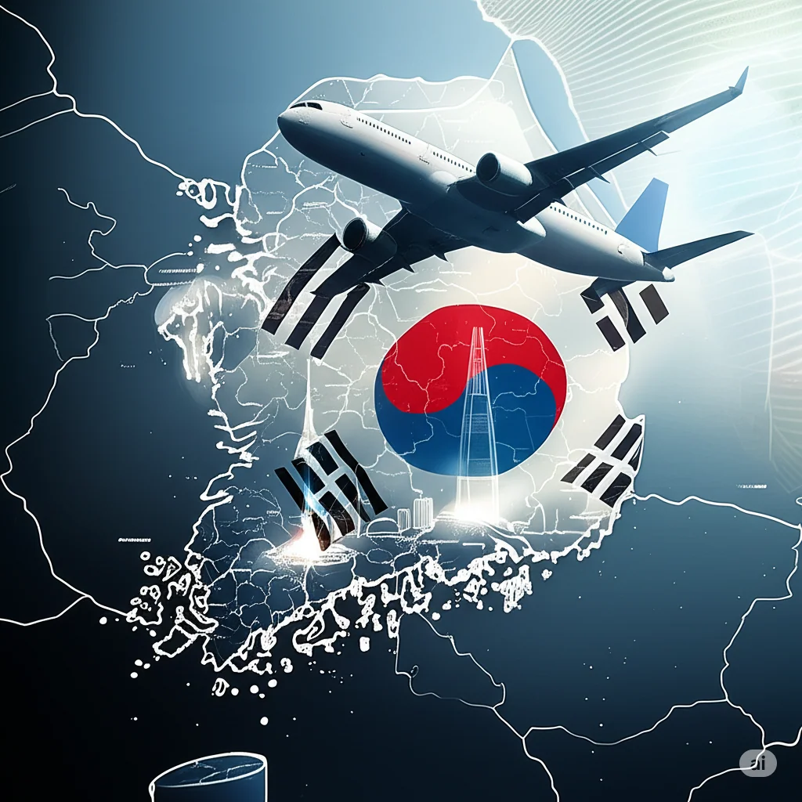

Incheon International Airport (ICN) sits on reclaimed land off Yeongjong Island; Gimpo International Airport (GMP) is in western Seoul, about 40 km away. Plenty of people book a trip that says only "Seoul" and discover at the itinerary stage that the first flight lands at Incheon while the second leaves from Gimpo. No airline covers that gap — you cross it yourself.

Two very different things get called a transfer here. Staying inside the international transit area with bags checked through, continuing on another international flight, is airside transit. Going to Gimpo for a domestic flight — or for another ticket's international departure — means clearing Korean immigration, entering the country, collecting your bags and walking out of arrivals. The first depends on transit rules, the second on your right to enter Korea.

## 1. The first hurdle: going to Gimpo means entering Korea

Visa-free transit applies only when you do not enter the country: no more than 24 hours in the international transit area, bags checked through, an onward international flight, and a nationality and route the rules allow. The moment Gimpo is on the itinerary, that route is closed — you must clear immigration. Applying "no visa needed to transit Incheon" to an airport change is the standard mistake here.

Check three things before departure. Is your Korean visa valid, with enough entries left? Do you qualify for K-ETA or visa-free entry, and is your nationality currently on the list? Does your passport meet the validity requirement? The K-ETA list and its temporary exemptions have changed repeatedly, so an old blog post is not a source.

There is a checkpoint at the departure end too: on separate tickets the first check-in desk often asks about your onward booking and your right to enter Korea, and with the wrong documents you can be refused boarding at your origin rather than at Incheon. Third-country passports follow the same rules.

## 2. AREX: only the all-stop train serves Gimpo

Airport Railroad (AREX) has a station at both Incheon terminals, on level B1 of the Transport Centre; follow the "Airport Railroad" signs down the escalator. Two services share the platforms and are told apart by colour: the orange-yellow Express and the blue all-stop train. Check which you are boarding before the gates.

The important part: the Express stops only at Incheon T2, Incheon T1 and Seoul Station. It does not stop at Gimpo Airport at all. T1 to Seoul Station takes about 43 minutes and T2 about 51 minutes, for 13,000 won. Boarding it for Gimpo simply carries you past your stop to Seoul Station, and you have to come back — double the money and time.

Gimpo is served only by the all-stop train: about 40 minutes and 4,750 won from T1, about 50 minutes and 5,350 won from T2. It calls at every station and seats are first come first served. Buy a ticket at the B1 counter or the machines, or simply tap a T-money card at the gate.

| Option | Time | Fare | Notes |
| --- | --- | --- | --- |
| AREX all-stop, T1 → Gimpo | about 40 min | 4,750 won | B1 Transport Centre, blue train |
| AREX all-stop, T2 → Gimpo | about 50 min | 5,350 won | Passes through T1, no change needed |
| AREX Express | does not serve Gimpo | 13,000 won | Seoul Station only — do not board |
| Airport bus 6100 / 6101 | 50–70 min | 7,500–9,000 won | T1 stops 5B / 6A; T2 near exits 4–5 |
| Taxi | depends on traffic | 45,000–55,000 won | T1 5C / 6C; T2 4C |

The B1 waiting area has free Wi-Fi and charging points. Daytime trains are frequent, but check the last one: on a late landing, confirm a service still runs before ruling out a taxi.

## 3. Buses 6100 and 6101: the easier option with luggage

Buses 6100 and 6101 run from Incheon towards Gimpo Airport, taking 50–70 minutes depending on traffic, for about 7,500–9,000 won according to boarding point and route. At T1 the stops are 5B and 6A outside the level 1 arrivals hall; at T2 near exits 4–5. Route numbers and stop names appear in Korean and English — check for 6100 or 6101 before queueing.

The advantage is the doorstep drop at the Gimpo terminal: no hauling suitcases into a station and out again. The cost is traffic — the expressway and western Seoul clog up between roughly 07:00–09:00 and 18:00–20:00, and weekend afternoons are slow. With heavy bags and a comfortable margin, the bus beats the train.

## 4. Taxi: the least stressful choice for three or four people

Incheon T1 or T2 to Gimpo Airport runs about 45,000–55,000 won, with the meter moving according to traffic and waiting time. Pick-up points are outside exits 5C and 6C on the level 1 arrivals floor at T1, and outside exit 4C at T2; both have marked queues.

For English-speaking service, book an International Taxi at an arrivals-level desk or online and give your flight number. Split three or four ways the fare is close to the bus per person, and it removes the waiting, the change of vehicle and the luggage handling — the safest option when protecting a check-in deadline. The airport call centre, +82-1577-2600, has Chinese-speaking staff; ranks are outside arrivals, so follow the "Taxi" signs rather than hailing from the kerb.

## 5. Baggage: through-checking only happens on one ticket

A single connecting ticket on one carrier or within one alliance: ask at your origin for the bags to be checked through to the final destination, and at Incheon you stay airside. That is the only easy version of this journey.

Two separately bought tickets: the bags stop at Incheon. You clear immigration, collect them from the belt, take them to Gimpo by train, bus or taxi, and check them in again at the second ticket's desk, which usually closes about 30 minutes before departure — work backwards from it. Free allowances are generally not pooled across two tickets, and the second flight applies its own rules, so price any excess beforehand.

## 6. How much time to allow: the 1.5, 2 and 3 hour rules

By rail, count at least 1.5 hours: landing, immigration, bags, buying or topping up a card, the wait and the ride, plus 10 minutes from T2. By bus, at least 2 hours, with no ceiling when traffic misbehaves. For an international-to-domestic connection, allow 3 hours or more — immigration, the baggage belt, the 40–50 minute ride and then check-in and security at Gimpo.

A blunter way to plan: with only 2 hours between the tickets, skip the train and take a taxi; with only 1.5 hours, look at rebooking rather than at route maps. Between 07:00–09:00 and 18:00–20:00 both rail and road are busiest, so add margin either way.

At Gimpo, do not walk into the first building you see: the domestic and international terminals are separate but connected buildings with different check-in levels and entrances. Follow the "국내선" (domestic) or "국제선" (international) signs and confirm which building houses your airline's desk.

The reverse direction — landing at Gimpo, departing from Incheon — is the same distance and broadly symmetrical: 1.5 hours by rail, 2 hours by bus. Transport is quicker to find at Gimpo, but its international departure hall has fewer desks and security lanes, so peak-season queues may not be shorter.

## Related links

- **On this site**: [Incheon International Airport (ICN)](/airport/ICN), [South Korea (KR)](/country/KR)
- **Wikipedia**: [Incheon International Airport](https://en.wikipedia.org/wiki/Incheon_International_Airport), [Gimpo International Airport](https://en.wikipedia.org/wiki/Gimpo_International_Airport), [Airport Railroad Express](https://en.wikipedia.org/wiki/Airport_Railroad_Express)
- **Baidu Baike**: [Incheon International Airport](https://baike.baidu.com/item/%E4%BB%81%E5%B7%9D%E5%9B%BD%E9%99%85%E6%9C%BA%E5%9C%BA), [Gimpo International Airport](https://baike.baidu.com/item/%E9%87%91%E6%B5%A6%E5%9B%BD%E9%99%85%E6%9C%BA%E5%9C%BA)
- **Official sites**: [AREX](https://www.airportrailroad.com/), [Incheon Airport](https://www.airport.kr/)

_Fares, timetables and entry rules change; the figures here are indicative. Check the AREX and Incheon Airport websites, and Korea's immigration authorities, before you travel._
