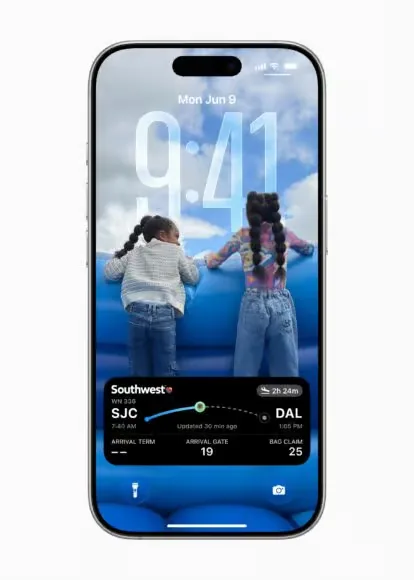

Dokončíte nákup a pak přepnete do Mailu, abyste vyhrabali číslo zásilky. Na letišti žije palubní vstupenka, sledování zavazadel a mapa letiště každé v jiné aplikaci. U kasy lovíte kartu a nemůžete najít její číslo. iOS 26 to všechno stahuje do Peněženky: objednávky se sledují automaticky, sledování zavazadel je zabudované v palubní vstupence a kreditní karty se vyplňují v celém systému – žádné přeskakování mezi aplikacemi.

Je to největší vylepšení Peněženky za poslední roky a sahá od nakupování přes cestování a platby až po identitu. Tady je, co je nového.

## 0. Aktualizace 2026: iOS 27 je venku

Apple vydal vývojářskou betu iOS 27 na WWDC 2026 v červnu a jako obvykle uvedl veřejnou verzi s novými iPhony v září. Změny Peněženky v iOS 27 se netýkají ani tak palubní vstupenky samotné, jako spíš proměny Peněženky v prohledávatelné úložiště dokladů, které umí dělit platby a vydávat průkazy: jednotné vyhledávání napříč kartami, průkazy a transakcemi; dělení účtu Apple Cash; digitální průkazy vytvářené obchodníky; a digitalizace některých fyzických karet a jízdenek s pomocí AI ([MacRumors](https://www.macrumors.com/guide/ios-27-wallet/), [ZDNET](https://www.zdnet.com/business/ios-27-apple-wallet-new-features-guide/)).

Mapa letiště, sledování zavazadel, Živé aktivity a sdílení letu, které cestovatelům záleží nejvíc, přišly v iOS 26 a do iOS 27 přecházejí, místo aby je nahradily. Následující průchod vychází z rozhraní iOS 26; v iOS 27 se vstupní body mohou mírně posunout, ale chování zůstává stejné.

## 1. Sledování objednávek s Apple Intelligence

Peněženka získává **Sledování objednávek**, jediné místo pro přehled všech online objednávek:

- **Bez nutné integrace na straně obchodníka.** Apple Intelligence čte čísla objednávek a aktualizace doručení z Mailu a synchronizuje je do Peněženky.
- **Všechny objednávky, ne jen z Apple Pay.** Zachycují se i e-maily z jiných platebních metod.
- **Kde to najdete.** Klepněte na tlačítko „…“ vpravo nahoře v Peněžence a potom na **Objednávky**.

> Poznámka: vyžaduje zařízení s podporou Apple Intelligence a některé objednávky může být nutné označit jako dokončené ručně.

## 2. Palubní vstupenky: mapy letišť a sledování zavazadel

Palubní vstupenka se z osamoceného QR kódu mění v plnohodnotného cestovního asistenta – to je část, která se hodí nejvíc, pokud létáte:

- **Živá aktivita.** Stav letu se zobrazuje na uzamčené obrazovce a v Dynamic Islandu, takže bránu, čas nástupu a zavazadlový pás vidíte bez otevírání aplikace.
- **Mapa letiště.** Do vstupenky je zabudovaná mapa interiéru letiště, která vás navede k bráně, salonkům, bezpečnostní kontrole, výdeji zavazadel a toaletám.
- **Sledování zavazadel.** Propojené s Lokátorem, takže zavazadlo s AirTagem lze dohledat.
- **Ztracená zavazadla.** Ztracené zavazadlo můžete nahlásit přímo z Peněženky.
- **Sdílení letu.** Jedním klepnutím pošlete údaje o letu rodině nebo přátelům, aby vás mohli vyzvednout nebo let sledovat.

Mezi leteckými společnostmi, které to už podporují, jsou United, Air Canada a Delta; American Airlines, Lufthansa a Qantas přislíbily, že budou následovat.

## 3. Automatické vyplňování karet, nyní v celém systému

iOS 26 rozšiřuje automatické vyplňování kreditních karet ze Safari na celý systém:

- **Funguje kdekoli.** Klepněte na textové pole v jakékoli aplikaci nebo na webu → **Automatické vyplňování** → **Kreditní karty**.
- **Jedno místo pro správu.** Nová nabídka Automatické vyplňování v Peněžence vypisuje, přidává a spravuje všechny uložené karty.
- **Přidání karty.** Naskenujte ji kamerou nebo ji zadejte a potvrďte Face ID nebo Touch ID.

## 4. Digitální doklad (americký pas): cestování bez papírů

- Americký pas lze přidat do Peněženky a uložit na iPhone nebo Apple Watch.
- Funguje na některých kontrolních bodech TSA ve Spojených státech a splňuje standard Real ID.
- Může také ověřit věk u prodejců, v aplikacích a na webech.

> Omezení: neplatí pro mezinárodní cestování ani překračování hranic – fyzický pas stále potřebujete.

## 5. Platby na splátky s Apple Pay

Při platbě v obchodě přes Apple Pay si můžete vybrat splátkový plán nabízený vaší bankou nebo vydavatelem karty. Platí stejně pro kreditní i debetní karty, což usnadňuje rozložení větších nákupů.

## 6. Ovládání reklam: propagační oznámení lze vypnout

Apple konečně řeší dlouholetou stížnost přepínačem „Nabídky a akce“:

- **Kde.** Peněženka → „…“ vpravo nahoře → **Oznámení** → vypněte **Nabídky a akce**.
- Propagační oznámení z Peněženky (například tipy na závody F1) po vypnutí přestanou.
- Je ve výchozím nastavení zapnutý, takže ho musíte vypnout ručně.

Pokud létáte často, začněte mapou letiště uvnitř palubní vstupenky a sledováním zavazadel v Lokátoru; zbytek může počkat do další cesty.

## Související odkazy

- **Na tomto webu**: [Los Angeles LAX](/airport/LAX), [Spojené státy (US)](/country/US)
- **Wikipedie**: [Los Angeles LAX](https://en.wikipedia.org/wiki/Los_Angeles_International_Airport)
- **Baidu Baike**: [Los Angeles LAX](https://baike.baidu.com/item/%E6%B4%9B%E6%9D%89%E7%9F%B6%E5%9B%BD%E9%99%85%E6%9C%BA%E5%9C%BA)
