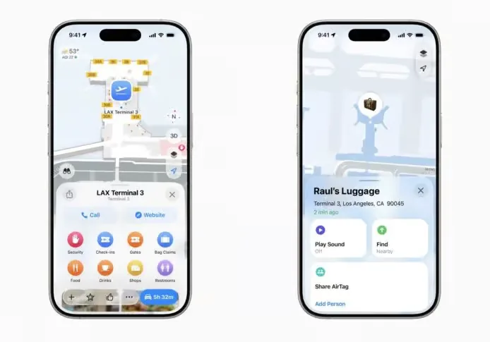
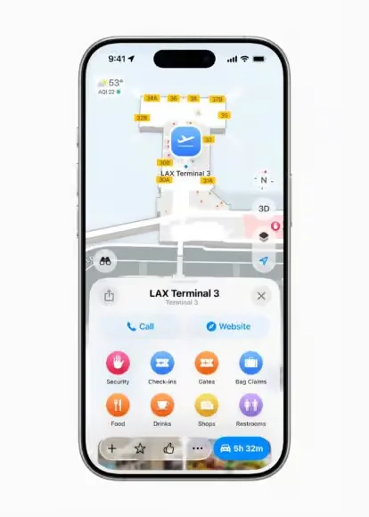
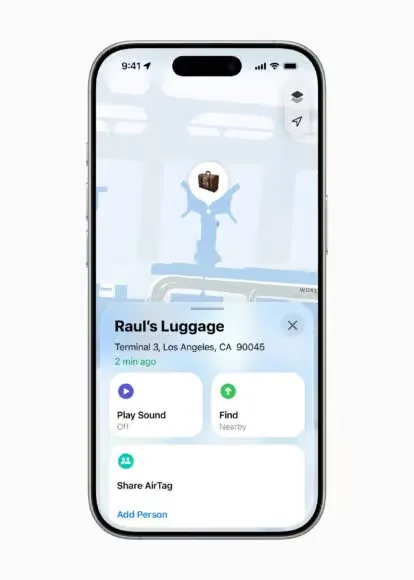
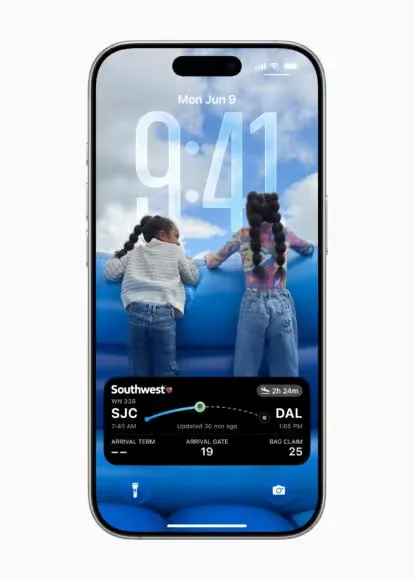

Vous finalisez un achat, puis passez à Mail pour dénicher le numéro de suivi. À l'aéroport, la carte d'embarquement, le suivi des bagages et le plan d'aéroport vivent chacun dans une application différente. En caisse, vous fouillez pour trouver une carte et ne retrouvez plus le numéro. iOS 26 rassemble tout cela dans Wallet : commandes suivies automatiquement, suivi des bagages intégré à la carte d'embarquement et cartes bancaires remplies automatiquement dans tout le système — fini le safari entre applications.

C'est la plus grande mise à jour de Wallet depuis des années, couvrant achats, voyage, paiements et identité. Voici ce qui est nouveau.

## 0. La mise à jour 2026 : iOS 27 est disponible

Apple a publié la bêta développeur d'iOS 27 à la WWDC 2026 en juin et, comme d'habitude, livré la version publique avec les nouveaux iPhone en septembre. Les changements de Wallet dans iOS 27 portent moins sur la carte d'embarquement elle-même que sur la transformation de Wallet en un portefeuille d'identifiants consultable, partageable et capable d'émettre des passes : recherche unifiée parmi les cartes, les passes et les transactions ; partage d'addition avec Apple Cash ; passes numériques créés par les commerçants ; et numérisation assistée par IA de certaines cartes et de certains billets physiques ([MacRumors](https://www.macrumors.com/guide/ios-27-wallet/), [ZDNET](https://www.zdnet.com/business/ios-27-apple-wallet-new-features-guide/)).

Le plan d'aéroport, le suivi des bagages, les Live Activities et le partage de vol, qui comptent le plus pour les voyageurs, sont apparus avec iOS 26 et sont repris dans iOS 27 plutôt que remplacés. La visite ci-dessous suit l'interface d'iOS 26 ; sur iOS 27, les points d'entrée peuvent légèrement changer, mais le comportement reste le même.

## 1. Suivi des commandes, propulsé par Apple Intelligence

Wallet gagne le **suivi des commandes**, un endroit unique pour suivre chaque commande en ligne :

- **Aucune intégration du marchand nécessaire.** Apple Intelligence lit les numéros de commande et les mises à jour d'expédition dans Mail et les synchronise avec Wallet.
- **Toutes les commandes, pas seulement Apple Pay.** Les e-mails issus d'autres moyens de paiement sont aussi récupérés.
- **Où regarder.** Touchez le bouton « … » en haut à droite de Wallet, puis **Commandes**.

> Remarque : nécessite un appareil compatible avec Apple Intelligence, et certaines commandes devront peut-être être marquées comme terminées manuellement.

## 2. Cartes d'embarquement : plans d'aéroport et suivi des bagages

La carte d'embarquement passe d'un simple QR code à un véritable assistant de voyage — la partie qui compte le plus si vous prenez l'avion :

- **Live Activity.** Le statut du vol apparaît sur l'écran verrouillé et dans la Dynamic Island : la porte, l'heure d'embarquement et le tapis à bagages sont visibles sans ouvrir d'application.
- **Plan d'aéroport.** Un plan intérieur de l'aéroport est intégré au passe et vous indique la porte, les salons, le contrôle de sécurité, la livraison des bagages et les toilettes.
- **Suivi des bagages.** Intégré à Localiser, pour retrouver une valise équipée d'un AirTag.
- **Bagages perdus.** Vous pouvez signaler une valise manquante directement depuis Wallet.
- **Partage de vol.** Envoyez les détails du vol à votre famille ou à vos amis en un geste, pour qu'ils puissent venir vous chercher ou suivre le vol.

United, Air Canada et Delta figurent parmi les compagnies déjà prises en charge ; American Airlines, Lufthansa et Qantas se sont engagées à suivre.

## 3. Remplissage automatique des cartes bancaires, désormais dans tout le système

iOS 26 étend le remplissage automatique des cartes bancaires de Safari à l'ensemble du système :

- **Fonctionne partout.** Touchez un champ de texte dans n'importe quelle application ou site web → **Remplissage auto** → **Cartes bancaires**.
- **Un seul endroit pour les gérer.** Un nouveau menu Remplissage auto dans Wallet liste, ajoute et gère toutes les cartes enregistrées.
- **Ajouter une carte.** Scannez-la avec l'appareil photo ou saisissez-la, puis confirmez avec Face ID ou Touch ID.

## 4. Carte d'identité numérique (passeport américain) : voyager sans papier

- Un passeport américain peut être ajouté à Wallet et stocké sur l'iPhone ou l'Apple Watch.
- Il fonctionne à certains points de contrôle TSA aux États-Unis et répond à la norme Real ID.
- Il permet aussi de vérifier votre âge chez les commerçants, dans les applications et sur les sites web.

> Limite : il n'est pas valable pour les voyages internationaux ni pour le passage des frontières — le passeport physique reste indispensable.

## 5. Paiement en plusieurs fois avec Apple Pay

Lors d'un paiement en boutique avec Apple Pay, vous pouvez choisir un paiement en plusieurs fois proposé par votre banque ou l'émetteur de votre carte. Cela vaut pour les cartes de crédit comme de débit, ce qui facilite l'étalement des achats plus importants.

## 6. Contrôle des publicités : les notifications promotionnelles peuvent être désactivées

Apple répond enfin à une plainte de longue date avec un interrupteur « Offres et promotions » :

- **Où.** Wallet → « … » en haut à droite → **Notifications** → désactivez **Offres et promotions**.
- Les notifications promotionnelles de Wallet (des suggestions de courses de F1, par exemple) s'arrêtent une fois l'option désactivée.
- L'option est activée par défaut, il faut donc la désactiver manuellement.

Si vous prenez souvent l'avion, commencez par le plan d'aéroport dans la carte d'embarquement et le suivi des bagages dans Localiser ; le reste peut attendre votre prochain voyage.

## Liens utiles

- **Sur ce site** : [Aéroport de Los Angeles LAX](/airport/LAX), [États-Unis (US)](/country/US)
- **Wikipédia** : [Aéroport international de Los Angeles](https://en.wikipedia.org/wiki/Los_Angeles_International_Airport)
- **Baidu Baike** : [Aéroport international de Los Angeles](https://baike.baidu.com/item/%E6%B4%9B%E6%9D%89%E7%9F%B6%E5%9B%BD%E9%99%85%E6%9C%BA%E5%9C%BA)
