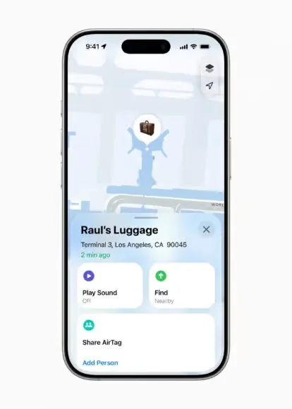

Je rondt een aankoop af en schakelt dan over naar Mail om het volgnummer van je zending op te zoeken. Op de luchthaven zitten de instapkaart, bagageopsporing en luchthavenkaart elk in een andere app. Bij de kassa zoek je tussen je spullen naar een kaart en vind je het nummer niet. iOS 26 brengt dat allemaal samen in Wallet: bestellingen worden automatisch gevolgd, bagageopsporing zit in de instapkaart en creditcards worden systeembreed automatisch aangevuld — geen heen-en-weer tussen apps meer.

Het is de grootste vernieuwing van Wallet in jaren, op het gebied van winkelen, reizen, betalen en identiteit. Dit is wat er nieuw is.

## 0. De update van 2026: iOS 27 is uit

Apple bracht in juni tijdens WWDC 2026 de bèta voor ontwikkelaars van iOS 27 uit en leverde zoals gewoonlijk in september de openbare versie mee met de nieuwe iPhones. De Wallet-veranderingen in iOS 27 gaan minder over de instapkaart zelf dan over het omvormen van Wallet tot een doorzoekbare, splitsbare opslag voor pasjes en inloggegevens, die ook zelf pasjes kan uitgeven: geïntegreerd zoeken in kaarten, pasjes en transacties; het splitsen van Apple Cash-rekeningen; door handelaren gemaakte digitale pasjes; en digitalisering met behulp van kunstmatige intelligentie van sommige fysieke kaarten en kaartjes ([MacRumors](https://www.macrumors.com/guide/ios-27-wallet/), [ZDNET](https://www.zdnet.com/business/ios-27-apple-wallet-new-features-guide/)).

De luchthavenkaart, bagageopsporing, Live-activiteiten en het delen van vluchten die voor reizigers het belangrijkst zijn, kwamen in iOS 26 en blijven in iOS 27 behouden in plaats van te worden vervangen. De onderstaande uitleg volgt de interface van iOS 26; in iOS 27 kunnen de toegangspunten iets verschuiven, maar het gedrag is hetzelfde.

## 1. Bestellingen volgen met Apple Intelligence

Wallet krijgt **Bestellingen volgen**, één plek om elke online bestelling te volgen:

- **Geen integratie door de verkoper nodig.** Apple Intelligence leest bestelnummers en verzendupdates uit Mail en synchroniseert ze met Wallet.
- **Alle bestellingen, niet alleen die van Apple Pay.** E-mails van andere betaalmethoden worden ook opgepikt.
- **Waar je moet kijken.** Tik rechtsboven in Wallet op de knop '…' en dan op **Bestellingen**.

> Let op: vereist een apparaat dat Apple Intelligence ondersteunt, en sommige bestellingen moeten mogelijk handmatig als voltooid worden gemarkeerd.

## 2. Instapkaarten: luchthavenkaarten en bagageopsporing

De instapkaart verandert van een losse QR-code in een volledige reisassistent — het onderdeel dat het belangrijkst is als je vliegt:

- **Live-activiteit.** De vluchtstatus verschijnt op het vergrendelscherm en in de Dynamic Island, zodat de gate, de instaptijd en de bagageband zichtbaar zijn zonder een app te openen.
- **Luchthavenkaart.** In de pas is een plattegrond van de luchthaven opgenomen, die je de weg wijst naar de gate, lounges, beveiligingscontrole, bagagehal en toiletten.
- **Bagageopsporing.** Geïntegreerd met Find My, zodat een tas met AirTag kan worden gelokaliseerd.
- **Zoekgeraakte bagage.** Je kunt een vermiste tas rechtstreeks vanuit Wallet melden.
- **Vluchten delen.** Stuur vluchtgegevens met één tik naar familie of vrienden, zodat ze je kunnen ophalen of de vlucht kunnen volgen.

United, Air Canada en Delta behoren tot de luchtvaartmaatschappijen die al worden ondersteund; American Airlines, Lufthansa en Qantas hebben toegezegd te volgen.

## 3. Automatisch aanvullen van creditcards, nu systeembreed

iOS 26 breidt het automatisch aanvullen van creditcards uit van Safari naar het hele systeem:

- **Werkt overal.** Tik in een willekeurige app of website op een tekstveld → **Automatisch aanvullen** → **Creditcards**.
- **Eén plek om ze te beheren.** Een nieuw menu Automatisch aanvullen in Wallet toont, voegt toe en beheert elke opgeslagen kaart.
- **Een kaart toevoegen.** Scan hem met de camera of typ hem in en bevestig met Face ID of Touch ID.

## 4. Digitale identiteit (Amerikaans paspoort): papierloos reizen

- Een Amerikaans paspoort kan aan Wallet worden toegevoegd en op iPhone of Apple Watch worden opgeslagen.
- Het werkt bij sommige TSA-controleposten in de Verenigde Staten en voldoet aan de Real ID-standaard.
- Het kan ook je leeftijd verifiëren bij winkels, in apps en op websites.

> Beperking: het is niet geldig voor internationale reizen of grensoverschrijdingen — je hebt nog steeds je fysieke paspoort nodig.

## 5. Betalingen in termijnen met Apple Pay

Wanneer je in een winkel met Apple Pay betaalt, kun je een gespreid betalingsplan kiezen dat je bank of kaartaanbieder aanbiedt. Het geldt zowel voor credit- als debetkaarten, waardoor grotere aankopen makkelijker over meerdere termijnen te spreiden zijn.

## 6. Reclame-instellingen: promotiemeldingen kunnen worden uitgeschakeld

Apple heeft eindelijk een al lang bestaande klacht aangepakt met een schakelaar 'Aanbiedingen en promoties':

- **Waar.** Wallet → '…' rechtsboven → **Meldingen** → schakel **Aanbiedingen en promoties** uit.
- Promotiemeldingen van Wallet (bijvoorbeeld suggesties voor F1-races) stoppen zodra de schakelaar uit staat.
- De schakelaar staat standaard aan, dus je moet hem handmatig uitzetten.

Als je vaak vliegt, begin dan met de luchthavenkaart in de instapkaart en bagageopsporing via Find My; de rest kan wachten tot je volgende reis.

## Gerelateerde links

- **Op deze site**: [Los Angeles LAX](/airport/LAX), [Verenigde Staten (US)](/country/US)
- **Wikipedia**: [Los Angeles LAX](https://en.wikipedia.org/wiki/Los_Angeles_International_Airport)
- **Baidu Baike**: [Los Angeles LAX](https://baike.baidu.com/item/%E6%B4%9B%E6%9D%89%E7%9F%B6%E5%9B%BD%E9%99%85%E6%9C%BA%E5%9C%BA)
