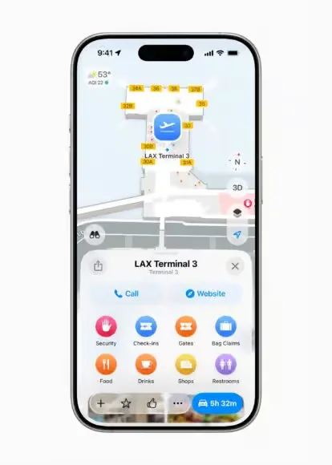

Você termina uma compra e depois abre o Mail para procurar o número de rastreamento. No aeroporto, o cartão de embarque, o rastreamento da bagagem e o mapa do aeroporto ficam cada um em um app diferente. No caixa, você procura um cartão e não encontra o número. O iOS 26 junta tudo isso na Wallet: pedidos rastreados automaticamente, rastreamento de bagagem integrado ao cartão de embarque e cartões de crédito que preenchem os dados automaticamente em todo o sistema — sem ficar pulando de app em app.

É a maior atualização da Wallet em anos, abrangendo compras, viagens, pagamentos e identidade. Veja o que há de novo.

## 0. A novidade de 2026: o iOS 27 já saiu

A Apple lançou o beta de desenvolvedor do iOS 27 na WWDC 2026, em junho, e, como de costume, liberou a versão pública junto com os novos iPhones em setembro. As mudanças da Wallet no iOS 27 têm menos a ver com o cartão de embarque em si e mais com transformar a Wallet em um repositório de credenciais pesquisável, divisível e que emite passes: busca unificada entre cartões, passes e transações; divisão de contas do Apple Cash; passes digitais criados por comerciantes; e digitalização assistida por IA de alguns cartões e ingressos físicos ([MacRumors](https://www.macrumors.com/guide/ios-27-wallet/), [ZDNET](https://www.zdnet.com/business/ios-27-apple-wallet-new-features-guide/)).

O mapa do aeroporto, o rastreamento de bagagem, as Live Activities e o compartilhamento de voo que mais importam para quem viaja chegaram no iOS 26 e continuam no iOS 27 em vez de serem substituídos. O passo a passo abaixo segue a interface do iOS 26; no iOS 27, os pontos de entrada podem mudar um pouco, mas o comportamento é o mesmo.

## 1. Rastreamento de pedidos com o poder da Apple Intelligence

A Wallet ganha o **Rastreamento de Pedidos**, um único lugar para acompanhar todas as compras on-line:

- **Não é preciso integração do comerciante.** A Apple Intelligence lê números de pedido e atualizações de envio no Mail e os sincroniza com a Wallet.
- **Todos os pedidos, não só os do Apple Pay.** E-mails de outros meios de pagamento também são captados.
- **Onde encontrar.** Toque no botão “…” no canto superior direito da Wallet e depois em **Pedidos**.

> Observação: é preciso um dispositivo compatível com a Apple Intelligence, e alguns pedidos podem precisar ser marcados como concluídos manualmente.

## 2. Cartões de embarque: mapas de aeroporto e rastreamento de bagagem

O cartão de embarque deixa de ser um QR code solitário e vira um assistente de viagem completo — a parte que mais importa para quem voa:

- **Live Activity.** O status do voo aparece na Tela de Bloqueio e na Dynamic Island, então o portão, o horário de embarque e a esteira de bagagem ficam visíveis sem abrir nenhum app.
- **Mapa do aeroporto.** Um mapa interno do aeroporto vem embutido no passe e indica o caminho até o portão, as salas VIP, a segurança, a retirada de bagagem e os banheiros.
- **Rastreamento de bagagem.** Integrado ao Find My, para localizar uma mala equipada com AirTag.
- **Bagagem extraviada.** Você pode registrar o extravio de uma mala direto pela Wallet.
- **Compartilhamento de voo.** Envie os detalhes do voo para a família ou amigos com um toque, para que possam se encontrar com você ou acompanhar o voo.

A United, a Air Canada e a Delta estão entre as companhias aéreas já compatíveis; American Airlines, Lufthansa e Qantas já se comprometeram a adotar o recurso.

## 3. Preenchimento automático de cartão de crédito, agora em todo o sistema

O iOS 26 estende o preenchimento automático de cartão de crédito do Safari para o sistema inteiro:

- **Funciona em qualquer lugar.** Toque em um campo de texto em qualquer app ou site → **Preenchimento Automático** → **Cartões de Crédito**.
- **Um só lugar para gerenciá-los.** Um novo menu de Preenchimento Automático na Wallet lista, adiciona e gerencia todos os cartões salvos.
- **Adicionar um cartão.** Escaneie-o com a câmera ou digite os dados, depois confirme com Face ID ou Touch ID.

## 4. Documento de identidade digital (passaporte dos EUA): viagem sem papel

- Um passaporte dos EUA pode ser adicionado à Wallet e armazenado no iPhone ou no Apple Watch.
- Ele funciona em alguns postos de controle da TSA nos Estados Unidos e atende ao padrão Real ID.
- Também pode comprovar a idade em lojas, em apps e em sites.

> Limitação: não vale para viagens internacionais nem para travessias de fronteira — você ainda precisa do passaporte físico.

## 5. Pagamentos parcelados com o Apple Pay

Ao pagar em uma loja com o Apple Pay, você pode escolher um plano de parcelamento oferecido pelo seu banco ou emissor do cartão. Ele vale tanto para cartões de crédito quanto de débito, o que facilita dividir compras maiores.

## 6. Controles de anúncios: notificações promocionais podem ser desativadas

A Apple finalmente atendeu a uma reclamação antiga com um botão “Ofertas e Promoções”:

- **Onde.** Wallet → “…” no canto superior direito → **Notificações** → desative **Ofertas e Promoções**.
- As notificações promocionais da Wallet (sugestões de corridas de F1, por exemplo) param quando o botão é desativado.
- Ele vem ativado por padrão, então precisa ser desligado manualmente.

Se você voa com frequência, comece pelo mapa do aeroporto dentro do cartão de embarque e pelo rastreamento de bagagem no Find My; o resto pode esperar até a próxima viagem.

## Links relacionados

- **Neste site**: [Los Angeles LAX](/airport/LAX), [Estados Unidos (US)](/country/US)
- **Wikipédia**: [Los Angeles LAX](https://en.wikipedia.org/wiki/Los_Angeles_International_Airport)
- **Baidu Baike**: [Los Angeles LAX](https://baike.baidu.com/item/%E6%B4%9B%E6%9D%89%E7%9F%B6%E5%9B%BD%E9%99%85%E6%9C%BA%E5%9C%BA)
