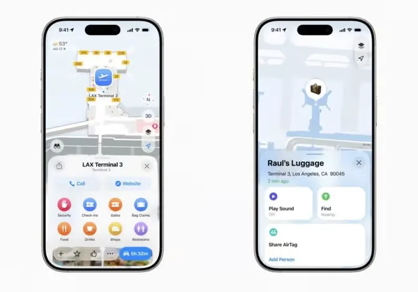

Ви завершуєте покупку, а потім переходите в Mail, щоб відшукати номер для відстеження. В аеропорту посадковий квиток, відстеження багажу й карта аеропорту живуть у різних застосунках. На касі ви риєтеся в пошуках картки й не можете знайти номер. iOS 26 збирає все це у Wallet: замовлення відстежуються автоматично, відстеження багажу вбудоване в посадковий квиток, а кредитні картки автозаповнюються в усій системі — більше не треба перемикатися між застосунками.

Це найбільше оновлення Wallet за роки, що охоплює покупки, подорожі, платежі та посвідчення особи. Ось що нового.

## 0. Оновлення 2026 року: вийшла iOS 27

Apple випустила бета-версію iOS 27 для розробників на WWDC 2026 у червні й, як завжди, випустила публічну версію разом із новими iPhone у вересні. Зміни Wallet в iOS 27 менше стосуються самого посадкового квитка, а більше — перетворення Wallet на сховище облікових даних із пошуком, розділенням рахунків і випуском перепусток: єдиний пошук по картках, перепустках і транзакціях; розділення рахунків Apple Cash; цифрові перепустки, створені продавцями; і оцифрування деяких фізичних карток і квитків за допомогою ШІ ([MacRumors](https://www.macrumors.com/guide/ios-27-wallet/), [ZDNET](https://www.zdnet.com/business/ios-27-apple-wallet-new-features-guide/)).

Карта аеропорту, відстеження багажу, Live Activities і поширення даних рейсу, які найважливіші для мандрівників, з'явилися в iOS 26 і перейшли в iOS 27, а не були замінені. Наведений нижче огляд описує інтерфейс iOS 26; в iOS 27 точки входу можуть трохи зміститися, але поведінка та сама.

## 1. Відстеження замовлень на базі Apple Intelligence

У Wallet з'являється **відстеження замовлень** — єдине місце, де можна стежити за кожним онлайн-замовленням:

- **Інтеграція з продавцем не потрібна.** Apple Intelligence зчитує номери замовлень і оновлення про доставку з Mail і синхронізує їх із Wallet.
- **Усі замовлення, не лише Apple Pay.** Електронні листи щодо інших способів оплати теж розпізнаються.
- **Де шукати.** Торкніться кнопки «…» у верхньому правому куті Wallet, потім **Замовлення**.

> Примітка: потрібен пристрій із підтримкою Apple Intelligence, а деякі замовлення, можливо, доведеться позначати завершеними вручну.

## 2. Посадкові квитки: карти аеропортів і відстеження багажу

Посадковий квиток перетворюється з самотнього QR-коду на повноцінного помічника в подорожі — це найважливіше, якщо ви летите:

- **Live Activity.** Статус рейсу з'являється на екрані блокування й у Dynamic Island, тож вихід на посадку, час початку посадки та стрічку видачі багажу видно без відкриття застосунку.
- **Карта аеропорту.** У квиток вбудовано внутрішню карту аеропорту, яка вказує шлях до виходу на посадку, лаунжів, зони огляду, видачі багажу й туалетів.
- **Відстеження багажу.** Інтеграція з Find My дає змогу знайти валізу з AirTag.
- **Загублений багаж.** Про зниклу валізу можна повідомити прямо з Wallet.
- **Поширення даних рейсу.** Надішліть дані рейсу рідним або друзям одним дотиком, щоб вони могли вас зустріти чи стежити за рейсом.

United, Air Canada і Delta — серед авіакомпаній, які вже підтримують цю функцію; American Airlines, Lufthansa і Qantas пообіцяли долучитися.

## 3. Автозаповнення кредитних карток тепер у всій системі

iOS 26 розширює автозаповнення кредитних карток із Safari на всю систему:

- **Працює будь-де.** Торкніться текстового поля в будь-якому застосунку чи на сайті → **Автозаповнення** → **Кредитні картки**.
- **Одне місце для керування.** Нове меню «Автозаповнення» у Wallet показує, додає та керує всіма збереженими картками.
- **Додавання картки.** Відскануйте її камерою або введіть вручну, потім підтвердьте за допомогою Face ID чи Touch ID.

## 4. Цифрове посвідчення особи (паспорт США): подорожі без паперових документів

- Паспорт США можна додати до Wallet і зберігати на iPhone або Apple Watch.
- Він працює в деяких пунктах перевірки TSA у США та відповідає стандарту Real ID.
- Ним також можна підтвердити вік у магазинах, застосунках і на сайтах.

> Обмеження: він недійсний для міжнародних подорожей або перетину кордонів — фізичний паспорт усе одно потрібен.

## 5. Оплата частинами через Apple Pay

Платячи в магазині через Apple Pay, ви можете вибрати план оплати частинами, запропонований вашим банком або емітентом картки. Це стосується як кредитних, так і дебетових карток, тож великі покупки легше розподілити в часі.

## 6. Керування рекламою: рекламні сповіщення можна вимкнути

Apple нарешті відповіла на давню скаргу перемикачем «Пропозиції та акції»:

- **Де.** Wallet → «…» у верхньому правому куті → **Сповіщення** → вимкніть **Пропозиції та акції**.
- Рекламні push-повідомлення від Wallet (наприклад, пропозиції щодо гонок Формули-1) припиняються, щойно перемикач вимкнено.
- Він увімкнений за замовчуванням, тож вимикати його треба вручну.

Якщо ви часто літаєте, почніть із карти аеропорту в посадковому квитку й відстеження багажу в Find My; решта може зачекати до наступної подорожі.

## Пов'язані посилання

- **На цьому сайті**: [Лос-Анджелес LAX](/airport/LAX), [Сполучені Штати (US)](/country/US)
- **Вікіпедія**: [Лос-Анджелес LAX](https://en.wikipedia.org/wiki/Los_Angeles_International_Airport)
- **Байду Байке**: [Лос-Анджелес LAX](https://baike.baidu.com/item/%E6%B4%9B%E6%9D%89%E7%9F%B6%E5%9B%BD%E9%99%85%E6%9C%BA%E5%9C%BA)
