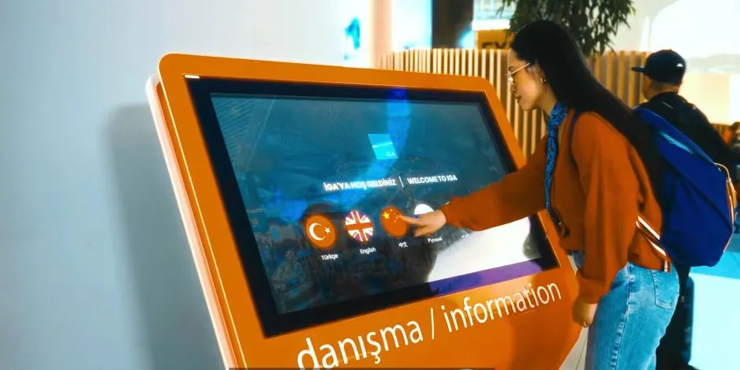

গোল্ডেন উইক আসছে,

আর দূরপাল্লার ভ্রমণ গরম হতে শুরু করেছে।

**চীনা নাগরিকদের জন্য তুরস্কে ভিসামুক্ত প্রবেশ** চালু থাকায়,

আর **চীন ও তুরস্কের মধ্যে সরাসরি ফ্লাইট** প্রতি মৌসুমে সহজতর হওয়ায়,

তুরস্ক হয়ে উঠেছে সবচেয়ে জনপ্রিয় শরৎকালীন গন্তব্যগুলোর একটি।

ইউরোপ ও এশিয়া জুড়ে বিস্তৃত একটি সুপার-হাব হিসেবে,

iGA ইস্তাম্বুল বিমানবন্দর যাত্রী-অভিজ্ঞতা নিয়ে কাজ চালিয়ে যাচ্ছে,

প্রতিটি থামাকে ভেবেচিন্তে সাজানো, সহজ ও আরামদায়ক করে তুলছে।

আপনি স্বল্প সময়ের সংযোগে থাকুন, ফ্লাইটের মাঝে দীর্ঘ অপেক্ষায় থাকুন,

বা তুরস্কের ভ্রমণ শুরু করতে ইস্তাম্বুলে পৌঁছান,

এই ব্যবহারিক বিমানবন্দর গাইড

টার্মিনালের ভেতরের চীনা ভাষার সেবা, লাউঞ্জ, পরিবার-বান্ধব সুবিধা ও ভ্রমণ-সুবিধাগুলো ধরে ধরে দেখাবে।

## 01 বিমানবন্দর জুড়ে চীনা ভাষায় ভ্রমণ

সীমান্ত পেরিয়ে ভ্রমণে ভাষার বাধা বা পড়তে না পারা সাইন—এটাই সবচেয়ে অনাকাঙ্ক্ষিত। ইস্তাম্বুল বিমানবন্দরে চীনা ভাষাভাষী ভ্রমণকারীরা আত্মবিশ্বাসের সঙ্গে পুরো যাত্রা পেরোতে পারেন।

### প্রতিটি ধাপে চীনা ভাষার সাইন

কাস্টমস চ্যানেল, ট্যাক্স রিফান্ড এলাকা ও তথ্য ডেস্ক থেকে শুরু করে গেট, ট্রান্সফার করিডর ও ফ্লাইট তথ্য স্ক্রিন—টার্মিনালের গুরুত্বপূর্ণ সব জায়গায় **চীনা ভাষার সাইন** আছে, তাই তথ্য সঙ্গে সঙ্গে পাওয়া যায় ও সহজে অনুসরণ করা যায়।

অনুবাদ নিয়ে ভোগান্তি নেই, পথ হারানোর ভয় নেই—চোখ তুললেই পথ পাওয়া যায়। ট্রান্সফার, ট্যাক্স রিফান্ড ও বোর্ডিং এক নজরেই পরিষ্কার।

### স্মার্ট ভিডিও কিয়স্ক

**（ডিজিটাল কিয়স্ক）**

টার্মিনালে **স্মার্ট ভিডিও সহায়তা কিয়স্ক ও স্ব-সেবা মেশিন** আছে, সবগুলোতেই চীনা ভাষা সমর্থিত; ভিডিওতে কর্মীর সঙ্গে কথা বলে ফ্লাইট, বিমানবন্দরের সুবিধা ইত্যাদি জানতে পারেন।

### মাঠে চীনা ভাষাভাষী গাইড

## 02 আরামে অপেক্ষা করার উপায়

বিমানবন্দর জুড়ে বিশ্রাম, কেনাকাটা, খাওয়া ও হেলান দেওয়ার জায়গা, যা অপেক্ষাকে বিশ্রামদায়ক করে তোলে।

### কয়েকটি এলাকায় টিভি লাউঞ্জ

ইস্তাম্বুল বিমানবন্দর কয়েকটি জনপ্রিয় অপেক্ষা এলাকায় **সর্বসাধারণের জন্য টিভি দেখার জায়গা** তৈরি করেছে, তাই অপেক্ষার সময় খবর দেখতে বা চ্যানেল ঘুরিয়ে সময় কাটাতে পারেন—একঘেয়ে লে-ওভার আর নয়।

### ডিউটি-ফ্রি কেনাকাটা ও বিশ্বজুড়ে খাবার

টার্মিনালে **বিশাল ডিউটি-ফ্রি এলাকা** আছে, যেখানে বৈশ্বিক বিউটি ব্র্যান্ড, বিলাসবহুল লেবেল, তুর্কি বিশেষ খাবার ও উপহার—দামও চোখ বুলানোর মতো; পথে যেতে যেতে কিছু কিনে নেওয়ার জন্য আদর্শ।

খাবারের জন্য **সব ধরনের রেস্তোরাঁ** আছে: ঐতিহ্যবাহী তুর্কি কফি, স্থানীয় বিশেষ খাবার ও আন্তর্জাতিক চেইন। গরম খাবার, হালকা নাস্তা, মিষ্টি ও পানীয়—সবই সহজে পাওয়া যায়।

### iGA লাউঞ্জ

দীর্ঘ সংযোগে শান্ত কোথাও জিরিয়ে নিতে চাইলে **iGA লাউঞ্জ** ভালো ঠিকানা।

এটি ভালোভাবে সজ্জিত: গরম ও ঠান্ডা পানীয়সহ সারাদিন খোলা বুফে, শাওয়ার, বাইরের ভিউ টেরেস, বিনামূল্যের হাই-স্পিড WiFi ও ফ্লাইট তথ্য ডিসপ্লে। ভেতরে আরও আছে শিশুদের খেলার জায়গা, নামাজ ঘর, ব্যবসায়িক এলাকা ও লগেজ লকার—তাই পরিবার একসঙ্গে ভ্রমণ করলেও আরামে অপেক্ষা করতে পারে।

## 03 পরিবার-বান্ধব সুবিধা

পরিবারের জন্য বিমানবন্দরের সুবিধাগুলো প্রস্থান, ট্রানজিট ও অপেক্ষার প্রতিটি ধাপ সহজ করে।

### শিশুদের খেলার মাঠ

বিমানবন্দরে **700 m²-এর থিম-ভিত্তিক শিশুদের খেলার মাঠ** আছে, যা কয়েকটি গেট ও চেক-ইন এলাকায় ছড়ানো; শিশুরা খেলে শক্তি ক্ষয় করতে পারে।

### বেবি কেয়ার

**বেবি কেয়ার রুম** পুরো টার্মিনাল জুড়ে ছড়ানো, আর **স্ট্রলার ধার নেওয়া যায়**, যা বিভিন্ন বয়সের শিশুদের পরিবারের প্রয়োজন মেটায়।

### পারিবারিক ভ্রমণ আরও সহজ

নির্দিষ্ট **পারিবারিক পার্কিং স্পেস ও পরিবারের জন্য অগ্রাধিকার সিকিউরিটি লেন** লাইনের সময় অনেক কমিয়ে দেয়, তাই শিশু নিয়ে ভ্রমণ মসৃণ হয়।

## 04 চীন থেকে আসা ভ্রমণকারীদের জন্য ব্যবহারিক টিপস

গোল্ডেন উইকের ভ্রমণ আরও মসৃণ করতে আরও কিছু ব্যবহারিক খুঁটিনাটি:

· টার্মিনালে কয়েকটি **গরম পানির পয়েন্ট** আছে, গরম পানি খেতে অভ্যস্ত ভ্রমণকারীদের জন্য আরাম। **লাগেজ ট্রলি** সব জায়গায় পাওয়া যায়, তাই বড় ব্যাগ সহজে সরানো যায়।

· **হাই-স্পিড WiFi পুরো টার্মিনাল জুড়ে**—নেমেই সংযোগ করুন, ফ্লাইট দেখুন, পরিবারকে মেসেজ করুন ও পরিকল্পনা হালনাগাদ করুন।

· ইস্তাম্বুল বিমানবন্দর **চব্বিশ ঘণ্টা চলে**, ফলে গভীর রাতে আসা, ভোরের আগে ছাড়া বা দীর্ঘ সংযোগে থাকা যাত্রীরা বেশি নমনীয়তা পান।

✈️✈️✈️

ইউরোপ ও এশিয়া জুড়ে, প্রতিটি যাত্রাকে যুক্ত করে।

এই গোল্ডেন উইকে,

আপনি ইস্তাম্বুল বিমানবন্দর হয়ে অন্য কোথাও যাচ্ছেন,

বা তুরস্ক ঘুরতে এখানে পৌঁছাচ্ছেন,

চীনা ভাষার সেবা, পরিবার-বান্ধব সুবিধা ও বৈচিত্র্যময় বিমানবন্দর-অভিজ্ঞতা যাত্রাটাকে সহজ করে।

**iGA ইস্তাম্বুল বিমানবন্দর,**

**প্রতিটি যাত্রার সঙ্গে দেখা হওয়ার অপেক্ষায়।**

## সংশ্লিষ্ট লিংক

- **এই সাইটে**: [ইস্তাম্বুল বিমানবন্দর (IST)](/airport/IST), [তুরস্ক (TR)](/country/TR)
- **উইকিপিডিয়া**: [ইস্তাম্বুল বিমানবন্দর](https://en.wikipedia.org/wiki/Istanbul_Airport)
- **বাইদু বাইকে**: [ইস্তাম্বুল বিমানবন্দর](https://baike.baidu.com/item/%E4%BC%8A%E6%96%AF%E5%9D%A6%E5%B8%83%E5%B0%94%E6%9C%BA%E5%9C%BA)

ছবির সূত্র: [istairport.com](http://istairport.com)
