La Semaine d'or approche,

et les voyages long-courriers reprennent de l'élan.

Avec **l'entrée sans visa en Turquie pour les citoyens chinois** désormais en place,

et **des vols directs entre la Chine et la Turquie** de plus en plus simples à chaque saison,

la Turquie est devenue l'une des destinations d'automne les plus prisées.

En tant que super-hub entre l'Europe et l'Asie,

l'aéroport iGA d'Istanbul continue de travailler sur l'expérience des passagers,

pour rendre chaque escale attentionnée, simple et confortable.

Que vous soyez en correspondance courte, en longue attente entre deux vols,

ou que vous arriviez à Istanbul pour commencer un voyage en Turquie,

ce guide pratique de l'aéroport

vous présente les services en chinois, les salons, les équipements adaptés aux familles et les facilités de voyage à l'intérieur du terminal.

## 01 Voyager en chinois, d'un bout à l'autre de l'aéroport

Quand on traverse des frontières, la dernière chose que l'on souhaite est une barrière de la langue ou un panneau illisible. À l'aéroport d'Istanbul, les voyageurs sinophones peuvent parcourir tout leur trajet en toute confiance.

### Une signalétique en chinois à chaque étape

Que ce soit aux files de douane, à l'espace de détaxe, au bureau d'information, aux portes, aux couloirs de correspondance ou aux écrans d'information sur les vols, les points clés du terminal portent une **signalétique en chinois**, pour une information immédiate et facile à suivre.

Pas de bataille avec la traduction et pas d'errance — levez les yeux et vous trouverez votre chemin. Correspondances, détaxe et embarquement se lisent d'un coup d'œil.

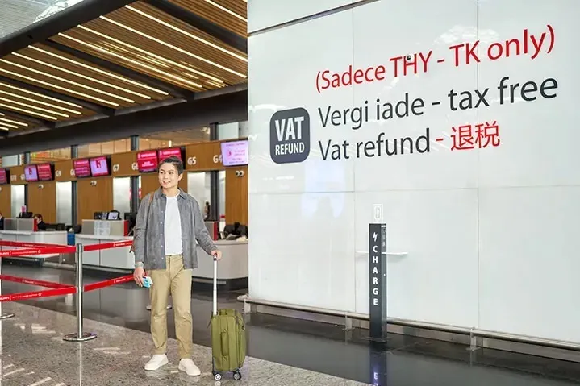

### Des bornes vidéo intelligentes

**(Digital Kiosk)**

Le terminal dispose de **bornes d'assistance vidéo intelligentes et de machines en libre-service**, toutes en chinois, où vous pouvez joindre un agent par vidéo pour vous renseigner sur les vols, les installations de l'aéroport et bien plus.

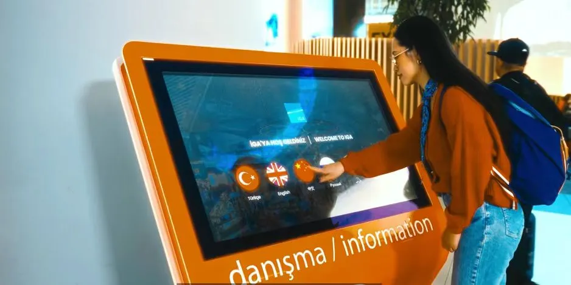

### Des accompagnateurs sinophones sur le terrain

## 02 Des façons confortables d'attendre

L'aéroport regorge d'endroits pour se détendre, faire du shopping, manger et se reposer, transformant une attente en moment réparateur.

### Des espaces TV dans plusieurs zones

L'aéroport d'Istanbul a installé des **espaces TV publics** dans plusieurs zones d'attente très fréquentées, pour regarder les informations ou flâner en attendant — fini les escales ennuyeuses.

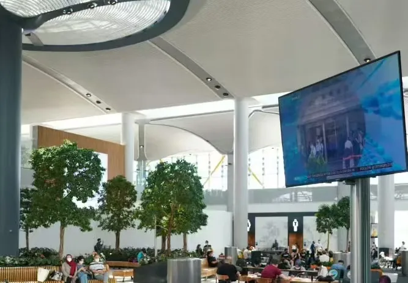

### Boutiques hors taxes et cuisine du monde entier

Le terminal abrite un **immense quartier hors taxes** réunissant marques de beauté internationales, griffes de luxe, spécialités turques et cadeaux, à des prix qui valent le détour — idéal pour dénicher quelque chose en passant.

Côté restauration, **toutes sortes de restaurants** sont présents : café turc traditionnel, spécialités locales et chaînes internationales. Plats chauds, en-cas légers, desserts et boissons se trouvent tous facilement.

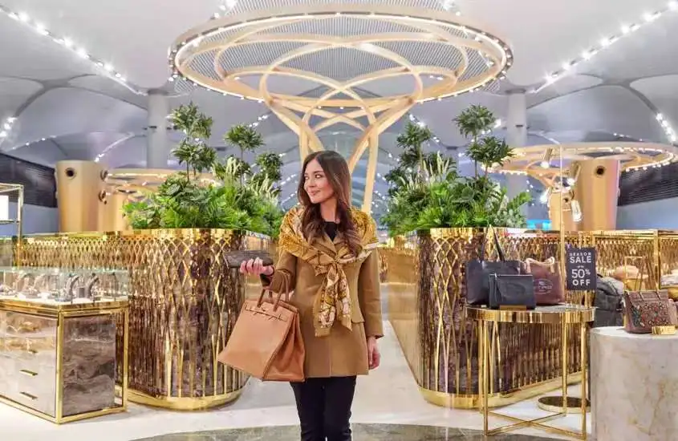

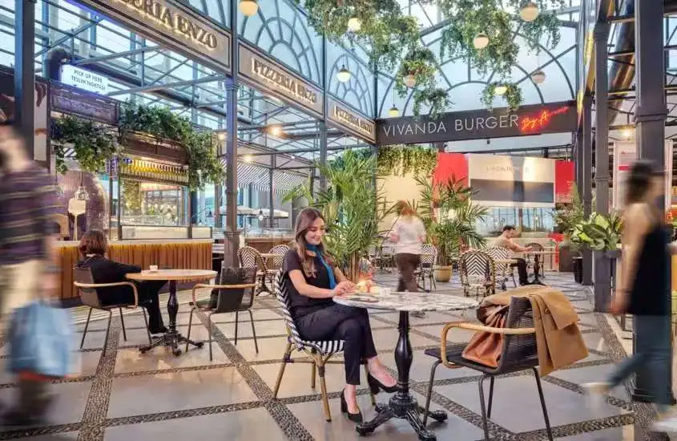

### iGA Lounge

Lors d'une longue correspondance, quand vous cherchez un endroit calme pour souffler, l'**iGA Lounge** est une bonne adresse où poser vos bagages.

Il est bien équipé : un buffet ouvert toute la journée avec boissons chaudes et froides, des douches, une terrasse extérieure avec vue, un Wi-Fi haut débit gratuit et des écrans d'information sur les vols. À l'intérieur, on trouve aussi un espace de jeux pour enfants, une salle de prière, un espace d'affaires et des consignes à bagages — de quoi attendre confortablement, même en famille.

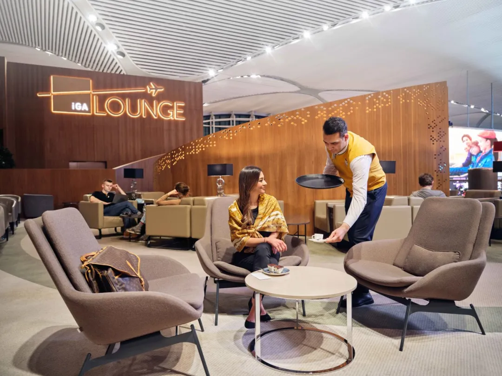

## 03 Des équipements adaptés aux familles

Pour les familles, les installations de l'aéroport facilitent le départ, le transit et l'attente à chaque étape.

### L'aire de jeux pour enfants

L'aéroport dispose d'une **aire de jeux thématique pour enfants de 700 m²**, répartie sur plusieurs zones de portes et d'enregistrement, où les enfants peuvent jouer et se dépenser.

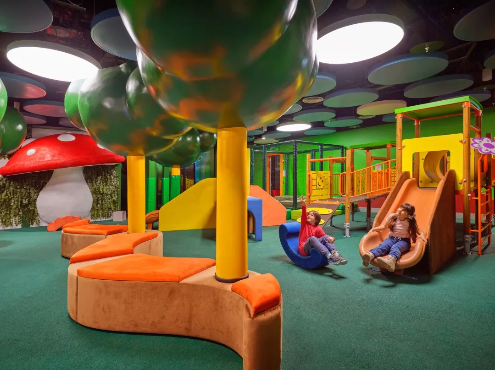

### Les soins pour bébés

Des **espaces de soins pour bébés** sont répartis dans tout le terminal, et des **poussettes peuvent être empruntées**, de quoi couvrir les besoins des familles à différents âges.

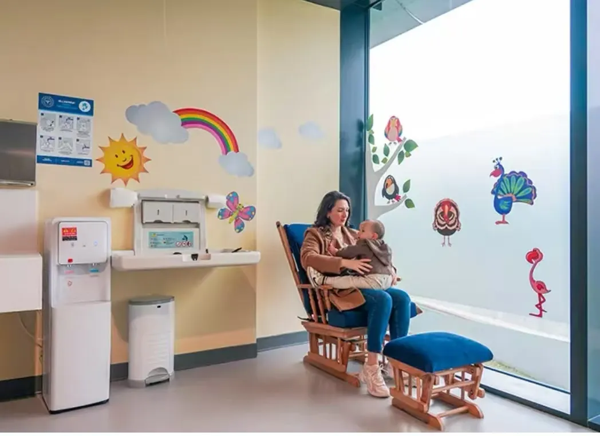

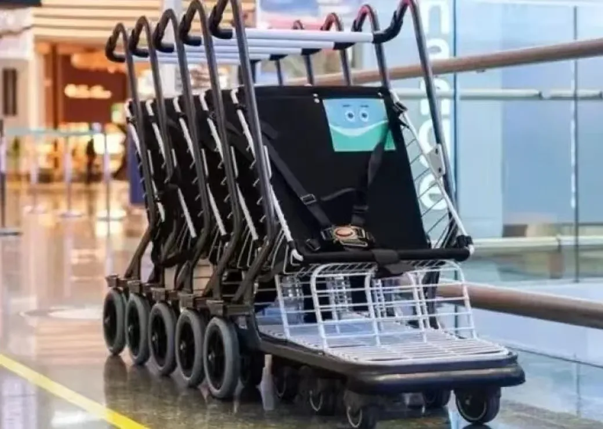

### Des voyages en famille facilités

Des **places de stationnement dédiées aux familles et des files de sécurité prioritaires pour les familles** réduisent nettement le temps d'attente, pour voyager avec des enfants en toute sérénité.

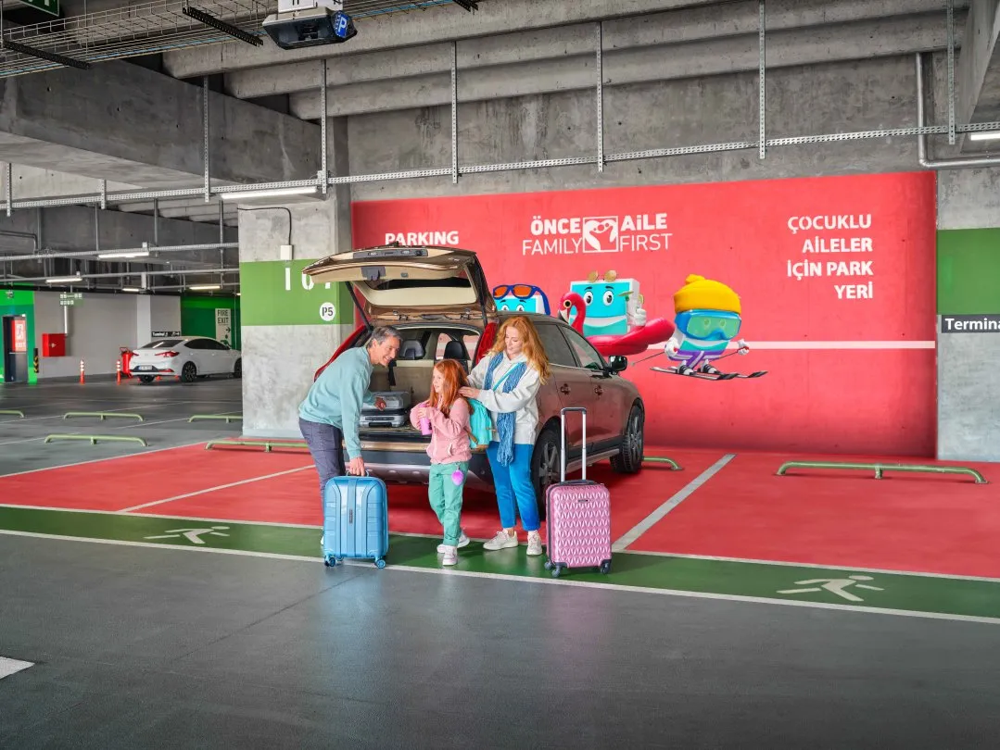

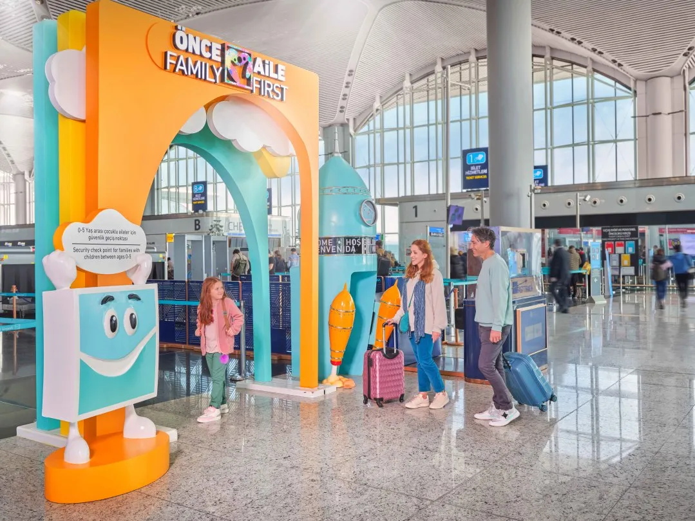

## 04 Conseils pratiques pour les voyageurs venant de Chine

Pour rendre le voyage de la Semaine d'or encore plus fluide, voici quelques détails pratiques supplémentaires :

· Le terminal compte plusieurs **points d'eau chaude**, un confort pour les voyageurs habitués à boire chaud. Des **chariots à bagages** sont disponibles partout, pour déplacer facilement les sacs volumineux.

· **Le Wi-Fi haut débit couvre tout le terminal** — connectez-vous dès l'atterrissage pour vérifier vos vols, écrire à votre famille et ajuster vos plans.

· L'aéroport d'Istanbul **fonctionne 24 heures sur 24**, offrant plus de souplesse aux passagers qui arrivent tard le soir, partent avant l'aube ou ont de longues correspondances.

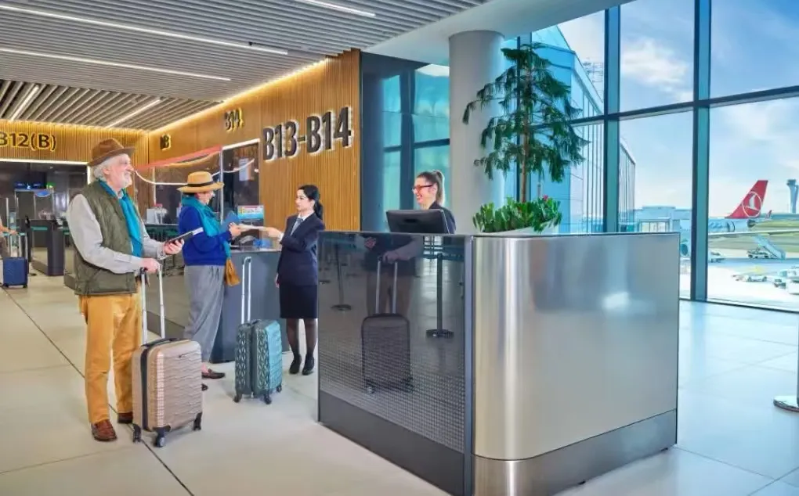

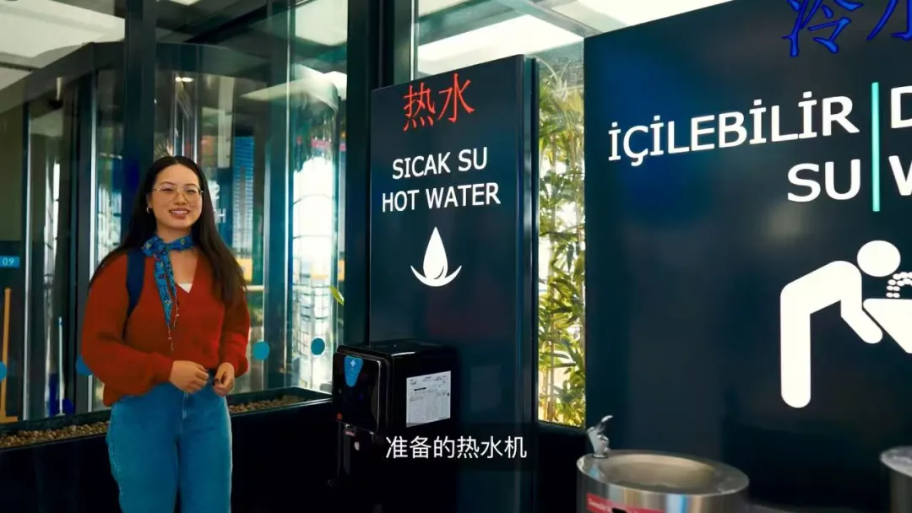

✈️✈️✈️

Entre l'Europe et l'Asie, il relie chaque voyage.

En cette Semaine d'or,

que vous transitiez par l'aéroport d'Istanbul vers une autre destination,

ou que vous y arriviez pour explorer la Turquie,

les services en chinois, les équipements pour les familles et la richesse de l'expérience aéroportuaire facilitent le voyage.

**L'aéroport iGA d'Istanbul,**

**au rendez-vous de chaque voyage.**

## Liens utiles

- **Sur ce site** : [Aéroport d'Istanbul (IST)](/airport/IST), [Turquie (TR)](/country/TR)
- **Wikipédia** : [Aéroport d'Istanbul](https://en.wikipedia.org/wiki/Istanbul_Airport)
- **Baidu Baike** : [Aéroport d'Istanbul](https://baike.baidu.com/item/%E4%BC%8A%E6%96%AF%E5%9D%A6%E5%B8%83%E5%B0%94%E6%9C%BA%E5%9C%BA)

Source des images : [istairport.com](http://istairport.com)
