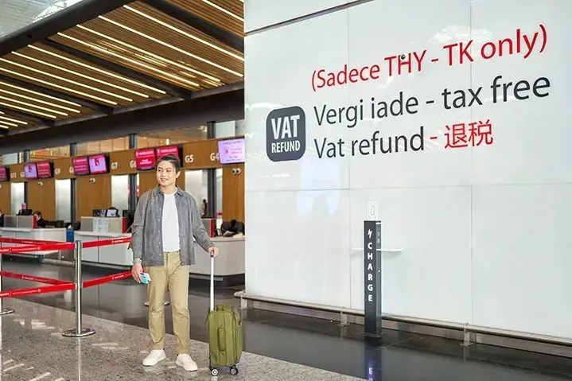

गोल्डन वीक आ रहा है,

और लंबी दूरी की यात्राएँ गरमा रही हैं।

**चीनी नागरिकों के लिए तुर्किये में वीज़ा-मुक्त प्रवेश** लागू होने के साथ,

और **चीन व तुर्किये के बीच सीधी उड़ानें** हर मौसम में आसान होती जा रही हैं,

तुर्किये शरद ऋतु के सबसे लोकप्रिय गंतव्यों में से एक बन गया है।

यूरोप और एशिया को जोड़ने वाले एक सुपर-हब के रूप में,

iGA इस्तांबुल एयरपोर्ट यात्री अनुभव पर लगातार काम कर रहा है,

ताकि हर ठहराव सुविचारित, आसान और आरामदायक हो।

चाहे आप छोटे कनेक्शन पर हों, उड़ानों के बीच लंबा इंतज़ार कर रहे हों,

या तुर्की की यात्रा शुरू करने के लिए इस्तांबुल पहुँच रहे हों,

यह व्यावहारिक एयरपोर्ट गाइड

टर्मिनल के अंदर की चीनी भाषा सेवाओं, लाउंज, परिवार-अनुकूल सुविधाओं और यात्रा सुविधाओं से आपका परिचय कराती है।

## 01 पूरे हवाई अड्डे में चीनी भाषा में सफ़र

सीमाओं के पार यात्रा में आपको सबसे कम भाषा की बाधा या ऐसा संकेत चाहिए जिसे पढ़ा न जा सके। इस्तांबुल एयरपोर्ट पर चीनी बोलने वाले यात्री पूरी यात्रा आत्मविश्वास के साथ पूरी कर सकते हैं।

### हर कदम पर चीनी संकेत

सीमा शुल्क चैनल, टैक्स रिफ़ंड क्षेत्र और सूचना डेस्क से लेकर गेट, ट्रांसफ़र गलियारों और उड़ान सूचना स्क्रीन तक, टर्मिनल के प्रमुख स्थानों पर **चीनी भाषा के संकेत** हैं, इसलिए जानकारी तुरंत और समझने में आसान होती है।

अनुवाद से जूझना नहीं, भटकना नहीं — नज़र उठाइए और रास्ता मिल जाएगा। ट्रांसफ़र, टैक्स रिफ़ंड और बोर्डिंग एक नज़र में साफ़।

### स्मार्ट वीडियो कियोस्क

**（डिजिटल कियोस्क）**

टर्मिनल में **स्मार्ट वीडियो सहायता कियोस्क और स्वयं-सेवा मशीनें** हैं, जो सभी चीनी भाषा समर्थित हैं; इनमें वीडियो के ज़रिए कर्मचारी से जुड़कर उड़ानों, हवाई अड्डे की सुविधाओं और अन्य बातों के बारे में पूछ सकते हैं।

### टर्मिनल में चीनी बोलने वाले गाइड

## 02 इंतज़ार के आरामदायक तरीके

हवाई अड्डा आराम करने, खरीदारी करने, खाने और विश्राम के लिए जगहों से भरा है, जो इंतज़ार को सुकूनदायक बना देता है।

### कई क्षेत्रों में टीवी लाउंज

इस्तांबुल एयरपोर्ट ने कई लोकप्रिय प्रतीक्षा क्षेत्रों में **सार्वजनिक टीवी देखने के क्षेत्र** बनाए हैं, ताकि इंतज़ार के दौरान आप समाचार देख सकें या सर्फ़ कर सकें — उबाऊ लेओवर अब नहीं।

### ड्यूटी-फ्री खरीदारी और दुनिया भर का भोजन

टर्मिनल में **विशाल ड्यूटी-फ्री क्षेत्र** है, जिसमें वैश्विक ब्यूटी ब्रांड, लक्ज़री लेबल, तुर्की की विशेषताएँ और उपहार शामिल हैं, ऐसी कीमतों पर जो देखने लायक हैं — रास्ते में कुछ खरीदने के लिए आदर्श।

भोजन के लिए **हर तरह के रेस्तराँ** मौजूद हैं: पारंपरिक तुर्की कॉफ़ी, स्थानीय व्यंजन और अंतर्राष्ट्रीय चेन। गरम भोजन, हल्के नाश्ते, मिठाइयाँ और पेय — सब आसानी से मिल जाते हैं।

### iGA लाउंज

लंबे कनेक्शन पर, जब आप किसी शांत जगह पर सुस्ताना चाहें, तो **iGA लाउंज** अच्छी जगह है।

यह अच्छी तरह सुसज्जित है: गरम और ठंडे पेय के साथ पूरे दिन खुला बुफ़े, शॉवर, बाहर देखने की छत, मुफ़्त हाई-स्पीड WiFi और उड़ान सूचना डिस्प्ले। अंदर बच्चों का खेल क्षेत्र, प्रार्थना कक्ष, व्यवसाय क्षेत्र और सामान के लॉकर भी हैं — इसलिए साथ यात्रा करने वाला परिवार भी आराम से इंतज़ार कर सकता है।

## 03 परिवार-अनुकूल सुविधाएँ

परिवारों के लिए हवाई अड्डे की सुविधाएँ प्रस्थान, ट्रांज़िट और इंतज़ार को हर चरण पर आसान बनाती हैं।

### बच्चों का खेल का मैदान

हवाई अड्डे में **700 वर्ग मीटर का थीम-आधारित बच्चों का खेल क्षेत्र** है, जो कई गेट और चेक-इन क्षेत्रों में फैला है, जहाँ बच्चे खेलकर अपनी ऊर्जा निकाल सकते हैं।

### शिशु देखभाल

**शिशु देखभाल कक्ष** पूरे टर्मिनल में फैले हैं, और **बेबी स्ट्रॉलर उधार लिए जा सकते हैं**, जिससे अलग-अलग उम्र के बच्चों वाले परिवारों की ज़रूरतें पूरी होती हैं।

### पारिवारिक यात्रा और आसान

समर्पित **परिवार पार्किंग स्थान और परिवार प्राथमिकता सुरक्षा लेन** कतार का समय बहुत घटा देते हैं, जिससे बच्चों के साथ यात्रा सुगम हो जाती है।

## 04 चीन से आने वाले यात्रियों के लिए व्यावहारिक सुझाव

गोल्डन वीक की यात्रा को और सुगम बनाने के लिए कुछ और व्यावहारिक विवरण:

· टर्मिनल में कई **गरम पानी के पॉइंट** हैं, जो गरम पानी पीने के आदी यात्रियों के लिए राहत हैं। **सामान ट्रॉली** हर जगह उपलब्ध हैं, इसलिए भारी बैग आसानी से ले जाए जा सकते हैं।

· **हाई-स्पीड WiFi पूरे टर्मिनल में है** — उतरते ही जुड़ें और उड़ान जाँचें, परिवार को संदेश भेजें और अपनी योजनाएँ अपडेट करें।

· इस्तांबुल एयरपोर्ट **चौबीसों घंटे चलता है**, जिससे देर रात पहुँचने वाले, भोर से पहले उड़ान भरने वाले या लंबे कनेक्शन वाले यात्रियों को अधिक लचीलापन मिलता है।

✈️✈️✈️

यूरोप और एशिया को जोड़ते हुए, हर सफ़र को जोड़ते हुए।

इस गोल्डन वीक,

चाहे आप इस्तांबुल एयरपोर्ट से होकर कहीं और जा रहे हों,

या तुर्किये घूमने यहाँ पहुँच रहे हों,

चीनी भाषा की सेवाएँ, परिवार-अनुकूल सुविधाएँ और विविध एयरपोर्ट अनुभव यात्रा को आसान बनाते हैं।

**iGA इस्तांबुल एयरपोर्ट,**

**हर सफ़र से मिलने का इंतज़ार करते हुए।**

## संबंधित लिंक

- **इस साइट पर**: [इस्तांबुल एयरपोर्ट (IST)](/airport/IST), [तुर्किये (TR)](/country/TR)
- **विकिपीडिया**: [इस्तांबुल एयरपोर्ट](https://en.wikipedia.org/wiki/Istanbul_Airport)
- **Baidu Baike**: [इस्तांबुल एयरपोर्ट](https://baike.baidu.com/item/%E4%BC%8A%E6%96%AF%E5%9D%A6%E5%B8%83%E5%B0%94%E6%9C%BA%E5%9C%BA)

चित्रों का स्रोत: [istairport.com](http://istairport.com)
