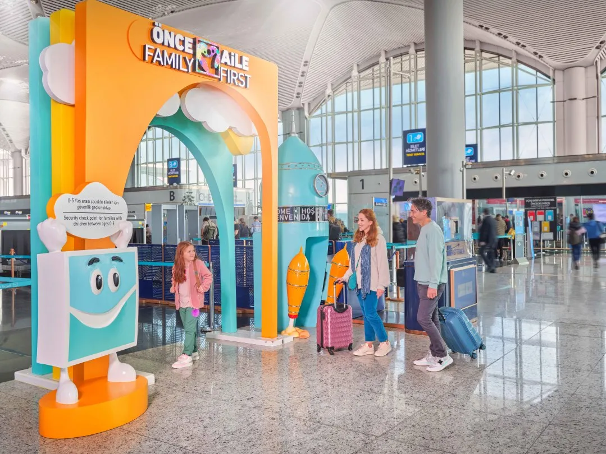

ゴールデンウィークが近づき、

長距離旅行もにぎわい始めています。

**中国人のトルコ入国がビザなしで可能**になり、

**中国とトルコを結ぶ直行便**もシーズンごとに便利になっています。

トルコは秋の人気旅行先のひとつになりました。

ヨーロッパとアジアにまたがるスーパーハブとして、

iGAイスタンブール空港は旅客体験の向上に取り組み続け、

すべての立ち寄りを思いやりがあり、簡単で快適なものにしています。

短い乗り継ぎでも、フライト間の長い待ち時間でも、

イスタンブールに到着してトルコ旅行を始める場合でも、

この実用的な空港ガイドが、

ターミナル内の中国語サービス、ラウンジ、ファミリー向け施設、旅行の利便性を案内します。

## 01 中国語で、空港をまるごと移動

国境を越える旅で最も避けたいのは、言葉の壁や読めない看板です。イスタンブール空港では、中国語を話す旅行者が自信を持って旅の全体を移動できます。

### 各ステップに中国語の案内表示

税関通路、免税還付エリア、インフォメーションデスクから、ゲート、乗り継ぎ通路、フライト情報画面まで、ターミナルの要所には**中国語の案内表示**があり、情報がすぐにわかりやすく確認できます。

翻訳に苦労することも、迷うこともありません。顔を上げれば道がわかります。乗り継ぎ、免税還付、搭乗も一目でわかります。

### スマートビデオキオスク

**（デジタルキオスク）**

ターミナルには**スマートビデオ案内キオスクとセルフサービス端末**があり、すべて中国語に対応しています。ビデオ通話でスタッフにフライトや空港施設などについて尋ねられます。

### 館内の中国語対応ガイド

## 02 快適に待つ方法

空港にはくつろぎ、買い物をし、食事をし、休息できる場所が豊富にあり、待ち時間を癒しの時間に変えてくれます。

### 各エリアのテレビラウンジ

イスタンブール空港は人気の待合エリアに**公共のテレビ視聴エリア**を設けており、待ちながらニュースを見たり、のんびり過ごしたりできます。退屈な乗り継ぎはもうありません。

### 免税ショッピングと世界のグルメ

ターミナルには**巨大な免税エリア**があり、世界のビューティーブランド、高級ブランド、トルコの名産品、ギフトがそろっています。見て回る価値のある価格で、通りがかりに買い物するのに最適です。

食事は**あらゆる種類のレストラン**がそろっています。伝統的なトルココーヒー、地元の名物料理、国際チェーンなどです。温かい食事、軽食、デザート、飲み物も簡単に見つかります。

### iGAラウンジ

長い乗り継ぎで、静かに気持ちを整えたいときに、**iGAラウンジ**は立ち寄り先として良い選択です。

設備も充実しています。温かい飲み物と冷たい飲み物を備えた終日営業のビュッフェ、シャワー、屋外展望テラス、無料高速WiFi、フライト情報ディスプレイがあります。館内には子供の遊び場、礼拝室、ビジネスエリア、荷物ロッカーもあり、家族連れでも快適に待つことができます。

## 03 ファミリー向け施設

家族連れにとって、空港の施設は出発、乗り継ぎ、待ち時間のあらゆる段階を楽にしてくれます。

### 子供の遊び場

空港には**700 m²のテーマ別子供遊び場**があり、いくつかのゲートエリアとチェックインエリアに分かれています。子供たちは遊んでエネルギーを発散できます。

### ベビーケア

ターミナル全体に**ベビーケアルーム**が設けられ、**ベビーカーの貸し出し**も行われています。さまざまな年齢の子供連れ家族のニーズに対応しています。

### 家族旅行をもっと楽に

専用の**ファミリー駐車スペースと家族優先保安検査レーン**が待ち時間を大幅に短縮し、子供連れの旅行がスムーズに進みます。

## 04 中国からの旅行者向け実用情報

ゴールデンウィークの旅をさらにスムーズにするために、もう少し実用的な情報を紹介します。

・ターミナルには**給湯ポイント**がいくつかあり、お湯を飲む習慣のある旅行者にとってありがたい設備です。**荷物カート**も各所にあり、大きな荷物も簡単に移動できます。

・**高速WiFiがターミナル全体をカバー**しています。到着したらすぐに接続して、フライトの確認、家族への連絡、予定の更新ができます。

・イスタンブール空港は**24時間営業**しており、深夜に到着する人、夜明け前に出発する人、長い乗り継ぎをする人に柔軟性をもたらします。

✈️✈️✈️

ヨーロッパとアジアにまたがり、すべての旅をつなぎます。

このゴールデンウィーク、

イスタンブール空港を経由して別の場所へ向かう場合でも、

ここに到着してトルコを巡る場合でも、

中国語サービス、ファミリー向け施設、多彩な空港体験が旅を楽にしてくれます。

**iGAイスタンブール空港、**

**すべての旅との出会いを楽しみにしています。**

## 関連リンク

- **このサイト内**：[イスタンブール空港 (IST)](/airport/IST)、[トルコ (TR)](/country/TR)
- **Wikipedia**：[イスタンブール空港](https://en.wikipedia.org/wiki/Istanbul_Airport)
- **百度百科**：[イスタンブール空港](https://baike.baidu.com/item/%E4%BC%8A%E6%96%AF%E5%9D%A6%E5%B8%83%E5%B0%94%E6%9C%BA%E5%9C%BA)

画像出典：[istairport.com](http://istairport.com)
