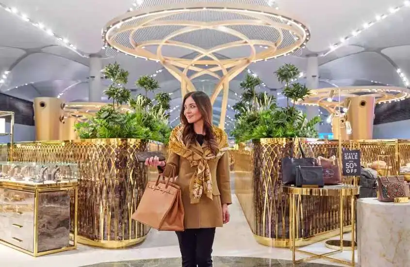
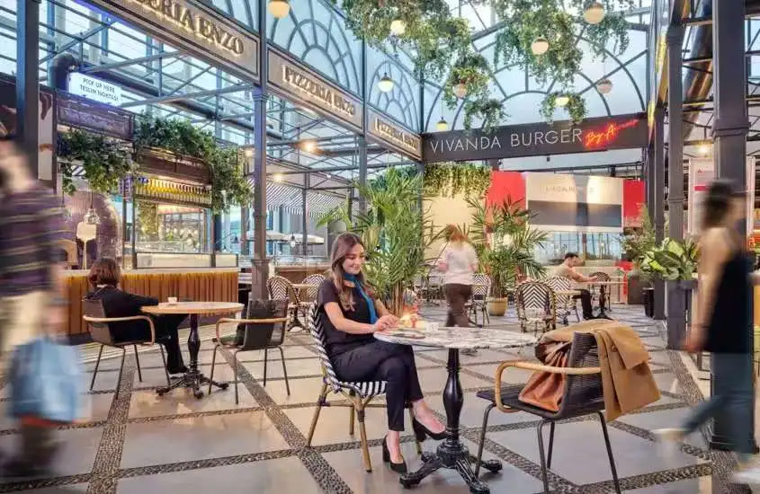
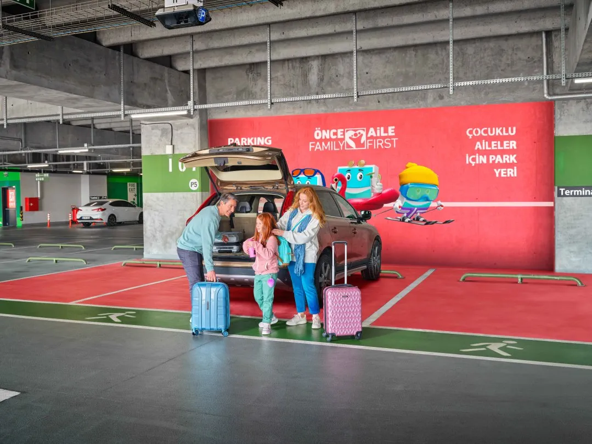

Złoty Tydzień nadchodzi,

a podróże długodystansowe nabierają tempa.

Gdy **obywatele Chin mają bezwizowy wjazd do Turcji**,

a **bezpośrednie loty między Chinami a Turcją** są co sezon łatwiejsze,

Turcja stała się jednym z najpopularniejszych kierunków jesieni.

Jako wielki węzeł przesiadkowy między Europą a Azją,

lotnisko iGA Istanbul nieustannie pracuje nad doświadczeniem pasażera,

sprawiając, że każdy postój jest przemyślany, łatwy i wygodny.

Nieważne, czy masz krótką przesiadkę, długie oczekiwanie między lotami,

czy przylatujesz do Stambułu, by zacząć turecką podróż,

ten praktyczny przewodnik po lotnisku

poprowadzi cię przez chińskojęzyczne usługi, saloniki, udogodnienia dla rodzin i wygody podróżnych w terminalu.

## 01 Podróż po chińsku przez całe lotnisko

W podróży przez granice najmniej potrzebna jest bariera językowa albo znak, którego nie umiesz odczytać. Na lotnisku Istanbul podróżni posługujący się chińskim mogą przejść całą podróż pewnie.

### Chińskie oznaczenia na każdym kroku

Od kanałów celnych, strefy zwrotu podatku i punktu informacyjnego po bramki, korytarze przesiadkowe i ekrany informacji o lotach — kluczowe miejsca w terminalu mają **chińskie oznaczenia**, dzięki czemu informacje są natychmiastowe i łatwe do odczytania.

Bez zmagania się z tłumaczeniem i bez błądzenia — podnieś wzrok, a znajdziesz drogę. Przesiadki, zwrot podatku i wejście na pokład są jasne na pierwszy rzut oka.

### Inteligentne wideokioski

**(kiosk cyfrowy)**

W terminalu są **inteligentne kioski z pomocą wideo i automaty samoobsługowe**, wszystkie obsługujące chiński; przez wideo można połączyć się z pracownikiem i zapytać o loty, udogodnienia lotniska i nie tylko.

### Chińskojęzyczni przewodnicy na hali

## 02 Wygodne sposoby oczekiwania

Lotnisko pełne jest miejsc, w których można odpocząć, zrobić zakupy, zjeść i zregenerować siły, zamieniając oczekiwanie w coś krzepiącego.

### Strefy telewizyjne w kilku miejscach

Lotnisko Istanbul urządziło **publiczne strefy oglądania telewizji** w kilku popularnych miejscach oczekiwania, więc w trakcie czekania można obejrzeć wiadomości albo coś pooglądać — koniec z nudnymi przesiadkami.

### Zakupy wolnocłowe i jedzenie z całego świata

W terminalu znajduje się **ogromna strefa wolnocłowa** z globalnymi markami kosmetyków, luksusowymi domami mody, tureckimi specjałami i upominkami, w cenach, które warto przejrzeć — idealna na zakupy w drodze.

Jeśli chodzi o jedzenie, **restauracje każdego rodzaju** są na miejscu: tradycyjna turecka kawa, lokalne specjały i międzynarodowe sieci. Ciepłe posiłki, lekkie przekąski, desery i napoje znajdziesz bez trudu.

### iGA Lounge

Przy długiej przesiadce, gdy chcesz gdzieś spokojnie zebrać myśli, **iGA Lounge** to dobre miejsce, by przysiąść.

Jest dobrze wyposażony: całodzienny bufet z ciepłymi i zimnymi napojami, prysznice, zewnętrzny taras widokowy, darmowe szybkie WiFi i ekrany informacji o lotach. W środku są też plac zabaw dla dzieci, sala modlitw, strefa biznesowa i szafki na bagaż — więc nawet rodzina podróżująca razem może czekać wygodnie.

## 03 Udogodnienia dla rodzin

Dla rodzin udogodnienia lotniska ułatwiają odlot, tranzyt i oczekiwanie na każdym etapie.

### Plac zabaw dla dzieci

Na lotnisku jest **tematyczny plac zabaw dla dzieci o powierzchni 700 m²**, rozmieszczony w kilku strefach bramek i odprawy, gdzie dzieci mogą się bawić i wyładować energię.

### Opieka nad niemowlętami

**Pokoje opieki nad niemowlętami** są rozmieszczone w całym terminalu, a **wózki można wypożyczyć** — to pokrywa potrzeby rodzin z dziećmi w różnym wieku.

### Łatwiejsza podróż z rodziną

Wydzielone **miejsca parkingowe dla rodzin i priorytetowe linie kontroli bezpieczeństwa dla rodzin** mocno skracają czas stania w kolejce, dzięki czemu podróż z dziećmi przebiega sprawnie.

## 04 Praktyczne wskazówki dla podróżnych z Chin

Aby podróż w Złotym Tygodniu była jeszcze płynniejsza, oto kilka dodatkowych praktycznych szczegółów:

· W terminalu jest kilka **punktów z gorącą wodą** — pociecha dla podróżnych przyzwyczajonych do picia gorącej wody. **Wózki bagażowe** są dostępne wszędzie, więc duże torby łatwo przewieźć.

· **Szybkie WiFi obejmuje cały terminal** — połącz się zaraz po przylocie, by sprawdzić loty, napisać do rodziny i zaktualizować plany.

· Lotnisko Istanbul **działa całą dobę**, dając pasażerom przylatującym późną nocą, odlatującym przed świtem czy czekającym na długie przesiadki więcej swobody.

✈️✈️✈️

Łączy Europę i Azję, spina każdą podróż.

W tym Złotym Tygodniu,

czy przejeżdżasz przez lotnisko Istanbul w drodze gdzie indziej,

czy przylatujesz tutaj, by zwiedzić Turcję,

chińskojęzyczne usługi, udogodnienia dla rodzin i różnorodne doświadczenie lotniska ułatwiają podróż.

**Lotnisko iGA Istanbul,**

**z niecierpliwością czeka na każdą podróż.**

## Powiązane linki

- **Na tej stronie**: [Lotnisko Istanbul (IST)](/airport/IST), [Turcja (TR)](/country/TR)
- **Wikipedia**: [Istanbul Airport](https://en.wikipedia.org/wiki/Istanbul_Airport)
- **Baidu Baike**: [Istanbul Airport](https://baike.baidu.com/item/%E4%BC%8A%E6%96%AF%E5%9D%A6%E5%B8%83%E5%B0%94%E6%9C%BA%E5%9C%BA)

Źródło zdjęć: [istairport.com](http://istairport.com)
