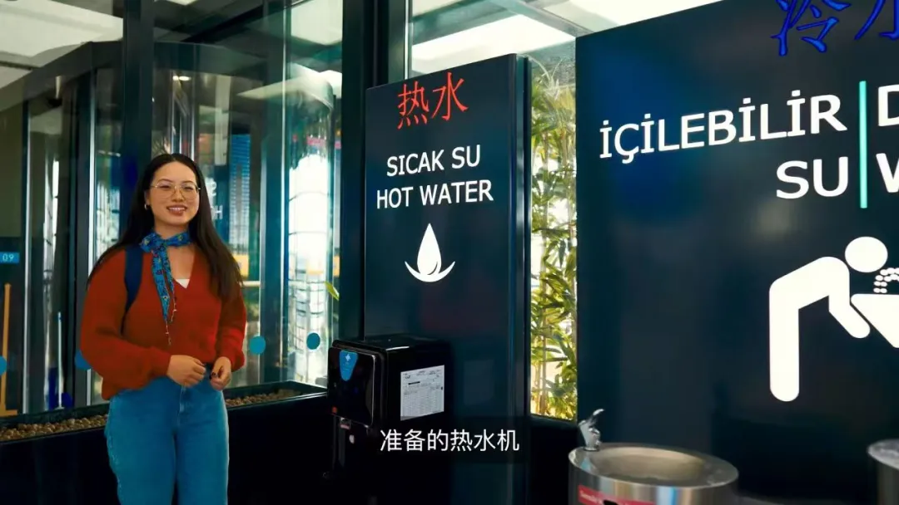

Wiki ya Dhahabu inakaribia,

na safari za masafa marefu zinaanza kuamka.

Wakiwa na **uingiaji bila visa nchini Türkiye kwa raia wa China** ukiwa umewekwa,

na **ndege za moja kwa moja kati ya China na Türkiye** zikizidi kuwa rahisi kila msimu,

Türkiye imekuwa moja ya maeneo maarufu zaidi ya vuli.

Kama kitovu kikuu kinachounganisha Ulaya na Asia,

Uwanja wa Ndege wa iGA Istanbul unaendelea kufanya kazi katika uzoefu wa abiria,

ukifanya kila kituo kiwe cha kufikiriwa, rahisi na cha starehe.

Iwe uko kwenye muunganisho mfupi, kusubiri kwa muda mrefu kati ya ndege,

au unawasili Istanbul kuanza safari ya Uturuki,

mwongozo huu wa vitendo wa uwanja wa ndege

unakupitisha katika huduma za lugha ya Kichina, mapumziko, huduma rafiki kwa familia na urahisi wa safari ndani ya terminal.

## 01 Kusafiri kwa Kichina, kupitia uwanja mzima

Unaposafiri kuvuka mipaka, kitu cha mwisho unachotaka ni kizuizi cha lugha au alama usiyoweza kusoma. Kwenye Uwanja wa Ndege wa Istanbul, wasafiri wanaozungumza Kichina wanaweza kupitia safari yote kwa kujiamini.

### Alama za Kichina katika kila hatua

Kuanzia njia za forodha, eneo la marejesho ya kodi na dawati la habari hadi malango, korido za uhamisho na skrini za habari za ndege, sehemu muhimu kote terminal zina **alama za Kichina**, kwa hivyo habari ni za papo kwa papo na rahisi kufuata.

Hakuna kujitahidi kutafsiri na hakuna kuzurura — angalia juu na utapata njia yako. Uhamisho, marejesho ya kodi na kupanda ndege ni wazi kwa mtazamo mmoja.

### Kioski mahiri za video

**（Kioski cha Kidijitali）**

Terminal ina **kioski mahiri za usaidizi wa video na mashine za kujihudumia**, zote zikiauni Kichina, ambapo unaweza kufikia mfanyakazi kwa video kuuliza kuhusu ndege, huduma za uwanja na zaidi.

### Waelekezi wanaozungumza Kichina uwanjani

## 02 Njia za starehe za kusubiri

Uwanja umejaa maeneo ya kupumzika, kununua, kula na kustarehe, yakigeuza kusubiri kuwa kitu cha kurejesha nguvu.

### Sehemu za kutazama TV katika maeneo kadhaa

Uwanja wa Ndege wa Istanbul umeweka **maeneo ya umma ya kutazama TV** katika kanda kadhaa maarufu za kusubiri, ili uweze kufuatilia habari au kuvinjari unaposubiri — hakuna tena kusubiri kwa kuchosha.

### Ununuzi bila ushuru na chakula kutoka kote duniani

Terminal ina **eneo kubwa la bidhaa bila ushuru** linalojumuisha chapa za urembo za kimataifa, chapa za anasa, bidhaa maalum za Uturuki na zawadi, kwa bei zinazostahili kuangaliwa — bora kwa kununua vitu ukipita.

Kwa chakula, **migahawa ya kila aina** imeangaziwa: kahawa ya kitamaduni ya Uturuki, vyakula maalum vya hapa na minyororo ya kimataifa. Milo ya moto, vitafunio vyepesi, vitindamlo na vinywaji vyote ni rahisi kupata.

### iGA Lounge

Kwenye muunganisho mrefu, unapotaka mahali tulivu pa kujipanga upya, **iGA Lounge** ni mahali pazuri pa kutua.

Ina vifaa vizuri: bufee wazi wa siku nzima wenye vinywaji vya moto na baridi, bafu za kuoga, terasi ya nje ya kutazama, WiFi ya bure ya kasi na skrini za habari za ndege. Ndani pia kuna eneo la kuchezea watoto, chumba cha maombi, eneo la kazi na makabati ya mizigo — kwa hivyo hata familia inayosafiri pamoja inaweza kusubiri kwa starehe.

## 03 Huduma rafiki kwa familia

Kwa familia, huduma za uwanja hufanya kuondoka, uhamisho na kusubiri kuwa rahisi katika kila hatua.

### Uwanja wa michezo wa watoto

Uwanja una **uwanja wa michezo wa watoto wenye mandhari wa mita za mraba 700**, ulioenea katika maeneo kadhaa ya malango na kujisajili, ambapo watoto wanaweza kucheza na kutoa nishati.

### Huduma za watoto wachanga

**Vyumba vya kutunza watoto wachanga** vimeenea kote terminal, na **viti vya kusukuma watoto vinaweza kuazimwa**, vikishughulikia mahitaji ya familia katika umri tofauti.

### Safari za familia zimefanywa rahisi

**Maeneo maalum ya maegesho ya familia na njia za kipaumbele za ukaguzi wa usalama kwa familia** hupunguza sana muda wa foleni, kwa hivyo kusafiri na watoto huenda vizuri.

## 04 Vidokezo vya vitendo kwa wasafiri kutoka China

Ili kufanya safari ya Wiki ya Dhahabu iwe laini zaidi, hapa kuna maelezo machache zaidi ya vitendo:

· Kuna **vituo kadhaa vya maji ya moto** kwenye terminal, faraja kwa wasafiri waliozoea kunywa maji ya moto. **Mikokoteni ya mizigo** inapatikana kila mahali, kwa hivyo mizigo minene ni rahisi kuhamisha.

· **WiFi ya kasi inashughulikia terminal yote** — unganisha mara tu unapotua ili kuangalia ndege, kutuma ujumbe kwa familia na kusasisha mipango yako.

· Uwanja wa Ndege wa Istanbul **unafanya kazi saa 24**, ukiwapa abiria wanaowasili usiku sana, wanaoondoka kabla ya mapambazuko au walioko kwenye muunganisho mrefu kubadilika zaidi.

✈️✈️✈️

Inaunganisha Ulaya na Asia, ikiunganisha kila safari.

Wiki hii ya Dhahabu,

iwe unapita Uwanja wa Ndege wa Istanbul kuelekea mahali pengine,

au unawasili hapa kuchunguza Türkiye,

huduma za lugha ya Kichina, huduma rafiki kwa familia na uzoefu tofauti wa uwanja hufanya safari kuwa rahisi.

**Uwanja wa Ndege wa iGA Istanbul,**

**tunatarajia kukutana na kila safari.**

## Viungo vinavyohusiana

- **Kwenye tovuti hii**: [Uwanja wa Ndege wa Istanbul (IST)](/airport/IST), [Türkiye (TR)](/country/TR)
- **Wikipedia**: [Uwanja wa Ndege wa Istanbul](https://en.wikipedia.org/wiki/Istanbul_Airport)
- **Baidu Baike**: [Uwanja wa Ndege wa Istanbul](https://baike.baidu.com/item/%E4%BC%8A%E6%96%AF%E5%9D%A6%E5%B8%83%E5%B0%94%E6%9C%BA%E5%9C%BA)

Chanzo cha picha: [istairport.com](http://istairport.com)
