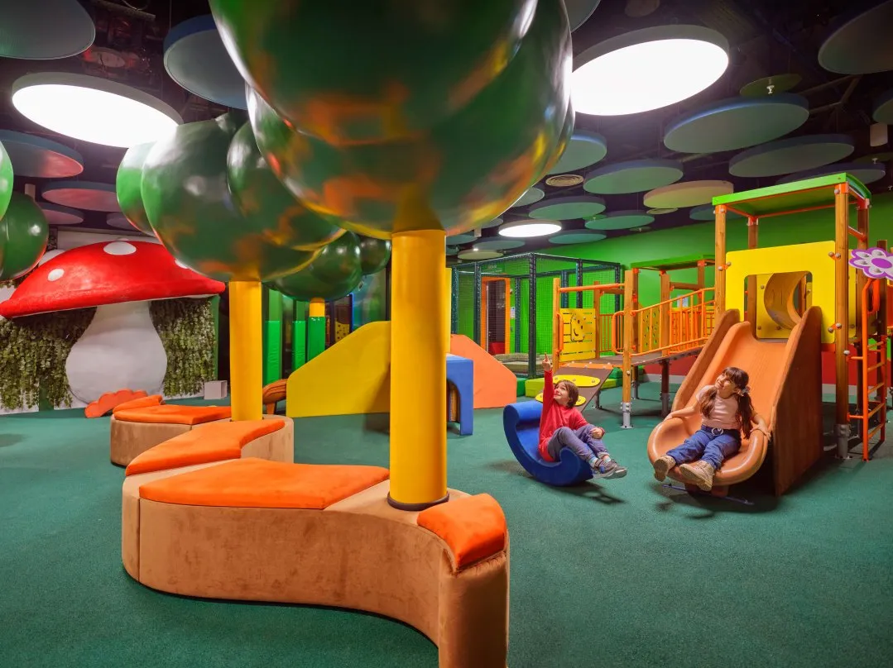
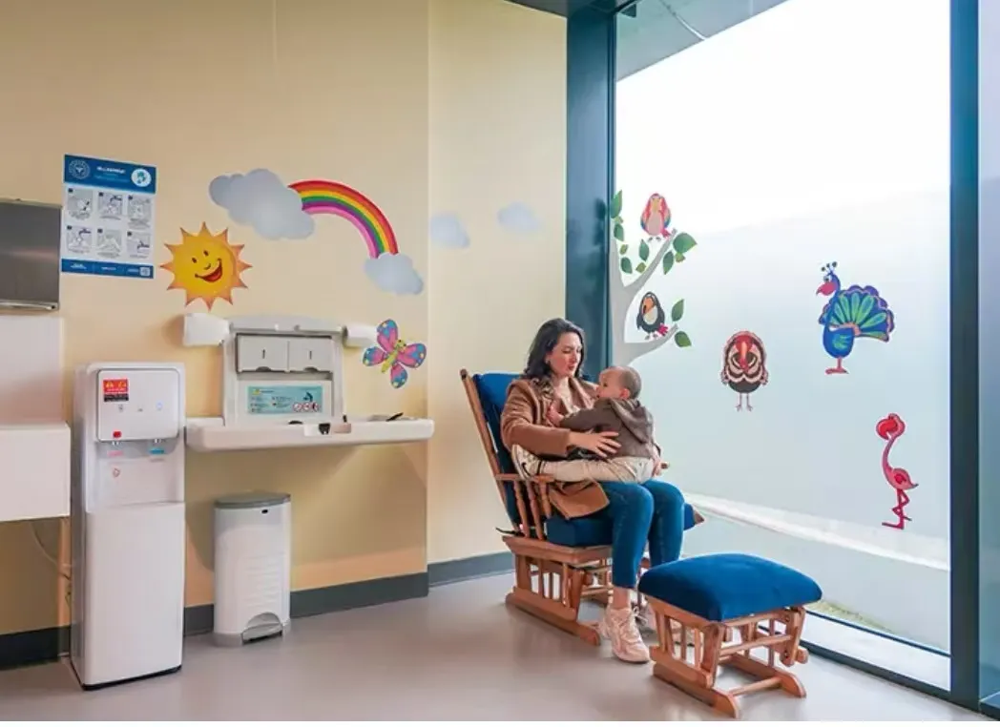

Altın Hafta geliyor,

ve uzun mesafeli seyahatler hız kazanıyor.

**Çin vatandaşları için Türkiye'ye vizesiz giriş** yürürlükteyken,

ve **Çin ile Türkiye arasındaki doğrudan uçuşlar** her sezon kolaylaşırken,

Türkiye en popüler sonbahar destinasyonlarından biri hâline geldi.

Avrupa ile Asya'yı kucaklayan bir süper merkez olarak,

iGA İstanbul Havalimanı yolcu deneyimi üzerinde çalışmayı sürdürüyor,

her durağı düşünceli, kolay ve konforlu kılıyor.

Kısa bir aktarma yapıyor, uçuşlar arasında uzun bir bekleme yaşıyor,

ya da İstanbul'a bir Türkiye gezisine başlamak için geliyor olun,

bu pratik havalimanı rehberi

terminal içindeki Çince hizmetleri, yolcu salonlarını, aile dostu olanakları ve seyahat kolaylıklarını adım adım anlatıyor.

## 01 Çince seyahat, havalimanının her yerinde

Sınırlar arası seyahat ederken en son isteyeceğiniz şey dil bariyeri ya da okuyamadığınız bir tabeladır. İstanbul Havalimanı'nda Çince konuşan gezginler tüm yolculuk boyunca kendilerinden emin ilerleyebilir.

### Her adımda Çince tabelalar

Gümrük kanallarından vergi iadesi alanına ve danışma masasına, kapılardan aktarma koridorlarına ve uçuş bilgi ekranlarına kadar terminalin önemli noktalarında **Çince tabelalar** bulunur; böylece bilgiye hemen ulaşılır ve takip etmesi kolaydır.

Çeviri ile uğraşmak ve boşuna dolaşmak yok — başınızı kaldırın ve yolunuzu bulun. Aktarmalar, vergi iadeleri ve binişler bir bakışta açık.

### Akıllı video kiosklar

**(Dijital Kiosk)**

Terminalde **akıllı video yardım kioskları ve self servis makineler** var; hepsi Çince destekliyor ve uçuşlar, havalimanı olanakları ve daha fazlası hakkında bir görevliye video üzerinden ulaşabilirsiniz.

### Sahada Çince konuşan rehberler

## 02 Beklemek için konforlu yollar

Havalimanı dinlenmek, alışveriş yapmak, yemek yemek ve mola vermek için yerlerle dolu; beklemeyi dinlendirici bir şeye dönüştürüyor.

### Birkaç alanda TV salonları

İstanbul Havalimanı birkaç popüler bekleme bölgesinde **halka açık TV izleme alanları** kurdu; böylece beklerken haberleri izleyebilir veya göz atabilirsiniz — artık sıkıcı aktarmalar yok.

### Dünyanın dört bir yanından gümrüksüz alışveriş ve yemek

Terminalde küresel güzellik markaları, lüks etiketler, Türk özel ürünleri ve hediyelikleri kapsayan **dev bir gümrüksüz satış bölgesi** var; fiyatlar göz atmaya değer — geçerken bir şeyler almak için ideal.

Yemek konusunda **her türden restoran** mevcut: geleneksel Türk kahvesi, yerel özel ürünler ve uluslararası zincirler. Sıcak yemekler, hafif atıştırmalıklar, tatlılar ve içecekler kolayca bulunuyor.

### iGA Lounge

Uzun bir aktarmada, sessiz bir yerde soluklanmak istediğinizde **iGA Lounge** iyi bir duraktır.

İyi donanımlı: sıcak ve soğuk içeceklerle gün boyu açık büfe, duşlar, dışarı bakan bir teras, ücretsiz yüksek hızlı WiFi ve uçuş bilgi ekranları. İçeride ayrıca çocuk oyun alanı, mescit, iş alanı ve bagaj dolapları var — böylece birlikte seyahat eden bir aile bile rahatça bekleyebilir.

## 03 Aile dostu olanaklar

Aileler için havalimanının olanakları kalkışı, aktarmayı ve beklemeyi her aşamada kolaylaştırıyor.

### Çocuk oyun alanı

Havalimanında birkaç kapı ve check-in alanına yayılmış **700 m²'lik temalı bir çocuk oyun alanı** var; çocuklar burada oynayıp enerjilerini atabilir.

### Bebek bakımı

**Bebek bakım odaları** tüm terminale dağıtılmış durumda ve **bebek arabaları ödünç alınabiliyor**; farklı yaşlardaki ailelerin ihtiyaçlarını karşılıyor.

### Aile seyahati daha kolay

Çocuklu seyahati sorunsuz hâle getiren **aile park yerleri ve aile öncelikli güvenlik şeritleri**, kuyruk süresini belirgin biçimde kısaltıyor.

## 04 Çin'den gelen gezginler için pratik ipuçları

Altın Hafta seyahatini daha da sorunsuz kılmak için birkaç pratik ayrıntı daha:

· Terminalde birkaç **sıcak su noktası** var; sıcak su içmeye alışkın gezginler için bir konfor. **Bagaj arabaları** her yerde bulunuyor, böylece hacimli çantaları taşımak kolay.

· **Yüksek hızlı WiFi tüm terminali kapsıyor** — indiğiniz anda bağlanarak uçuşları kontrol edin, ailenize mesaj atın ve planlarınızı güncelleyin.

· İstanbul Havalimanı **gece gündüz çalışır**; gece geç saatte gelen, şafak öncesi kalkan veya uzun aktarma yapan yolculara daha fazla esneklik tanır.

✈️✈️✈️

Avrupa ile Asya'yı kucaklayan, her yolculuğu birbirine bağlayan.

Bu Altın Hafta,

İstanbul Havalimanı'ndan başka bir yere geçiyor olsanız da,

ya da Türkiye'yi keşfetmek için buraya geliyor olsanız da,

Çince hizmetler, aile dostu olanaklar ve çeşitlilik gösteren havalimanı deneyimi yolculuğu kolaylaştırıyor.

**iGA İstanbul Havalimanı,**

**her yolculukla buluşmayı dört gözle bekliyor.**

## İlgili bağlantılar

- **Bu sitede**: [İstanbul Havalimanı (IST)](/airport/IST), [Türkiye (TR)](/country/TR)
- **Wikipedia**: [İstanbul Havalimanı](https://en.wikipedia.org/wiki/Istanbul_Airport)
- **Baidu Baike**: [İstanbul Havalimanı](https://baike.baidu.com/item/%E4%BC%8A%E6%96%AF%E5%9D%A6%E5%B8%83%E5%B0%94%E6%9C%BA%E5%9C%BA)

Görsel kaynağı: [istairport.com](http://istairport.com)
