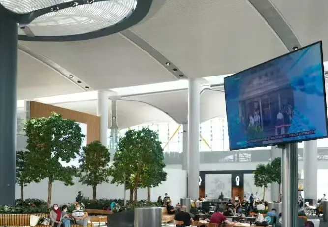

Золотий тиждень наближається,

і далекі подорожі набирають обертів.

Після запровадження **безвізового в'їзду до Туреччини для громадян Китаю**

та **прямих рейсів між Китаєм і Туреччиною**, які стають зручнішими з кожним сезоном,

Туреччина стала одним із найпопулярніших осінніх напрямків.

Як велетенський авіавузол, що охоплює Європу й Азію,

аеропорт iGA Istanbul постійно працює над досвідом пасажирів,

роблячи кожну зупинку продуманою, легкою та комфортною.

Чи у вас коротка пересадка, чи довге очікування між рейсами,

чи ви прибуваєте до Стамбула, щоб почати подорож Туреччиною,

цей практичний путівник аеропортом

проведе вас китайськомовними послугами, лаунжами, сімейними зручностями та зручностями для мандрівників у терміналі.

## 01 Подорож китайською мовою по всьому аеропорту

Перетинаючи кордони, найменше хочеться зіткнутися з мовним бар'єром або вказівником, який не можете прочитати. В аеропорту Стамбула китайськомовні мандрівники можуть упевнено пройти весь шлях.

### Китайськомовні вказівники на кожному кроці

Від каналів митного контролю, зони повернення податків і довідкової стійки до виходів на посадку, транзитних коридорів і табло з інформацією про рейси — ключові місця терміналу мають **китайськомовні вказівники**, тож інформація одразу перед очима й легко сприймається.

Жодних труднощів із перекладом і жодних блукань — підведіть погляд, і ви знайдете дорогу. Пересадки, повернення податків і посадка зрозумілі з першого погляду.

### Розумні відеокіоски

**(Цифровий кіоск)**

У терміналі є **розумні відеокіоски та автомати самообслуговування**, усі з підтримкою китайської мови, де через відеозв'язок можна звернутися до працівника із запитаннями про рейси, зручності аеропорту тощо.

### Китайськомовні консультанти в залі

## 02 Комфортні способи зачекати

В аеропорту безліч місць, де можна розслабитися, зробити покупки, поїсти й відпочити, перетворюючи очікування на щось відновлювальне.

### Телевізійні лаунжі в кількох зонах

Аеропорт Стамбула облаштував **публічні зони перегляду телебачення** в кількох популярних зонах очікування, тож можна дізнатися новини чи погортати щось, поки чекаєте — більше жодного нудного очікування між рейсами.

### Безмитні покупки та страви з усього світу

У терміналі є **величезна зона безмитної торгівлі** зі світовими брендами краси, люксовими марками, турецькими делікатесами й подарунками з цінами, на які варто звернути увагу — ідеально, щоб прихопити щось дорогою.

Щодо їжі, тут є **ресторани на будь-який смак**: традиційна турецька кава, місцеві делікатеси й міжнародні мережі. Гарячі страви, легкі закуски, десерти й напої знайти легко.

### iGA Lounge

Під час довгої пересадки, коли хочеться тихого місця, щоб зібратися з думками, **iGA Lounge** — гарний прихисток.

Він добре обладнаний: буфет, відкритий протягом усього дня, з гарячими й холодними напоями, душові, відкрита оглядова тераса, безкоштовний швидкісний Wi-Fi і табло з інформацією про рейси. Усередині також є дитячий майданчик, молитовна кімната, бізнес-зона й камери схову для багажу — тож навіть родина, яка подорожує разом, може чекати з комфортом.

## 03 Зручності для сімей

Для родин зручності аеропорту полегшують виліт, транзит і очікування на кожному етапі.

### Дитячий майданчик

В аеропорту є **тематичний дитячий майданчик площею 700 м²**, розподілений між кількома зонами виходів на посадку та реєстрації, де діти можуть гратися й виплеснути енергію.

### Догляд за немовлятами

**Кімнати для догляду за немовлятами** розташовані по всьому терміналу, а **дитячі коляски можна позичити**, що покриває потреби родин із дітьми різного віку.

### Легші подорожі з родиною

Спеціальні **сімейні паркувальні місця та сімейні пріоритетні смуги контролю безпеки** різко скорочують час у чергах, тож подорож із дітьми минає гладко.

## 04 Практичні поради для мандрівників із Китаю

Щоб подорож на Золотий тиждень була ще простішою, ось кілька практичних деталей:

· У терміналі є кілька **точок з гарячою водою** — розрада для мандрівників, звиклих пити гарячу воду. **Багажні візки** доступні всюди, тож об'ємні валізи легко переміщати.

· **Швидкісний Wi-Fi покриває весь термінал** — підключіться одразу після прибуття, щоб перевірити рейси, написати рідним і оновити плани.

· Аеропорт Стамбула **працює цілодобово**, даючи пасажирам, які прибувають пізно вночі, вилітають до світанку або мають довгі пересадки, більше гнучкості.

✈️✈️✈️

Охоплюючи Європу й Азію, з'єднуємо кожну подорож.

Цього Золотого тижня,

чи ви прямуєте через аеропорт Стамбула кудись далі,

чи прибуваєте сюди, щоб відкрити Туреччину,

китайськомовні послуги, сімейні зручності та різноманітний аеропортовий досвід роблять подорож простішою.

**iGA Istanbul Airport,**

**з нетерпінням чекаємо на кожну подорож.**

## Пов'язані посилання

- **На цьому сайті**: [Аеропорт Стамбула (IST)](/airport/IST), [Туреччина (TR)](/country/TR)
- **Вікіпедія**: [Аеропорт Стамбула](https://en.wikipedia.org/wiki/Istanbul_Airport)
- **Байду Байке**: [Аеропорт Стамбула](https://baike.baidu.com/item/%E4%BC%8A%E6%96%AF%E5%9D%A6%E5%B8%83%E5%B0%94%E6%9C%BA%E5%9C%BA)

Джерело зображень: [istairport.com](http://istairport.com)
