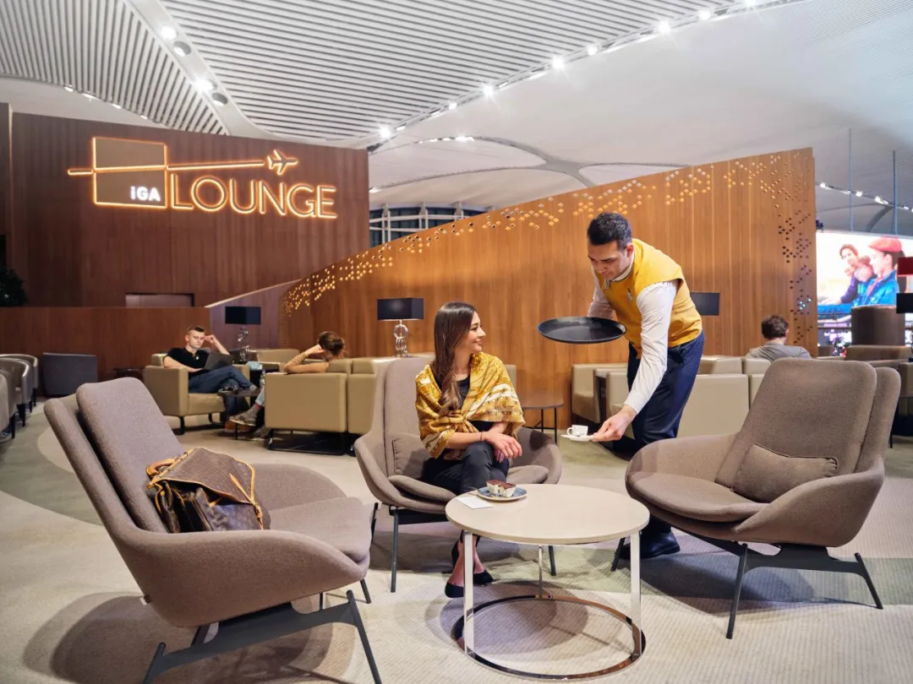
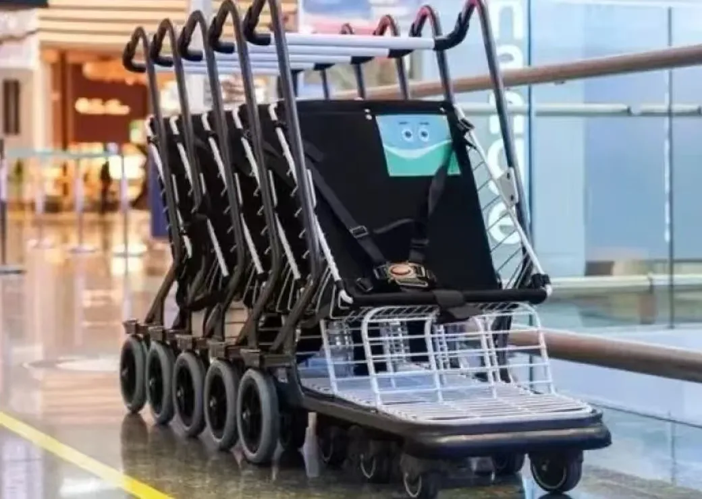
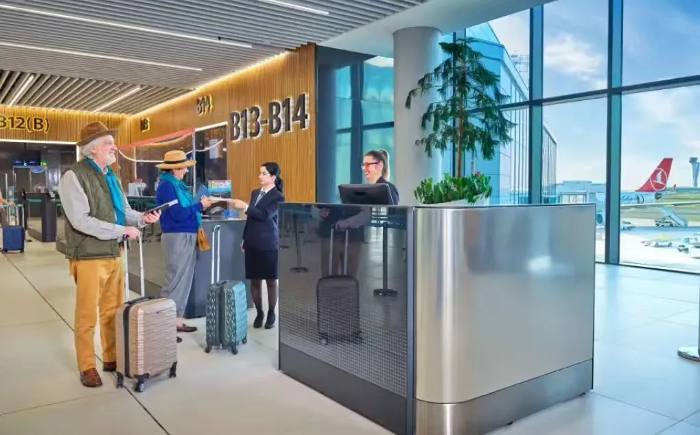

Tuần lễ Vàng đang đến gần,

và du lịch đường dài đang ấm dần lên.

Khi **người Trung Quốc đã được miễn thị thực nhập cảnh Thổ Nhĩ Kỳ**,

và **các chuyến bay thẳng giữa Trung Quốc và Thổ Nhĩ Kỳ** ngày càng thuận tiện mỗi mùa,

Thổ Nhĩ Kỳ đã trở thành một trong những điểm đến mùa thu được yêu thích nhất.

Là một siêu trung tâm nối châu Âu và châu Á,

sân bay iGA Istanbul không ngừng cải thiện trải nghiệm hành khách,

để mỗi điểm dừng đều chu đáo, dễ dàng và thoải mái.

Dù bạn đang nối chuyến ngắn, chờ lâu giữa các chuyến,

hay đến Istanbul để bắt đầu hành trình khám phá Thổ Nhĩ Kỳ,

cẩm nang sân bay thực tế này

sẽ dẫn bạn qua các dịch vụ tiếng Trung, phòng chờ, tiện ích thân thiện với gia đình và những tiện nghi du lịch bên trong nhà ga.

## 01 Đi lại bằng tiếng Trung suốt cả sân bay

Khi vượt qua biên giới, điều bạn không muốn nhất là rào cản ngôn ngữ hay một tấm biển không đọc được. Tại sân bay Istanbul, du khách nói tiếng Trung có thể đi qua toàn bộ hành trình một cách tự tin.

### Biển chỉ dẫn tiếng Trung ở từng bước

Từ các làn hải quan, khu hoàn thuế và quầy thông tin đến cổng, hành lang nối chuyến và màn hình thông tin chuyến bay, những điểm quan trọng khắp nhà ga đều có **biển chỉ dẫn tiếng Trung**, nên thông tin đến ngay và dễ theo.

Không phải vật lộn với bản dịch và không phải đi lạc — chỉ cần nhìn lên là bạn tìm thấy đường. Nối chuyến, hoàn thuế và lên máy bay đều rõ ràng trong nháy mắt.

### Kiosk video thông minh

**（Kiosk kỹ thuật số）**

Nhà ga có **kiosk hỗ trợ video thông minh và máy tự phục vụ**, tất cả đều hỗ trợ tiếng Trung, nơi bạn có thể gặp nhân viên qua video để hỏi về chuyến bay, tiện ích sân bay và nhiều hơn nữa.

### Nhân viên hướng dẫn nói tiếng Trung tại sảnh

## 02 Những cách chờ thoải mái

Sân bay có rất nhiều nơi để thư giãn, mua sắm, ăn uống và nghỉ ngơi, biến thời gian chờ thành điều có thể hồi sức.

### Khu xem TV ở nhiều khu vực

Sân bay Istanbul đã bố trí **khu xem TV công cộng** ở một số khu chờ đông người, để bạn có thể xem tin tức hoặc lướt web trong lúc chờ — không còn những lần nối chuyến buồn tẻ.

### Mua sắm miễn thuế và ẩm thực khắp thế giới

Nhà ga có **khu miễn thuế khổng lồ** gồm các thương hiệu làm đẹp toàn cầu, nhãn hàng xa xỉ, đặc sản Thổ Nhĩ Kỳ và quà tặng, với mức giá đáng để dạo xem — lý tưởng để mua sắm trên đường đi.

Về ăn uống, **đủ loại nhà hàng** đều có: cà phê Thổ Nhĩ Kỳ truyền thống, đặc sản địa phương và chuỗi quốc tế. Bữa nóng, món nhẹ, tráng miệng và đồ uống đều dễ tìm.

### iGA Lounge

Trong một lần nối chuyến dài, khi bạn muốn một nơi yên tĩnh để lấy lại sức, **iGA Lounge** là chỗ dừng chân tốt.

Tiện nghi đầy đủ: buffet mở cả ngày với đồ uống nóng và lạnh, phòng tắm, sân hiên ngắm cảnh ngoài trời, WiFi tốc độ cao miễn phí và màn hình thông tin chuyến bay. Bên trong còn có khu vui chơi trẻ em, phòng cầu nguyện, khu làm việc và tủ gửi hành lý — nên cả gia đình đi cùng cũng có thể chờ thoải mái.

## 03 Tiện ích thân thiện với gia đình

Với các gia đình, tiện ích của sân bay giúp việc khởi hành, nối chuyến và chờ đợi dễ dàng hơn ở mọi bước.

### Sân chơi trẻ em

Sân bay có **sân chơi trẻ em theo chủ đề rộng 700 m²**, trải khắp một số khu cổng và khu check-in, nơi trẻ em có thể vui chơi và xả năng lượng.

### Chăm sóc em bé

**Phòng chăm sóc em bé** được bố trí khắp nhà ga, và **có thể mượn xe đẩy**, đáp ứng nhu cầu của gia đình ở các độ tuổi khác nhau.

### Du lịch gia đình dễ dàng hơn

**Chỗ đỗ xe dành cho gia đình và làn an ninh ưu tiên cho gia đình** cắt giảm mạnh thời gian xếp hàng, để việc đi lại cùng trẻ em diễn ra suôn sẻ.

## 04 Mẹo thực tế cho du khách từ Trung Quốc

Để chuyến đi dịp Tuần lễ Vàng càng suôn sẻ, đây là vài chi tiết thực tế nữa:

· Trong nhà ga có một số **điểm nước nóng**, một sự an ủi cho những người quen uống nước nóng. **Xe đẩy hành lý** có ở khắp nơi, nên hành lý cồng kềnh dễ di chuyển.

· **WiFi tốc độ cao phủ toàn bộ nhà ga** — kết nối ngay khi hạ cánh để kiểm tra chuyến bay, nhắn tin cho gia đình và cập nhật kế hoạch.

· Sân bay Istanbul **hoạt động suốt ngày đêm**, mang lại sự linh hoạt hơn cho hành khách đến muộn ban đêm, khởi hành trước bình minh hoặc nối chuyến dài.

✈️✈️✈️

Nối châu Âu và châu Á, kết nối mọi hành trình.

Tuần lễ Vàng này,

dù bạn quá cảnh sân bay Istanbul để đến nơi khác,

hay đến đây để khám phá Thổ Nhĩ Kỳ,

các dịch vụ tiếng Trung, tiện ích thân thiện với gia đình và trải nghiệm sân bay đa dạng sẽ giúp chuyến đi dễ dàng hơn.

**Sân bay iGA Istanbul,**

**mong được gặp mọi hành trình.**

## Liên kết liên quan

- **Trên trang này**: [Sân bay Istanbul (IST)](/airport/IST), [Thổ Nhĩ Kỳ (TR)](/country/TR)
- **Wikipedia**: [Sân bay Istanbul](https://en.wikipedia.org/wiki/Istanbul_Airport)
- **Baidu Baike**: [Sân bay Istanbul](https://baike.baidu.com/item/%E4%BC%8A%E6%96%AF%E5%9D%A6%E5%B8%83%E5%B0%94%E6%9C%BA%E5%9C%BA)

Nguồn ảnh: [istairport.com](http://istairport.com)
