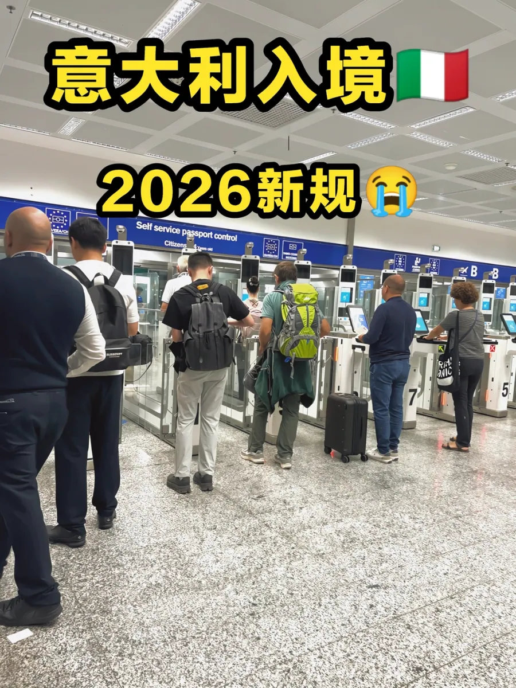

Terbang ke Italia dari Tiongkok pada dasarnya ada dua pintu: **Milan Malpensa (MXP)** di utara dan **Roma Fiumicino (FCO)** di ibu kota. Visa Schengen yang sama dan penerbangan panjang yang sama tetap dapat menghasilkan waktu kedatangan yang berbeda berjam-jam — bukan karena pelancongnya, tetapi karena berapa banyak petugas yang ditempatkan di loket manual untuk paspor non-UE di masing-masing bandara.

Pada 2026, **Entry/Exit System (EES)** Uni Eropa juga sudah beroperasi penuh, sehingga pengunjung non-UE mendaftarkan sidik jari dan gambar wajah di kios saat masuk pertama kali sebelum pemeriksaan manual. Langkah tambahan itu sendiri tidak lambat, tetapi mengubah bentuk antrean. Setiap waktu tunggu di bawah ini berasal dari laporan pelancong, bukan janji bandara.

## 1. Dua bandara, dua pengalaman

Aturan Schengen identik di kedua bandara; cara penerapannya tidak. Perbedaannya terlihat pada berapa banyak loket manual yang dijaga, bagaimana kedatangan dikelompokkan sepanjang hari, dan seberapa cepat antrean diserap.

### Milan Malpensa (MXP): di mana antreannya

Malpensa adalah gerbang jarak jauh Italia utara dan bandara yang digunakan penerbangan langsung dari Tiongkok ke Milan. **Paspor non-UE hanya dapat menggunakan loket manual, dan pada musim puncak sering hanya dua yang dibuka.** Kedatangan jarak jauh juga menumpuk: **pukul 16.00–21.00 adalah puncaknya**, ketika beberapa pesawat berbadan lebar mendarat dalam satu jam dan ratusan penumpang non-UE membanjiri satu jalur. Pelancong melaporkan **antrean mulai dari dua jam**; pada 2026 seorang pelancong Tiongkok menunggu **tiga jam** untuk cap masuk.

### Roma Fiumicino (FCO): yang lebih lancar

Fiumicino adalah bandara tersibuk di Italia dan telah berinvestasi lebih banyak pada teknologi perbatasan: **77 e-gate, lebih banyak daripada bandara lain di Eropa**. Sebagian besar pemegang paspor UE disaring ke mesin, yang mengurangi tekanan pada loket. Penerbangan pagi adalah jendela paling sepi: **yang mendarat antara pukul 06.00 dan 09.00 hampir tidak mengantre dan selesai dalam sekitar sepuluh menit**. Paspor Tiongkok tetap tidak dapat menggunakan e-gate, tetapi lebih banyak loket yang dibuka dan pemeriksaannya bergerak lebih cepat.

| Poin | Milan Malpensa (MXP) | Roma Fiumicino (FCO) |
| --- | --- | --- |
| Jalur untuk paspor Tiongkok | Hanya loket manual | Hanya loket manual |
| Jendela puncak | **16.00–21.00**, kedatangan jarak jauh menumpuk | Penerbangan pagi **06.00–09.00** paling sepi |
| Waktu tunggu tipikal | **Dua jam ke atas**; laporan tiga jam | Sekitar **sepuluh menit** pada penerbangan pagi |

Gerbang tersebut melayani pelancong UE, EEA, dan Swiss; papannya bertuliskan Self service passport control. Dengan paspor Tiongkok, jangan ikut antrean itu — terus berjalan sampai Anda melihat **All Passports / TUTTI I PASSAPORTI**.

## 2. Yang perlu disiapkan sebelum terbang

Petugas perbatasan melihat paspor mungkin selama tiga puluh detik, dan apakah prosesnya lancar kurang bergantung pada bahasa Inggris Anda daripada pada apakah dokumennya siap diserahkan.

1. **Paspor, berlaku minimal enam bulan.** Hal yang baru disadari orang terlambat: paspor dengan sisa dua bulan masih bisa mendapatkan visa dan tetap bisa ditolak masuk.
2. **Visa Schengen (tipe C, kunjungan singkat).** Ajukan sekitar **1,5 bulan sebelumnya**; pada musim puncak, janji temu dan pemrosesan dapat memakan **30–45 hari**.
3. **Tiket pulang atau lanjutan.** Bukti bahwa Anda akan pergi tepat waktu; cetak seluruh perjalanan.
4. **Pemesanan hotel, sebaiknya dicetak.** Alamat malam pertama Anda paling penting.
5. **Asuransi perjalanan.** Wajib untuk visa Schengen dan mencakup seluruh masa tinggal; simpan sertifikatnya bersama Anda.

Cetak ketiga dokumen — rencana perjalanan, pemesanan, polis — dan simpan bersama paspor. Untuk jam pertama setelah mendarat, ponsel adalah barang Anda yang paling tidak andal.

## 3. Bea cukai dan uang tunai: batas keras

Melewati imigrasi adalah separuh dari kedatangan; setelah pengambilan bagasi datang bea cukai, yang lebih blak-blakan daripada kontrol perbatasan — petugas dapat berdiskusi dengan Anda, aturan tidak.

- **Uang tunai: hingga €10.000 tidak perlu deklarasi**, di atas itu Anda harus mendeklarasikannya. Ambang batas itu bukan larangan; mendeklarasikan itu legal, tidak mendeklarasikan tidak.
- **Dilarang: produk daging dan susu.** Sosis, dendeng sapi, sosis matang, keju — kemasan vakum tidak membuat perbedaan, dan bagasi tercatat juga diperiksa.
- **Tembakau: 200 batang rokok**, untuk pelancong berusia **17 tahun ke atas**.
- **Alkohol: satu botol minuman keras atau dua botol alkohol berkadar lebih rendah.**
- **Obat-obatan: hanya jumlah untuk penggunaan pribadi, dengan resep.** Narkotika diperiksa paling ketat.

| Barang | Batas | Catatan |
| --- | --- | --- |
| Uang tunai | **Hingga €10.000 tanpa deklarasi** | Di atas itu, deklarasikan; keluarga yang bepergian bersama dihitung gabungan |
| Daging dan susu | **Dilarang** | Kemasan vakum tidak membuat perbedaan |
| Rokok | **200** | Pelancong berusia 17 tahun ke atas |
| Alkohol | **Satu botol minuman keras atau dua botol alkohol berkadar lebih rendah** | Anggur, bir, dan sejenisnya |
| Obat-obatan | **Jumlah penggunaan pribadi plus resep** | Simpan kemasan asli |

Jebakan yang paling sering dialami wisatawan Tiongkok adalah daging. Beberapa sosis dan sekantong dendeng sapi terlihat biasa di dalam koper, tetapi jika ditemukan langsung disita, dengan denda pada kasus yang lebih serius.

## 4. Berjalan dari gerbang ke ban berjalan

Bandara Italia pada dasarnya memiliki satu rute utama dari pintu pesawat ke ban berjalan bagasi, dengan papan petunjuk dalam bahasa Italia dan Inggris. Pendatang pertama ragu jalur mana yang harus diambil, dan keraguan itulah yang membuat antrean bertambah panjang.

1. **Ikuti USCITA / Exit.** Jangan berhenti di garbarata untuk mencari sinyal, dan jangan mengikuti panah Transfer kecuali Anda benar-benar transit.
2. **Ambil All Passports / TUTTI I PASSAPORTI.** Aula terbagi menjadi jalur layanan mandiri dan manual; paspor Tiongkok termasuk jalur manual, dan e-gate tidak akan menghasilkan catatan masuk untuk Anda.
3. **Registrasi EES saat masuk pertama.** Pindai paspor di kios, berikan sidik jari dan foto, konfirmasi tanda terima, lalu pergi ke loket manual. Registrasi tidak sama dengan diizinkan masuk.
4. **Ambil bagasi Anda.** Temukan nomor penerbangan Anda di layar. Di Milan, bagasi kadang sudah diturunkan di samping ban berjalan, jadi tanyakan kepada petugas jika Anda tidak melihatnya.
5. **Lewati bea cukai.** Tidak ada yang perlu dideklarasikan, ambil **jalur hijau**; melebihi batas atau membawa barang yang wajib dideklarasikan, ambil **jalur merah**.

Langkah ketiga adalah tempat orang paling sering salah. Kios EES biasanya berada di satu sisi sebelum jalur manual, dengan petugas mengarahkan arus pada jam sibuk; masuk pertama perlu registrasi, sedangkan masuk kembali dalam tiga tahun biasanya dicocokkan dengan catatan yang ada.

## 5. EES dan pertanyaan yang selalu diajukan

EES adalah sistem masuk/keluar elektronik UE, diperkenalkan bertahap mulai Oktober 2025 dan beroperasi penuh sejak April 2026. Sistem ini mencatat setiap masuk dan keluar non-UE dengan sidik jari dan gambar wajah, bukan cap paspor. Perubahan yang terlihat adalah langkah layanan mandiri tambahan saat masuk pertama; manfaatnya adalah pemeriksaan loket yang lebih cepat pada setiap masuk kembali dalam tiga tahun.

**Apakah EES membuat antrean lebih panjang?** Registrasi menambah satu atau dua menit per orang. Yang menentukan waktu tunggu adalah jumlah loket yang dibuka — masalah Milan bukanlah mesin yang lambat, melainkan terlalu sedikit loket yang dijaga.

**Apakah paspor Tiongkok dapat menggunakan e-gate?** Saat ini tidak. E-gate Italia melayani pelancong UE, EEA, dan Swiss, plus pelancong terdaftar dari negara lain tertentu di beberapa bandara; paspor Tiongkok tidak termasuk.

**Apakah saya perlu masuk Italia jika hanya transit?** Jika penerbangan berikutnya berada di dalam Schengen, biasanya Anda menyelesaikan masuk Schengen di titik kedatangan pertama. Transit internasional tanpa masuk Schengen, Anda tetap di sisi udara.

**Apa yang akan mereka tanyakan?** Biasanya tiga hal dalam bahasa Inggris: apa yang Anda lakukan, berapa lama Anda tinggal, di mana Anda menginap. Jawaban spesifik lebih baik — “wisata, sepuluh hari, malam pertama dekat Milano Centrale” lebih baik daripada “hanya jalan-jalan”.

Satu catatan terakhir: nomor loket, waktu tunggu, dan prosedur EES yang tepat bervariasi sesuai jadwal penerbangan dan staf hari itu. Waktu di sini berasal dari pengukuran dan laporan pelancong; periksa situs bandara, polisi perbatasan Italia, dan bea cukai untuk hari Anda bepergian.

## Tautan terkait

- **Di situs ini**: [Bandara Roma Fiumicino (FCO)](/airport/FCO), [Bandara Milan Malpensa (MXP)](/airport/MXP), [Italia (IT)](/country/IT)
- **Wikipedia**: [Bandara Roma Fiumicino](https://en.wikipedia.org/wiki/Rome_Fiumicino_Airport), [Bandara Milan Malpensa](https://en.wikipedia.org/wiki/Milan_Malpensa_Airport)
- **Baidu Baike**: [Bandara Roma Fiumicino](https://baike.baidu.com/item/%E7%BD%97%E9%A9%AC-%E8%8F%B2%E4%B9%8C%E7%B1%B3%E5%A5%87%E8%AF%BA%E6%9C%BA%E5%9C%BA), [Bandara Milan Malpensa](https://baike.baidu.com/item/%E7%B1%B3%E5%85%B0-%E9%A9%AC%E5%B0%94%E5%BD%AD%E8%90%A8%E6%9C%BA%E5%9C%BA)
