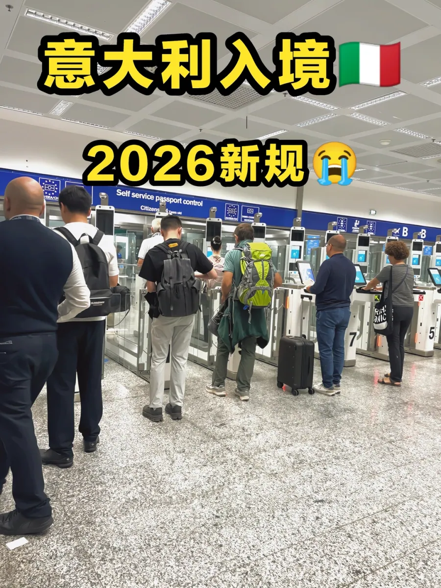

중국에서 이탈리아로 가는 길에는 사실 두 개의 문이 있습니다. 북부의 **밀라노 말펜사(MXP)** 와 수도에 있는 **로마 피우미치노(FCO)** 입니다. 같은 솅겐 비자, 같은 장거리 비행이라도 도착 시간은 몇 시간씩 차이 날 수 있습니다 — 여행자 때문이 아니라, 각 공항이 비EU 여권용 수동 카운터에 몇 명의 심사관을 배치하는지 때문입니다.

2026년에는 EU의 **입출국 시스템(EES)** 도 완전히 가동되어, 비EU 방문자는 첫 입국 시 수동 심사 전에 키오스크에서 지문과 얼굴 이미지를 등록합니다. 추가 단계 자체는 느리지 않지만 줄의 모양을 바꿉니다. 아래의 모든 대기 시간은 공항의 약속이 아니라 여행자들의 보고에서 나온 것입니다.

## 1. 두 공항, 두 가지 경험

솅겐 규칙은 두 공항에서 동일합니다. 적용 방식은 다릅니다. 차이는 수동 카운터에 몇 명이 배치되는지, 하루 중 도착편이 어떻게 몰리는지, 그리고 줄이 얼마나 빨리 소화되는지에서 드러납니다.

### 밀라노 말펜사(MXP): 줄이 생기는 곳

말펜사는 이탈리아 북부의 장거리 관문이며 밀라노로 가는 중국 직항편이 사용하는 공항입니다. **비EU 여권은 수동 부스만 쓸 수 있고, 성수기에는 종종 두 곳만 열립니다.** 장거리 도착편도 몰립니다. **16:00~21:00이 피크**로, 한 시간 안에 여러 대의 광동체 항공기가 내리면 수백 명의 비EU 승객이 한 줄로 모여듭니다. 여행자들은 **두 시간부터 시작하는 줄**을 보고하며, 2026년에는 한 중국인 여행자가 입국 도장을 받는 데 **세 시간**을 기다렸습니다.

### 로마 피우미치노(FCO): 더 매끄러운 쪽

피우미치노는 이탈리아에서 가장 붐비는 공항이며 국경 기술에 더 많이 투자했습니다. **e-gate가 77대로 유럽에서 가장 많습니다.** 대부분의 EU 여권 소지자는 기계로 분산되어 카운터의 부담이 줄어듭니다. 이른 항공편이 가장 한산한 구간입니다. **06:00~09:00에 착륙한 승객은 거의 줄을 서지 않고 약 10분 만에 통과합니다.** 중국 여권은 여전히 e-gate를 쓸 수 없지만, 열린 카운터가 더 많고 심사가 더 빨리 진행됩니다.

| 항목 | 밀라노 말펜사(MXP) | 로마 피우미치노(FCO) |
| --- | --- | --- |
| 중국 여권용 통로 | 수동 카운터만 | 수동 카운터만 |
| 피크 시간대 | **16:00~21:00**, 장거리 도착편 집중 | 이른 항공편 **06:00~09:00**이 가장 한산 |
| 일반적인 대기 | **두 시간 이상**, 세 시간 사례도 보고 | 이른 항공편은 약 **10분** |

그 게이트는 EU와 EEA, 스위스 여행자용이며 표지판에는 Self service passport control이라고 적혀 있습니다. 중국 여권이라면 그 줄에 서지 말고, **All Passports / TUTTI I PASSAPORTI** 가 보일 때까지 계속 걸어가십시오.

## 2. 출발 전에 준비할 것

국경 심사관이 여권을 보는 시간은 아마 30초입니다. 그 시간이 매끄럽게 흘러가는지는 영어 실력보다 서류를 바로 건넬 수 있는지에 달려 있습니다.

1. **여권, 최소 6개월 유효.** 사람들이 너무 늦게 알게 되는 것: 두 달 남은 여권으로도 비자를 받을 수 있고, 그래도 입국을 거부당할 수 있습니다.
2. **솅겐 비자(C형, 단기 체류).** 약 **1.5개월 전**에 신청하십시오. 성수기에는 예약과 심사가 **30~45일**까지 늘어날 수 있습니다.
3. **귀국 또는 다음 목적지 항공권.** 제때 떠난다는 증명입니다. 전체 여정을 출력하십시오.
4. **호텔 예약, 가능하면 출력해서.** 첫날 밤의 주소가 가장 중요합니다.
5. **여행자 보험.** 솅겐 비자에 필수이고 전체 체류 기간을 보장해야 합니다. 증서를 소지하십시오.

세 문서 — 일정표, 예약 확인서, 보험 증서 — 를 모두 출력해 여권과 함께 두십시오. 착륙 후 첫 한 시간 동안 휴대폰은 가장 믿기 어려운 소지품입니다.

## 3. 세관과 현금: 확실한 한도

입국 심사를 통과하는 것은 도착의 절반입니다. 수하물을 찾은 뒤에는 세관이 기다리는데, 국경 심사보다 더 무뚝뚝합니다 — 심사관은 당신과 이야기할 수 있지만, 규칙은 그렇지 않습니다.

- **현금: 최대 €10,000까지는 신고가 필요 없습니다.** 그 이상은 신고해야 합니다. 기준은 금지가 아니라 신고 의무입니다. 신고하면 합법이고, 신고하지 않으면 아닙니다.
- **금지 품목: 육류와 유제품.** 소시지, 육포, 건조 소시지, 치즈 — 진공 포장도 상관없고, 위탁 수하물도 검사합니다.
- **담배: 200개비**, **17세 이상** 여행자.
- **주류: 독주 한 병 또는 낮은 도수 주류 두 병.**
- **의약품: 처방전이 있는 개인 사용량만.** 마약류는 가장 엄격하게 검사합니다.

| 품목 | 한도 | 비고 |
| --- | --- | --- |
| 현금 | **€10,000까지 신고 없이** | 초과 시 신고, 함께 여행하는 가족은 합산 |
| 육류·유제품 | **금지** | 진공 포장도 상관없음 |
| 담배 | **200개비** | 17세 이상 여행자 |
| 주류 | **독주 한 병 또는 낮은 도수 주류 두 병** | 와인, 맥주 등 |
| 의약품 | **개인 사용량 + 처방전** | 원래 포장 유지 |

중국인 여행자가 가장 자주 빠지는 함정은 육류입니다. 소시지 몇 개와 육포 한 봉지는 여행 가방 안에서 별것 아니어 보여도, 발견되면 즉시 압수되고 심한 경우 벌금이 부과됩니다.

## 4. 탑승구에서 수하물 벨트까지

이탈리아 공항은 항공기 문에서 수하물 벨트까지 사실상 하나의 주요 동선이 있고, 이탈리아어와 영어로 표지가 있습니다. 처음 온 사람은 어느 줄에 서야 할지 망설이고, 그 망설임이 바로 줄이 길어지는 이유입니다.

1. **USCITA / Exit 표지를 따르십시오.** 제트브리지에서 신호를 잡으려 멈추지 말고, 정말로 환승하는 것이 아니라면 Transfer 화살표를 따라가지 마십시오.
2. **All Passports / TUTTI I PASSAPORTI로 가십시오.** 홀은 셀프서비스 줄과 수동 줄로 나뉘고, 중국 여권은 수동 줄에 속하며 e-gate는 당신의 입국 기록을 만들어 주지 않습니다.
3. **첫 입국 시 EES에 등록하십시오.** 키오스크에서 여권을 스캔하고 지문과 사진을 제공하고 영수증을 확인한 뒤 수동 카운터로 가십시오. 등록은 입국 허가와 다릅니다.
4. **수하물을 찾으십시오.** 화면에서 항공편 번호를 찾으십시오. 밀라노에서는 가방이 벨트 옆에 이미 내려져 있는 경우도 있으니 보이지 않으면 직원에게 물으십시오.
5. **세관을 통과하십시오.** 신고할 것이 없으면 **녹색 통로**, 면세 한도를 넘거나 신고할 물품이 있으면 **적색 통로**로 가십시오.

세 번째 단계에서 사람들이 가장 자주 틀립니다. EES 키오스크는 보통 수동 줄 앞 한쪽에 있고 혼잡한 시간에는 직원이 안내합니다. 첫 입국에는 등록이 필요하지만, 3년 이내 재입국은 보통 기존 기록과 대조됩니다.

## 5. EES와 모두가 묻는 질문

EES는 EU의 전자 입출국 시스템으로, 2025년 10월부터 단계적으로 도입되어 2026년 4월부터 완전히 운영됩니다. 여권 도장 대신 지문과 얼굴 이미지로 비EU 입출국을 기록합니다. 눈에 보이는 변화는 첫 입국 시의 셀프서비스 단계 하나이고, 이점은 3년 이내 재입국 시 카운터 심사가 빨라진다는 것입니다.

**EES 때문에 줄이 길어지나요?** 등록은 1인당 1~2분을 더합니다. 대기를 만드는 것은 열린 카운터의 수입니다 — 밀라노의 문제는 느린 기계가 아니라 배치된 부스가 너무 적다는 것이었습니다.

**중국 여권으로 e-gate를 쓸 수 있나요?** 현재는 아닙니다. 이탈리아의 e-gate는 EU와 EEA, 스위스 여행자, 그리고 일부 공항에서는 특정 다른 국가의 등록 여행자를 위한 것입니다. 중국 여권은 여기에 포함되지 않습니다.

**환승만 한다면 이탈리아에 입국해야 하나요?** 다음 항공편이 솅겐 지역 안이라면 보통 첫 도착지에서 솅겐 입국 절차를 밟습니다. 솅겐에 들어가지 않고 국제선으로 환승한다면 에어사이드에 머뭅니다.

**무엇을 묻나요?** 보통 영어로 세 가지입니다. 무엇을 하러 왔는지, 얼마나 머무는지, 어디에 머무는지. 구체적인 답이 더 잘 통합니다 — "관광, 10일, 첫날 밤은 밀라노 첸트랄레 근처"가 "그냥 둘러보러요"보다 낫습니다.

마지막으로: 카운터 수와 대기 시간, 정확한 EES 절차는 그날의 항공편 일정과 인력에 따라 달라집니다. 여기 적힌 시간은 여행자들의 측정과 보고에서 나온 것입니다. 여행하는 날의 공항과 이탈리아 국경 경찰, 세관 웹사이트를 확인하십시오.

## 관련 링크

- **이 사이트에서**: [로마 피우미치노 공항(FCO)](/airport/FCO), [밀라노 말펜사 공항(MXP)](/airport/MXP), [이탈리아(IT)](/country/IT)
- **위키백과**: [로마 피우미치노 공항](https://en.wikipedia.org/wiki/Rome_Fiumicino_Airport), [밀라노 말펜사 공항](https://en.wikipedia.org/wiki/Milan_Malpensa_Airport)
- **바이두 백과**: [로마 피우미치노 공항](https://baike.baidu.com/item/%E7%BD%97%E9%A9%AC-%E8%8F%B2%E4%B9%8C%E7%B1%B3%E5%A5%87%E8%AF%BA%E6%9C%BA%E5%9C%BA), [밀라노 말펜사 공항](https://baike.baidu.com/item/%E7%B1%B3%E5%85%B0-%E9%A9%AC%E5%B0%94%E5%BD%AD%E8%90%A8%E6%9C%BA%E5%9C%BA)
