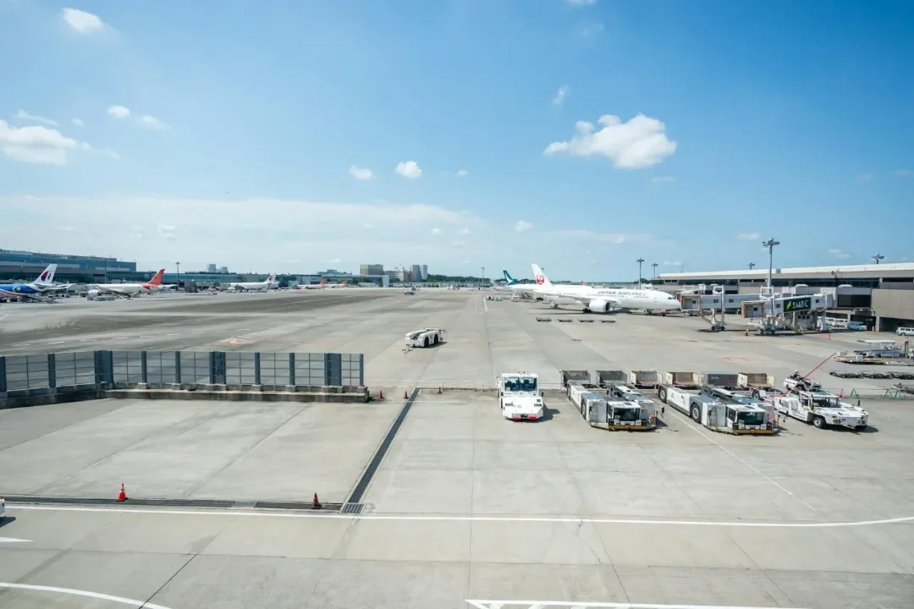
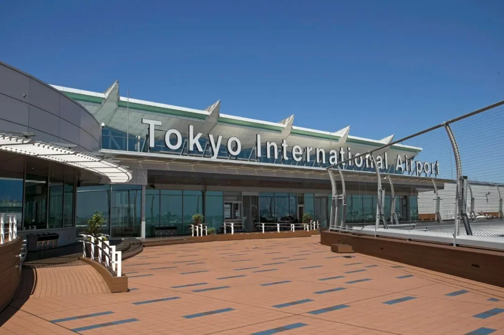
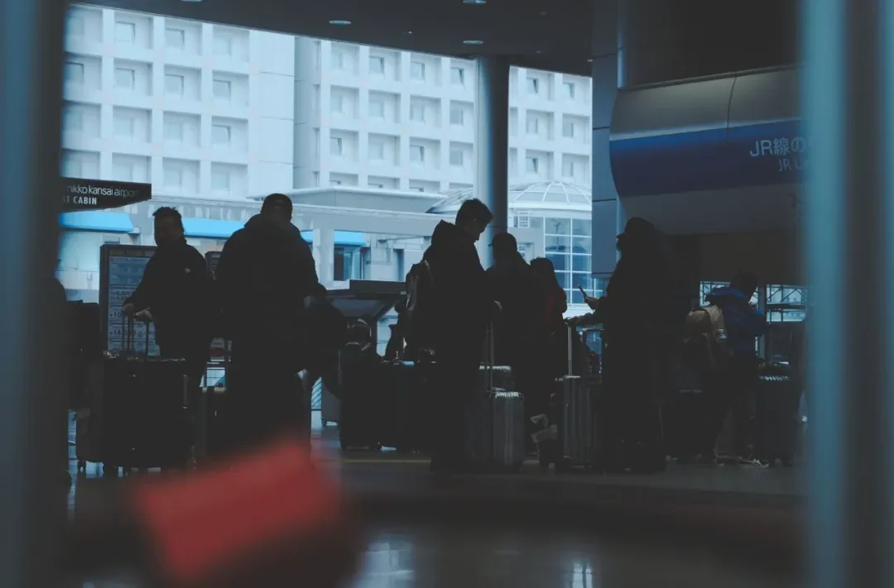

일본 여행은 출발 시간보다 어디에 내리는지가 더 크게 좌우합니다. 나리타와 하네다는 모두 도쿄를 담당하지만, 하나는 지바 시골에 있고 다른 하나는 도쿄만 가장자리에 있습니다. 간사이는 오사카만의 인공섬을 차지하고, 주부는 나고야와 호쿠리쿠의 관문이며, 나하는 나하 시내 끝에 바짝 붙어 있습니다. 시내로의 이동은 한두 시간, 그리고 수천 엔씩 차이 납니다.

이 안내서는 다섯 공항을 표 하나로 비교한 뒤, 도쿄 선택과 간사이·주부, 오키나와, 모두가 거치는 입국 절차, 심야 도착 후의 숙박을 차례로 다룹니다. 요금은 참고 수치이니 운영사 사이트를 확인하십시오.

## 1. 다섯 공항 한 표로 보기

| 공항 | 도시 | 도시까지 거리 | 주요 교통 | 소요 시간 | 참고 요금 | 적합한 경우 |
| --- | --- | --- | --- | --- | --- | --- |
| 나리타(NRT) | 도쿄(지바) | 약 60~70km | JR 나리타 익스프레스, 게이세이 스카이라이너, 게이세이 쾌속, 리무진 버스 | 60~90분 | 약 ¥1,050~3,200 | 도쿄와 간토, 저렴한 항공권 |
| 하네다(HND) | 도쿄(도쿄만) | 약 15km | 게이큐선, 도쿄 모노레일, 리무진 버스, 택시 | 13~40분 | 약 ¥300~1,230 | 도쿄 도심, 빠듯한 일정 |
| 간사이(KIX) | 오사카, 교토 | 오사카만의 인공섬 | JR 하루카, 난카이 라피트, JR 간사이공항 쾌속, 리무진 버스 | 40~80분 | 약 ¥1,210~3,490 | 오사카, 교토와 간사이 |
| 주부(NGO) | 나고야 | 나고야 남쪽 인공섬 | 메이테쓰 μ-Sky, 메이테쓰 특급, 리무진 버스 | 28~35분 | 약 ¥890~1,500 | 나고야, 주부와 호쿠리쿠 |
| 나하(OKA) | 오키나와(나하) | 나하 시내 | 유이레일 모노레일, 버스, 렌터카 | 12~30분 | 약 ¥230~270 | 오키나와 본섬 |

거리와 시간은 가장 가까운 도심 기준의 대략적인 값입니다. 요금은 편도 범위이며 택시는 제외했습니다. 도쿄라면 하네다나 나리타, 오사카와 교토라면 간사이, 나고야와 호쿠리쿠라면 주부, 오키나와라면 나하 — 그리고 도쿄의 두 공항에서 그 선택의 부담이 가장 크게 다가옵니다.

## 2. 도쿄: 하네다(HND) 대 나리타(NRT)

나리타국제공항은 지바현에 있어 도쿄에서 60~70km 떨어져 있습니다. 일본 최대의 국제선 관문으로 장거리 노선 선택이 가장 넓고, 터미널이 세 개(저비용항공사는 T3)이며 면세 쇼핑도 가장 풍부합니다. 대가는 이동입니다 — 가장 빠른 열차도 한 시간이 걸립니다.

- **JR 나리타 익스프레스(N'EX)**: 약 60분, 참고 요금 ¥3,070 — 가장 빠르고 가장 비쌉니다.
- **게이세이 스카이라이너**: 닛포리까지 36분, ¥2,570 — 야마노테선을 쓰기에 편합니다.
- **게이세이 쾌속**: 약 70분, ¥1,050 — 가장 저렴한 방법입니다.
- **리무진 버스**: 신주쿠까지 약 100분, ¥3,200 — 호텔까지 문 앞입니다.

정리하면 이렇습니다. 시간이 중요하면 N'EX나 스카이라이너, 돈이 중요하면 게이세이 쾌속입니다. 30분 느리지만 요금은 절반 이하입니다. 신주쿠 호텔과 무거운 짐에는 버스가 좋고, 교통 상황이 관건입니다.

하네다의 공식 명칭은 도쿄국제공항입니다. 도쿄만에 있어 약 15km 떨어져 있고 심야편을 유지합니다. T1과 T2는 국내선, T3은 국제선입니다. 장점은 거리입니다 — 십여 분이면 시내에 닿습니다.

- **게이큐선**: 시나가와까지 13분, 약 ¥300~410.
- **도쿄 모노레일**: 하마마쓰초까지 13분, ¥500.
- **리무진 버스**: 신주쿠까지 40~50분, ¥1,230.
- **택시**: 긴자까지 약 30분, ¥7,000~8,000.

도쿄만 여행한다면 하네다가 나리타보다 낫습니다. 시내로 더 빠르고 심야에도 쓸 수 있습니다. 다만 하네다 항공권은 보통 더 비싸고, 나리타는 더 싸지만 멀리 있습니다. 운임 차이가 크다면 나리타가 이깁니다. 도쿄와 간사이를 함께 본다면 나리타로 들어와 간사이로 나가거나 그 반대로 하여 되돌아가는 길을 없애십시오.

## 3. 간사이(KIX): 오사카, 교토와 간사이 지역

간사이국제공항은 오사카만의 인공섬에 있습니다. T1이 대부분을 담당하고 T2는 저비용항공사용입니다.

- **JR 하루카**: 교토까지 80분, ¥3,490.
- **난카이 라피트**: 난바까지 38분, ¥1,450.
- **JR 간사이공항 쾌속**: 오사카까지 65분, ¥1,210.
- **리무진 버스**: 오사카 시내까지 50분, ¥1,600.

무엇을 탈지는 묵는 곳에 달려 있습니다. 교토와 나라에는 환승 없는 하루카, 난바와 신사이바시에는 라피트, 우메다와 오사카역에는 가장 저렴한 JR 쾌속, 짐이 무거우면 버스입니다.

간사이는 오사카 도심에서 약 40분, 교토에서 80분 거리입니다. 막차가 끊기면 사실상 택시가 유일한 선택이므로 늦은 도착에는 이를 계산에 넣으십시오.

## 4. 주부(NGO)와 나하(OKA)

### 나고야와 호쿠리쿠: 주부 센트레아

주부 센트레아국제공항은 나고야 남쪽 인공섬에 있고 하네다와 나리타, 간사이보다 작으며 나고야와 주부, 호쿠리쿠를 담당합니다. 철도는 메이테쓰뿐으로 μ-Sky와 특급을 번갈아 운행하므로 환승이 필요 없습니다.

- **메이테쓰 μ-Sky**: 나고야역까지 28분, ¥1,250.
- **메이테쓰 특급**: 나고야역까지 35분, ¥890.
- **리무진 버스**: 사카에까지 30분, ¥1,500.

μ-Sky는 7분을 아끼는 대신 약 40% 더 비쌉니다. 나고야역 근처라면 특급으로 충분하고, 사카에는 버스가 더 쉽습니다. 나고야와 도야마, 다카야마를 잇는 여행이라면 도쿄에 내려 신칸센으로 이어가는 것보다 주부가 낫습니다.

### 오키나와: 나하 공항

나하 공항은 오키나와 본섬 나하의 끝에 있습니다. 다섯 곳 중 가장 열대적이고 국제선은 비교적 적으며 대부분 대만과 홍콩, 한국에서 옵니다.

- **유이레일 모노레일**: 현청앞까지 12분, ¥270.
- **버스**: 나하 시내까지 20분, ¥230.

다섯 곳 중 가장 저렴하게 닿습니다. 십여 분에 몇백 엔입니다. 다만 오키나와 일정은 대부분 섬 전체로 퍼지고, 그곳에서는 렌터카가 거의 필수입니다. 렌터카 데스크는 도착장 바로 밖에 있습니다. 시내와 슈리성을 본다면 모노레일과 버스로 충분합니다.

## 5. 입국 절차: Visit Japan Web, 수하물, 세관

절차는 다섯 공항 모두 같습니다. 달라지는 것은 줄과 터미널 배치뿐입니다. 출발 전에 Visit Japan Web에 입국과 세관 정보를 등록하면 QR 코드 두 개가 생성되고, 순서대로 사용합니다.

1. **입국 심사**: 입국 심사대로 가서 여권과 함께 Visit Japan Web QR(또는 종이 입국 카드)을 보여 주십시오.
2. **수하물**: 짐을 찾으십시오. 엉뚱한 벨트에서 기다리지 말고 수하물 벨트 화면에서 항공편 번호를 확인하십시오.
3. **세관**: 짐을 밀고 세관을 통과하며 세관 QR(또는 종이 신고서)을 보여 주십시오. 요청을 받으면 가방을 열어 보이십시오.
4. **나가기**: JR 패스 교환 카운터와 IC 카드 발매기, 버스 데스크는 보통 같은 도착층에 있습니다.

QR 코드 두 개를 미리 스크린샷해 두십시오. 공중에는 신호가 없고, 공항 Wi-Fi는 먼저 연결해야 합니다. JR 패스 교환은 나리타와 하네다, 간사이에 있고, IC 카드는 도착층에서 판매합니다 — 도쿄는 Suica, 간사이는 ICOCA입니다. 줄은 도착편이 몰리는 시간을 따라가므로 막차가 중요하다면 앞자리에 앉아 빠르게 걷으십시오.

## 6. 심야편과 공항 숙박

하네다는 24시간 운영하며 저가 심야편을 대부분 받습니다. 나리타의 야간편은 대개 T3을 쓰는 저비용항공사입니다. 자정 이후에 도착해 택시비를 내지 않으려면 첫차를 기다리거나 공항 근처에 묵어야 하고, 공항 호텔이 종종 더 저렴한 밤이 됩니다.

- **공항에서 자기**: 하네다와 나리타 모두 야간 구역이 있지만 샤워실은 없습니다. 따뜻한 옷과 목베개를 챙기십시오.
- **공항 호텔**: 나리타의 Toyoko Inn, 하네다 안의 First Cabin 캡슐 호텔 — 둘 다 걸어갈 수 있습니다.

공항 선택은 시내까지의 속도와 항공권 가격 사이의 균형입니다. 하네다는 가장 편리하고 가장 비싸며, 나리타는 더 싸고 더 멉니다. 호텔까지의 총 시간과 비용을 더해 보면, 답은 종종 한두 시간과 ¥5,000을 아껴 줍니다.

## 관련 링크

- **이 사이트에서**: [나리타국제공항(NRT)](/airport/NRT), [하네다 공항(HND)](/airport/HND), [간사이국제공항(KIX)](/airport/KIX), [일본(JP)](/country/JP)
- **위키백과**: [나리타국제공항](https://en.wikipedia.org/wiki/Narita_International_Airport), [하네다 공항](https://en.wikipedia.org/wiki/Haneda_Airport), [간사이국제공항](https://en.wikipedia.org/wiki/Kansai_International_Airport), [주부 센트레아국제공항](https://en.wikipedia.org/wiki/Ch%C5%ABbu_Centrair_International_Airport), [나하 공항](https://en.wikipedia.org/wiki/Naha_Airport)
- **바이두 백과**: [나리타국제공항](https://baike.baidu.com/item/%E6%88%90%E7%94%B0%E5%9B%BD%E9%99%85%E6%9C%BA%E5%9C%BA), [도쿄 하네다 공항](https://baike.baidu.com/item/%E4%B8%9C%E4%BA%AC%E7%BE%BD%E7%94%B0%E6%9C%BA%E5%9C%BA), [간사이국제공항](https://baike.baidu.com/item/%E5%85%B3%E8%A5%BF%E5%9B%BD%E9%99%85%E6%9C%BA%E5%9C%BA), [주부국제공항](https://baike.baidu.com/item/%E4%B8%AD%E9%83%A8%E5%9B%BD%E9%99%85%E6%9C%BA%E5%9C%BA), [나하 공항](https://baike.baidu.com/item/%E9%82%A3%E9%9C%B8%E6%9C%BA%E5%9C%BA)

사진 출처: 乐意门. 요금과 시간은 2026년 상반기 운영사 발표에서 나온 참고치이며, 여행하는 날 운영사와 공항 웹사이트를 확인하십시오.
