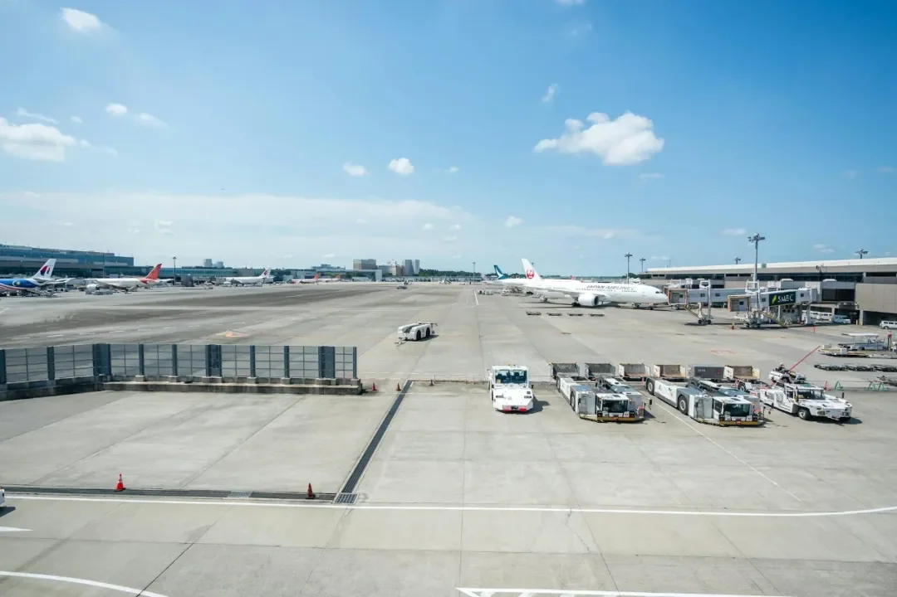
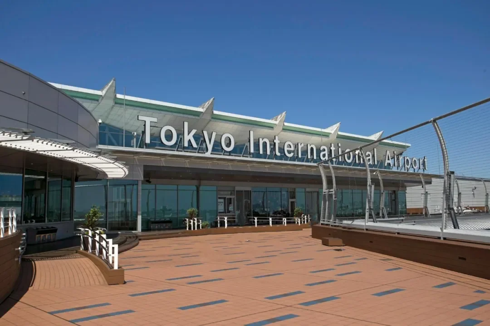

Onde você pousa molda uma viagem ao Japão mais do que o horário da decolagem. Narita e Haneda atendem Tóquio, mas um fica no interior de Chiba e o outro na beira da Baía de Tóquio; Kansai ocupa uma ilha artificial na Baía de Osaka; Chubu é a porta de entrada para Nagoya e o Hokuriku; Naha é espremido na borda da cidade de Naha. Os traslados até a cidade variam em uma ou duas horas e em milhares de ienes.

Este guia compara os cinco em uma tabela e depois percorre a escolha de Tóquio, Kansai e Chubu, Okinawa, as etapas de chegada pelas quais todos passam e a pernoite após um voo noturno. As tarifas são valores de referência; confira os sites dos operadores.

## 1. Cinco aeroportos em uma tabela

| Aeroporto | Cidade | Distância até a cidade | Transporte principal | Tempo de viagem | Tarifa de referência | Melhor para |
| --- | --- | --- | --- | --- | --- | --- |
| Narita (NRT) | Tóquio (Chiba) | cerca de 60–70 km | JR Narita Express, Keisei Skyliner, expresso limitado da Keisei, ônibus limousine | 60–90 min | cerca de ¥1.050–3.200 | Tóquio e Kanto, passagens mais baratas |
| Haneda (HND) | Tóquio (Baía de Tóquio) | cerca de 15 km | linha Keikyu, Tokyo Monorail, ônibus limousine, táxi | 13–40 min | cerca de ¥300–1.230 | Centro de Tóquio, horários apertados |
| Kansai (KIX) | Osaka, Kyoto | ilha artificial na Baía de Osaka | JR Haruka, Nankai Rapi:t, JR Kansai Airport Rapid, ônibus limousine | 40–80 min | cerca de ¥1.210–3.490 | Osaka, Kyoto e Kansai |
| Chubu (NGO) | Nagoya | ilha artificial ao sul de Nagoya | Meitetsu μ-Sky, expresso limitado da Meitetsu, ônibus limousine | 28–35 min | cerca de ¥890–1.500 | Nagoya, Chubu e o Hokuriku |
| Naha (OKA) | Okinawa (Naha) | cidade de Naha | monotrilho Yui Rail, ônibus, carro alugado | 12–30 min | cerca de ¥230–270 | Ilha principal de Okinawa |

Distâncias e tempos são aproximados, até o centro da cidade mais próximo; as tarifas são faixas de ida e excluem táxis. Haneda ou Narita para Tóquio, Kansai para Osaka e Kyoto, Chubu para Nagoya e o Hokuriku, Naha para Okinawa — e é no par de Tóquio que a decisão pesa mais.

## 2. Tóquio: Haneda (HND) versus Narita (NRT)

O Aeroporto Internacional de Narita fica na província de Chiba, a 60–70 km de Tóquio: é a maior porta de entrada internacional do país, com a maior variedade de voos de longa distância, três terminais (as companhias de baixo custo usam o T3) e as compras duty-free mais completas. O custo é o traslado — até o trem mais rápido leva uma hora.

- **JR Narita Express (N'EX)**: cerca de 60 minutos, tarifa de referência ¥3.070 — o mais rápido e o mais caro.
- **Keisei Skyliner**: 36 minutos até Nippori, ¥2.570 — prático para a linha Yamanote.
- **Expresso limitado da Keisei**: cerca de 70 minutos, ¥1.050 — o jeito mais barato de entrar na cidade.
- **Ônibus limousine**: cerca de 100 minutos até Shinjuku, ¥3.200 — de porta de hotel a porta de hotel.

Resumo: N'EX ou Skyliner quando o tempo importa; o expresso limitado da Keisei quando o dinheiro importa, meia hora mais lento por menos da metade da tarifa; o ônibus para hotéis em Shinjuku e malas pesadas, se o trânsito permitir.

O nome oficial de Haneda é Aeroporto Internacional de Tóquio. Ele fica na Baía de Tóquio, a cerca de 15 km, e mantém voos noturnos: T1 e T2 para voos domésticos, T3 para internacionais. Sua vantagem é a distância — uma dúzia de minutos e você está na cidade.

- **Linha Keikyu**: 13 minutos até Shinagawa, cerca de ¥300–410.
- **Tokyo Monorail**: 13 minutos até Hamamatsucho, ¥500.
- **Ônibus limousine**: 40–50 minutos até Shinjuku, ¥1.230.
- **Táxi**: cerca de 30 minutos até Ginza, ¥7.000–8.000.

Para uma viagem só a Tóquio, Haneda vence Narita: entra mais rápido na cidade e é utilizável tarde da noite. Mas as passagens para Haneda costumam custar mais, enquanto Narita é mais barata e mais distante; se a diferença de tarifa for grande, Narita ganha. Para Tóquio mais Kansai, voe para Narita e saia por Kansai, ou o contrário, e evite voltar pelo mesmo caminho.

## 3. Kansai (KIX): Osaka, Kyoto e a região de Kansai

O Aeroporto Internacional de Kansai fica em uma ilha artificial na Baía de Osaka; o T1 faz o trabalho pesado e o T2 atende companhias de baixo custo.

- **JR Haruka**: 80 minutos até Kyoto, ¥3.490.
- **Nankai Rapi:t**: 38 minutos até Namba, ¥1.450.
- **JR Kansai Airport Rapid**: 65 minutos até Osaka, ¥1.210.
- **Ônibus limousine**: 50 minutos até Osaka, ¥1.600.

Qual você pega depende de onde vai dormir: Haruka para Kyoto e Nara, sem baldeação; Rapi:t para Namba e Shinsaibashi; o rápido da JR para Umeda e a Estação de Osaka, pela tarifa mais baixa; o ônibus quando a bagagem é pesada.

Kansai fica a cerca de 40 minutos do centro de Osaka e a 80 de Kyoto. Depois que os últimos trens passam, os táxis são efetivamente a única opção, então leve isso em conta em uma chegada tarde.

## 4. Chubu (NGO) e Naha (OKA)

### Nagoya e o Hokuriku: Chubu Centrair

O Aeroporto Internacional Chubu Centrair fica em uma ilha artificial ao sul de Nagoya, menor que Haneda, Narita e Kansai, e atende Nagoya, Chubu e o Hokuriku. A Meitetsu é a única ferrovia, alternando μ-Sky e expressos limitados, então não é preciso baldeação.

- **Meitetsu μ-Sky**: 28 minutos até a Estação de Nagoya, ¥1.250.
- **Expresso limitado da Meitetsu**: 35 minutos até a Estação de Nagoya, ¥890.
- **Ônibus limousine**: 30 minutos até Sakae, ¥1.500.

O μ-Sky economiza sete minutos por cerca de 40% a mais; perto da Estação de Nagoya, o expresso limitado basta, enquanto Sakae é mais fácil de ônibus. Para uma viagem baseada em Nagoya, Toyama e Takayama, Chubu é melhor do que pousar em Tóquio e seguir de Shinkansen.

### Okinawa: Aeroporto de Naha

O Aeroporto de Naha fica na borda de Naha, na ilha principal de Okinawa — o mais tropical dos cinco, com relativamente poucos voos internacionais, a maioria de Taiwan, Hong Kong e Coreia.

- **Monotrilho Yui Rail**: 12 minutos até Kencho-mae, ¥270.
- **Ônibus**: 20 minutos até Naha, ¥230.

É o mais barato dos cinco para chegar: uma dúzia de minutos e algumas centenas de ienes. Mas a maioria dos roteiros por Okinawa se espalha pela ilha, onde um carro alugado é quase essencial — as locadoras ficam logo na saída do desembarque. Para a cidade e o Castelo de Shuri, o monotrilho e os ônibus bastam.

## 5. O fluxo de chegada: Visit Japan Web, malas e alfândega

As etapas são as mesmas nos cinco aeroportos; só mudam as filas e o layout do terminal. Registre os dados de imigração e alfândega no Visit Japan Web antes de voar, e o sistema gera dois QR codes, usados em ordem.

1. **Imigração**: vá até os balcões de imigração e mostre o QR code do Visit Japan Web (ou um cartão de chegada de papel) junto com o passaporte.
2. **Bagagem**: pegue suas malas, conferindo o número do voo na tela da esteira em vez de esperar na esteira errada.
3. **Alfândega**: passe com as malas pela alfândega e mostre o QR code da alfândega (ou uma declaração de papel); abra a mala se pedirem.
4. **Saída**: os balcões de troca do JR Pass, as máquinas de cartão IC e os guichês de ônibus costumam ficar no mesmo piso de desembarque.

Tire capturas de tela dos dois QR codes com antecedência: não há sinal no ar e o Wi-Fi do aeroporto precisa de conexão primeiro. Há troca de JR Pass em Narita, Haneda e Kansai; cartões IC são vendidos no piso de desembarque — Suica na região de Tóquio, ICOCA em Kansai. As filas acompanham a leva de chegadas, então, se o último trem importa, sente-se na frente e ande rápido.

## 6. Voos noturnos e pernoite

Haneda funciona 24 horas e recebe a maioria dos voos noturnos de baixo custo; os voos noturnos de Narita são em grande parte de companhias de baixo custo no T3. Pousar depois da meia-noite sem pagar um táxi significa esperar o primeiro trem ou ficar perto do aeroporto, onde um hotel do aeroporto costuma ser a noite mais barata.

- **Dormir no aeroporto**: Haneda e Narita têm áreas para pernoite, mas não têm chuveiros; leve uma camada de roupa quente e um travesseiro de pescoço.
- **Hotéis do aeroporto**: o Toyoko Inn em Narita e o hotel-cápsula First Cabin dentro de Haneda — ambos acessíveis a pé.

Escolher um aeroporto é um equilíbrio entre a velocidade até a cidade e o preço da passagem: Haneda é o mais conveniente e o mais caro, Narita é mais barato e mais distante. Some o tempo total e o custo até o seu hotel, e a resposta muitas vezes economiza uma ou duas horas e ¥5.000.

## Links relacionados

- **Neste site**: [Aeroporto Internacional de Narita (NRT)](/airport/NRT), [Aeroporto de Haneda (HND)](/airport/HND), [Aeroporto Internacional de Kansai (KIX)](/airport/KIX), [Japão (JP)](/country/JP)
- **Wikipédia**: [Aeroporto Internacional de Narita](https://en.wikipedia.org/wiki/Narita_International_Airport), [Aeroporto de Haneda](https://en.wikipedia.org/wiki/Haneda_Airport), [Aeroporto Internacional de Kansai](https://en.wikipedia.org/wiki/Kansai_International_Airport), [Aeroporto Internacional Chubu Centrair](https://en.wikipedia.org/wiki/Ch%C5%ABbu_Centrair_International_Airport), [Aeroporto de Naha](https://en.wikipedia.org/wiki/Naha_Airport)
- **Baidu Baike**: [Aeroporto Internacional de Narita](https://baike.baidu.com/item/%E6%88%90%E7%94%B0%E5%9B%BD%E9%99%85%E6%9C%BA%E5%9C%BA), [Aeroporto de Haneda de Tóquio](https://baike.baidu.com/item/%E4%B8%9C%E4%BA%AC%E7%BE%BD%E7%94%B0%E6%9C%BA%E5%9C%BA), [Aeroporto Internacional de Kansai](https://baike.baidu.com/item/%E5%85%B3%E8%A5%BF%E5%9B%BD%E9%99%85%E6%9C%BA%E5%9C%BA), [Aeroporto Internacional de Chubu](https://baike.baidu.com/item/%E4%B8%AD%E9%83%A8%E5%9B%BD%E9%99%85%E6%9C%BA%E5%9C%BA), [Aeroporto de Naha](https://baike.baidu.com/item/%E9%82%A3%E9%9C%B8%E6%9C%BA%E5%9C%BA)

Créditos das imagens: 乐意门. Tarifas e tempos vêm de publicações dos operadores do primeiro semestre de 2026 e são indicativos; confira os sites dos operadores e do aeroporto no dia da sua viagem.
